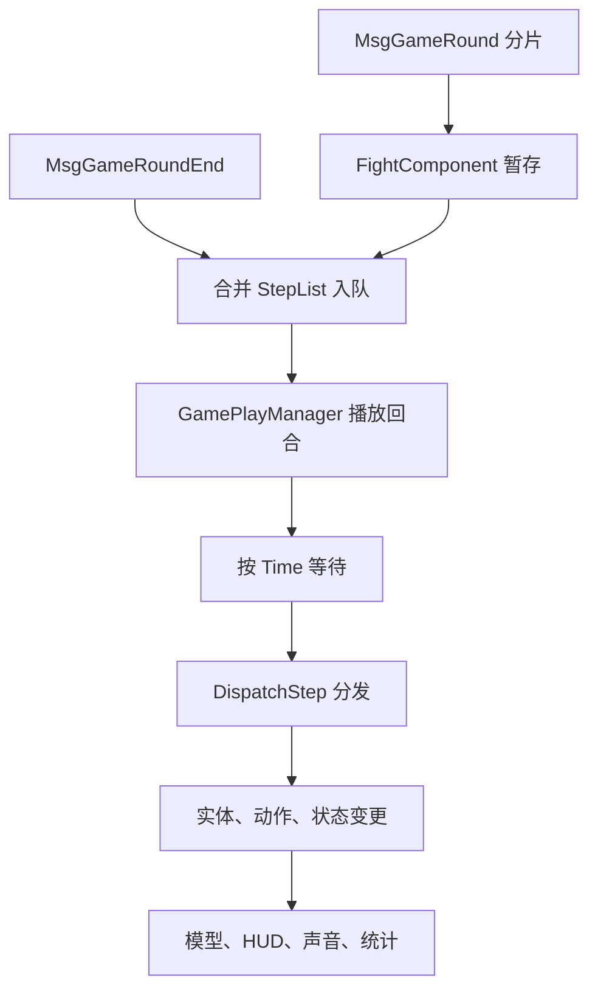

# 战斗执行

[总索引](../README.md)

状态：未完成。通用战斗数据模型、部分官方公式、离线执行器、检查点、HUD 和演出已经接入；原版战斗的完整规则覆盖、逐事件调度、资源闭包、运行验收和 Windows 版本发布仍未完成。

## 功能简介

本页只维护所有战斗共用的会话、阶段、准备、格网、单位、行动队列、技能、命中、伤害／治疗、状态、召唤、胜负、HUD、战报、演出和检查点。具体地图、剧情、任务、掉落、活动入口、养成事务和玩法奖励不属于本页。

“完整还原”表示当前 Unity 代码和资源已经覆盖并完成相应检查；“自定义实现”表示客户端或共享代码没有提供服务器裁决，按已确认的单机规则补足。配置存在、资源已提取或旧引擎测试通过，都不能单独视为通用战斗完成。

### 官方来源与证据边界

原版机制以 [official-source.json](../../official-source.json) 选择的 `871_156598` 客户端／共享反编译代码为主，入口见[当前代码清单](../../.tools/source-packages/current/871_156598/code-manifest.json)。现有战斗配置和部分资源仍来自 `854_156383`，对应[历史反编译目录](../../.tools/source-packages/official-code/)、[历史代码清单](../../assets/reference/official-city/code-manifest.json)、[战斗规则](../../assets/official/battle-rules.json)和[技能规则](../../assets/official/skill-rules.json)。不同版本只按各自来源使用，不混合推断。

客户端能够证明消息消费、数据结构、共享公式、界面和部分生命周期，不能证明服务器如何生成全部步骤或裁决所有结果。`MyFightAI`、部分 AI 组件、随机命中和若干状态触发只有壳或配置；`BattleFormulaHandler.InvokeDamagePhaseProcessor` 为空；部分胜负组件只有标识。因此本页明确区分官方证据和离线补足。

战斗预览对象在编辑模式校验结束时使用 `DestroyImmediate` 清理本次创建的模型网格、材质、贴图、HUD、挂载父节点及临时 SortingGroup；运行时仍使用 `Destroy`。已有地图角色在释放临时父节点前恢复原父级、姿态及动画，原有 SortingGroup 仅恢复状态。该处理不删除导入资产，避免 `ProjectTools.Validate` 结束时留下编辑模式销毁错误。

## 原版战斗系统

以下 F01—F43 是必须保留的通用功能范围，不代表当前全部完成。类名相对于上述官方客户端／共享源码目录。

### 会话、阶段、准备和结果

| 编号 | 原版功能 | 官方机制 |
| --- | --- | --- |
| F01 | 建立、加载、释放 | `FightRoot`、`FightSceneRoot`、`GamePlayManager` 创建战斗上下文、实体容器和场景对象，结束时停用并释放。 |
| F02 | 主面板与延迟 | `FightMainPanelLoader` 按普通、记录或回放模式加载面板，消费 `ShowMainPanelDelay`，取消时停止加载并释放。 |
| F03 | 阶段 | `GameStatus` 包含 Preparing、PlayStart、Play、Pause、EntryTransition、BattleEnd、BattleEndTransition、End 等状态；模式可跳过未使用阶段。 |
| F04 | 准备与就绪 | 准备倒计时、自动就绪、取消就绪、开始权限和 `SkipPrepareStatus/UserStart` 由准备面板与团队倒计时消费。 |
| F05 | 波次、回合和上限 | 波次、个人回合、全局回合分别维护；`GameProgressUI` 显示 `MaxRound`、个人回合上限和临界提示。 |
| F06 | 胜负与结束 | 玩家／敌方死亡、守护目标失败、决斗结果等由结果组件输出，公共层播放结束演出、清理并交接结果。 |
| F07 | 离开与切出 | `FightMainPanelLeaveHandler` 和切出控件按阶段、身份、观战／录像状态及离开策略处理确认和离开。 |

### 格网、站位、移动和目标

| 编号 | 原版功能 | 官方机制 |
| --- | --- | --- |
| F08 | 场地、阵型、占格 | `FightSceneInfo`、`MyFightGridGround`、`MyFightRoleGrid` 保存坐标、高度、身体占格、地形／边界阻挡、出生偏移、方向和翻转。 |
| F09 | 准备拖拽 | `PrepareBattlePlayerDrag` 校验准备阶段、控制权、拖拽阈值、射线格点、最近合法格、占位冲突、回退和拾放演出。 |
| F10 | 调整区域与交换 | `ChangeBattlePosHandler` 按调整区域、出生列表、队伍偏移和控制权决定合法落点及占位交换。 |
| F11 | 中途加入站位 | `ChangePosHandler`、`PrepareBattlePlayerSoulDrag` 按 `JoinInMiddle` 和加入权限预览并提交位置。 |
| F12 | 寻路与位移 | `AStarUtils`、`MyFightGridMover`、`MyFightActionSkillMove` 消费 MoveDist、MoveMask、占格、路径、时长和朝向；技能移动另有延迟、条件和方向。 |
| F13 | 目标与施法方式 | `HitTargetType` 区分敌友、自己、主人和召唤物；`SkillTargetType` 区分点、实体、可站立点、方向、跟随和锁定，范围按近到远展开。 |
| F14 | AI、嘲讽、混乱 | `AiPriorityId/LastAiPriorityId` 引用策略列表，并结合属性最值、角色分组、忽略状态和控制状态选择动作。完整评分器属于服务器缺口。 |
| F15 | 单位详情 | `FightRoleClickInput` 校验查询条件后打开单位详情或执行回调；普通点击不等同手动攻击。 |

### 技能、命中、结算、状态和召唤

| 编号 | 原版功能 | 官方机制 |
| --- | --- | --- |
| F16 | 技能装配 | 技能提供者按物品、实体、等级、品阶、属性、CD、被动和来源创建 `FightSkillAgentComponent`。 |
| F17 | 消耗、CD、次数 | `CostType`、有效消耗、起始重置、限定次数和波次重置共同决定施放资格；状态可修改或停止 CD。 |
| F18 | 动作生命周期 | `ActionDuration`、`Duration` 和等待 Hit、Move、Damage、子技能的条件分别决定动作结束；负时长可表示不自动结束，中断另有通知。 |
| F19 | 额外、重放、子技能 | `FightSkillExtSkill`、`FightSkillReplayCfg`、重放次数、子技能和状态白名单限制来源、条件、递归和次数。 |
| F20 | 命中图 | Fixed、NormalNext、Chained、RandomTarget、CustomTarget、TriggerSkill 等组件展开目标、范围、追踪、延迟、临时属性和附加效果。 |
| F21 | 伤害与治疗 | 共享公式处理攻防、等级／位阶、元素、职业／类别、暴击、格挡、衰减、HP、护盾、绝对伤害和反馈标记。 |
| F22 | 状态生命周期 | 状态支持计时、无限持续、平行／替换、可驱散、叠层／叠时及上限、同来源、属性快照、死亡禁用和复活重启。 |
| F23 | 状态触发 | 开始／结束、个人／全局回合、行动、技能、命中／受伤、死亡／击杀、层数变化、条件检查、转移、移除、持续变化和累计伤害都可触发。 |
| F24 | 控制与防护 | 属性变换、行动条、HP 限制、CD、重放、普通／持续／一次性／无敌护盾、韧性和多层 HP 按组件协同。 |
| F25 | 召唤与附属单位 | 怪物、宠物、格子物件、智能格子物件、替身保留主人、来源、属性继承、数量、寿命、存活和销毁关系。 |

### HUD、公共控件和战报

| 编号 | 原版功能 | 官方机制 |
| --- | --- | --- |
| F26 | 回合时间轴 | `GameProgressUI`、`GameRoundUI` 按 NextTime 队列显示回合、阵营、头像、主角色标识及行动／受击／死亡／插入移除动画。 |
| F27 | 名称、血条、死亡 | `GamePlayerHUD`、`GameCharacterHpUI`、`FightRoleFightHpView` 和 `BattleHpAndShieldHandle` 绑定名称、HP、护盾和死亡标识。 |
| F28 | Boss、韧性、多层 HP | `FightMainPanelBossUI` 显示敌方视野内最多两个 Boss，绑定名称、头像、状态、多层 HP／盾和韧性；最大韧性为0时隐藏。 |
| F29 | 状态详情 | `FightStatusController` 池化状态图标，响应应用、结束、禁用、层数、回合和自定义计数，并提供详情输入。 |
| F30 | 阶段状态 | `FightMainPanelStageStatus` 汇总阶段和实际状态、去重并消费显示黑名单；点击后打开状态明细。 |
| F31 | 技能槽和宠物能量 | `GameSkillIcon` 显示 Ready、Applied、InCD、Ended、LimitedTimes、ProfessionLimit、Disabled；辅助技能另有品质、能量和无宠物占位。 |
| F32 | 准备方案入口 | 准备时可取消就绪、打开方案、校验职业／禁用／宠物提示并刷新战斗快照；方案编辑由技能功能页维护。 |
| F33 | 倍速与锁定 | `FightMainPanelSpeedUI` 根据条件和身份生成档位，分离文案与倍率，并在结束或停用时复位。 |
| F34 | 快进 | `FightMainPanelFastForwardUI` 处理阶段门槛、权限、延迟、防重、请求／执行、失败提示和复位；快进独立于倍速。 |
| F35 | 镜头 | `FightMainPanelCameraUI` 在准备、观战和默认锁定条件下切换跟随／自由镜头。 |
| F36 | 托管、背包 | `FightMainPanelHostingUI/BagUI` 处理显示条件、状态、弹窗和红点；入口不代表任意换装或使用物品。 |
| F37 | 录像、回放、跳过 | 保存意愿、记录流、回放和剧情跳过信号分别处理；录像不是战斗检查点。 |
| F38 | 观战、聊天、扩展 | 公共面板切换观战对象、技能提供者和聊天入口，模式扩展通过外部适配器接入。 |
| F39 | 战报与统计 | 报告提供者按配置选择个人／全员，展示施放、命中、伤害、治疗、护盾、状态次数和占比。 |

### 模型、演出和资源

| 编号 | 原版功能 | 官方机制 |
| --- | --- | --- |
| F40 | 单位外观 | `MyFightRoleCharacter`、`PlayerAnimatorAppearance` 绑定职业、装备、武器、皮肤和单位模型，保留骨骼、网格、贴图、挂点、尺寸、方向和层序。 |
| F41 | 生成、移动、动作 | 单位、技能、命中、伤害 Playable 处理生成、移动、施放、受击、死亡、复活、召唤和清理。 |
| F42 | 特效、飘字、声音 | 范围、弹道、跟踪、偏移、延迟、材质、粒子、声音和飘字由配置与 Playable 驱动。 |
| F43 | UI 生命周期 | `FightMainPanel` 动态装配控件、订阅／解绑事件，保留官方坐标、锚点、字体、遮罩、滚动、按钮命中、旋转和动画。 |

## 原版执行链

原版分为规则状态、过程消息和 Unity 表现三层。`Common.EcEntity/EcComponent` 保存逻辑数据，`MyEntity/MyComponent` 把实体绑定到 GameObject、Playable 和 UI。一次技能可以生成多个命中，一个命中可以产生多个目标结果；技能、动作、命中、伤害和状态有各自结束时点。

`FightRoundDriverComponent` 按 NextTime 升序插入，严格保持同刻步骤的原顺序。客户端可见的行动间隔为 `100000 / sqrt(max(1, Speed) × 境界 SpeedScale)`；属性速度和播放倍率分开处理。技能实例先处理消耗、CD、次数和开始／中断／结束事件，再展开命中与结果。结算结果保留 `SkillId`、`HitId`、`TargetId` 和来源实体，状态保留创建者、持有者、计时者、来源技能和生命周期。

## 完整还原部分

- 怪物单位使用本次战斗实际计算的等级和段位建立状态，并将同一等级交给主动／被动技能组装；使用玩家等级的关卡不再把导出时的占位等级 1 写回单位。Map14 数据 Play Mode 已执行 1,649 个实例的属性与技能构造，其中动态实例为 87 个；该夹具不代替完整战斗画面、输入、奖励与存档验证。

当前 Unity 工程已经形成可复用的战斗内核，但还不是完整原版战斗交付：

- `FightBattleState` 保存单位、属性、HP／护盾／韧性、技能、状态、格网、回合、召唤链接、事件和战报来源；`FightBattleExecutor.Begin/Restore/Step`、`FightTurnQueue`、`FightBattlePhaseMachine` 提供会话、阶段、回合推进、暂停边界和重复回执保护。
- `FightDamageFormula`、`FightDamageResolver`、`FightDamageSettlement`、`FightStatusLifecycle`、`FightStatusTriggerRuntime` 和 `FightResilienceFormula` 已接入官方数据可证明的部分，包括 HP／护盾差值、绝对伤害、暴击／格挡输入、元素反馈、状态计时／叠层、累计伤害、CD、破韧和随机流。
- `FightBattleGrid`、`OfficialBattleGridMapper`、`FightBattlePreparationPositions` 支持格网、身体占格、移动掩码、合法落点和已授权单位的原子换位；失败操作不修改检查点。
- `FightBattleCheckpointSerializer` 提供版本化 JSON 保存／读取，并在恢复时校验；检查点保留战斗状态、事件序号、随机种子和统计，重复或旧步骤不会再次结算。
- `OfficialBattleRuntimeController`、`OfficialBattleSceneView`、`OfficialBattleHudView`、`OfficialBattleRoundDisplay` 和相关 Catalog 已接入场景、时间轴、血条、Boss、技能槽、状态、战报行、伤害飘字、元素反馈、镜头和公共控件。官方战斗 prefab／材质／字体按来源清单绑定。
- `OfficialBattleProgressDriver` 统一 Arena、Fantasy Tower 和 Daily Dungeon 的自动进度节拍：只在控制器允许推进时累计时间，逐步调用 `Advance`，并用控制器计算的演出时长安排下一步；各玩法保留自己的进入、隐藏、检查点和结果事务。主线额外的阶段门控暂留在地图模块，但仍复用同一战斗控制器。
- `OfficialBattleNativeAnimationLibrary` 和 `OfficialBattleNativeModelView` 已能加载已恢复的原生模型数据；固定版原动画采样包包含403个模型的4609条动画数据，纹理页按来源清单校验。岩灵／替身模型、HUD 绑定和部分骨骼姿态已做局部 Play Mode 检查；抽帧网格不等同 Animator 状态切换、逐骨骼混合或完整战斗演出。
- 战报构建和统计已保留施放、命中、治疗、护盾、承伤、破韧、状态及来源信息；缺失的旧存档字段保持未知，不从剩余 HP／护盾倒推。

## 自定义实现

技能伤害测试（StageType 43）采用用户确认的本地怪物属性方案：`FightDamageTestRules` 只在测试关卡消费固定伤害 1／无限生命选项。怪物伤害在护盾结算前变为 1；无限生命保持怪物 HP，保留完整命中伤害和原通知顺序供战报统计，并免除怪物的生命施法费用。选项写入战斗检查点，普通关卡继续使用原结算路径。`scripts/test_skill_damage_test.ps1` 已验证连续致死命中、伤害统计、普通关卡隔离、关闭选项和检查点恢复；`scripts/test_unity_combat.ps1` 的 97 组公式及战斗规则回归通过。技能入口、测试画面、结算界面与发布验证见[技能页](skills.md)，本段不表示完整测试流程已经完成。

以下内容是因为未取得服务器代码而做的本地替代，不宣称为原版服务器规则：

- 离线执行采用固定随机种子、步骤序号、回执和版本化检查点，以便单机续算和重复输入去重；客户端只提供了消费消息和部分公式。
- `FightBattleResultRules` 提供标准清场、显式保护目标和显式玩家对决三种可配置结果策略；主角死亡、保护目标死亡、双方全灭和回合上限的优先级属于离线策略，调用方必须明确参与者，不能从地图或同阵营猜测。
- `FightBattlePreparationPositions` 用调用方提供的控制名单替代服务器站位请求，保留官方格网／身体占格校验，允许合法受控单位交换位置。
- `FightVoodooDollRules` 按已确认方案实现替身：传导完整结算伤害（包括溢出）为绕盾真实伤害，禁止治疗传导，替身结束时转移减益并保留原状态计时／叠层语义；来源和同步实体 ID 仍使用官方配置。
- 服务器未提供的 AI 评分、随机命中、复杂触发顺序、伤害阶段钩子、位移条件、召唤数量／寿命、战报聚合和部分元素／减伤组合只实现了有明确配置或已确认口径的分支，其余保持未决，不把近似结果写成官方规则。

## 尚未实现

- **会话和准备**：完整就绪／取消就绪／方案刷新、所有控制权与中途加入接口、完整阵型／高度／身体占格、入场／结束过渡、离开／后台条件和准备冷启动恢复。
- **回合、AI 和技能调度**：完整 `AiType` 评分、嘲讽／混乱、所有技能资格条件、方向与位移规则、逐 Delay 分帧执行、实体等待、负时长、中断／销毁、递归白名单和重入限制。当前仍有同一 Step 内同步处理的路径。
- **命中、伤害和状态**：Scope 旋转／逐格延迟／过滤条件、其余命中组件、完整伤害阶段钩子、全部状态事件／来源约束／快照／转移／持续变化，以及护盾、HP 限制、CD、韧性、元素、固定直伤和耗盾组合的全量联动。
- **召唤和结果**：宠物、格子物件、智能物件及其他召唤的完整继承、数量、寿命、销毁、复活消费者和非命中 HP 变化；各外部玩法的结果策略、资源事务和奖励由所属页接入。
- **HUD、战报和公共控件**：全部时间轴事件和头像、真实 Boss 视野、单位／阶段状态详情、技能品质／能量、正式战报入口、回放／快进／托管／背包／观战／聊天及完整语言字体服务；自动进度驱动目前合并三种 Runner，主线仍有独立阶段门控。
- **画面和音频**：完整复合外观、Animator 状态切换／过渡／混合、生成／复活／召唤特效、Playable 精确停止／中断、范围／弹道／挂点／排序、相机环境、粒子、材质、shader、飘字合并和音频速度同步。
- **验证和发布**：通用战斗全流程 Play Mode 模拟输入、真实画面／遮挡／缩放／声音、重启续战和 Windows Player 验证；完成前不能声称战斗功能完成或发布对应版本。

## 实现概括

| 分类 | 当前结论 |
| --- | --- |
| 已完整实现的通用子项 | 战斗状态与检查点模型、确定性回合执行的基础、官方可取得的部分伤害／HP／护盾／元素／状态／韧性公式、格网和受控换位、时间轴／HUD／战报／飘字的已绑定子项，以及部分原生模型加载和局部 Play Mode 检查。 |
| 因没有服务器代码而自定义 | 离线随机流与回执、结果策略、受控站位请求替代、替身传导／减益转移，以及有明确证据的部分 AI、触发、元素、减伤和统计接线。所有近似分支都在本页标明为本地规则。 |
| 仍待实现 | 原版完整准备、逐事件回合调度、AI、命中／状态／召唤／胜负、完整 HUD／公共控件／战报、原生动作／特效／音频、全流程 Play Mode、存档恢复和 Windows Player 发布。 |

### 代码与来源入口

- 规则与执行：`unity/Assets/Game/Runtime/Official/Combat/`
- 离线替代：`unity/Assets/Game/Runtime/Offline/Combat/`
- 表现与 HUD：`unity/Assets/Game/Runtime/Presentation/Combat/`
- 战斗来源清单：`assets/reference/battle-rules/`
- 官方代码与配置：`.tools/source-packages/current/871_156598/official-code/`、`assets/official/`
