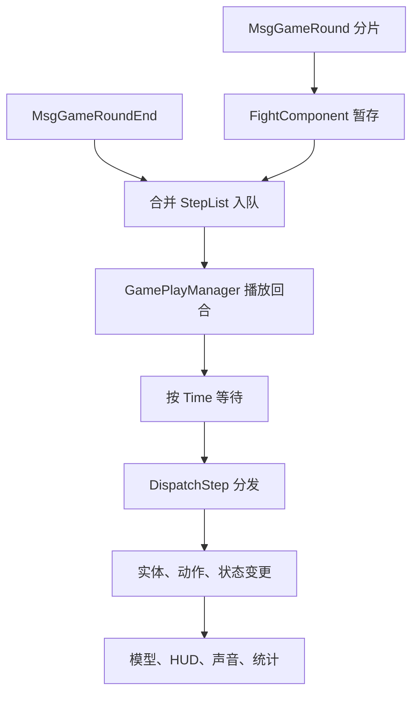

# 战斗执行

[总索引](../README.md)

状态：未完成。通用战斗数据模型、部分官方公式、离线执行器、检查点、HUD 和演出已经接入；原版战斗的完整规则覆盖、逐事件调度、资源闭包、运行验收和 Windows 版本发布仍未完成。

## 功能简介

本页只维护所有战斗共用的会话、阶段、准备、格网、单位、行动队列、技能、命中、伤害／治疗、状态、召唤、胜负、HUD、战报、演出和检查点。具体地图、剧情、任务、掉落、活动入口、养成事务和玩法奖励不属于本页。

所有战斗宿主通过 `IOfficialBattleModeAdapter` 接入同一控制器，并保留控制器生成的 `FinalReport`；宿主只负责各自的持久化、奖励和离场处理。日常、竞技场、幻境之塔、技能试伤、周常和主线地图均实现该报告契约；每日挑战原生结算页的总伤害与角色伤害统计及战报按钮、技能试伤原生结算页的总伤害与战报按钮均消费同一份最终报告，不再从检查点重建统计。公共单位战报包含官方 `DamageAndShieldDamageDealt` 字段。窗口化 Play Mode 实测周常112步和竞技场6步至结算，报告的关卡、结局、单位／技能行数及伤害、承伤、治疗、护盾总量与最终检查点统计一致；竞技场实测原生全员战报两次打开、玩家切换、技能页和关闭释放。技能试伤实测主页入口、设置、10回合战斗、原生结算页、公共报告／最终检查点统计一致、战报打开及返回设置；验证使用隔离存档。Map10 主线实战现加入同一最终报告／最终检查点统计断言，尚待本轮窗口化 Play Mode 执行。每日挑战完整入口到原生结算页仍待实际流程验证。相关 Windows Player 发布尚未完成。

“完整还原”表示当前 Unity 代码和资源已经覆盖并完成相应检查；“自定义实现”表示客户端或共享代码没有提供服务器裁决，按已确认的单机规则补足。配置存在、资源已提取或旧引擎测试通过，都不能单独视为通用战斗完成。

### 官方来源与证据边界

当前 [official-source.json](../../official-source.json) 选择 `884_156692`，本页当前场景人物、外观及分段迁移使用[同版代码清单](../../.tools/source-packages/current/884_156692/code-manifest.json)。既有战斗规则核心、配置和部分资源仍按各自历史来源保留；涉及 `871_156598` 的入口包括[历史反编译目录](../../.tools/source-packages/official-code/)、[历史代码清单](../../assets/reference/official-city/code-manifest.json)、[战斗规则](../../assets/official/battle-rules.json)和[技能规则](../../assets/official/skill-rules.json)。历史载荷不改标为当前版本，不混合推断。

客户端能够证明消息消费、数据结构、共享公式、界面和部分生命周期，不能证明服务器如何生成全部步骤或裁决所有结果。`MyFightAI`、部分 AI 组件、随机命中和若干状态触发只有壳或配置；`BattleFormulaHandler.InvokeDamagePhaseProcessor` 为空；部分胜负组件只有标识。因此本页明确区分官方证据和离线补足。

战斗预览对象在编辑模式校验结束时使用 `DestroyImmediate` 清理创建的模型网格、材质、贴图、HUD、挂载父节点及临时 SortingGroup；运行时仍使用 `Destroy`。已有地图角色在释放临时父节点前恢复原父级、姿态及动画，原有 SortingGroup 仅恢复状态。该处理不删除导入资产，避免 `ProjectTools.Validate` 结束时留下编辑模式销毁错误。

公共表现上下文 `OfficialBattleHostPresentation` 捕获调用方相机及可见根节点，战斗前台显示时暂停主城更新并隐藏原场景／HUD，退出或转入后台时恢复原相机投影、姿态和显隐。`OfficialBattleCameraView` 消费原 `GameCameraIniter.Adaptor` 的宽高比和尺寸，并复用已安装的 Cinemachine 及原群组取景字段；256个 GameId 的绑定由 `prepare_battle_camera_bindings.py` 可复现提取，来源见[相机清单](../../assets/reference/battle-scenes/camera-source-manifest.json)。日常、竞技、阶梯、技能测试及主线入口共用该相机实现。日常副本已实际执行至结算并检查新截图；玩家模型的额外1.25倍本地系数已移除，独立 Windows Player 验证显示官方0.3模型比例与脚下血条居中对齐。日常、竞技、阶梯的实际结算与主城恢复集成均已通过，竞技守卫职业服装和头发层级也已在实际战斗截图核对；Map10 已通过共用镜头下的准备／播放、速度与聊天模拟输入、最终命中等待、结束返回及原相机／角色层级恢复，七张实际运行截图已检查；技能试打也已在共用镜头与原生主角模型下完成十回合、结算、玩家／技能统计、技能快照与返回设置，十张新截图已检查。技能图依赖审计发现原 `MyPlayableCameraMove` 和 `MyPlayableFightCameraFollowerWeightModifier`，已把其偏移分组混合与目标权重／临时跟随目标逻辑接到 Cinemachine 战斗镜头；`MyPlayableLookAt`、Spine 派生类及角色部件显隐 Playable 也已加入原生适配代码。这些新增代码尚未经过 Unity 导入／编译及技能实战画面验收，不能视为生产技能演出已接通。活动版本的 2,216 个技能演出 prefab 仍在闭包迁移；`MyPlayableCharacterPartVisibility` 依赖的 `ShadowBoneFollower`、`ui`、`body` 是 9301 原角色序列化部件，运行时映射与生产显隐宿主接入见下文，旧采样怪物实时阴影骨骼仍未完成。手动拖拽／缩放、镜头技能全量及全部场景画面尚未验收，不能据此声称完整相机迁移。

公共技能图调度由 `OfficialBattleSkillGraphCatalog`／`OfficialBattleSkillGraphPlayback` 统一负责，控制器消费同一步内各次施法的 `Delay`，等时事件保持原顺序，并把大帧拆到各施法时点推进原生 Playable 时钟；`LateUpdate` 单独驱动原 `PostProcessFrame`。目录保留 `MyFightSkill` 的 `UpPlayablePrefab`／`DownPlayablePrefab`／`LeftPlayablePrefab`／`RightPlayablePrefab` 和 `myPlayablePrefab` 字段，只有原方向字段未配置或为空时才使用原默认资源；已配置的方向图／默认图加载失败会报告技能ID、字段和资源路径，避免把转换／打包遗漏当成原空字段。目录派发回归分别覆盖原方向字段缺省、已声明方向图缺失和默认图缺失。步骤结束至少等待全部施法时点，退出清除未播放队列并释放原生作用域。`scripts/test_battle_skill_graph_dispatch.ps1` 编译实际目录与调度类，以记录型作用域检查方向绑定／默认回退、结算后已死亡施法者、延迟／等时顺序、大帧时钟、收尾与释放；静态元数据检查、全工程 Unity 编译及 `ProjectTools.Validate` 通过。本检查不证明完整技能资源已导入或全部正式技能演出已验收；技能实体视图的具体接入及验证边界见下文，完整资源闭包、怪物实时阴影骨骼和正式技能实战仍待完成，未构建或发布 Windows Player。

技能施放事件现保存 `FightBattleSkillCastPresentation`：在主技能、幻兽能量技、子技能、额外技能、普通／配置／状态触发及累计伤害触发执行前，捕获源／目标格点、目标实体、朝向、翻转及 `FlipSource`／`SkillTargetType`；执行后保存本次施法自己的持续和行动时长。后续命中、牵引、其他施法转向及步骤结算不会覆盖这些输入，检查点序列化保留快照。方向按原 `Pos2d.FourDirs` 的下／左／上／右索引转换到原生 Playable 字段，避免把执行器索引误作 `Common.Direction` 枚举。步骤结束等待各技能延迟加持续时长。延迟触发、牵引前后目标位置、范围子技能各自目标、时长与检查点恢复及结算后转向调度测试通过；全工程 Unity 编译和 `ProjectTools.Validate` 通过。这里的源格点和技能朝向来自当前离线执行器快照，不等同于补齐缺失的原服务器技能实体创建规则。

公共 `OfficialBattleSkillEntityPlayback` 现将施法快照投影到原 `MyEntity.Bind`／`MyStart`／`End`／`Remove` 和完整 `MyFightSkill`，`Skill` 参数指向独立技能对象；源／目标实体保持原视图类型与标识，目标分支由原 `PreferredPosToPlayable` 和 `IsEntityTargetType` 决定，格点目标使用快照和公共格网映射。所选884版1,884个技能的原 `PreferredPosToPlayable`／`ShowSkillReplay` 均按导出凭据逐文件核验并生成显式目录，见[技能实体视图凭据](../../assets/reference/battle-animation/skill-entity-views-source-manifest.json)。新挂载的原 `MyGridTransform` 通过显式翻转节点注入使用原翻转公式；结束时钟拆至各技能自己的持续时长，保留原移除只发布结束／解除中断订阅、不停止演出图的行为，图仍引用的技能及缓存目标保留到会话释放。退出先结束技能并停止图，再释放源绑定、相机和场景。原 `GroundDissolve` 改为开场与战斗共用的独立程序集，保留脚本GUID并消除战斗与开场的循环依赖。全工程编译、`ProjectTools.Validate` 和静态检查通过；内置屏Play Mode中男女角色各以直接Animator与原AnimationController运行四组公共技能实体验证，检查了独立Skill、实体／格点目标、精确结束事件、原生粒子和自身绑定释放，已查看八张实际运行帧。夹具使用11170完整原图，并使用10820的原目标偏好配置隔离检查格点分支；不代表10820完整演出或全量技能验收。其他技能实体组件、创建后的中断事件转发、完整怪物显隐、正式战斗中的原生动画绑定及Windows Player仍未完成；相机演出输入宿主见下文。

公共技能栏现按所选884版 `MyFightSkillAgent` 的开始／结束通知更新原 `Applied`／`Ended` 状态，由公共技能实体桥接源单位和槽位，控制器先刷新CD快照再派发零延迟技能；不再从整步行动者和施法列表推断技能已开始。延迟挂载HUD保留仍在执行的槽位，其他单位和负槽位子技能不改动玩家技能栏，退出解除原代理订阅且保留外部订阅。原方向／默认演出均为空的已登记技能仍创建原技能实体；未知ID不派发，声明资源缺失仍报错。1,884项图与实体目录ID集合逐项相等，10100的五项空演出字段已核对原prefab及导出凭据，见[技能栏生命周期来源](../../assets/reference/battle-hud/skill-slot-lifecycle-source-manifest.json)。既有854版技能栏美术与布局保持其原来源。派发回归、静态检查、全工程Unity编译与 `ProjectTools.Validate` 通过；内置屏Direct3D 11 Play Mode中男女角色各以直接Animator及原AnimationController完成四组原生检查，覆盖0.25秒延迟、0.5秒持续、跨单位回合触发、逐技能结束、CD恢复、延迟挂载与借用代理解绑，并通过公共派发验证10100空演出技能的精确开始／结束。已查看三种技能状态的实际运行输出；隔离Canvas未显示完整技能栏，槽位结论来自原状态绑定对象的显隐断言，不作为正式技能栏画面验收。此夹具隔离使用11170原图、重复的10032图标槽位及固定时长，不证明正式配装合法性、规则选定时长、中断转发、完整菜单输入、存档或Windows Player；未新增或发布正式可执行版本。

公共技能演出相机由 `OfficialBattlePerformanceCamera`／`OfficialBattleCameraView` 持有，`OfficialBattleSkillGraphPlayback.BindSceneHosts` 将普通镜头偏移和演出镜头宿主一起注入原生作用域。所选884版231个原战场的 `CM_PerformanceOfSkill` 层级、位置、完整镜头／过渡／优先级和 CameraOffset 按导出凭据恢复，现有普通战斗场景均有匹配，见[演出相机来源](../../assets/reference/battle-scenes/performance-camera-source-manifest.json)。原 `GameCameraController` 的普通／演出相机直接切换顺序不变，不增加相机引用计数；偏移应用到当前相机，原演出相机没有 recomposer，因此不附加缩放。输入签名沿用原 `InputOperationModule` 的 GameObjectInput 层编号、32位种子递增／回绕、独立令牌与解除规则；公共准备区仍读取每帧模拟／鼠标输入，但封锁期间不派发场景交互，不封锁HUD或停止战斗时钟。

本项派发回归、静态检查（118,004 GUID）、全工程Unity导入／编译及 `ProjectTools.Validate` 通过。内置屏Direct3D 11 Play Mode中，男女角色各以直接Animator及原AnimationController完成四组验证：从真实15840图复制原相机叶节点及字段，通过生产公共图调度的同一宿主绑定入口播放，核对1000坐标演出场、原-1.5源偏移、实际激活相机、XY镜头偏移、1.77秒结束恢复、独立输入令牌和播放中作用域释放；已查看八张实际选定相机输出帧。该夹具只替换叶节点的附加对象为隔离目标，不执行15840完整技能图；普通镜头使用既有历史来源，未重标为当前版本。完整15840演出、正式HUD交互期间的封锁验证、显隐宿主、全部技能动画和Windows Player仍未完成。

公共场景视图现直接实现 `IBattleMasterEntityResolver`，由控制器经 `BindSceneHosts` 注入技能图作用域；绑定不依赖是否创建了相机。查询仅匹配当前检查点角色的实体根节点，并读取其直接 `MasterId`；不把模型子节点当实体、不回退到施法者或目标、不排除仍在容器内的阵亡主人，也不通过残留挂载根节点返回已移除的主人。原 `ApplyOverrideToMaster` 的源／目标选择和初始化顺序保持不变，来源见[母体覆盖代码](../../assets/reference/battle-animation/skill-master-override-runtime-source-manifest.json)。静态检查、派发回归、全工程编译与 `ProjectTools.Validate` 通过；内置屏 Direct3D 11 Play Mode 中男女角色各以直接 Animator／原 AnimationController 执行四组完整13280原图，验证直接主人、无主人、空输入、模型子节点、主人缺失／移除、阵亡主人保留、只改写源不改写目标，以及停止回池后按新的主人关系重新初始化，已查看四张实际技能帧。夹具从公共场景的真实挂载接口建立实体，使用生产宿主注入；未覆盖全部技能、正式战斗中断转发或 Windows Player。

角色显隐配置已由 `scripts/prepare_battle_character_visibility.py` 从所选884版原 `ECViewDriver.mECViews` 的 SerializeReference 注册表严格解码，读取409个角色 prefab，其中33个有非空 `mDelayVisibilityParts`。原 YAML 导出不包含该托管注册表，不能据此认为原配置为空；公共目录保留原部件路径、顺序、空引用与空数组，并以资源地址区分复用模板名称的 prefab，见[角色显隐来源](../../assets/reference/battle-scenes/character-visibility-source-manifest.json)。3100原配置只包含世界HUD与阴影，不包含人物本体；部分怪物则指定了body。公共场景现通过 `OfficialBattleSceneView.Visibility.cs` 实现 `IBattleCharacterPartVisibilityHost`，控制器经 `BindSceneHosts` 注入；按原列表将ui映射到已有世界HUD、body映射到已有原模型子树、阴影映射到恢复的原子树，不整体隐藏角色渲染器。先解析全部引用再切换，缺失绑定明确报告角色及原路径；空数组不改变对象，已销毁引用沿用原Unity空对象语义。绑定保留实际引用，新实体根节点复用同一单位ID时重新解析，原Playable的开始／结束字段、时长和停止顺序不变。

本项目录生成器／解码器／schema／官方代码及输出哈希核对、派发回归、静态检查（119,315个GUID）、全工程Unity编译与 `ProjectTools.Validate` 通过。内置屏Direct3D 11 Play Mode中，男女角色各用直接Animator／原AnimationController完成四组生产公共场景绑定验证：13120原显隐叶节点的0.65秒开始／结束、正常结束、立即停止、回池复用、作用域释放和已销毁HUD引用，以及3318仅ui列表、3201空列表；八张实际运行帧已查看，隐藏／恢复时原生本体和武器持续显示。正式竞技场宿主以隔离存档和模拟HUD输入完成三步战斗、结算及退出，Unity退出码为0；准备帧已检查，播放／结果截帧已返回主城，未作为技能帧或完整画面验收证据。本验证使用13120原图中的叶节点，不等于完整13120图或正式技能实战通过。旧采样怪物仍缺实时阴影骨骼，涉及该引用的配置会明确失败，不能据此声称33份非空列表全部可用；完整怪物显隐和Windows Player发布仍未完成。

公共阴影模块 `OfficialBattleShadowView` 按所选884版显隐配置恢复19份原 `ShadowBoneFollower` 子树，保留原父节点变换、子对象、Sprite顶点／UV／Pivot／Rect、排序与完整mip贴图；资源地址与原对象名称分别保存，实例恢复原名称。`prepare_battle_character_shadows.py` 核验原导出、APK对象及Windows转换缓存，凭据见[角色阴影来源](../../assets/reference/battle-scenes/character-shadow-source-manifest.json)。公共场景挂载具有实时原生骨骼的借用角色时，显式绑定原 `AttachmentFollower`；另一个原 `BoneFollower` 的限定阴影配置通过独立Unity空间计算适配到同一骨骼接口，不引入旧npm runtime。场景负责阴影与补齐父节点的释放，不销毁借用角色；旧采样怪物没有实时骨骼接口，尚未接入该路径，不能用角色根节点代替阴影骨骼。静态检查通过（119,303个GUID），全工程编译与 ProjectTools.Validate 通过，19份原阴影prefab均导入且依赖完整。内置屏Direct3D 11 Play Mode中，男女角色各用直接Animator／原AnimationController执行四组公共场景挂载、实际骨骼运动、两种原跟随配置、阴影渲染像素及卸载／重挂／场景释放验证，已查看四张阴影局部运行帧。正式竞技场宿主以隔离存档和模拟HUD输入完成三步战斗、玩家阵亡、结算和退出；夹具按实际生命状态允许死亡后HUD正常释放，存活时仍检查原挂载位置。其播放／结算截帧已返回主城，未作为技能演出帧证据；主城入口本就存在网格／材质异常，未据此通过完整画面验收。全量怪物原生骨骼、完整角色显隐和Windows Player发布仍未完成。

场景行动条从公共表现上下文显式取得本场输出相机，覆盖 HUD 立即挂载及延迟挂载路径；不再依赖主城未设置的 `Camera.main`。原 `GameRoundScene` 的屏幕锚点转换、相机尺寸缩放和 prefab 坐标保持原计算，适配仅补足相机引用。位置回归在渲染帧末比较原 HUD 锚点与行动条实际投影，避免在 Cinemachine 本帧更新前读取旧位置。日常、竞技场和塔层的准备／播放投影检查均通过，已检查其实际画面；Windows Player 技能试打的行动条位置也已核对。

Map12 私有日常副本通过 `BeginPrivateMapRoom` 显式传入同一表现上下文，公共模块接管地图相机与宿主场景／HUD 的隐藏和恢复；私图活动期间暂停地图镜头的 `LateUpdate`，避免地图跟随覆盖战斗取景。表现上下文支持额外的原生 HUD 根节点，主线及私图入口均显式传入独立 `WorldCanvas`，避免地图小地图／任务栏叠加到战斗 HUD。Map10 的独立 HUD 显隐及返回恢复断言也已通过。Map12 已通过模拟地图／路线输入、12102及四个后续房间、相机／角色／HUD 恢复与存档冷读，已查看完整450×800战斗和返回截图；具体范围见[山之国](../maps/map-12.md)。

原生战斗资源的自动导入不再覆盖已转换的显式绑定；实际强制重导入官方图集和人物 prefab 后，图集文本、Atlas、材质和 prefab 四份载荷逐字节保持一致，且无导入错误。转换维护方式见[素材管理](../asset-management.md#android-资源迁移到-windows)。动态字体构建保护与原0×0图集的处理范围见[职业字体](professions.md)。

玩家实体3100使用官方 `body → PlayerModel_Game` 层级及0.3模型缩放；复用人物清除地图偏移与额外比例，血条挂在共同移动的战斗实体原点，释放时还原原父级、位置、旋转和缩放。独立 Windows Player 已以675×1463窗口完成十回合技能试打、结算动画、玩家／技能统计、技能快照和设置返回，模拟点击及 `result.json` 通过，十张实际运行帧已查看；该验证 Player 未发布到正式目录，正式存档未用于测试。

编辑器公共截图工具 `BattleGameViewInput` 直接保存 `ScreenCapture.CaptureScreenshotAsTexture` 的完整渲染面，不再按桌面窗口位置二次裁剪；尺寸断言已复现旧实现把675×1463帧裁成1×1463的问题。内置屏 Play Mode 中，日常副本387步、竞技场6步、幻境之塔62步均执行至真实结算，模拟公共 HUD 开始／倍速输入、完整截图尺寸、官方人物层级比例、模型／血条水平投影、行动条投影及退出后的相机／人物姿态恢复检查通过，已查看11张675×1463入口、准备、播放和返回画面。全量静态检查通过（84,719个GUID），Unity导入／编译和 `ProjectTools.Validate` 通过。本验证由隔离存档夹具直接装入各宿主，不代表完整玩法入口点击、全部人物动作或 Windows 发布完成；自定义助战参数的验证边界见[NPC助战](npc-assistance.md)。

公共挂载人物切入官方 Game Animator 时，恢复的 AnimationClip 仅含 SkeletonMecanim 动作标记，没有人物骨骼曲线；直接替换控制器会使人物保持双臂展开的初始姿态。`OfficialBattleCharacterAnimationCatalog` 现按精确动作名称和一致时长，将已有转换控制器中的原生骨骼片段绑定到官方战斗状态图，并在技能覆盖片段解析时复用同一查找；原参数、状态及过渡继续由官方控制器驱动，退出时释放临时覆盖控制器并恢复原控制器。此处复用[已有转换来源](../../assets/reference/battle-models/character-animation-binding-source-manifest.json)，没有重新烘焙骨骼或新增 runtime 依赖。男女控制器各有26段已转换动作，未转换的技能、受击、移动和死亡片段仍是缺项，不用地图动作替代。

`SkillDamageTestValidation.VerifyBattleCharacterMotion` 在人物局部空间比较实际可见网格顶点，排除镜头及格网移动造成的误通过；旧实现已实际触发“待机时钟推进但网格保持初始姿态”的失败，绑定修正后三种宿主的待机变化检查通过。同一独立 Windows Player 在内置屏675×1463窗口，以两份隔离存档分别完成男女角色的主城→技能→试打设置→十回合实际战斗→结算、玩家／技能统计、技能快照及返回设置；两次 `result.json` 均通过，人物待机网格变化检查通过，20张完整运行画面已查看，人物与脚下血条居中对齐。本验证不覆盖全部职业／服装组合、尚未转换的战斗动作或正式版本发布。

原生人物姿态绑定由 `CharacterNativeAttachmentGeometry.BindOriginalPose` 返回可释放租约，结算动作持有并在重绑／销毁时释放；网格恢复上一个仍存活的姿态，全部释放后恢复 Animator 骨骼、附件父级、显隐和绘制顺序。旧实现已实际复现结算姿态销毁后附件仍挂临时根节点的问题。`CharacterNativePoseBindingValidation` 在 Play Mode 使用男女654／706个真实附件，检查镜像和非均匀缩放下的顶点恢复、两种官方结算动作、嵌套绑定、乱序／重复释放及部分绑定失败回滚。包含该修复的同一 Windows Player 已重跑上述男女试打流程，覆盖结算动作重绑与销毁，两次结果均通过，20张完整运行画面已查看。官方每个性别的四条附件变形均作用于裁剪遮罩；上述修复没有将其误作现有可绘制网格的顶点变形，完整战斗动作仍需接入裁剪绘制链、混合与物理求值。

当前主城仍有异常几何与环境显示缺项，游记有白块和未填充文字，人物完整动作绑定仍需继续核验。截图完整、人物比例与血条位置通过不能作为上述表现均已还原的结论。正式 Windows 入口为 `D:/Desktop/杖剑传说/杖剑传说.exe`，本项修复尚未发布新 Player。

## 原始官方实现

战斗以官方 Fight 共享实现、实体组件、技能／状态配置及客户端表现为依据；公式、执行阶段、目标选择、冷却、护盾、状态与结束链保持原顺序。客户端与共享代码不包含的服务器统计、合并及结算规则按本页已确认的本地裁决接线。

### 官方代码与资源依据

以下记录原客户端／配置和已有转换依据；转换产物不等同于 Unity 玩法已接通。

战斗准备区使用当前 `871_156598` 官方输入，`scripts/prepare_battle_preparation.py` 先核对 `Assembly-CSharp.dll`／`Console.dll` 解码哈希及反编译来源，再由 APK 优先、当前云端校验缓存其次解析 `prefabs_ui_fight_changebattleposarea` 和角色3100拖拽组件引用；解码9266条阶段范围与阶段类型偏移，恢复128×128原 Sprite、九宫格、PPU、SpriteRenderer、Sprites/Default材质、2.5秒原透明度动画及原玩家碰撞体。载荷为 `unity/Assets/Official/Combat/Preparation/`，原生绑定为 `unity/Assets/Game/Resources/Combat/Preparation/`，输入对象与输出哈希见[准备来源清单](../../assets/reference/battle-rules/preparation-source-manifest.json)。只恢复已取证的组件，未用替代素材补齐拾起／放下、高亮或NPC交互；实际验证范围与缺项见[战斗执行](battle-execution.md)。

战斗 Boss HP 层数表单独从固定 APK `871_156598` 的 `defaultpackage_assets_config_luban.bundle` 对象 `Assets/Config/Luban/monster_hp_plies.g.bytes` 解码，164 行输入 SHA256 为 `66b6496732f115b7370bc4fa3114d76c66f552de1fa73f70c06fa59b485e342e`。`python -B scripts/prepare_unity_combat_hp_plies.py` 通过固定版 `TbMonsterHpPliesInfo` 构造器生成 `unity/Assets/Official/Combat/monster-hp-plies.json`；输出、APK 对象、bundle 和转换版本记录在 [Boss HP 层数来源清单](../../assets/reference/official-map/monster-hp-plies-source-manifest.json)。

`prepare_fidelity_battle.py` 从固定 871_156598 的原始表和 config_ec 转换 7 张表、45 个怪物等级属性类、7,417 个原实体，共 139 类组件，当前解码无失败且严格核对全部组件字节。包含 471 种怪物及 2,699 组技能／属性配置。原有同 ID 的旧格式实体优先使用相同客户端内的正式配置，选择、跳过范围、原始来源、格式化器及哈希均保留在 [battle-rules/source-manifest.json](../../assets/reference/battle-rules/source-manifest.json)。运行数据为 `assets/official/battle-rules.json`，纳入显式资源清单。

、 移植原伤害公式与怪物属性计算。`generate_battle_reference.py` 编译原 C# 方法生成 97 组伤害及 8 组怪物属性对照，只去掉日志并提供配置读取适配；输出和源码／校验程序哈希见 [damage-reference.json](../../assets/reference/battle-rules/damage-reference.json)。追加 [secondary-reference.json](../../assets/reference/battle-rules/secondary-reference.json) 的 72 组原 C# 治疗、效果命中、生命消耗、护盾换算等对照；副本执行器尚未接入完整实体流程；素材／数据转换和独立公式通过不代表实际战斗已经还原。没有新增自绘素材。

`prepare_fidelity_battle.py` 补入固定 `871_156598` 的 `FightCharacter_part1.g.bytes` 和 `FightMonster_part1` 至 `part21`，与既有 FightSkill／FightStatus／FightPet／FightOther 使用相同原生成格式读取器。运行 `battle-rules.json` 包含原角色体积、旋转中心、移动配置、角色类型和初始状态；完整输入对象、版本、APK／校验 CDN 来源及输入输出 SHA256 见 `battle-rules/source-manifest.json`。此前转换范围与原输出哈希保存在 `battle-rules/history/source-before-character-monster.json`，不将既有未转换实体记为官方缺失。没有新增自绘素材。

`prepare_fidelity_battle.py` 增量转换固定 manifest `871_156598` 的原 stage_npc、npc_level_detail、npc_profession_detail、npc_template、FightNpc 及幻兽额外属性。battle-rules/source-manifest.json 记录输入对象、真实APK/CDN来源及输入输出哈希，前一来源收据保存为 battle-rules/history/source-before-npc.json。

`python scripts/prepare_battle_presentation.py` 从固定原男角色 SplitBinarySO 提取216段100／200战斗及配套动作，复用当前官方可定制皮肤、贴图和原始染色遮罩，采样为本地原生网格帧；4,672段怪物／NPC／召唤体动作复用已登记原模型骨骼、皮肤和贴图。原技能预制体 AnimationClip 覆盖名称用于绑定动作。当前初始剑／杖仍使用既有官方位图及网格，按原pWeapon_R2骨骼相对已有地图站姿变换接入；这是本地挂点适配，不是新绘素材或新的官方原武器网格。逐对象来源及输出SHA256见 official-map/battle-presentation-source-manifest.json，既有模型／角色来源收据哈希保留。

`python scripts/prepare_battle_effects.py` 按原 MyPlayableSequence 时间、FollowBone／Track 挂点和 ParticleSystem／材质转换技能及伤害粒子资源。3,543组绑定、4,226组粒子配置复用原资源和通用粒子转换器；原版本缺包依赖通过独立校验的新版同CAB资源解析，真实864_156496凭据与原版本来源分开保存在 official-map/battle-effects-source-manifest.json 的 counterparts 字段；未填入或改写原版本缓存。声音保留原Wwise事件引用，尚未将其等同于已转换音频。上述来源收据记录实际输出和缺失依赖，运行只使用本地转换后的显式资源。

`prepare_battle_stages.py` 从固定 manifest `871_156598` 的 FightStage EC 与原 `stage_monster_array`／`ai_priority` 表转换256个战场、474个阵型及40组AI优先级；原始表字节与APK内TextAsset逐字节核对。输入对象、APK／校验CDN来源、构造器及输出哈希见 [战场配置来源](../../assets/reference/official-map/battle-stages-source-manifest.json)。

`prepare_battle_scenes.py` 按 `FightComponent.SceneName` 解析229个原预制体，跟随 `FightEnvironmentLoader` 的昼夜GUID和父变换，转换基础层、Sprite／Tilemap／Mesh、Spine及ParticleSystem到本地二维资源。677份场景层包含1354个JSON／几何文件，统一目录为 `assets/official/battle-scenes/`；入口为 `battle-scenes.json`。原BG02副本的atlas键不匹配时，唯一同名且Rect／Pivot／Border／PPU完全相同的原atlas Sprite用于解析，原副本、atlas与实际对象分别登记，没有另绘位图。完整对象、处理及输入输出SHA256见 [战场环境来源](../../assets/reference/official-map/battle-scenes-source-manifest.json)。

`scripts/prepare_unity_battle_scenes.py` 校验上述固定版目录和256个阶段绑定，恢复229个唯一基础场景、非空昼夜网格及6,376张贴图，共6,656项资源；Unity 输出及每项SHA256记录在 `unity/Assets/Official/Combat/Scenes/scene-assets-source-manifest.json`。运行目录 `BattleScenes/catalog.json` 将GameId绑定到 `Resources.Load` 路径；[`OfficialBattleEnvironmentView`](../../unity/Assets/Game/Runtime/Presentation/Combat/OfficialBattleEnvironmentView.cs) 以官方网格顶点、UV、颜色、排序层和贴图建立场景，并按调用方覆盖值或原prefab默认昼夜加载环境几何。昼夜运行时规则见固定版 `FightTimeTypeSwitcher`：消费 `StageInfo.TimeType`，`MapActivedAuto` 再检查地图区域激活；当前Map10入口尚未传入运行时昼夜值。Unity端目前用 `Sprites/Default` 建立材质；原材质／shader、环境粒子与Spine，以及真实Editor／Play Mode画面仍未验证。

固定 APK／匹配 871_156598 的 Appearance 与 FightMonster／FightNpc／FightCharacter／FightPet／FightSkill 资源，经 prepare_battle_animation.py 读取原控制器常量、m_TOS、默认参数、状态与过渡、覆盖片段和 MyPlayable 绑定，输出 assets/official/battle-animation/catalog.json。输入对象、程序集字段、原客户端代码及输出 SHA256 见 battle-animation/source-manifest.json。没有按动作名称前缀编造技能动画。现有 Spine 网格按 12 fps 采样，相同附件拓扑的顶点混合为引擎适配，逐骨骼混合的精度边界在对应功能／地图文档如实记录。

`prepare_unity_battle_skill_playables.py` 从上述固定目录提取 1,451 个含默认 Playable 的技能实体、1,480 个动作 cue（1,191 个 Animator 参数 cue、289 个 clip override），生成 `Combat/skill-playables.json` 并将官方 AnimationClip 复制到 `unity/Assets/Game/Resources/Combat/SkillAnimations/`。8 个 NPC／召唤物 clip 均由固定版技能 prefab 的 `OverrideClip` PPtr 解析到原始对象：7 个来自 APK 内 `defaultpackage_assets_appearanceassets_npc_npc_middle_model_anim.bundle`，另 1 个 `npc_10206/skill_01` 来自固定版本 CDN 的 `defaultpackage_assets_appearanceassets_npc_npc_big_model_anim.bundle`。7 个中型 NPC 动画来自既有 AssetRipper 缓存；新增大体型动画从该固定 bundle 单独转换，按 bundle 名、`m_Name` 和 `m_StopTime` 与原对象核对（1.8333 秒），原始 AnimationClip SHA256 为 `92777a742fd1146f6725d7b9d9a84686ac470bdc18f0a331caff6e5fbdf380c4`，导出 `.anim` SHA256 为 `b331f45ad0117359f3e34242bb01f8195612c014c93d8bf388c2c18295e410f7`。所有 132 个包内 clip 的来源文件／来源对象、APK 或 CDN bundle provenance、输入／输出 SHA256 及目录 GUID 写入 `battle-animation/skill-playables-source-manifest.json`。Unity Editor 导入和 Play Mode 动画结果尚未验证。

`scripts/prepare_battle_native_mesh_pack.py` 将固定 APK 版本 `871_156598` 的已校验原 Spine 抽帧 JSON 规整为 Unity 可读网格帧，并仅绑定哈希匹配的官方 atlas 页，生成 `unity/Assets/StreamingAssets/Combat/native-battle-meshes.zip`。包内含403个模型、4609条动画记录及其引用纹理页；未找到匹配 atlas 页或模型 Spine 绑定的记录保留在来源清单的失败／跳过项，不补画替代素材。该包是原动画帧数据的运行载荷，不包含 Animator 状态机／过渡，也不代表完整战斗画面验收；内置屏  Play Mode 当前只验证岩灵／替身代表模型及姿态采样。

依据：`unity/Assets/Official/Combat/native-battle-meshes-source-manifest.json`。

`prepare_battle_hud.py` 从固定 871_156598 的 FightMainPanel、速度／托管、首领、行动条、战场状态说明、技能／幻兽与 StatusUI prefab 转换原 RectTransform、SafeArea、组件引用、Sprite、原生动画及字体。场景飘字直接转换 FightDamageSettings.EffectUIPoolPresents 的 13 个真实 prefab、TextMesh 位图字形和元素提示动画；保留原状态可见性、颜色、格式化、叠层／回合及首领分层生命／护盾计算。资源与对象输入输出哈希见 `battle-hud/source-manifest.json`，运行纹理在 `assets/official/battle-hud/`。

`prepare_battle_pet_models.py` 转换 40 个 FightPet 世界模型、40 个骨骼和 391 个原动画，保留世界层级、缩放、皮肤及静态几何；来源见 `battle-pets/source-manifest.json`，运行纹理、网格和动画在 `assets/official/battle-pets/`。没有用 UI 幻兽模型或自绘图片代替世界模型。世界模型与 HUD 使用独立显式 PNG 清单；动画绑定另见 `battle-animation/source-manifest.json`。

原控制器、方向 playable、生成／死亡、冻结／恢复在战斗时间线中执行；ShowSkillReplay、CDModify、技能扣血和元素提示绑定取原客户端与公共组件。尚未解析的图片地址原样列在 HUD 来源清单；没有替换或伪装缺项。共享导入、统一素材包和 Windows 正式成品需在资源锁交接后更新。

从1884个原 `MyFightSkill` 对象的 `PreferredPosToPlayable` 生成（输出SHA256 `5b661a9efbbd304977374446aa1c3b064b2b80605ff50b9fd88e8c3e7b426a90`），输入对象逐项匹配 `battle-audio/bindings-source-manifest.json` 的原对象哈希；文件内保留所用对象哈希集合的SHA256，重建入口为 `prepare_battle_audio.py --targets-only`。实体目标类型按原 `FightSkillComponentInfo.IsEntityTargetType` 的1／4／5迁移，用于保持Wwise对象范围和随机容器归属。

音量路由另读取 APK 的 `launch_assets_launch_scriptableconfig_wwisemanagerconfig.bundle`（MD5 `c68c296caddce110b1797a0f4c48e2e8`，SHA256 `a21c3dbc422bc531d05893c4085be52202e8ceaeb9e01cc12fd67b2ec00ab478`）：原 `Volume_ALL`／`Volume_SFX`／`Volume_Voice` 的ID分别为3240620755／3673881719／3676256460；`prepare_battle_audio.py` 的 `routing`／`check` 直接核验原引用与名称哈希。

`scripts/prepare_battle_audio.py` 沿固定 `871_156598` 的 MyFightSkill、全部 MyFightHit 系列、MyFightDamage、MyFightStatus、MyActionAgent、MyFightRoleCharacter 与 DefaultMoveEffectSupport 的 Playable 引用，提取方向、暴击／格挡、状态叠层、出场／死亡、序列时间、持续时间及停止事件；另从五种原阶梯楼层 prefab 读取 `StageDemonBattlefieldPanelItemPlayerPlayable` 的 Wwise 引用。从 28 个已校验原版 Wwise 分包（含 Init）转换 2172 个 Event、2068 份 Vorbis；新增阶梯 `Note_FantasyLadder_Flash`（2367806325）和 `Note_FantasyLadder_Elevator`（828673327）。wwiser 展开原 Event／Action／随机容器及原 dB 增益，vgmstream 解码，保留循环边界、随机变体、防重复／洗牌、停止对象范围与淡出。未使用自动音量归一化或替代音频。运行资源在 `assets/official/battle-audio/`，通过该目录 `resources.json` 和 显式加载；原包 URL／MD5／SHA256、原 Playable 对象／类型与输出哈希分别登记在 `battle-audio/source-manifest.json`、`battle-audio/bindings-source-manifest.json`。`--check` 校验来源包、全部输出哈希、循环与显式绑定覆盖。

prepare_home_ui.py 从固定 871_156598 的 FurnitureFastHangUpDialog、其 ItemPrefab 指针 FurnitureSpeedUsedItem 迁移原层级／状态／滑条与长按字段，共60个窗口／条目、269张相关原图；原客户端／公共程序集的加速请求、预览和四类处理器代码输入 SHA256 登记在 home-completion/source-manifest.json 的 fast_sources。／／ 使用这些真实配置与代码；服务端普通结算体未取得，直接到账和超过设施储存上限的处理由用户经验补证，具体边界仅记对应功能／地图文档。未添加自绘素材或自定义布局。

`scripts/prepare_unity_battle_monster_portraits.py` 按固定 manifest `871_156598` 提取 Map10／Map11 所需 38 种 Monster.IconId (`G_<id>`)。APK 来源包：`defaultpackage_assets_image_itemicon_gameheadicon_monster_map4countries_noatlas.bundle`，MD5 `0479892d6d89bf17fd2e592af3f03a49`，SHA256 `b07fe5bd436a230d6c31f8a88a07e6f3cd3cbcee95ebf1aee56cbd763020c10e`；`defaultpackage_assets_image_itemicon_gameheadicon_monster_mapsp_noatlas.bundle`，MD5 `2683984d4e613c8eb9411bc16ea483cb`，SHA256 `7b71fe37fd62f6255aaa3c42a4bccf181426cbfe0d1a230067e2e192b2e486e2`。魔女召唤所需 `G_3703` 位于 `monster_maptherion_noatlas.bundle`；APK 实际包内没有该 bundle，复用已缓存官方云端文件，MD5 `735124c8a8db27ba8846a5a6770c7f89` 与固定版索引一致，SHA256 `933bd8b252ec9949d39d28057deca746f830fb5b0f0e5ad9ddcfb5580dd18c07`。缓存下载版本 `871_156598` 与所选索引 `871_156598` 分别记录，不更改预期哈希。源输入、PNG／Sprite meta 和输出目录哈希见 `assets/reference/battle-hud/monster-portraits-source-manifest.json`，原 PNG 与 `.meta` 纳入 `unity/Assets/Official/Combat/MonsterPortraits/`，显式绑定 `Combat/OfficialBattleMonsterPortraitCatalog`；catalog SHA256 为 `f67e051f5dc1febb3d4f561f7b8c8502bdc6912668a9b5025bd72af2fc6d010f`。

`scripts/prepare_unity_battle_report_assets.py` 校验固定 APK／CDN manifest `871_156598` 的7个报告 bundle SHA256，并将个人、全员、玩家统计行、技能统计行及分隔线7个 prefab 和34项依赖资产导入 `unity/Assets/Official/Combat/BattleReport/`；7个 Unity Resources prefab 位于 `unity/Assets/Game/Resources/Combat/BattleReport/`。Prefab 的 UGUI／TMP 脚本 GUID 映射至工程内 Unity 包，所有外部 PPtr 均在转换后检查；逐 bundle URL、输入／导出／运行时 prefab SHA256 和资产路径见 [report-panels-source-manifest.json](../../assets/reference/battle-hud/report-panels-source-manifest.json)。其中8个 AssetRipper MonoBehaviour 文件是缺少 IL2CPP 脚本重建后的空壳，不含行为。官方客户端面板逻辑见 `.tools/source-packages/official-code/client-source/FightEndReportPanelProvider.cs`、`FightEndReportPanel.cs`、`FightEndReportPlayerTabView.cs`、`FightEndReportSkillTabView.cs` 及同目录相关 Item／Base 类；原服务器报告结构的个人报告消费现通过下文公共窗口适配本地完成检查点；全员报告提供者见下文公共接线，其余正式入口仍待迁移。

固定版 `871_156598` 的 `FightUtilsHandler.IsSkillMeetProfession` 经 `ProfessionBaseInfoParser.IsSkillAvailableForProfession` 计算玩家主动／被动技能可用性；对应官方共享实现位于 `.tools/source-packages/official-code/common-source/Common/FightUtilsHandler.cs`、`FightSkillData.cs`、`PassiveSkillData.cs`、`ProfessionBaseInfoParser.cs` 与 `ProfessionUtils.cs`，数据来自 `assets/official/rules.json` 的 `profession_base`。离线目录按 `Skills`、`FightUsedSkills` 和 `PrePro` 继承链计算同一标记；职业为0时依据 `OfflineEquipmentProfile` 的装备位置10解析当前武器类型，按官方 Sword→Zhanshi（1）、Wand→Fashi（10）映射优先回退当前武器，再回退初始武器。Map10、日常副本、幻想塔和竞技场玩家技能绑定均写入 `ProfessionAvailability`。客户端 `FightMainPanelSkillUI` 将不匹配技能显示为 `GameSkillIcon.State.ProfessionLimit`。未找到施放执行链消费 `IsAvailable` 并拒绝技能的证据，故本地只迁移可用性标记与 HUD 状态，不添加释放禁令。

通用战斗准备与规则补全：`871_156598` 原战斗 prefab 的407项输入／初始化绑定由 `prepare_battle_hud_graphic_bindings.py` 提取并在 Resources 显式加载；404项为 Graphic／CanvasGroup 字段，3项为官方组件字段指向的初始隐藏对象，见 [graphic-bindings-source-manifest.json](../../assets/reference/battle-hud/graphic-bindings-source-manifest.json) 和 [session-source-manifest.json](../../assets/reference/battle-hud/session-source-manifest.json)。`prepare_battle_prop_defaults.py` 从 APK 的 `config_luban` 重新读取73条默认属性，迁移 `LevelPropParser.TryGetPropDict` 的缺键补齐机制，编译绑定至 `FightOfficialLevelPropDefaults`，输入、源码及生成哈希见 [prop-defaults-source-manifest.json](../../assets/reference/battle-rules/prop-defaults-source-manifest.json)。`prepare_battle_rule_texts.py` 从当前 `871_156598` 已校验语言文件提取5149条原文，输出 `Assets/Official/Combat/battle-texts.json`，版本与输入输出记录见 [text-source-manifest.json](../../assets/reference/battle-rules/text-source-manifest.json)，详情弹窗绑定待接。战斗验证依赖的累充原生曲线从已有官方 bundle 经 AssetRipper 恢复，保留曲线并适配 Legacy Animation，见 [动画来源](../../assets/reference/commerce-components/accumulated-panel-animation-source-manifest.json)。

通用战斗场景和单位绑定：`scripts/prepare_battle_scene_bindings.py` 按 APK 优先、固定版 `871_156598` 云端缓存回退，恢复原 TagManager 排序层、344种单位模型 Transform 父链／MeshRenderer／血条排序及256个战斗场景的原相机位置和尺寸，严格解码 `GameCameraController` 依赖。输入对象、CAB、pathID、原始哈希和运行绑定哈希见 [layout-source-manifest.json](../../assets/reference/battle-scenes/layout-source-manifest.json)，载荷由 `Combat/battle-scene-bindings.json` 及 SHA256 侧车显式加载。现有场景网格恢复向下 Y／纹理 V，模型采样网格恢复纹理 V，并保留原 prefab 模型节点变换；这些是历史载荷的渲染修复，不代表已替换旧 Spine 转换依赖或完成原生角色动画。真实鼠标准备、运行至结算和场外节点／镜头恢复通过，角色、头像及完整 HUD 缺项仍见战斗所属页。

战斗快捷入口状态：`prepare_battle_function_entry.py` 复用固定 `871_156598` APK 内 `defaultpackage_assets_animation_ui_functionentrysui.bundle` 的原控制器及三个片段，从已校验同版 FightMainPanel 缓存恢复 StateSwitcher、两个按钮及两项 SelfRect 引用；输入对象、bundle／APK 哈希、官方源码和九个可选缺目标通道的哈希记录见 [function-entry-source-manifest.json](../../assets/reference/battle-hud/function-entry-source-manifest.json)。`OfficialBattleFunctionEntryTools.Restore` 保留原60fps曲线、整数参数、三个状态／转换及收展事件，生成 `Assets/Official/Combat/HUD/Resources/Combat/FunctionEntrys.controller` 与三个原生 AnimationClip；输入、转换器和资产／meta SHA256 见 [function-entry-native-source-manifest.json](../../assets/reference/battle-hud/function-entry-native-source-manifest.json)。`OfficialBattleHudView` 按原节点显式绑定官方控件逻辑及桌面指针适配；没有绘制替代面板或恢复消息服务。

战斗 HUD Sprite 导入：`OfficialBattleHudSpriteTools.Restore` 从上述30个固定版 prefab 节点读取88张实际引用图片的尺寸、边界、像素枢轴及 PPU，恢复38份受影响导入器；其中25张原九宫格边界先前未应用。`OfficialBattleHudAssetTools` 同步修复扁平树初始化和资源路径／文件名查找。原节点、官方来源清单／载荷、PNG、meta 及转换器 SHA256 见 [sprite-import-source-manifest.json](../../assets/reference/battle-hud/sprite-import-source-manifest.json)，显式绑定继续使用 `OfficialBattleHudCatalog`。聊天服务和动态头像仍未迁移完毕，新增元数据未生成完整素材快照。

战斗头像拍摄：`prepare_battle_portraits.py` 分别读取 `871_156598`／`871_156598` 官方 APK 配置，确认头照摄影参数与场景分支开关相同，再从固定871 APK 提取摄影棚和两个场景时间轴 prefab 的原层级／组件引用。76项输入对象、版本、原始字节、官方代码、生成器、运行适配及 JSON 哈希见 [portrait-source-manifest.json](../../assets/reference/battle-hud/portrait-source-manifest.json)。运行载荷为 `Assets/Official/Combat/Portraits/Resources/Combat/battle-portraits.json`；`CharacterNativePortraitCapture` 以当前原生附件网格和已有官方姿势拍摄透明头像，不使用采样帧，不生成替代素材。此阶段尚未绑定完整场景时间轴及其材质、粒子与动画，新增载荷未生成完整素材快照。

公共人物头像：`OfficialBattleCharacterPortraits.ForProfile` 复用上述摄影参数、原生人物网格、已转换姿势及既有原 `SkeletonDye-2D` shader 的 Windows 摄影适配，供主线地图、日常／每日挑战／Map12 私图、竞技场、幻境之塔和技能试打共用。主角按当前存档外观拍摄；竞技守卫由玩法适配器提供其真实外观，并应用相同的官方摄影排除部件。每个战斗单位只拍摄一次，100×120 透明头像随本场世界根节点释放，连续塔层各自持有。`OfficialBattleRequest.TimelinePortrait` 支持局部覆盖，未提供的头像继续走公共怪物目录及原空图；场景行动条按原角色类型区分玩家和怪物，守卫不再因带有怪物属性模板而进入怪物分支。临时摄影模型保留原摄影棚坐标，并恢复男女原图集全部937份材质一致的世界裁剪高度 -1,000,000，避免 shader 默认零平面将负坐标摄影模型整体裁掉；当前884来源单独记录于[头像材质来源](../../assets/reference/battle-hud/character-portrait-material-source-manifest.json)，不重写旧摄影参数的版本凭据。内置屏 Play Mode 已通过日常、竞技场、塔层的公共 Runner 实战与头像复用／释放检查，Map10 女性角色原模拟输入、双尺寸技能槽及结束恢复，以及 Map12 私图连续房间与冷读回归；已查看相关实际战斗画面。此前 Windows Player 在内置屏以 Direct3D 12 通过主城技能入口、试打设置、十回合战斗、结算动画、玩家／技能统计、技能快照及返回设置的模拟点击流程，退出码为0；本次移除已确认错误的1.25倍本地比例后，Player 构建及战斗画面待重新验证。该旧构建基于提交 `ad5d7abe6`；静态检查、Unity 导入／编译与 `ProjectTools.Validate` 曾通过。不代表全部时间轴事件、NPC 头像、材质和动画完成。

战斗 NPC 时间轴头像：`prepare_battle_npc_portraits.py` 以固定 `871_156598` APK 的 `npc.g.bytes` 与官方构造器解码148条配置，通过 APK 优先及已校验同版云端 bundle 提取89张原 Texture2D／Sprite，保留原尺寸、中心枢轴、PPU和采样／环绕参数。配置、资源清单、原对象／bundle／APK或云端哈希、官方代码、生成器、显式目录及输出见 [npc-portraits-source-manifest.json](../../assets/reference/battle-hud/npc-portraits-source-manifest.json)，绑定入口为 `Combat/OfficialBattleNpcPortraitCatalog`，由通用场景时间轴的 NPC 分支按 `NpcClassId` 解析。战斗两表引用61个非零NPC，已覆盖53个；11015—11022的8张配置图片经871／871清单和全部9个头像 bundle 实际对象核对仍未定位，查找输入分别记录，未混用版本或替换素材；49条 MapExploreBoss 历史图路径及2条空 Icon 保留未绑定。

战斗技能槽状态：`prepare_battle_skill_slots.py` 从固定版 `871_156598` 的 FightMainPanel／GameSkillIconItem 原 prefab 提取4个有序技能槽引用、5份 StateGameObjectConfig、图标／品质／CD文字引用，记录实际组件和 GameObject 原始哈希。`WorldGameSkillIcon` 直接保留官方状态枚举、对象共享判断和切换次序；主面板使用原槽对象，不追加替代卡片，不改坐标和重复节点名；主面板0—6与独立卡0—7的原配置差异原样保留。宠物解锁另核对原 `function_limit` Type 62 的 `HasAnyPetCondition`、`HasAnyPetCondition.IsMet` 与 `FunctionType`，直接读取本地持有数量，迁移 `FightMainPanelSkillUI.RefreshView` 的显隐和 `offsetMax.x=0/70`，输入行、配置和控制器哈希记入同一清单。技能槽状态绑定未新增或替换美术；禁用来源、完整技能事件、宠物图标／能量及详情仍见战斗页。

依据：[skill-slots-source-manifest.json](../../assets/reference/battle-hud/skill-slots-source-manifest.json)。

战斗技能品质：`scripts/prepare_battle_skill_quality.py` 依据原 `GameSkillIcon.Init`、`LanguageUtils.GetItemQualityImage`、Quality／ItemType 枚举及固定871物品／技能／皮肤配置，生成1910条原物品品质绑定与6张官方品质图。输入为 APK 内 `defaultpackage_assets_image_ui_itemquality.bundle`，记录实际 Sprite、SpriteAtlas、Texture2D、CAB、依赖与原始对象哈希；PNG 与既有官方导出逐字节核对。独立原生载荷为 `Assets/Official/Combat/SkillQualities/`，显式目录为 `Resources/Combat/OfficialBattleSkillQualityCatalog`，使用 FullRect／RGBA32、原采样参数及浮点留白／UV，避免自动 tight mesh 二次裁切、额外压缩或透明扩色。详见 [skill-quality-source-manifest.json](../../assets/reference/battle-hud/skill-quality-source-manifest.json)。运行 JSON 用随包 SHA256 侧车核验，输出保护拒绝覆盖已修改资产，Git 对相关哈希输入固定 LF；品质7原加载关系仍未取得，不替换为其他品质图。

- 战斗伤害飘字数值：`scripts/prepare_battle_damage_display.py` 核对871／871两版 `CharacterDamageUIManager`、`CharacterDamageUI`、`DamageResultParameter` 与 `FightDamageComponentImplement`，记录原始显示值和实际 HP 结算的分离；[来源清单](../../assets/reference/battle-hud/damage-display-source-manifest.json) 固定代码、原 HUD 层级及运行绑定哈希。继续使用固定871原数字 prefab；仅恢复数值输入、检查点字段和旧记录回退，不新增替代素材。

- 战斗世界空间数字：`scripts/prepare_battle_world_damage.py` 从固定871官方配置的 GUID 定位7个数字型 `DamageScene/*_Combine_Scene` prefab，复用已核实的 `world-ui.json` 层级及动画，并重新读取原 Transform、TextMesh、DamageNumberUI、CharacterDamageUI、DamageFloatSize、SortingGroup、Font、Material、Texture 对象。输出5套原位图字体与7个层级的显式本地绑定，[来源清单](../../assets/reference/battle-hud/world-damage-source-manifest.json) 记录 APK／缓存来源和输入输出哈希；Windows 材质复用已有 `UI/GameDamage` 程序转换。未更换为普通字体或新布局；纯提示型飘字和合并逻辑仍待完整迁移。

- 战斗元素反馈：`scripts/prepare_battle_element_feedback.py` 从固定871官方6个数字型世界 prefab 重新读取 `ElementConfrontationUI`、文本／背景引用、Animator、原生 TMP 字体、流式字体配置、Sprite／贴图／材质，复用经长度／MD5核实的原 FZY4K TTF；`scripts/prepare_battle_world_shaders.py` 将选定原 GLES 程序逐支转换为 Windows HLSL。复用两版官方文本／显示分支与背景自适应算法，原描边换算依据 APK 恢复的 `TMPEffect.DoSetup`／回调和 `get_atlasPadding` ARM64 指令，方法地址、元数据索引、字节哈希、输入对象及输出／运行绑定见[元素反馈来源](../../assets/reference/battle-hud/element-feedback-source-manifest.json)。仅覆盖这6类飘字的实际单描边分支，未声明完整 TMPEffect；数字源码提取同时保留原 RectTransform 的轴心／锚点，避免旧默认轴心造成文字与数字重叠。

`scripts/prepare_battle_damage_visibility.py` 核对固定871 APK／对应已缓存官方依赖的实际对象，扫描3,708个技能和角色 bundle，严格读取1,367组 `MyFightDamage` 显示开关及551个角色 prefab 根组件。当前规则引用的1,331个伤害实体均已绑定；3组隐藏、318组关闭零值，怪物3933的原 `CustomDamageUITypeFilter` 仅过滤零伤害免疫。两版客户端的隐藏／元素／非零／过滤／零值分支、提示类型与颜色顺序保持可核对来源；运行回执分别保存伤害 prefab 身份和运行序号，旧回执不推造身份。输出 `Resources/Combat/damage-visibility.json`、输入对象／bundle／配置和代码哈希见 [来源清单](../../assets/reference/battle-hud/damage-visibility-source-manifest.json)，接线和验证边界见[战斗执行](battle-execution.md)。

战斗状态计数：`scripts/record_battle_status_counter.py` 记录官方 `FightStatusController.CalcStatusRemainRound`、`FightStatusComponent.RoundComp`、`FightStatusUtilsHandler.GetStatusTargetByType` 与 `FightStatusItemBase`／`FightStatusUIItem` 的计数和节点显示分支，复用已绑定原图标／文字资源；源代码、图标清单输入及运行代码哈希见 [status-counter-source-manifest.json](../../assets/reference/battle-hud/status-counter-source-manifest.json)。此次未新增或替换美术，受控 Play Mode 像素与正常模拟点击回归范围写回[战斗执行](battle-execution.md)。

战报分页依赖：`scripts/restore_battle_report_tabs.py` 按固定871原包／严格同哈希缓存读取7份战报 prefab 的536个组件，补回31个分页组件的原序列化字段、标准布局、Graphic 输入标志和2处 SafeArea；迁移官方 `TabItem／TabGroup／TabTransition／TabAnimatorTransition`，复用既有官方 NoDrawingRayCast／Windows SafeArea，原 Animator Controller 和层级不变。PPtr 转为 Unity 行内格式，原输入、对象、代码、转换工具及运行输出哈希见 [report-tabs-source-manifest.json](../../assets/reference/battle-hud/report-tabs-source-manifest.json)。此清单在既有 `report-panels-source-manifest.json` 的原始导出之上记录运行 prefab 的后续转换。5组分页的16次模拟点击、回调顺序、重复点击、提交输入与原动画通过 Play Mode。

战报图形字段另见 [report-graphics-source-manifest.json](../../assets/reference/battle-hud/report-graphics-source-manifest.json)：从同批官方原 bundle 严格读取279个 Image／MirrorImage／TMP，恢复36个原生 Sprite、完整尺寸／轴心／裁剪偏移、原图集和本地字体引用。既有 AssetRipper 原生导出的几何／图集位置逐项核对，修复紧裁剪 Sprite 尺寸缩小；Knob 由 APK 内置资源的原生 typetree 直接恢复。最终图集使用固定 UnityPy 解码；复用已核对原对象哈希的 FZY4K，MPLUS 原字体按 FontAssetFontConfig 长度和 MD5验证，空动态 atlas 按原配置分配。脚本 `restore_battle_report_graphics.py` 和 Unity 导入工具显式绑定原生引用；本清单覆盖更新后的运行 prefab 输出哈希。279图形／36几何及5组16次分页模拟点击的 Play Mode 检查通过，表格布局与个人数据行接线见下文公共战报窗口，其余正式入口仍待完成。

战报布局／缩放／滚动和标准控件：`restore_battle_report_foundation.py` 严格读取同版原组件字段，新增迁移客户端 `LayoutElementClamper／MaintainGlobalScale／MaintainGlobalScaleUI`，复用原 Grid／横向布局、已提交的完整 LoopScroll 代码及 Unity UGUI。此前新增战报图集和字体尚未生成完整素材快照。

依据：[report-foundation-source-manifest.json](../../assets/reference/battle-hud/report-foundation-source-manifest.json)。

战报同步滚动：`restore_battle_report_scroll_sync.py` 从同版原组件严格读取3处表头／列表引用，迁移 `FightEndReportSkillTabView` 的限制、归一化复位和比例跟随方法。本地初始化入口适配原 UIBase 生命周期，保留原布局刷新次序；模拟列表拖拽与两端越界、普通战斗统计和结算返回通过。个人真实数据提供者见下文公共战报窗口；全员下拉框数据见下文公共接线，其余正式入口仍待迁移。

依据：[report-scroll-source-manifest.json](../../assets/reference/battle-hud/report-scroll-source-manifest.json)。

战报玩家下拉控件：`restore_battle_report_dropdown.py` 严格恢复同版 `UIDropdown／DropdownItem`、所需状态对象／颜色分支及文本键值分支，迁移 APK 公共包内原对象3171787996812696172的行 prefab；保留原层级和五个预览行，三组原始变换及3项共享图形均核对，原动画／控制器复用既有载荷。28个组件／343字段、源对象、代码、managed-reference 适配和运行输出见 [report-dropdown-source-manifest.json](../../assets/reference/battle-hud/report-dropdown-source-manifest.json)。六条控件样本、8次模拟点击、行复用／新建、两档颜色及开关动画终态通过；语言／字体／效果服务、正式全局输入、真实数据和 Wwise 音效尚未完成。`battle_report_font_receipt.py` 将已提交字体载荷与编辑器自动生成的动态字形缓存分别记录，核对原种子字形与所有非缓存参数不变；缓存哈希不代表已提交素材。

战报中文文本：`restore_battle_report_texts.py` 从固定871版两份 WwiseBnk 中文语言 rawfile 严格按该版大小及MD5读取，仅输出7份原战报 prefab 所需25个条目；恢复121处原 `MultiLanguageText` 的完整字段、组件位置及绑定，不改原图形／布局。沿用原 `LocalizationTextService` 查表／回退／文本处理与原键值格式化顺序；完整字体／语言切换、替换提供者及文字效果仍待实现。

依据：[report-text-source-manifest.json](../../assets/reference/battle-hud/report-text-source-manifest.json)。

玩家战报数值行：`restore_battle_report_player_row.py` 从871 APK 的原 `FightEndReportPlayerTabViewItem` 对象迁移10字段／39项字段与引用、原本人底色 managed reference 及组件位置，保留原布局和图形。数值刷新、本体／召唤／宠物三类相加、队伍四项分母和中文紧凑格式复用官方 `FightEndReportPlayerTabView／Item`；未知历史显示空白、未知队伍分母清空对应条。原始 PlayerIcon 引用保留为宿主头像／资料端点；个人窗口和技能试伤头像已接通，其他宿主身份、完整资料及未确认代理类型归组仍有缺项。四条原 SlicedFilledImage 复用既有官方网格移植和经原始对象 SHA-256 核实的 ImgBgTitle 原生 Sprite，恢复完整字段与四种原色；图形、纹理与代码均无替代。原 bundle／对象／字段及代码／输出哈希见 [report-player-row-source-manifest.json](../../assets/reference/battle-hud/report-player-row-source-manifest.json)。

战斗召唤继承使用已取得的官方 `BattleFormulaHandler.CalcSummonMonsterInheritProp`、`SummonRankAdditiveFactorParser` 和详情合并调用。当前871与历史871相应反编译文件逐字节一致，运行时保持871已校验配置；输入哈希、程序集与转换入口见 [召唤继承清单](../../assets/reference/battle-rules/summon-inheritance-source-manifest.json)，生成脚本为 `scripts/prepare_battle_summon_inheritance.py`。

召唤继承缺配置分支：按所选884原 `BattleFormulaHandler.CalcSummonMonsterInheritProp`，缺少固定配置时保留两项 null 输出；固定配置存在但缺加成配置时保留已计算固定属性和空继承字典，诊断不终止战斗。公共执行器只合入非 null 结果，未补造继承值；双影原召唤物3925沿此分支继续使用已有怪物属性。来源与移植哈希见[缺配置分支清单](../../assets/reference/battle-rules/summon-missing-config-source-manifest.json)。召唤规则夹具覆盖3925空输出、既有三类精确继承系数、实际岩灵生成与检查点；四项活动的真实战斗及公共战报交互范围见[圣兽与双影](daily-challenges.md)，完整窗口仍待恢复。

战斗岩灵／替身模型：模型3181／4600、原骨骼与atlas文本、完整纹理mip、原shader对象及岩灵头像Sprite原网格按APK优先和当前871云端来源恢复，转换／输入／输出哈希见[模型来源清单](../../assets/reference/battle-rules/summon-models-source-manifest.json)；Unity原生材质、骨骼数据、 shader及原URP管线显式绑定哈希见[模型绑定清单](../../assets/reference/battle-rules/summon-models-binding-source-manifest.json)。Play Mode只证明这两个模型和直接姿态采样，Animator过渡、其他模型、完整特效及Windows Player仍待实现，未生成完整素材快照。

## 完整还原部分

官方战斗模型索引 `Assets/Official/Combat/Presentation/models.json` 按来源清单逐字节保留 `assets/official/battle-presentation/models.json`，包括 UTF-8 BOM；`OfficialBattleModelCatalog` 使用 `TextAsset.bytes` 对照原始 SHA256，避免 `TextAsset.text` 解码时丢失 BOM 导致来源校验失败。`prepare_unity_battle_assets.py` 的 `copy_verified` 负责恢复并拒绝哈希不符的输入。Unity `ProjectTools.Validate` 会验证该绑定。

技能伤害测试的被动技能快照保留战斗装配时的原物品、等阶、完整槽级和来源小阶；统计触发的子实体按原物品关联到详情，不要求子实体与根技能实体相同。快照与主动行动槽分开，状态消失后仍保留在内存检查点。规则检查覆盖状态清除后的检查点往返及不增加主动槽；实际交互和 Windows 验证范围见[技能](skills.md)。

- 怪物单位使用战斗实际计算的等级和段位建立状态，并将同一等级交给主动／被动技能组装；使用玩家等级的关卡不再把导出时的占位等级 1 写回单位。Map14 数据 Play Mode 已执行 1,649 个实例的属性与技能构造，其中动态实例为 87 个；该夹具不代替完整战斗画面、输入、奖励与存档验证。

当前 Unity 工程已经形成可复用的战斗内核，但还不是完整原版战斗交付：

- `FightBattleState` 保存单位、属性、HP／护盾／韧性、技能、状态、格网、回合、召唤链接、事件和战报来源；`FightBattleExecutor.Begin/Restore/Step`、`FightTurnQueue`、`FightBattlePhaseMachine` 提供会话、阶段、回合推进、暂停边界和重复回执保护。
- `FightDamageFormula`、`FightDamageResolver`、`FightDamageSettlement`、`FightStatusLifecycle`、`FightStatusTriggerRuntime` 和 `FightResilienceFormula` 已接入官方数据可证明的部分，包括 HP／护盾差值、绝对伤害、暴击／格挡输入、元素反馈、状态计时／叠层、累计伤害、CD、破韧和随机流。
- `FightBattleGrid`、`OfficialBattleGridMapper`、`FightBattlePreparationPositions` 支持格网、身体占格、移动掩码、合法落点和已授权单位的原子换位；失败操作不修改检查点。
- `FightBattleCheckpointSerializer` 提供版本化 JSON 保存／读取，并在恢复时校验；检查点保留战斗状态、事件序号、随机种子和统计，重复或旧步骤不会再次结算。
- `OfficialBattleRuntimeController`、`OfficialBattleSceneView`、`OfficialBattleHudView`、`OfficialBattleRoundDisplay` 和相关 Catalog 已接入场景、时间轴、血条、Boss、技能槽、状态、战报行、伤害飘字、元素反馈、镜头和公共控件。官方战斗 prefab／材质／字体按来源清单绑定。
- 公共战斗模块为 `OfficialBattleRuntimeController`。所有现有运行入口（主线地图、日常副本／每日挑战、竞技场、幻境之塔、技能伤害测试）通过 `Begin(OfficialBattleRequest)` 启动或恢复同一实现；请求提供检查点、世界挂点、HUD 挂点及实际有差异的配置／适配器。模块内部建立格网映射、默认技能图标／头像／模型目录和朝向，管理 HUD、战斗环境、跳跃移动、技能演出、CD／回合／行动条、胜负与统计。角色职业动作组、地图专属头像／NPC 模型作为适配器注入，避免公共战斗反向依赖角色界面程序集。

- 公共战斗属性装配器 `OfficialBattlePassivePropertyAssembler` 已接入主线地图、日常副本、竞技场、幻境之塔和技能伤害测试。入口只提供玩家存档／技能槽或模式专属怪物被动绑定；装配器统一按官方技能目录求取被动的品阶、槽级、位阶参数并以 checked 规则合并战斗属性，缺失技能项保持显式失败。幻兽能量支援技能仍由 `OfficialBattlePetEnergyAssembler` 保留其专用的能量与继承规则。这样各入口不再复制同一套被动属性公式，新增战斗模式可通过绑定列表接入公共实现。
- 公共格网装配器 `OfficialBattleGridAssembler` 已接入日常副本、竞技场、幻境之塔、技能伤害测试和主线地图。各玩法只适配自己的场景 cell 数据；公共实现统一生成 `FightBattleGrid`、阻挡格、可行走 `MoveMask` 和空格网校验，保持原地面类型与高度阈值规则一致。
- 公共属性装配器 `OfficialBattlePropertyAssembler` 已接入主线地图、日常副本、竞技场、幻境之塔、技能伤害测试及幻兽能量装配。它统一属性列表排序、重复属性合并、缺失值读取和速度等整数属性的 checked 窄化；幻兽的能量、继承和被动合并仍由其专用适配器负责。
- 公共技能装配器 `OfficialBattleSkillAssembler` 已接入上述现有战斗入口的玩家、怪物和竞技守卫单位。各入口只提供技能槽、实体、装备／皮肤、职业可用性、等级和被动绑定；公共实现统一按本场属性计算技能属性快照与 CD，并创建被动状态和战斗技能状态。主线保留官方零值属性列表语义，其他入口保留原有非零过滤语义。
- `OfficialBattlePlayerLoadoutAssembler` 已将主线地图、日常副本、竞技场及 Map10 系列入口的玩家主动／被动槽、皮肤、槽级、武器职业可用性、装备被动收敛到公共装配。主线显式保留零值技能属性并要求有效主动技能，其余入口沿用非零过滤；日常副本仍由自己的适配层添加 NPC 助战并调整 Boss 属性，竞技场仍自行装配竞技对手的守卫技能，Map10 builder 仍处理关卡与怪物编队。
- 公共单位装配器 `OfficialBattleUnitAssembler` 已接入上述入口的角色和怪物初始化。入口提供位置、阵营、波次、怪物／NPC 标识、方向和 MaxHpPlies 等玩法字段；公共实现统一从属性初始化 HP／MaxHP／属性列表、移动距离和行动条速度，保持主线零值属性与其他入口非零属性的既有语义。
- 公共检查点装配器 `OfficialBattleCheckpointAssembler` 已接入日常副本、竞技场、幻境之塔、技能伤害测试、周常和主线地图。`OfficialMapBattleCheckpointBuilder` 将官方 Map10 场景的网格、玩家属性／技能、怪物波次／属性／技能统一转换为检查点；`OfficialMapBattleSessionOptionsBuilder` 统一读取 Map10 stage 的准备、离场、镜头和快进配置，站位范围仍由主线、塔层、试伤和周常适配器提供。幻境塔使用配置怪物属性，试伤按请求等级计算怪物属性，周常使用阶段中的原始等级与编队。玩法适配器仍负责模式规则、场景挂载、周期、奖励和存档。
- 公共助战事务配置 `OfficialBattleAssistOptions` 已接入日常副本／每日挑战 Runner。入口只提供官方 `PlayType`、入口标识和可选人数覆盖；选择校验、次数提交／回滚、检查点恢复身份和战斗结束清理继续由同一宿主流程执行。节庆首领可传入官方 PlayType 5 复用该边界，但其活动层、奖励和入口仍需独立适配器接通。
- 公共控制器现在通过 `BattleCompleted` 在最终技能／受击演出完成后交付最终检查点；日常副本、竞技场、幻境之塔、技能试伤和主线入口均由该事件触发模式结算，入口不再各自轮询 `CanCompleteBattle`。公共模块继续负责最终命中等待、回合推进、统计和 HUD／场景收尾，模式适配器只处理奖励、存档和场外事务。
- 同一完成边界现在生成一次 `FightBattleReport`，通过 `BattleReportReady` 和 `FinalReport` 对外提供单位／技能统计、伤害、治疗、护盾、状态和胜负结果；模式适配器可以直接消费公共报告，不再从各自检查点重复拼接统计。
- `IOfficialBattleModeAdapter` 现在是公共控制器与玩法宿主的结算 seam：主线地图、日常／每日挑战、竞技场、幻境之塔和技能试伤均把自身作为适配器传入请求。控制器在步骤应用、最终战报生成、完成演出释放和 HUD 离场输入后统一回调适配器；玩法只保留检查点持久化、奖励事务、场外恢复和离场行为，不再手动订阅或解除公共事件。公共宿主 Play Mode 验收会反射确认运行中的控制器持有当前宿主适配器，避免入口退回各自事件链。
- 当前版本已通过 `Zjcs.Editor.ProjectTools.Validate`（Unity 2022.3.57f1c2，退出码0），并以本机可用的 Mono Windows 后端构建发布至 `D:/Desktop/杖剑传说/杖剑传说.exe`；Player 已实际启动并正常退出。IL2CPP 后端因编辑器未安装 Windows IL2CPP 模块，本次未使用。
- 各入口每帧只调用 `Tick(deltaTime)` 请求推进。准备、暂停和当前演出由模块统一门控；初始等待默认为既有本地入口的0.8秒，后续推进等待当前演出完成。删除独立的 `OfficialBattleProgressDriver` 和各 Runner 的战斗计时器；主线保留的延迟只用于地图／剧情过渡。所有实时结果交接均等待 `CanCompleteBattle`，步骤回执只保存检查点，防止致命一击尚未播完就销毁场景。已经结束的每日挑战存档在挂载之前按检查点结算恢复。
- 家园各入口传入各自官方场景 GameId，并复用公共技能动作解析，移除始终返回 `idle_01` 的适配器。玩法适配器继续负责角色原挂点恢复、入口隐藏、消耗／奖励原子事务及持久化；战斗胜负、战报计数和检查点结构复用已有规则实现。周常通过 `WeeklyChallengeBattleRunner` 消费官方目录并调用公共控制器；关卡4800已在 Play Mode 验证真实战斗、模拟 HUD 开始／倍速输入、终局检查点回调、公共战报阶段／胜负／单位统计一致性及主城人物姿态恢复。虚空／混沌正式活动入口、周期／奖励、原生周常结算面板和 Windows Player 仍未完成。
- `OfficialBattleNativeAnimationLibrary` 和 `OfficialBattleNativeModelView` 已能加载已恢复的原生模型数据；固定版原动画采样包包含403个模型的4609条动画数据，纹理页按来源清单校验。岩灵／替身模型、HUD 绑定和部分骨骼姿态已做局部  Play Mode 检查；抽帧网格不等同 Animator 状态切换、逐骨骼混合或完整战斗演出。
- 战报构建和统计已保留施放、命中、治疗、护盾、承伤、破韧、状态及来源信息；缺失的旧存档字段保持未知，不从剩余 HP／护盾倒推。

### 已迁移代码与局部资源

以下为局部代码／资源接入，完整流程仍受本页缺项限制。

当前完整骨骼怪物模块（局部实现）：`BattleNativeMonsterAssets` 显式绑定当前 `884_156692` 中20个配置了阴影的怪物实体及21张原贴图，`BattleNativeMonsterRenderer.Create／Play／Advance／Release` 封装原 prefab 根节点至模型的层级、姿态、材质、采样设置、动作、物理历史与网格生命周期，并实现现有 `IProfessionFollowerRenderer` 接口，供原阴影／挂点跟随器读取同一实时骨骼。`LoadBattleMonster` 核对原版本、实体身份和压缩块哈希；公共骨骼后端按来源身份启用既有非等比继承、原约束顺序与凹裁剪，不另造怪物公式。动作使用完整原关键帧、附件、形变、继承和颜色通道；3709保留交错的IK／transform顺序，3903／3925保留6个原物理约束。全部原控制器、空动作状态和跨目录片段依赖已保留并核对参数、状态与转移；有实际骨骼动作的单叶状态与二动作过渡已由下述Animator入口消费，空状态仍严格拒绝；10个无骨骼动作的载体已在下述公共场景入口通过原技能替换片段消费。来源、原始对象、完整载荷、原生控制器闭包、逐mip转换和输出哈希见[完整骨骼怪物来源](../../assets/reference/battle-animation/live-monsters-source-manifest.json)。

该模块已通过内置屏BOE0CD1上的Direct3D11 Play Mode：18个实体、224个动作及2,016个姿势均生成有限的实时网格，19张纹理的尺寸、mip数、RGBA32、色彩空间与采样字段通过检查，原Windows Shader实际渲染全部18个实体；18张实际运行画面已查看。独立数据检查还覆盖实体身份错配拒绝，完整工程静态检查、Unity导入／编译与`ProjectTools.Validate`通过，编辑器退出0。验证是公共绘制接口的局部运行检查，未操作正式菜单或战斗HUD，不视为正式战斗流程验收；原Animator空状态、全部怪物与完整技能图，以及Windows Player仍待接通和验证；公共场景、原阴影和10个技能载体的当前接线范围见下文。本项尚未构建或发布正式可执行版本。

怪物原Animator姿态消费（局部实现）：`BattleNativeMonsterRenderer.BindOriginalAnimator` 显式装入相同实体的原Unity控制器，保留原参数与状态图、Mecanim的autoReset／MixNext／Replace、原culling和update设置，关闭自动Update后由已有 `Advance` 唯一推进战斗时间。`ApplyAnimatorPose` 消费真实原片段、归一化时钟、循环与过渡权重，原4.2贝塞尔分段、局部通道、约束和物理依次执行，同一怪物的物理历史只推进一次；显式的原Animator与Playable可以选择状态，绑定后禁止原始骨骼 `Play` 旁路抢占姿态。实际内置屏D3D11 Play Mode通过18个原模型、210个有骨骼动作状态、1,890次逐骨矩阵／槽位及颜色对比、14帧真实原状态机过渡；18张运行画面已查看，退出0。全工程导入／编译与 `ProjectTools.Validate`、静态检查（120481个GUID）通过。17个空状态和10个引用无骨骼动作 `shoot` 的载体已逐项识别并保留原资源，该底层入口仍拒绝未经替换的载体和空状态，不纳入本段单叶动作范围；10个载体的原Playable替换由下述公共场景适配负责。空状态的复位／过渡行为、完整原Playable施放链和正式宿主HUD／输入／存档及Windows Player仍未验证；完整骨骼的公共场景接线与阴影验证范围见下一段，整体战斗迁移仍未完成。

公共怪物场景入口（局部实现）：`OfficialBattleLiveMonsterModelView` 实现既有 `IOfficialBattleNativeModel`／倍速接口，内部持有完整实时骨骼、当前884版原模型父链与排序、原阴影及其真实骨骼跟随；各模式继续通过同一个 `OfficialBattleSceneView` 使用它。公共场景在专用召唤物和NPC适配之后、旧抽帧载荷之前选择此入口，按显式 `MonsterTemplateId` 解析实体，保留角色型竞技场守卫和未迁移实体的原分支。模型变换保留当前原层级，原完整 `AttachAgent` 表按序列化对象身份恢复，`body`、技能旋转点和其他挂点均指向原层级，不套用历史绑定。原Animator现在由此入口实际持有并推进：255个原状态路径及其精确Motion引用由 `Combat/monster-animator-bindings` 显式加载，只允许222个唯一绑定动作直接选择状态；17个空状态、重复动作状态及未替换的 `shoot` 不猜测别名。技能走已有 `OfficialBattleAnimatorPlayback` 的原 `MyPlayableOverrideAnimator`／`MyPlayableAnimator`，替换为相同实体真实原片段并保留原参数、速度、时长及结束恢复；原替换片段按原实现持续至后续替换或控制器释放。参数型技能和逐格移动直接消费公共事件展开的原参数与所属时长；死亡／复活适配保留原死亡叶的 `die=true` 持有和结束清除契约。来源复用[完整怪物清单](../../assets/reference/battle-animation/live-monsters-source-manifest.json)、[原阴影清单](../../assets/reference/battle-scenes/character-shadow-source-manifest.json)及[状态绑定来源](../../assets/reference/battle-animation/monster-animator-bindings-source-manifest.json)，未新增或重绘美术。内置屏D3D11 Play Mode通过20种怪物、222个唯一动作和1,110次含移动／翻转的阴影跟随检查；20种死亡持续和复活、10个真实 `shoot` 技能替换槽、公共场景原15510参数技能、原19811逐格移动及结束参数恢复通过。创建、格点重定位、原阴影实际像素差、控制器／实体移除释放通过，20张运行画面已查看。全工程导入／编译、`ProjectTools.Validate`（退出0）及静态检查（123549个GUID）通过。17个空状态、全部怪物、完整技能prefab图、正式宿主HUD／模拟输入／存档及Windows Player仍未完成，本项尚未构建或发布正式可执行版本。

怪物技能挂点恢复（局部实现）：`prepare_battle_monster_attachments.py` 复用原 prefab 层级／组件字段提取，恢复20种原生怪物共578个 Transform／RectTransform、原 `AttachAgent` 名称和对象列表，空引用按原样保留；其余记录的组件不因此视为已迁移。`BattleNativeMonsterRenderer.BindOriginalAttachments` 将原模型链和挂点合并到同一实体，伙伴既有挂点入口保持原行为。独立跟随适配仅消费现有原生姿态与 Unity 空间变换；3207的 `bone29`／`bone32` 按原字段跟随位置和方向；公共场景回归逐动作、移动和翻转核对这两点的实时骨骼位置与方向。3206／3207的完整原骨骼、控制器、两张原贴图及阴影已从当前APK优先闭包恢复，修复其旧采样分支没有 `rotate_01` 而导致原16010技能停止异常；没有修改原 `ApplyByBone` 分支。原挂点／对象及加载绑定见[怪物挂点来源](../../assets/reference/battle-animation/monster-attachments-source-manifest.json)，新增阴影见[来源清单](../../assets/reference/battle-animation/monster-additional-shadows-source-manifest.json)。三名伙伴的实际宿主夹具、恢复／结算及验证边界集中记录于[伙伴助战](npc-assistance.md)。

怪物完整技能图根绑定（局部实现）：`OfficialBattleMonsterAnimationController` 把原应用控制器恢复到技能叶查询的实体根节点，按原完整父链绑定现有模型Animator。20份原配置均保留 `InitOnAwake=true`、`CreateOverrideController=false`、`NotCreateGraph=false` 和原禁用重置／启用值，不把诊断替换控制器作为实体原配置。公共场景持有原生技能作用域时，由完整原prefab拥有施法动画叶，停止为同一次施法另派发提取的平铺动画参数；逐格移动通过已有动画播放模块复用实体同一个原控制器。没有完整作用域的独立诊断仍保留此前提取叶的适配，10个 `shoot` 替换槽检查不视为这些怪物正式技能装配的证明。原对象／字段、APK优先来源、应用源码、输出和接线身份见[怪物实体动画控制器来源](../../assets/reference/battle-animation/monster-animation-controllers-source-manifest.json)。内置屏D3D11 Play Mode通过18份实体根控制器的原字段／原Animator身份、初始化、姿态和卸载；公共场景以完整15510原图及3904兼容原状态验证延迟派发、原 `ApplyBySource` 绑定、实际 `skill_01`、原粒子、声音事件交付、无重复平铺叶、逐格移动参数恢复及作用域／场景释放，两张实际运行帧已查看。此配对是公共绑定夹具，未证明3904正式技能配置；声音使用记录型宿主，不证明实际音频播放。全工程Unity导入／编译及静态检查（123502个GUID）通过。`ProjectTools.Validate`通过，编辑器退出0。全部怪物技能装配、其余原技能图、中断、空状态、正式HUD输入／存档和Windows Player仍未完成，本项未构建或发布新版本。

怪物真实技能图装配验证（局部实现）：新增 `OfficialBattleMonsterSceneValidation.ConfiguredGraphs`，所选18种怪物中16种具有第0组主动技能，38次施法逐项使用实际装备技能与原右向／默认完整图，来源绑定经当前884官方表独立核对；不再用15510兼容夹具代替实际装备证据。内置屏BOE0CD1 Direct3D11 Play Mode通过公共场景、原实体控制器、完整图实例化、动画叶原根控制器身份、实际身体动作、无重复扁平cue及图／模型释放检查；64570原图无Animator叶，保留其纯特效分支。已查看38张实际图播放画面。这是每图两秒的表现探针，未验证自然结束、目标选择、伤害结算、实际音频、正式HUD输入或磁盘存档。已初始化图叶中另记录8种怪物共13组“怪物／技能／骨骼名”未闭合引用，均能在原始注册表中复核为名称未注册或序列化引用为空；不补造别名，也不把这些引用视为特效已完成。原字段与确切技能清单见[来源凭据](../../assets/reference/battle-animation/configured-monster-graphs-source-manifest.json)；动态注册链及完整生命周期仍待迁移。同期20份已安装原实体控制器与15510完整图／公共移动回归通过，Unity导入／编译及 `ProjectTools.Validate` 退出0；全量静态检查通过（123550个GUID）。本项未构建／发布Windows Player，整体战斗仍未完成。

状态属性初始化与叠层刷新（局部实现）：迁移 `884_156692` 的 `FightStatusComponentImplement.InitProps`／`SetStackedCount`、`FightStatusUtilsHandler.GetStatusProps`、`FightStatusPropBaseComponent.GetProps` 及共享属性公式。先将实体成长属性换算为状态配置属性，再用词条原始 Long 值覆盖（此处不按组件参数的 Float 类型除万），随后按配置叠层、对当前状态实体施加祝福并截断；属性组件随后执行属性转换、第二次状态换算及最终叠层。无属性组件的护盾直接使用初始化结果。保留原代码的边界：初始化零层得到空状态属性，后续缩放到零或空配置时不清空已有值；后续叠层更新从配置属性重算，不再次施加初始化祝福；关闭初始叠层缩放时，祝福同时影响原本别名引用的配置属性。状态保存原值、祝福、配置属性和状态属性，施加时深复制，旧检查点缺少初始化字段时重建；未计算的投影缓存保持 null，叠层和重放消耗会使缓存失效并刷新人物属性。装备被动携带的 `SkillPropMapFactorIds` 现在随状态触发、子技能、附加技能、召唤状态及技能施加状态传递，并在对应实体属性计算后按实体／属性键缩放；检查点保存和恢复保留该映射。实现入口为 `FightStatusPropertyRuntime.Initialization.cs`、`FightStatusPropertyModifiers.cs`、状态生命周期／触发运行时与执行器派生技能适配。`test_battle_status_properties.ps1` 在会话临时目录直接编译原方法作为对照，覆盖16个真实配置状态及受控边界、两阶段换算、原值替换、祝福截断、零层、属性转换、护盾倍率、实际人物攻击变化和检查点续接；成长计算由既有目录提供，本项对照不验证共享叠层仲裁和PVP缩放。战报回归的两次施放夹具显式配置一次重放上限，适配已确认的连续重放规则，不改变统计断言。来源与适配哈希见[状态属性清单](../../assets/reference/battle-rules/status-properties-source-manifest.json)。状态施加、触发链、护盾统计和连续重放回归通过；全量静态检查通过（84,379个GUID），内置屏D3D12导入／编译与 ProjectTools.Validate 通过。首次宿主进程在系统内存不足期间加载怪物头像时原生崩溃；确认进程退出后重跑，同一套三宿主验收通过，退出码0：日常副本123步、竞技场10步、幻境之塔11步均真实结算，每场检查攻击原值17→祝福截断25→两层投影50、缓存刷新和检查点往返；独立重放22／2／4次、原60171子技能23／2／6次，模拟公共HUD开始／倍速、两像素时间轴投影及人物／相机恢复通过。已查看11张实际入口／准备／播放／返回截图，人物、怪物和背景可见；主城黑白几何、游记白块／占位文字及公共HUD缺项仍存在。入口和本项状态由隔离夹具建立，不计作正式穿戴词条或完整菜单输入验收，未构建／发布本项Windows Player。装备被动状态装配和祝福向已接入的派生状态／技能传播已完成；正式穿戴词条收集和其余组件执行仍未完成，不代表完整技能系统或完整装备效果已还原。

通用状态伤害处理（局部实现）：按官方 `FightStatusDamageProcessComponentInfo` 与 `FightStatusDamageProcessNoIndependentMultiplierComponentInfo` 的目标、阶段、结果类型、来源状态动作和敌我过滤恢复 `BeforeShield` 分支。状态实例保存组件快照，25108／25126 的 `Ridicule(58)` 来源条件、25136 的治疗增幅和 24198 的召唤者增伤均在护盾／结算前执行；24062 继续走已有“施加者伤害”专用公式，避免重复倍率。`test_battle_damage_process.ps1` 新增四个真实状态配置的伤害／治疗断言，并保留原 24062、护盾、累计伤害和检查点回归。官方未提供服务器执行体的其他阶段或未列入当前配置的组件仍不推定为已实现。

HP 阈值触发（局部实现）：`FightStatusHpLessThanComponent` 与 `FightStatusHpLimitComponent` 已从官方配置解析绝对／百分比门槛、死亡触发、开场检查、角色类型、最大次数、连续再次检查、自动移除、状态／技能触发、状态替换值及 `ChangeSkillCD` 调用。兼容官方旧式整数 `StatusList` 与带目标参数的 `StatusCfgs`；触发技能保留来源状态的品阶、等级、位阶和祝福映射；死亡触发允许保留死亡来源执行一次技能。`IsCheckExsitForbidden` 会在单位存在 ActionType 70 禁用状态时跳过本次检查，`NotMeetRemoveStatus` 会在阈值不满足时移除该来源配置的已触发状态。`FightStatusHpLimitComponent` 的 `ChangeSkillCD` 按官方 `FightSkillState.ChangeCooldown` 修改槽的冷却起点。`ApplyByAroundUnitCount` 按配置的目标阵营、实体／角色类型、相对格点范围和最大次数筛选存活单位，并为每个命中单位执行配置状态／技能；当前 25296→13548 的邻近格子触发已接入。`scripts/test_battle_hp_thresholds.ps1` 覆盖真实60410、60600、60050、25065、25296、25067、24202，以及合成连续检查、自动移除和死亡来源。服务器没有提供该多态调用的执行体，上述邻近单位筛选、触发目标传递、禁用状态检查和阈值不满足后的状态清理属于已确认的离线接线。

HP 状态启动执行（局部实现）：原 `FightStatusHpLessThanComponentInfo.TryAtStart` 明确模拟满血到当前血量的变化，`FightStatusHpDecreaseUnitComponentInfo.TryAtStart` 明确在战斗开始检测。初始 HP 检查从准备阶段的无输出调用迁到正式执行前的独立启动步骤；满足条件的技能、伤害／治疗、位移、状态动作及存续时间进入公共事件与播放队列，不推进个人回合／冷却，也不消耗主动技能槽。状态施加当步通过同一启动通知处理自身 HP 组件，继承父命中的局部时间；初始／新激活波次的状态使用持久化 `HpStartChecked` 标记，初次检查前读档保持待处理，检查后不重复，旧检查点缺少标记时保留原来已经初始化的边界。保留已有 HP-limit 初始检查接线；该组件没有 `TryAtStart` 开关，不把此行为标为取得服务器实现。旧式 `SkillId`／未指定来源目标的调用使用原技能目标选择，明确指定的调用保留原来源和目标，修复 HP-limit 收集阶段丢弃默认调用；目标类型为 `None` 的技能允许零目标执行，原10710不会再被空目标列表过滤。初始化随机流同步回检查点，避免准备阶段读档丢失随机 CD 消耗。`test_battle_hp_startup.ps1` 覆盖原24202→10170、零个人回合推进、命中0.4秒创建后的当步启动、默认 HP-limit 调用和旧式敌方技能选择夹具、初始60801随机CD与准备阶段恢复逐字一致、旧检查点迁移及一次性执行；不以默认调用夹具改写原配置。召唤注册后仅补查尚未启动的状态，避免新状态通知和旧召唤初始化再次消耗触发次数；原10710生成岩灵的隔离规则夹具将24202门槛设为100%、允许两次且不自动销毁，验证只检查一次并保留10170调用，正式配置未修改。

HP-less-than 次数边界：原 `FightStatusHpLessThanComponentInfo.AutoDestory` 注释明确为达到次数后移除，现按 `MaxCount` 的耗尽边界移除，不再在首次命中时提前结束。`MaxCount=-1` 不因自动移除结束，`MaxCount=0` 不触发；有限次数在多次检查间保留，开启连续检查时达到上限再移除。规则回归保留原24202技能并隔离变化次数参数，覆盖0、3、-1和两次连续检查。当前随包启用自动移除的原配置均为一次，本修复保持其行为；多次边界使用隔离夹具验证。HP阈值、HP启动、状态启动及连续触发回归通过。Unity导入／编译与`ProjectTools.Validate`通过；内置屏Direct3D12公共竞技场46步正常结算，启动调度中的三次检查与最终移除、原24202一次性技能、原10710岩灵显示、模拟HUD倍速输入及检查点断言通过，编辑器正常退出0。已查看准备、战斗、返回三张实际竖屏画面；沿用下文人物施法动作与完整入口的未完成边界，未发布新Player。

HP 监听与原24478连续治疗（局部实现）：按历史固定载荷的 `FightStatusHpLessThanComponentInfo.TargetType`（`HitTargetType`）监听应用者自身、敌友等对象；角色类型按实际血量变化者筛选。调用中的 `StatusTriggerTarget.TriggerSource`／`Applicator` 为状态应用者，`Creator` 为原创建者，`TriggerTarget` 为本次血量变化者，位置沿用该角色；不再把上述枚举按 `StatusTargetType` 解释。`ChangeStackCfg.BasePercent`／`ChangeUnit` 已解析、复制并持久化，复用既有叠层增加／消耗路径，零层结束。原24478保留友方、玩家／NPC、50%门槛、每次减一层和12620的零延迟治疗配置；每次实际治疗后重新检查当前HP，达到门槛上方或层数耗尽即停，同一监听器执行期间不递归进入自身。其他监听器仍按当前技能的触发开关与白名单响应；父命中的局部时间传给治疗事件。旧检查点缺少新增减层定义时从原目录按既有培养／替换值恢复，保留已存层数、次数及启动标记。入口为 `FightStatusTriggerRuntime.Apply`、`FightBattleExecutor.HpStartup.cs` 与目录／状态生命周期。共享 `FightStatusComponentImplement.ChangeStack` 提供有符号层数、上限及零层移除语义；HP服务器执行体未取得，本项按用户已确认的“按配置完整执行”方案接线，仍保留下文未接分支。

`test_battle_hp_listeners.ps1` 使用原24478→12620覆盖受伤队友、敌友／角色／死亡过滤、即时治疗后重查、逐次减层、耗尽移除、准备阶段读档逐字一致与旧字段恢复；另用隔离60000直伤在0.4秒使队友跌至40%，确认同一步连续治疗两次、越过50%后停且保留0.4秒。测试人物显式提供原治疗公式的基础分母属性，不改公式或正式配置。 HP监听、HP启动、HP阈值、状态启动、连续触发、检查点、主技能／状态重放、冷却状态及动作开始十组回归通过；新增旧字段兼容后复跑HP监听与四组相关回归通过。Unity导入／编译、`ProjectTools.Validate`及内置屏BOE0CD1的Direct3D12 Play Mode通过，实际公共竞技场75步结算、编辑器退出0；五层原24478使用来源品阶5／技能等级20／位阶1，在100万最大生命、30万当前生命的隔离夹具中恢复79115生命后耗尽。原24202启动一次、原10710岩灵显示、连续重放／累计消耗、模拟公共HUD倍速、时间轴投影、人物／相机归还和检查点往返通过。已查看六张675×1463入口／准备／治疗／播放／返回实际画面，治疗截图显示五条官方绿色数字和血条变化；截图时只暂停播放，未替换渲染。主页黑白几何、入口白块和完整人物动作缺项仍在，隔离Runner不计作完整菜单入口验收，未构建／发布新Player。最终全量静态检查通过85027个GUID；额外全工程编译复查受并发地图迷雾代码的类型名歧义影响，本项两次Play Mode均正常退出0，不将其扩大为并发修改的验证结论。

退出禁用后的HP补查（局部实现）：原 `FightStatusHpLessThanComponentInfo.IsCheckExsitForbidden` 的注释为“退出禁用进行一次检查”，原 `ActionType.ForbiddenTriggerStatus=70` 与24456三回合状态均保留。`FightStatusLifecycle.End` 在实际移除后通知本步执行器，仅重新检查开启该字段的HP监听；仍有其他禁用状态时由同一条件拦截，满血不触发。调用进入公共技能／伤害／持续时间队列并保留当前事件时间，不要求额外一次受击。状态结束订阅与启动订阅一同限定在 `Step` 的 `try/finally` 内，覆盖新召唤单位且不序列化；到期扫描保持倒序快照，避免补查导致新状态加入或原监听自行移除时破坏扫描。服务器组件执行体仍缺失，这一通知接线属于用户已确认的完整配置执行方案。`test_battle_hp_forbidden.ps1` 通过原24456自然到期→24202→10170、只触发一次、健康／另有24003禁用状态过滤及准备阶段恢复逐字一致；没有修改正式状态或技能配置。此接线仅覆盖走统一 `End` 的移除路径，不将直接删列表或完整禁用状态生命周期推定为已验证。 HP退出禁用、HP监听、HP启动、HP阈值、状态启动、连续触发、检查点及战斗生命周期、状态生命周期、驱散、召唤继承共11组规则回归通过；静态检查通过85027个GUID。Unity导入／编译与`ProjectTools.Validate`通过，内置屏BOE0CD1上的Direct3D12 Play Mode完成公共竞技场47步真实结算，原24456自然到期后24202补查只调用一次10170，伤害记录与检查点往返通过，编辑器退出0。模拟公共HUD倍速输入、时间轴投影和人物／相机归还通过；五张675×1463实际入口／准备／战斗／返回画面已查看。画面仍有主页异常几何、入口白块及战斗飘字重叠，完整动作与菜单入口尚未验收，未构建／发布新Player。

吸血回血后的HP通知（局部实现）：官方 `FightRoleFightComponent.Hp` 属性在变更时发布 `OnHpUpdate`；`FightBattleExecutor.ApplyHemophagia` 实际增加施放者HP并记录治疗后，同步通知已有HP监听，沿用本次技能的 `CanTriggerChild`／状态白名单、全部监听单位及当前命中时间；治疗公式与数值未改。受击者就是施放者时沿用本次目标检查，避免重复通知；没有实际回血时不额外触发。带显式来源的配置调用进入同一步公共队列，旧式HP技能列表单独按回血施放者执行，避免把来源误用为受击者。原25067在受击降至不高于30%后施加24315，吸血回升越过阈值时立即按原 `NotMeetRemoveStatus` 移除24315；这条HP通知属于用户已确认的完整配置执行方案，官方服务器监听执行体仍缺失。`test_battle_hp_recovery.ps1` 先复现真实命中／吸血后24315残留，再通过修复后的原配置、关闭触发、白名单、配置／旧式技能来源、配置调用的父命中时间／自动移除及中途存档恢复逐字一致检查；正式配置未修改。HP回血、退出禁用、友方监听、开场、阈值、命中动作、状态启动、连续触发和检查点共9组规则回归通过。静态检查通过85051个GUID；Unity导入／编译、`ProjectTools.Validate`及内置屏BOE0CD1上的Direct3D11 Play Mode通过，公共竞技场34步真实获胜并正常退出0。隔离检查点保留实际装备减伤，首次受击使HP从40万降至30万并激活24315，随后吸血25万使HP达到55万并移除24315；原生绿色回血飘字、检查点往返、模拟公共HUD倍速输入、时间轴投影及人物／相机归还通过。已查看六张675×1463实际入口／准备／回血／战斗／返回画面，回血截图显示官方绿色“+25万”和血条变化。主页异常几何、入口白块及完整人物动作缺项仍在；夹具不计作完整菜单入口验收，未构建／发布新Player。

HP条件解除的来源隔离（局部实现）：原25067的 `NotMeetRemoveStatus` 只撤销同一原始来源产生的24315，按已确认的实体／原技能标识匹配；另一装备、另一创建者、另一技能及来源不足而无法匹配的旧状态均保留。撤销通过 `FightStatusLifecycle.End` 发布正常结束通知，不再直接按状态编号批量删除。官方字段只说明“不满足的时候移除已经触发的状态”，服务器执行体仍缺失；来源隔离沿用用户已确认方案。显式配置的跨技能秘法切换（如15000产生的24254取消15007的24252）仍按其配置目标执行，不套用这条自身贡献撤销规则。`test_battle_hp_thresholds.ps1` 覆盖四种独立贡献、保留层数／调用次数及读档；`test_battle_hp_recovery.ps1` 覆盖真实受击、吸血越过30%阈值后仅撤销8801装备贡献，保留8802的层数，关闭触发／白名单及中途恢复逐字一致；正式配置未修改。来源回归及静态检查（88268个GUID）通过；Unity导入／编译、`ProjectTools.Validate` 与394项技能属性预览通过。内置屏BOE0CD1、Direct3D11公共竞技场34步实际获胜、正常退出0；受击后两份24315独立存在，吸血25万恢复至55万后仅撤销8801贡献，8802及其层数保留。模拟公共HUD输入、原生绿色回血飘字、检查点往返、时间轴和人物／相机归还通过，已查看六张实际入口／准备／回血／战斗／返回截图。主页异常几何、入口白块及完整人物动作仍有缺项，本项未构建／发布新Player。

技能生命消耗后的HP通知（局部实现）：官方 `FightSkillComponentImplement.Start` 先调用 `DoSkillCost`，`ReduceCurHpPer` 通过 `SetHp` 扣除 `CostValue` 后发送 `FireSkillCostByHp`；`FightRoleFightComponent.Hp` 在变更时发布 `OnHpUpdate`。本地在实际支付生命后、动作／技能开始监听及父命中前检查HP阈值，不改已有消耗数值。新增 `ApplyHpChangeTriggers` 复用配置技能即时执行与存续时间队列，旧式技能列表按扣血单位保留来源／自动选敌；沿用当前技能的触发开关、状态白名单、状态培养与全部单位监听，没有实际扣血时不新增检查。原25067即使本次技能没有命中也能因支付HP施加24315，原24202的10170调用及自动移除在施法零时刻完成。服务器阈值监听执行体仍缺失，此接线属于用户已确认的完整配置执行方案。`test_battle_hp_cost.ps1` 先复现无命中扣血漏触发，再通过原25067、配置／旧式技能来源与时间、扣血→触发→父命中顺序、自动移除、关闭／白名单、零消耗及准备存档恢复逐字一致检查；正式配置未改。HP消耗、回血、退出禁用、友方监听、开场、阈值、命中状态、状态启动、连续触发及检查点共10组规则回归通过，静态检查通过85058个GUID。Unity导入／编译、`ProjectTools.Validate`与内置屏BOE0CD1上的Direct3D11 Play Mode通过；公共竞技场67步真实失败结算，编辑器正常退出0，隔离检查点仅允许一次支付40万生命，从60万变为20万，同时完成25067／24202两条原配置触发。检查点往返、模拟公共HUD倍速输入、时间轴投影和人物／相机归还通过；已查看六张675×1463实际入口／准备／扣血／战斗／返回画面，扣血截图可见红色“40万”和血条变化。完整人物动作、主页异常几何及入口白块仍有既有缺项，夹具不计作完整菜单入口验收，未构建／发布新Player。

替身直传后的HP通知（局部实现）：`TransmitVoodooDamage` 在传导实际HP损失后调用公共 `ApplyHpChangeTriggers`，配置调用与旧式技能均沿用监听状态来源、当前命中时间及同一步队列。通过目录只读取同步技能的触发开关／白名单，不伪造施法或培养快照；累计伤害与不屈监听也使用该响应上下文。原10140的 `CanTriggerChild=false`、白名单仅24203，因此原25067／24202不能响应这次同步；同步施法记录保留父命中延迟。`test_battle_hp_substitute.ps1` 覆盖该原配置限制，并仅在内存副本中开放连续触发／加入24202白名单，核对允许的10170实际伤害、状态来源、0.4秒时间点、一次性移除与中途恢复逐字一致；正式配置未改。替身传导数值及来源仍按已确认的单机方案，HP通知属于用户确认的完整配置执行接线，不把缺失的服务器实现描述为已取得。

替身落点的官方移动掩码：实际竞技场验证复现原12200施法却不能生成4600，原因是本地替身误用默认掩码4，拒绝普通地面。`prepare_battle_voodoo_grid.py` 从当前884_156692官方APK成对提取4600的 `FightGridMoverComponent` 和 `EC/entity_grid_mover`，复用 `GridMoverComponentInfo.GetMoveMask` 的按位或算法，恢复第3项的普通地面／浅滩（0／6），掩码65。当前组件与已绑定战斗目录中的对应组件逐字段相等后才生成编译绑定，不修改旧目录的预期哈希，也不将当前表冒充旧版输入；来源、原始载荷／代码及输出哈希见[替身地面来源清单](../../assets/reference/battle-rules/voodoo-grid-source-manifest.json)。规则夹具保留实际普通地面，能复现旧的召唤失败；此绑定仅覆盖4600，其余召唤物移动配置仍需逐项核对。

替身HP通知的当前验证：最终静态检查通过85072个GUID；替身HP、原替身传导、技能生命消耗、吸血回血、退出禁用、友方监听、HP启动、HP阈值、连续触发、累计伤害、检查点及召唤继承共12组规则回归通过；恢复地面绑定后补跑五组相关回归通过。Unity导入／编译、`ProjectTools.Validate`和内置屏BOE0CD1上的Direct3D11 Play Mode通过，公共竞技场68步真实失败结算，编辑器正常退出0。原12200在实际普通地面生成原生4600，保留官方模型3193及 `showOnRoundProgress=0`；通用人物头像检查按官方隐藏标记过滤，另行断言实际模型网格可见且时间轴无替身卡。隔离检查点的一次80万伤害在0.4秒完整传导，将目标90万生命减至10万；同步施法时间、原10140的HP响应限制、检查点往返、模拟公共HUD倍速输入、时间轴投影与人物／相机归还通过。已查看六张675×1463实际入口／准备／替身／战斗／返回画面，保留实际角色动作与渲染；未以业务回调制造结算。夹具不计作完整菜单／选技入口验收；替身血条及状态栏的完整原prefab绑定仍需核对，主页异常几何、入口白块与完整人物动作亦有既有缺项，未构建／发布新Player。

HP 启动的当前验证：静态检查通过84993个GUID；HP启动、状态启动、HP阈值、检查点、主技能／状态重放、连续触发、动作开始及冷却状态规则回归通过；召唤登记与零目标调用修正后补跑HP启动、召唤继承、HP阈值和连续触发通过。Unity导入／编译、`ProjectTools.Validate`及内置屏BOE0CD1上的Direct3D12 Play Mode通过，日常副本、竞技场、塔分别运行404、45、114步后结算，编辑器正常退出0；再以原10710开场召唤复跑竞技场56步，确认3181生成事件及实际可见原生网格，正常退出0。三宿主均检查原24202→10170仅执行一次、个人回合未推进、旧式13500零时刻入动画队列、检查点往返；模拟公共HUD倍速输入、连续两次重放、累计层数消耗、时间轴投影及人物／相机归还通过。已查看三宿主的11张675×1463实际入口／战斗／返回画面，并复查召唤竞技场准备、岩灵显示和返回画面。验证曾复现默认目标调用过滤掉None召唤及召唤登记重复检查，补入失败回归后修复；自动开战已施法时的待机检查改为仅在Preparing阶段执行。人物完整施法骨骼动作仍有下文缺项，主页黑白几何、空白头像及入口占位显示仍可见；隔离夹具由公共Runner装配，不计作完整菜单入口验证。未构建或发布新的Windows Player，技能系统仍为局部迁移。

动作结束技能触发（局部实现）：`FightStatusActionEndComponent` 已解析动作类型白名单、概率、全目标动作结束标记及 `Skills` 调用；25030 在 ActionType 60 动作结束时收集并执行 11330，调用沿用状态施加者和目标并继承品阶／等级／位阶。25144、25293 的调用包含非默认 `CustomDamageInfo`，当前支持检查会保留未实现项而不执行，避免丢失自定义伤害公式。`test_battle_hp_thresholds.ps1` 覆盖 25030 的动作类型过滤、来源／目标和 25144 的拒绝路径。

击杀后触发（局部实现）：`FightStatusKillSkillComponent` 已接入实际命中结算，在目标 HP 归零后按概率、击杀对象实体过滤、过滤自身、最大次数和回合重置执行；`StatusEntClassId` 目标为击杀者自身，技能调用沿用击杀者的品阶／等级／位阶，并在 `IsSkillTargetDiePos` 时保留死亡实体作为技能位置目标。已覆盖 25028→24220、60590→60591 和 25152→12450；带自定义溢出／自定义伤害的 60130、25024、25123 等配置暂由支持检查拦截，待独立溢出伤害公式接入后恢复。`test_battle_hp_thresholds.ps1` 覆盖自身状态、实体过滤、次数限制和死亡位置目标。

近身范围触发（局部实现）：`FightStatusMoveNearComponent` 已解析 69 个官方状态的范围偏移、概率、目标阵营、角色类型、最大次数／每回合次数、开场／回合／站立回合／移动／进入范围／范围内移动事件及技能延迟；执行器在回合开始和移动事件后统一收集调用，按配置保留来源单位、目标单位和移动位置锚点，并支持首个位置去重、死亡目标过滤、连续状态触发和检查点状态计数。真实 12353→12570 配置覆盖开场一次性触发和范围外进入范围触发。原 `FightStatusMoveNearComponentInfo.SkillTriggerDelayTime` 明确延迟技能，`SkillTriggerImmediately` 明确忽略延时；执行器将配置延时一次性平移至该调用及其嵌套调用的施法、伤害、位移事件，并把延时纳入动作／存续时间。`FightBattleSkillCastEvent.Delay` 保存每次施放相对本步的开始时间，`OfficialBattleAnimationTimeline` 在此基础上追加原 Playable 局部时间；移动开始监听同时继承移动事件的开始时间，避免动画先于对应伤害／位移播放。旧检查点缺少施法延时字段时保持零起点。`test_battle_trigger_timing.ps1` 通过真实12353→12570在1.2秒命中、立即触发时0.2秒命中、存续时间1.7／0.7秒、延迟移动技能13500及其24346→58980嵌套监听、原动画200/skill_41和确定性读档；动画时间轴、动作开始、HP阈值、命中位移与连续重放回归通过。服务器未提供 `EnterRangeCauseFilter`、`ListenerRoleAdd` 与 AI 范围选择的执行代码；离线接线以实际移动事件和配置范围作为判定，原因过滤与监听器扩展保持宽松处理，不宣称已恢复服务器裁决。`test_battle_hp_thresholds.ps1` 覆盖开场来源／目标、一次性上限及进入范围转换。

近身状态开场收集按原 `TryAtStart` 的“状态开始时尝试一次”配置，遍历全部已激活且存活的持有者，不再限定为当前行动者；每个状态实例只检查一次，未激活波次保留待检查标记。个人回合事件仍只检查对应持有者。`test_battle_trigger_timing.ps1` 补测另一单位持有的12353在首个行动者动作前触发、未激活持有者不提前消耗开场标记及激活后继续触发。

战斗中新增近身状态的启动通知已接入 `FightBattleExecutor.StatusStartup`：参照官方 `FightStatusComponentImplement.Start` 的属性初始化、注册持有者、初始化回合时钟、发送启动通知顺序，新状态在施加当步收集自身的范围触发，刷新属性后执行；命中施加继承该命中的局部时间，动作结束施加继承本次动作结束时间，外层重放仅追加一次时间偏移。叠层及丢弃已有实体不重新启动，替换产生的新实体启动一次。启动订阅只在一步执行期间存在，异常退出也清除，不进入检查点；召唤的新单位同时订阅。HP 触发和阶段状态施加使用初始列表副本，避免启动技能增删状态／单位时破坏遍历；动作存在状态的生产器阻止嵌套重复进入，防止新实体的启动技能在生产器登记实例前重复创建。官方 `MaxCountEachRound` 明确小于等于0不限次数，已修正零值边界。`test_battle_status_startup.ps1` 验证命中0.4秒施加原12353，12570在1.4秒施放、1.6秒命中，同步保留存续时间；重放中的第二次启动在2.4秒，下一步不重复，叠层／丢弃／替换、零次数边界、异常清理及读档逐字一致通过。HP-less-than 的 `TryAtStart` 同时修正为额外开场检查，不再阻断后续血量变化；真实24202的满血开场后降至30%回归通过。上述通知现执行近身范围与 HP 启动检查，不代表全部状态组件的启动调度已恢复。

状态启动与范围延时的当前验证：`test_battle_status_startup`、`trigger_timing`、`hp_thresholds`、`skill_replay`、`status_replay`、`trigger_chains`、`action_start`、`hit_move`和`stage_status`规则脚本通过；阶段脚本已更新为当前随包规则路径，静态检查通过84844个GUID。Unity导入／编译、`ProjectTools.Validate`与内置屏BOE0CD1上的Direct3D12 Play Mode通过，日常副本、竞技场、爬塔分别运行177、69、128步后真实结算失败；模拟公共HUD开始／倍速点击、两像素时间轴投影、人物／相机恢复及检查点往返通过。隔离夹具将敌人放在合法相邻格并限制其攻击、增加生命；在原主技能首个伤害节点附加原12353施加项，三个宿主均在该父命中所在步骤内记录12570于1.36秒施放、1.56秒命中，没有等到下步。独立的12593监听仍改发原13500，以检查原200/skill_41动画在1秒排队后被实际Animator消费；此动画探针与新陷阱施加探针分别验证，不视为全部陷阱特效完成。两次连续重放、累计消耗与状态实例生产器回归保留。已查看11张675×1463实际入口、准备、播放与返回截图；竞技场飘字／闪光堆叠、主城黑白几何及入口白块仍可见。日志记录`Skills acceptance passed`后已返回编辑模式并进入关闭流程，但编辑器持续无响应，正常窗口关闭请求也未结束，已结束本会话进程，不计作正常退出。首次静态检查因并行会话新增文件暂缺元数据失败，元数据补齐后完整重跑通过；未改动该会话文件。宿主入口由隔离服务夹具装配，不计作完整菜单入口或全部技能演出验收；未构建或发布本项Windows Player。

移动范围状态（局部实现）：`FightStatusMoveRangeComponent` 已解析 24 个官方配置的范围／无限范围、目标类型、角色类型、ClassId 白名单、死亡过滤和 `MoveRangeSetting` 三类处理器。`TargetCloseTriggerApplyStatusSetting` 在目标进入范围时按来源状态的培养参数施加状态，离开范围时只移除该来源创建的对应状态，并按 `CheckEveryRound` 复核；`TargetCountAffectStatusOwnerSetting` 按范围内目标数切换持有者的满足／不满足状态；`TargetCountByHitTargetTypeSetting` 按目标数和 `MaxStack` 维护持有者状态。真实 24063→24033 覆盖进入与离开范围及来源隔离。服务器没有提供 MoveRange 处理器执行体，`InRangeCondition`、GridItem 检查及复杂目标类型的服务端裁决仍按离线范围筛选接线，未宣称与服务器逐分支一致。

回合检查技能（局部实现）：仅有的 25114→12160、25139→12500／12640 配置已接入回合开始队列，按 `ListenTargetType` 解析监听对象，独立判定技能概率并继承状态来源的品阶、等级、位阶和祝福映射。服务器没有提供 `FightStatusRoundCheckSkillComponent` 执行体，因此回合检查时机按离线战斗回合开始接线。

动作开始技能触发（局部实现）：`FightStatusActionStartComponent` 已解析动作类型、状态概率和技能列表，并在技能执行前按状态来源、目标和 `CanTriggerChild` 规则排队执行；真实 24148→13498 配置已回归。

普通寻路移动、本地退避和已成功执行的技能位移、击退、拖拽均已接入开始通知。官方 `ActionAgentComponentImplement.StartAction` 在 `AddEntity` 后发送 `StartEvent`，`FightActionSkillMoveComponent.StartImpl` 此时已提交路径坐标；本地据此在提交移动路径后收集触发。普通移动使用动作类型1；技能产生的移动从 `MoveBehaviourId` 对应实体的 `ActionComponent.ActionType` 取得6／7／8，并沿用父技能的已确认触发白名单，直接配置的伤害与移动不受该白名单抑制。一次路径只通知一次，不将每个格点或等待释放的技能当成另一次移动。触发伤害跟随已记录移动事件的延迟；嵌套移动保留自己的参数，不被外层重复通知或覆盖。尚未产生动作的失败寻路不补发通知；未恢复的原地碰撞／`BlockedPos`动作、`MoveCfg.Distance=-1`命中拖拽及其他移动裁决仍是缺项，不能据此宣称全部位移动作已还原。动作结束配置25144／25293监听移动但使用尚未接通的自定义伤害，仍保留未支持状态。

命中位移动作参数已贯通目录解析、`FightBattleHitCollector`展开、执行器事件、场景移动播放及检查点。展开时保留`MoveDuration`、`MoveSpeed`和逐项复制的`DoMoveConditions`，避免退回默认每格0.5秒或丢失条件后跳过移动。官方`FightActionSkillMoveComponent.GetDuration`优先固定每段时长，否则使用实际距离／速度；13553的一格击退为1／2.5＝0.4秒，64363的两格拖拽为2×0.32＝0.64秒。`test_battle_hit_move.ps1`使用原始13550／64360命中图节点和位移配置，隔离伤害与范围后验证事件参数及总时长；额外的距离条件夹具验证边界、越界拒绝、展开副本独立以及读档后逐字一致。当前表内未发现带条件的命中位移，边界夹具不作为其官方数值配置。

`FightStatusTriggerSkillCfg.StackedCountToDamageFactor` 明确将状态叠层数作为触发技能的伤害因子，`FightHitBaseComponentInfo.UseDamageFactor` 决定命中是否接受外部因子；24346→58980→58981 已接入这条路径。每次收集调用独立保存当时叠层数，仅用于本次触发技能的伤害，不泄漏给原施放技能；命中图解析、展开及检查点均保留开关。`test_battle_action_start.ps1` 使用真实配置，在测试属性下验证一层伤害896、三层2688、两个开关各自关闭、原技能伤害不变及检查点恢复后逐字一致；移动用例还覆盖13505／13553／64363的原始位移配置、普通寻路、退避、白名单、失败路径、延迟及移动触发致死。

开始触发的嵌套伤害可能杀死原施法者；执行器在开始触发结算后按既有“普通命中来源必须存活”约束复核 HP，停止尚未执行的普通命中，保留显式死亡来源技能的豁免。移动触发致死时不会释放等待中的技能，后续普通命中与主动位移也停止。最小两角色回归已复现原异常并验证修复，原始竞技场检查点回放5步后正常结算死亡；HP阈值的死亡来源技能及连续触发回归通过。

60070、60630 等配置包含自定义伤害或 AI 目标选择，官方服务器执行体未取得，当前支持检查会保留这些缺项；非默认自定义伤害即使没有 `PropTarget` 也不能绕过检查，尚未接入的 `TargetWithoutStatusIds` 同样明确保留缺项，不忽略配置后执行普通伤害。

状态创建者死亡后的继续触发尚未取得服务器规则：官方 `MyFightStatusActionStart` 与 `FightHandleTriggerSkillsByStatus` 没有执行体，24346 仅指定 `Source=Creator`；当前本地普通调用要求来源存活，此项仍待确认。观察夹具通过延长监听寿命、限制触发源攻击并增加其生命，观察首次实际移动上的三层伤害，随后移除该监听，继续核对原有连续重放与扣层；夹具保留技能本来的动作类型，不再用技能动作伪造位移通知。正式配置、人物档案及用户存档不受该夹具修改。

本段验证范围：动作开始／移动、HP阈值、连续触发及命中位移回归通过，覆盖直接效果不受被动开关抑制、独立移动不借用等待技能的开关、嵌套位移延迟及确定性读档；静态检查通过84732个GUID。Unity编译、`ProjectTools.Validate`及内置屏BOE0CD1上的Direct3D12 Play Mode通过，最终进程正常退出0。使用隔离存档、模拟HUD开始／倍速输入，日常副本、竞技场、爬塔分别运行380、69、110步后正常结算失败；三个宿主均在实际移动上观察到一次对应的三层伤害，并通过连续两次重放、层数消耗、动作条件和检查点断言。命中位移观察夹具仅在内存中把原13553击退附加到宿主技能首个伤害节点，并添加距离条件99；三个宿主的最终检查点分别记录10、7、15次速度2.5的实际位移，条件列表与速度通过展开、执行、场景播放和检查点保留。正式配置和用户档案不受此夹具改动。已查看三个宿主的准备、战斗、结束及主页／旅途入口共11张675×1463实际截图；竞技场伤害数字重叠、主页黑白三角、缺失头像和入口空白仍可见，不将入口界面计为通过。宿主由公开runner直接装配，入口窗口点击及全部技能动作／特效仍未覆盖。未构建或发布新的Windows Player，技能系统仍为局部迁移。

召唤物数量被动（局部实现）：`FightStatusRoleSummonCountComponent` 的 25104→24133、60560→60561 配置已解析。每个回合开始按主人拥有的存活召唤物计算数量，支持 `LimitCount`、拥有召唤物时添加状态、`UpdateStatusStack` 叠层更新及召唤物归零时移除；状态沿用来源技能的品阶、等级、位阶和祝福映射。服务器没有提供该组件执行体，当前离线接线以 `MasterId` 和存活 HP 作为召唤物归属／存活判定。

角色死亡触发（局部实现）：`FightStatusRoleDieComponent` 已接入实际死亡结算点，解析死亡角色类型、阵营、唯一角色、满足次数、最大次数、回合重置及技能／状态目标；技能调用保留死亡角色作为 `TargetPositionUnitId`，状态的 `Applicator` 与 `TriggerTarget` 按官方 `StatusTriggerTarget` 映射。真实 25105→12050 配置已回归。`TryHighestCombatRatingAtPlay` 和角色移除阶段之外的最高战力选择尚未接通。25105／25151 等还配置 `MasterType=Applicator`，当前执行仅筛选同阵营召唤物，尚未检查召唤物主人；缺少服务器执行体，其精确主人约束仍须确认，不能视为完整的召唤物死亡联动。

技能伤害层数消耗（局部实现）：`FightStatusConsumeStackSkillDmgScaleComponent` 已接入。真实状态 24768 在技能 68270 释放前检查至少 1 层，按 `ConsumeStackCount=-1` 消耗全部层数，并按 `ScaleValuePerStack/10000` 逐层叠加技能伤害倍率；层数归零沿用状态生命周期移除，配置的技能结束移除也会清理仍有剩余层数的效果。`ScalePropByStatusTypeCount`、属性替换和其他未配置的层数来源不擅自扩展；真实配置读取、1.3 倍倍率和三层全消耗已加入 `test_battle_trigger_chains.ps1` 回归。

动作存在被动（局部实现）：`FightStatusActionExistComponentInfo.Conditions` 原注释明确要求“全部都有时触发”，执行时逐项检查持有者当前状态的 `ActionType`。6 个官方配置均使用护盾动作类型 60；真实 `60220→60221` 在护盾存在时生成，护盾消失后移除该来源创建的实例。施加时按本节来源隔离规则处理同 ClassId，并记录返回实例，防止每次属性重建重复叠层；外部同名实例不会被该来源直接移除。当前仅接入状态动作类型 50～80，瞬时技能／移动动作的存在检查未实现；不同实体／技能已有独立来源；旧存档缺少装备实体记录或同来源重复生产者的贡献撤销仍未完整验证。规则回归覆盖多条件全部满足、条件消失、同名状态不重复叠加与外部实例保留；Unity／实际画面验证范围另见下文。

累计消耗层数触发（局部实现）：`FightStatusConsumeStackCountComponentInfo` 原注释明确要求监听“每累计消耗”指定层数，组件自身不扣除现有层数。真实 `25278` 在回合开始追加配置中的 14 个 `24031` 层数；技能重放或伤害倍率组件实际消耗 `24031` 时，监听器每累计 2 层触发一次 `24187`。新增层数、到期和普通移除不记作消耗；实际扣除数、阈值余数和原状态培养／报告来源保留，余数写入检查点。技能引起的消费响应遵守 `CanTriggerChild` 与状态白名单。回合开始的技能与状态列表共用一次组件概率和触发次数判定，避免状态分支绕过概率或吞掉技能分支的最后一次触发。复杂目标筛选与服务器特殊处理器未扩展，非空属性目标筛选明确保留为未支持。规则回归覆盖14层追加后不自行消费、分次累计、一次跨多个阈值、连续重放真实扣层触发、概率／次数、混合技能与状态分支、白名单及读档续算。范围目标集合 `MoveRangeInsideUnitIds` 的 HashSet 反序列化同时补齐，防止检查点读回丢失范围成员。

累计消费及动作存在被动的当前验证：触发链、回合开始、连续重放、被动重放、状态参数和检查点持久化六项规则脚本通过；全量静态元数据检查通过（84,680 个 GUID）。内置屏 D3D12 隔离工程完成 Unity 导入／编译、`ProjectTools.Validate` 和三宿主 Play Mode，退出码0；模拟公共HUD开始／倍速点击，日常副本382步、竞技场6步、幻境之塔54步均真实结算，各执行两次连续重放。夹具以25278监听独立20层测试状态，关闭其回合赠层，验证累计消费生成24187并达到原7层上限；60220额外增加第二个动作条件，验证条件全部存在时生成60221、缺少其中一个后经下一步重建移除。官方资源和正式配置未改动；检查点往返、两像素时间轴投影、人物／相机退出恢复通过。11张675×1463实际入口／准备／战斗／返回截图已查看，战斗人物、怪物、背景和部分伤害特效可见；人物张臂姿势、主城异常几何、游记白块／占位文案及公共HUD缺项仍存在。夹具建立宿主入口，不计为完整菜单入口点击验收，也不代表完整动作／技能演出还原；本项未构建或发布 Windows Player。

状态组件参数替换（局部实现）：复用当前 `884_156692` 的 `FightStatusBaseComponent.GetPropertyReplaceValue` 和 `FightStatusUtilsHandler.TryGetPropertyReplaceValue`，由 `scripts/prepare_battle_status_parameters.py` 从原访问器、Info 字段类型及组件继承生成53类组件／120项含继承字段的读取契约；字段重载按 Info 声明类型选择，不能以访问器返回类型推断。状态装配先在实例配置副本中应用显式类型替换，再交给既有解析器；共享官方配置不变。保留 Float 的万分比、Long 原值、整数窄化、类型不匹配时原转换、首项匹配与缺值回退；只有已找到原访问器的字段才被解析，未知映射继续保留给既有未支持检查。重放改用这条通用读取链。规则回归通过真实60170／60470的概率与次数替换、60170→60171回合开始子技能收集、实例隔离、60531未支持字段保护，以及受控配置中的长整型边界／重复映射；连续重放与被动FIFO回归通过。全量静态检查通过（84,374个GUID）。最终Unity内置屏D3D12导入／编译与 `ProjectTools.Validate` 通过，退出码0。内置屏D3D12隔离存档Play Mode通过日常副本128步、竞技场10步、幻境之塔11步的实际结算，原60170参数置为必定命中的隔离夹具分别执行60171子技能23／2／6次；独立被动FIFO重放、检查点往返、模拟公共HUD开始／倍速点击、人物／相机恢复和两像素投影检查通过，进程退出码0。已查看11张实际入口／准备／战斗／返回截图，人物、怪物和背景可见；主城几何异常、游记白块／占位文字和公共HUD缺项仍存在。宿主入口及本项状态由夹具装入，不计作正式穿戴词条或完整菜单入口点击验收；未构建／发布本项Windows Player。来源见[状态参数清单](../../assets/reference/battle-rules/status-parameters-source-manifest.json)。尚未执行的组件不会因为字段读取契约已提取而被视为已还原；状态属性中的原值替换／祝福缩放见本节对应段落，正式穿戴词条宿主接入仍未完成，装备参数范围见[装备功能](equipment.md)。

19个原版本缺失CAB依赖按既有独立校验机制读取新版官方同CAB包，真实 `864_156496` 版本、URL、MD5／SHA256和所用对象登记在上述收据的 `counterparts` 字段；其余场景主体保持871版本。没有修改原APK／CDN缓存或原版本185个缺项。场景入口保留原预制体根Transform，逻辑格经地面原点和根矩阵映射到原世界坐标；已转换几何保持同一世界坐标。转换资源加入显式加载清单及Windows导出过滤，运行时无需原Unity包、Python或网络。

通用战斗复用角色绑定：`OfficialBattleCharacterAnimationTools.Build` 检查既有男女原生 prefab 与实际 AnimatorController，各绑定26个非空 Motion，排除442／449个空状态；`Resources/Combat/OfficialBattleCharacterAnimationCatalog.asset` 按控制器引用和片段名称显式加载。输入 prefab／控制器哈希、既有转换链凭据、生成器及输出哈希见 [character-animation-binding-source-manifest.json](../../assets/reference/battle-models/character-animation-binding-source-manifest.json)。3100模型父链复用上述场景凭据，角色退场还原世界层级、变换、显隐和动画状态。挂接时清除地图视图根节点及直接角色子节点上的局部缩放与偏移，由官方战斗父链独立控制模型尺寸，避免把地图的0.3比例与战斗模型的0.3比例相乘；验收同时检查战斗比例和地图变换恢复。没有重新烘焙 Spine 数据，历史转换依赖和未转换动作继续保留原结论；人物头像接线及验证范围见上文“公共人物头像”。

战斗主面板材质：`prepare_battle_hud_materials.py` 从固定 `871_156598` 官方 FightMainPanel prefab 的三处实际 Image 引用取得序列帧、加亮及胶囊边框材质，沿引用取得原图、Shader 和全部16个 GLES 程序。Windows HLSL 转换保留选定分支的原运算与12个 UI 裁剪变体、材质属性和渲染状态，另外4个原分支归档保留；不复用缺少循环分支的其他 shader。输入对象／CAB／bundle／版本、转换器、运行绑定和输出哈希见 [materials-source-manifest.json](../../assets/reference/battle-hud/materials-source-manifest.json)，Unity 导入参数与原生材质／目录／meta 见 [materials-native-source-manifest.json](../../assets/reference/battle-hud/materials-native-source-manifest.json)。

## 自定义实现

回合触发延迟（局部实现）：官方 `FightStatusRoundStartComponentInfo` 提供DelayRound／DelayRoundType，说明监听者回合延迟要求有效ListenTargetType，且存在延迟时TryAtStart无效；客户端未提供服务器等待实现。按用户确认，从施加或同来源刷新的监听者个人回合起完整等待配置回合，延迟2时第3回合起允许判定；只等待开始的一次，成功后不重新延迟；刷新重新等待，保留实际调用次数与MeetCount累计。`RoundStartDelayStartRound` 单独保存监听者时钟，不复用可能属于另一单位的状态寿命时钟，等待在概率抽取、条件累计和效果之前判断。执行器在新状态、同来源续期、初始装配和真实新步骤前取得监听者回合，运行期委托不入存档，重复回执不推进等待。旧检查点按原配置恢复此前阻止的延迟分支；九项原配置的监听／寿命均指向持有者，故可从已保存StartRound恢复原等待起点，不重新等待或重置次数。

原64603／64613／64623／64633／64643／16693在第3回合执行原64604／64614／64624／64634／64644／16750，原25140在第3回合后连续添加24431，原25213只添加一次24852。`test_battle_round_delay.ps1` 覆盖九项实际技能／状态、前两回合不调用、第3回合调用、原有限状态到期、无限状态后续连续触发、刷新后第4／5回合等待且第6回合恢复、累计与实例保留、不同监听／寿命时钟、延迟时忽略TryAtStart且不提前耗随机数／累计、旧字段恢复及逐回合检查点逐字一致。25285的AnyFriendMatchFilter→LogicNotFilter→EntityHasAnyStatusFilter按用户确认补足：存在至少一个存活、在场且没有24207／24301任一状态的友方时才允许触发，包含自身、NPC与召唤物，不另加可选中限制；先检查条件，再抽概率和累计，不满足则跳过且等待不重启。配置类型链、IncludeMe和排除状态列表原样读取并深复制，其他未支持过滤树仍阻止执行。规则验证覆盖自身／玩家／NPC／召唤物、敌方、阵亡、离场及两项独立排除，确认失败条件不耗随机数或累计；25285→13370实际执行及旧检查点恢复通过。当前载荷没有GlobalRound延迟配置，该类型仍未开放。

回合延迟的图形验证：当前共享工程在Unity 2022.3.57f1c2／D3D11、内置屏BOE0CD1通过导入、编译、`ProjectTools.Validate` 及竞技场Play Mode，93步结算返回，退出0。实际25140／25213／64603在前两个人回合不调用，第3回合分别添加24431／24852及执行64604；25140同来源刷新后保留一次调用与累计，第4／5回合等待、第6回合恢复，至第25回合共21次，有限两项仍各一次。原25285在第3回合被真实24207状态挡住且未累计；移除该状态后第4回合仅执行一次原13370，后续附属实体参与同一真实战斗。模拟公共HUD输入、寿命到期、调用记录、结算提交和检查点往返通过；六张675×1463入口、准备、播放、第6回合及返回实际画面已检查，人物、附属实体、血条与数字可见。原附属实体行动条头像为空、主页异常几何、游历白块及完整状态图标／专属特效／人物动作仍有缺项；这不是完整菜单入口或全部动画验收。九项延迟及友方过滤、状态来源、条件累计、回合启动和检查点规则回归通过，最终静态检查通过87708个GUID。本项未构建或发布Windows Player，完整技能系统仍未完成。

重复状态的来源隔离（局部实现）：官方 `FightSourceInfo.Id`／`SkillInfo`／`GetSkillItemClassId` 保留施法实体、技能及培养，`FightStatusComponentInfo` 的叠层／叠时条件有“同来源”“同技能”标志，但未取得服务器同名实例选择代码。按用户确认的单机核心规则，不同实体或同一实体不同技能的同种状态并行存在、独立计算；同实体同技能只刷新最早的合格旧实例，采用最新施加记录中的来源与培养，保留实例ID、层数、剩余护盾、属性效果／变化、调用次数和条件累计进度。允许叠层时仍按原配置增加层数并封顶；允许叠时时沿用原剩余时间追加公式，否则刷新为原配置持续回合。该来源规则替代原来只按ClassId决定并行／替换／丢弃的本地实现，不把它写作已取得的服务器实现。同场战斗同一角色／怪物同一技能培养保持一致，合并不以等级／品阶差异另分实例。

重复状态的来源记录：`FightBattleStatusOrigin` 独立于战报归属保存单位ID、来源实体类型／实例ID、原技能物品ID及实体ID；同技能优先比较物品ID，旧记录缺失时比较已保存的技能实体ID，两者都缺失则不凭状态ID猜测合并。装备被动保留单件装备实例ID，套装保留持有者与套装ID；角色／怪物／召唤物使用各自战斗实体ID。来源从被动装配经过状态触发、子技能、附加技能、重放、命中附加状态及召唤状态继续传递，包含实际宠物实体被动，深复制并保存到检查点。刷新通过当前执行器取得配置指向的实际回合时钟，仍保留原施法／目标与属性计算，不把来源装备当作战斗角色。召唤数量增益和范围状态的查找／撤销同步按来源区分，防止同一角色的两件装备相互覆盖或移除效果；尚未迁入的组件不会因新增来源字段而自动视为完成。

重复状态的规则验证：`test_battle_status_sources.ps1` 覆盖九项原叠时状态的旧实例续时、额外额度与既有次数保留，最早匹配实例、不同角色／技能／装备隔离、三种旧同名行为下保留层数及护盾余量／次数／进度、来源深复制、旧直接来源恢复及缺失身份不猜测。原17052→60520的装备被动装配和真实状态效果保留各自装备来源；原60560→60561的召唤数量效果在反复检查与退场时独立生成／撤销，原24063→24033的范围效果只移除离开该来源范围的一份。实际24640→63280→63281伤害中，仅刷新来源2后，它执行六次，来源3仍执行三次；旧检查点中此前被拦截的合并定义重新恢复执行，重复回执及逐回合恢复的检查点与连续运行逐字一致。实际命中12202刷新使用原创建者第8／9回合，而非受击者的第0回合；真实自施子技能63430→63432→63433→63434→63435→63436→24658保留两件装备各自的父技能来源。内存夹具用于提供稳定来源身份和观察窗口，正式数值配置不改写。

初始被动的来源去重（局部实现）：`FightOfficialCombatCatalog.AssembleUnit` 不再绕过来源规则直接追加所有状态；首次装入仍保持模板、等待原执行器启动，重复的同实体同技能绑定续用最早实例，叠层／叠时沿用同一生命周期算法。开战前续期不提前记录战斗施加事件或执行启动／CD回调；尚未建立的外部回合时钟不伪造为持有者回合。开战前已合并的持续时间单独标记并随检查点保存，真正初始化回合时保留它、清除准备标记；其他初始状态沿用原初始化行为。真实17052→60520的同装备重复绑定及重复装配只保留一份，两件装备仍各产生一份60521／60522；原24640开战前合并保留六回合及六次额度，经准备检查点往返后启动仍保持，原12202创建者计时无需在装配阶段猜测时钟。此项修复依据上文用户确认的重复状态单机规则，未取得新的服务器装配实现。

初始装配图形验证：当前共享工程在Unity 2022.3.57f1c2／D3D11、内置屏BOE0CD1通过导入、编译、`ProjectTools.Validate` 和竞技场Play Mode，75步结算返回，退出0。夹具通过真实被动目录把装备8801重复绑定、再将8801／8802整组重复装配，开战前只保留各自一份60560且未提前启动；原10710召唤岩灵后，两份60561分别为一层，离场后分别撤销。守卫／岩灵的原24640仍分别结算六次／三次，第三次岩灵来源伤害在其正常离场后执行，检查点往返通过。模拟公共HUD输入和六张675×1463实际入口、准备、战斗、伤害及返回画面已检查；原有空召唤头像、主页异常几何、游历白块及完整人物动作／状态表现缺项仍在。本验证不表示完整菜单入口或完整技能系统迁移，不构建／发布Player。来源隔离、生命周期、回合启动和检查点规则回归通过；最终静态检查通过87668个GUID。

离场创建者的持续结算（局部实现）：官方 `FightStatusTriggerSkillCfg.Source=Creator` 继续指定原创建者，客户端缺少服务器离场执行体；按用户确认，已施加且仍有效的持续状态，在原创建者因召唤寿命结束或其他离场标记为Ended后，仍从保留的原战斗记录和属性执行。该例外只赋给明确使用Creator的已支持回合触发，不使离场者重新成为普通选敌、受击或行动对象；缺失创建者记录时仍不触发。原 `FightStatusComponentInfo.RemoveAtRoundTargetDestroy` 的移除优先保留：配置计时对象离场时，即使其HP仍大于0也移除对应状态，不能通过原来源例外继续执行已经销毁的状态。`test_battle_round_source.ps1` 对原24105／24135／24136／24243／24318验证真实离场来源扣血、原目标／位置、有限次数／持续时间、缺失记录、销毁移除与逐回合旧检查点恢复；状态生命周期、来源隔离及检查点规则回归通过。离场记录仍保留正数HP时，召唤数量统计同步排除Ended实体，与现有在场召唤物上限计算一致；原60560→60561的两份装备效果随最后一个召唤物离场分别撤销，重新存在召唤物时可分别恢复。

重复状态与离场来源的图形验证：Unity 2022.3.57f1c2／D3D11在内置屏BOE0CD1完成隔离副本的导入、编译、`Zjcs.Editor.ProjectTools.Validate` 与竞技场Play Mode，75步结算并返回家园，退出0。实际原10710召唤岩灵后，守卫与岩灵各自向主角施加原24640；只刷新守卫来源，原63280／63281分别结算六次18／36／14／14／29／14点伤害和三次14／29／29点伤害，旧实例、次数、持续时间和检查点独立。岩灵保持原始寿命并正常离场，主角第3回合的第三次岩灵来源伤害29点仍正确结算，未延长召唤寿命。原60560→60561先保留装备8801／8802各自一层效果，岩灵离场后分别撤销。模拟鼠标完成公共入口和结算，已查看家园、游历、准备、战斗、来源伤害和返回六张实际截图；人物、岩灵在场网格与伤害数字可见，完整状态图标／特效及全部人物动作尚未验收，岩灵在场时时间轴头像为空、家园黑白几何／游历白块仍存在。来源／离场来源、状态生命周期、HP阈值及检查点相关规则回归通过，静态检查通过87656个GUID。隔离副本中的技能执行代码与仓库当前改动一致；隔离副本保留全部程序集，并为小地图Editor验证夹具显式限定重名类型；共享文件未修改，本次只验收技能相关流程。本项未构建或发布Windows Player，完整技能系统仍未完成。

回合叠时公式（局部实现）：直接迁入已取得的官方 `FightStatusComponentImplement.UpdateStatusRound`：新持续时间为“原DurationRound＋当前剩余持续时间”，再以 `MaxAddDurationRound` 取最小值，并更新起始回合；0／负上限不擅自解释为无限。`FightStatusStackRoundModification` 在达到持续时间上限时仍通知叠时，`FightStatusRoundStartComponent` 每次通知将独立的叠时计数加一，最大调用数为原MaxCount乘该计数，实际已调用次数不重置；这与状态层数分开保存。收集与调用完成后的耗尽检查统一使用该有效额度，旧检查点缺少叠时历史时从一次初始化，不推造历史合并。入口为 `FightStatusLifecycle.ExtendDurationOnStack`／`RoundStartMaximumCount`、状态目录字段及 `FightBattleExecutor.RoundStartup.cs`。按用户确认，同场战斗中同一角色／怪物的同一技能培养保持一致，正式叠时应合并到最早合格旧实例并采用最新施加记录中的来源和培养；该实例筛选与来源刷新按本节“重复状态的来源隔离”接通，九项原MergeMaxCountOnStackRound分支已开放；来源记录缺失及全部复杂触发时序仍未完成。

回合叠时公式的规则验证：`test_battle_round_merge.ps1` 核对24037／24038／24045／24222／24472～24474／24486／24640的原额度，检查续时保留已调用次数、持续时间封顶后仍增加额度、无限额度、不启用追加额度的组件及0／负持续时间上限。公式专项的隔离夹具仅开放24640的回合调用并直接调用续时方法，来源筛选另由来源专项及下述图形流程覆盖：第一次63280／63281实际伤害后续时，剩余2回合加原3回合成为5、起始回合为1、实际调用仍为1，总额度增至6；随后恰好完成六次创建者→持有者扣血并立即移除，逐回合保存恢复与连续运行检查点逐字一致。正式数值配置未修改；九项正式分支的实际实例合并另由来源专项验证。

回合叠时公式的图形验证与真实同来源续期、原生剩余次数显示共同执行，范围及结果见下文“回合触发次数图标”；正式状态配置不改写。

回合创建者来源（局部实现）：核对当前884已取得的 `FightStatusTriggerSkillCfg`／`StatusTriggerTarget`，按原 `Source=Creator` 从状态创建者施法，`Target=Applicator／Creator` 分别绑定状态持有者／创建者，监听回合与施法者独立；来源位置使用实际施法者，显式持有者目标不重新走施法者自己的选敌。运行配置继续沿用已核验的854输入版本，未改标或修改原配置。原24105／24135／24136、24243、24318等十八项非叠时合并分支接通；培养、技能属性及战报施法归属沿用原创建者与状态来源。按用户确认的单机规则，创建者阵亡后，已施加的状态仍通过原创建者及其保留属性继续结算，持有者与受击目标仍须满足既有目标条件，不把阵亡创建者替换成持有者；来源位置也允许引用该阵亡创建者。缺少创建者记录时不伪造来源。旧检查点补齐新支持标记，保留已有调用次数、累计进度与随机状态。入口为 `FightStatusTriggerRuntime.CollectRoundStartInvocations`／`FightBattleExecutor.ExecuteConfiguredStatusSkills`。九项 `MergeMaxCountOnStackRound` 原分支已按来源隔离规则接通；创建者记录缺失与全部复杂触发时序尚未完成。

回合创建者来源的规则验证：`test_battle_round_source.ps1` 检查十八项原配置映射，实际运行24105／24135／24136／24243／24318的创建者→持有者伤害、有限次数与持续时间；同样检查创建者已阵亡但战场仍有存活敌人的情况，并核对真实扣血与施法归属。七项创建者自身目标检查监听对象、累计门槛、显式目标／位置与5品阶／20级培养；来源位置夹具仍按原单格作用范围排除相邻受击者。重复回执、缺失旧定义及逐回合保存恢复后的检查点逐字一致，九项叠时定义改为核对正式支持标记，实际合并由来源专项覆盖。随机状态、累计门槛、回合启动、属性目标、最低血量目标、状态参数、检查点、HP启动、连续触发、既有回合开始、命中动作及HP阈值回归通过；本项不代表所有状态组件或全部技能已完整迁移。

回合创建者来源的图形验证：Unity 2022.3.57f1c2／D3D11在内置屏BOE0CD1完成导入、编译、`Zjcs.Editor.ProjectTools.Validate` 与竞技场Play Mode。存活创建者流程69步结算；阵亡流程用原10710创建实际岩灵，隔离夹具给双方施加原24105、将创建者置于1HP以便真实命中致死，正式配置未修改。第3步原59680／59681实际扣除创建者最后1HP，第5／7步由已阵亡创建者各对原持有者造成64点伤害，来源5品阶／20级，调用次数2且按原持续时间结束；33步结算并返回家园，检查点往返一致、编辑器退出0。来源专项及十二项相关规则回归通过，静态检查通过87081个GUID。模拟鼠标操作公共流程，已查看两组家园、游历、准备、来源伤害、战斗和返回共十二张实际截图；原生人物、岩灵网格与伤害数字可见，但阵亡守卫仍保留站立网格，岩灵时间轴头像为空，状态完整图标／特效、阵亡和全部技能动作未据此验收；既有家园黑白几何／游历白块仍存在。本项未构建或发布Windows Player，技能系统仍为局部迁移。

头顶状态项与禁用显示（局部实现）：从所选884_156692已核对原生导出缓存恢复官方 `BattleStatusItem` prefab及 `FightStatusItem.Show/UpdateCount`，保留四节点层级、SpriteRenderer、整体0.48／图标0.5缩放、Object层序1／2／3、TMP字号16、计数挂点与TMPEffect描边。通过 `Combat/Status/BattleStatusItem` 显式加载，不再把菜单StatusUI放入头顶状态栏；历史854状态栏位置、0.18网格和容量按原凭据保留。PNG子资产引用适配为导入器类型3；原生字体／材质仍用类型2，复用已安装的官方FZY4K字体、相同TTF及逐项相同字面度量，并核对Windows材质保留数值。来源及转换哈希见[状态项来源](../../assets/reference/battle-hud/status-item-source-manifest.json)，生成器为 `scripts/prepare_battle_status_item.py`。

头顶图标按官方 `FightStatusController` 保留可见实例顺序：禁用实例移出显示，完全解除后追加末尾，不合并不同来源的同种图标；保留既有容量与池化回收，实际状态、层数、持续时间和数值缓存不因图标隐藏而删除。接线位于 `OfficialBattleUnitWorldHudView.cs`；这不代表完整状态详情、全部状态触发执行体或MyFightStatus专属Playable已迁移。当前验证：静态检查通过89449个GUID；Unity 2022.3.57f1c2在内置屏BOE0CD1、Direct3D11完成独立副本导入／编译、`ProjectTools.Validate` 与竞技场Play Mode，69步结算、编辑器退出0。原24040／24041在12轮真实命中中的实际状态实例通过不同装备来源并存、部分解除仍隐藏、完全解除追加末尾、池化槽复用及结束清空断言；原25117正常调用与12次额外解除尝试回归通过。已查看四张原生状态栏运行截图，图标分离且7层文字、官方字体／描边可见；计数7为显示专用夹具，不修改正式状态配置。另已查看六张公共入口、准备、战斗、命中及返回画面，模拟鼠标公共流程与检查点恢复通过。主页黑白几何、游历入口白块和全部技能人物动作仍有缺项，未据此验收；技能整体仍未完成，本项未构建／发布新Windows Player。

回合触发次数图标（局部实现）：按当前884_156692共享 `FightStatusRoundStartComponent.GetRemainCount` 与客户端 `MyFightStatusRoundStart.OnRemainCountUpdate`，把“配置MaxCount×叠时计数－已调用次数”接入原生状态项；无限次数返回-1并隐藏文字，不用层数或剩余持续回合替代。原24037、24038、24045、24222、24472～24474、24486、24640共九项自定义计数，在实际调用收集后递减，同来源叠时保留已调用次数并追加原次数额度；检查点直接使用原已保存记录，不新增存档字段。原24343、24481、25090三项回合替代显示按官方计数优先级读取调用次数；后者显示正确不代表其受属性影响的调用已执行。显示与来源入口同上，源码、现有规则输入及输出哈希随[状态项来源](../../assets/reference/battle-hud/status-item-source-manifest.json)记录。当前验证：`test_battle_round_merge.ps1` 九项原配置、六次真实创建者伤害／耗尽移除和逐回合读档一致性通过；静态检查通过89840个GUID。Unity 2022.3.57f1c2／Direct3D11在内置屏BOE0CD1完成隔离副本导入、编译、`ProjectTools.Validate` 和竞技场Play Mode，69步失败结算并返回家园，编辑器退出0。原生状态项专项核对九项自定义配置的调用收集、同来源续期、读档、耗尽／无限隐藏及三项回合替代配置。实战夹具通过正式 `FightStatusLifecycle.Apply` 施加原24640，在首次实际持续伤害事件中重复施加同来源状态，保留原实例、一次已调用记录、5回合持续时间、叠时计数2和5品阶／20级培养；原63280／63281连续六次造成14／14／14／29／33／33点伤害。每次真实扣血后直接核对正式人物挂接HUD中的原生文本，计数为3→5→4→3→2→1，最后一次耗尽时图标移除；每步保存恢复后的剩余次数一致，最终检查点往返通过。已查看六张入口、准备、战斗、第四次持续伤害和返回画面，并放大核对准备时3及第四次调用后2的原生文字；模拟公共HUD输入、时间轴、人物／相机归还通过。共享工程的并发塔入口空引用在隔离副本内使用已提交入口代码避开，受影响技能执行器、状态生命周期、原生HUD及专项夹具与工作区源码哈希一致，共享入口工作未回退。完整状态Playable、详情、全部人物技能动作及主页／游历既有异常仍未完成，本项未构建／发布Windows Player。

状态表现基础组件（局部实现）：从所选884_156692应用源码迁入 `MyPlayableStackPlay`、`StackCountPlayableMap` 和 `ApplyEffectByPriority`，入口为 `Runtime/Official/BattleStatusPlayables/`，重建工具为 `scripts/prepare_battle_status_playable_runtime.py`。11个构造／运行方法体去除空白与注释后逐项核对相同；仅调整命名空间、类型导入与场景播放中心的显式注入，原DLL脚本fileID同时核对。层数增加使用Begin，降低时使用旧区间的End；换区间请求旧Stay停止，再开始新Stay，保留原延迟停止与Stop后不清空历史层数的行为。图形优先级沿用原挂接对象＋PriorityID分组，同优先级并存；可恢复表现被隐藏后，仅在更高者结束且不存在其他阻挡时恢复最高的合格候选，不可恢复者走停止／归池。来源及适配哈希见[状态表现运行代码](../../assets/reference/battle-animation/status-playable-runtime-source-manifest.json)。完整MyFightStatus生命周期、全部状态原生表现图及人物骨骼绑定尚未接通。

状态表现组件验证：独立Play Mode使用实际 `MyPlayableManager`、原对象池和 `MyPlayableCenter`，以已有官方水波粒子作受控图形夹具，检查升／降层的Begin／Stay／End顺序、原异步停止、层数历史、池化来源／目标保留及最终释放；同时检查不同挂接目标／优先级组、Source／Target选择、同级阻挡、最高合格层恢复、同级候选一起恢复、低优先级后加入及不可恢复的中断。内置屏BOE0CD1、Direct3D11运行退出0；两张原生粒子画面已实际查看，分别检测到520／2333个可见像素。共享工程导入／编译与 `ProjectTools.Validate` 通过，静态检查通过89865个GUID。小地图面板的并发类型／引用缺口补齐后重新验证通过；本夹具不代表正式状态特效已接入，未构建或发布新Windows Player。

状态实体表现生命周期（局部实现）：从所选884_156692客户端迁入完整 `MyFightStatus` 的六类表现入口、`MyFightStatusAgent` 成员登记，以及 `ApplyByStatusStackCount`、`ApplyOverrideToStatusSource` 和其基类／接口；自定义计数通知沿用同版本 `GAction<T1,T2,T3>` 的订阅版本与安全调用。22个状态核心方法在明确替换实体访问边界后逐项核对分支与顺序相同。开始时依次调用初始、叠层、首个匹配层数区间、层数参数及召唤者表现；区间不变时不重播，区间降低使用前一区间End，普通叠层表现结束后可在下一次层数事件重播。禁用值变化与结束沿用原停止顺序和延迟归池，完全解除禁用后恢复各槽；状态结束解除全部组件监听。共享显示按各状态自身层数选择承担者、按共享组件提供的总层数选择区间，等层时保留原代码从本次调用者开始、仅在更高层数时改选的行为，不自行改为保留旧承担者。实体、原创建者／召唤者、共享层数、图标存在性和通知通过 `IFightStatusPlayableContext`／`IFightStatusPlayableState` 显式接入；不在表现层计算共享层数或推断死亡阶段。代码仍位于 `Runtime/Official/BattleStatusPlayables/`，重建入口为 `scripts/prepare_battle_status_view_runtime.py`，源码、脚本fileID、边界替换与输出哈希见[状态实体表现来源](../../assets/reference/battle-animation/status-view-runtime-source-manifest.json)。全部原生状态表现图、共享层数规则生产者和正式战斗人物／逐事件绑定尚未接通，组件迁入不代表实战状态特效已经完整还原。

状态实体表现验证：扩展既有独立Play Mode，使用真实播放管理器、对象池、播放中心与原水波粒子夹具，核对六槽开始顺序、同区间不重播、升／降层转换、自然结束后的叠层重播、状态参数实时更新、创建者替换、召唤者到持有者、依赖枚举及图标开关／自定义计数。夹具通过正式 `FightStatusLifecycle.AddStack` 和 `SetForbidden` 驱动数据，验证独立禁用位的部分／完全解除、初始禁用、不可叠层、结束后事件不再响应，以及同一对象池实例切换到另一状态后的新层数和旧监听清零；共享总层数采用显式夹具输入，分别验证承担者切换、总层数选区间、等层调用者与零层清空。自定义计数还核对通知期间新增订阅仅从下一次通知生效。内置屏BOE0CD1、Direct3D11运行退出0，三张实际画面已查看，可见像素分别为745／2578／604；验证副本的状态运行与编辑器源码／meta和工作区逐文件哈希一致。静态检查通过90065个GUID，共享工程导入／编译与 `ProjectTools.Validate` 通过。并行小地图生成器的类型映射、程序集引用和图标边界缺口已补齐后重跑，相关工作保留在对应会话。此处为独立组件集成验证，尚未验证正式战斗中的全部状态表现图或人物绑定，未构建／发布新Windows Player。

层数驱动的原生环绕图（局部实现）：迁入所选884_156692 `MyPlayableOrbitMovement`，19个原方法经场景实例化及诊断替换后逐项核对相同；按首个包含层数的区间选择环绕数量／prefab，相同prefab增减时保留仍需使用的对象，使用原轴向、半径、角速度、带符号的播放时间与可选LookAt计算位置。从已核验原生缓存恢复24221／24241／24477目录下三个完整表现图，保留全部层级、序列、局部对象、粒子模块和引用，无删减节点；34个资源含15张纹理及一个完整Windows Shader。逐纹理核对原APK对象、图像数据的每个原mip与转换缓存哈希，并以原导出PNG核对方向和逐通道相邻字节误差；运行载荷直接复用全部原mip的Windows原生资产，不以PNG重采样。源码、格式适配和显式加载清单分别见[环绕代码来源](../../assets/reference/battle-animation/status-orbit-runtime-source-manifest.json)、[环绕资源来源](../../assets/reference/battle-animation/status-orbit-assets-source-manifest.json)；工具为 `prepare_battle_status_orbit_runtime.py`／`prepare_battle_status_orbit_assets.py`，资源入口为 `Combat/status-orbits`。这些是三个原生表现图的恢复，尚未安装对应状态的全部六类表现入口或正式战斗人物／时间轴绑定。

环绕图的本地对象池适配：实际复播发现原环绕节点停止时清空对象列表，但保留旧等级／区间缓存，同层数复用会直接返回而不再创建环绕物。增加 `ResetData` 适配，在父序列可能早于子节点延迟停止而复位时，先调用原停止逻辑归还仍存活的对象，再恢复内部选择缓存和目标引用；原19个方法及数量、运动、层数公式保持原实现。这项修复仅恢复池化后再次播放所需的内部初始状态，不计算新的技能规则。

原生环绕图验证：独立Play Mode通过实际 `MyFightStatus` 参数、正式层数加减、原播放管理器／对象池／中心驱动三个完整原生图；逐项核对序列节点、1→配置最大层数→1的数量、保留已有环绕物、均匀间距／半径／轴向／播放时间、骨骼挂点移动跟随、面向目标和24477负速度。停止时同时检查原对象列表清空、所有已创建对象确实归还原池并关闭自身，以及状态监听解除；同一图在同层数下再次借用后仍正常创建。原区间切换、优先级、状态生命周期与跨状态参数复用回归同时通过。Unity 2022.3.57f1c2在内置屏BOE0CD1、Direct3D11运行退出0；已查看三张675×400实际运行画面，分别为三把剑、三片羽翼及五个爱心，检测到1175／12346／4960个可见像素。副本状态源码／meta及全部原生环绕安装输出与工作区／来源凭据逐文件哈希一致；静态检查通过90122个GUID，共享工程导入／编译与 `ProjectTools.Validate` 通过。全部状态图、对应状态完整表现入口及正式人物／时间轴仍未接通，本项未构建／发布新Windows Player。

原版完整施法图（局部实现）：按所选884_156692恢复11170系列的施法、子弹和命中三张完整图，保留全部原节点、局部对象、粒子、网格、材质、序列和引用；86项原生资产及声音样本形成203个正式输出，含36张完整mip贴图、一个完整Windows shader、原`100/skill_34`动作载体及`Skill_10032`事件引用。施法父图在0秒启动动作与声音，在0.14秒启动持续2.38秒的跟骨叶节点。当前`MyPlayableSound`七个方法和`MyPlayableOverrideAnimator`两个方法与所选官方实现规范化核对一致；仅沿用已有命名空间、日志及SDK事件字段桥。`OfflineBattleNativePlayableScope`在激活前注入原生图，直接使用原管理器、时序中心与FIFO对象池；声音后端由调用方显式提供，各次同步回调结束后恢复原全局后端，不改全局实例工厂。完整来源、输入输出哈希、音频bank／事件／动作／媒体路由、未归一化PCM及绑定代码见[来源凭据](../../assets/reference/battle-animation/cast-assets-source-manifest.json)，生成入口为`scripts/prepare_battle_cast_assets.py`。共享转换器新增SDK引用资产的类型／字段桥校验；此前六组图重生成后的503个正式资源逐字节不变。

完整施法图当前验证：Unity2022.3.57f1c2实际导入／编译、`ProjectTools.Validate`及内置屏BOE0CD1上的Direct3D11 Play Mode通过，最终退出0；静态检查通过90989个GUID。男女战士分别经直接Animator／已有AnimationController接入四种情况，实际完整图核对原动作覆盖与触发、源／目标不混淆、0.14秒延迟、原粒子发射、中断后隐藏、同一池实例重放重置延迟、子弹原曲线和命中图。声音事件3777790779发给本次目标，48kHz双声道129600帧原始样本导入后的PCM哈希一致，实际音频线程收到非零样本。独立播放器不能停止另一播放器的图；临时完整图夹具配置长声音／停止事件后，销毁活动播放器仍经本后端发送停止事件并保留另一播放器，正式资源未改。20张演出帧及4张首次可见性探针已查看：正式帧人物持剑随动作变化，后段金色施法、紫色子弹及白色命中特效可见；首次可见性探针中的武器尚待跟随，正式帧已正常挂接。八个人物外观／职业／性别／存档恢复流程同时回归通过。本检查明确使用原代码的“缺少body挂点时跟随源根节点”分支，身体动作求解仍为已有的物理求解前路径；正式战斗实体body挂点、完整Spine混合／物理、`MyFightSkill`实体生命周期与生产时间线接线、原Wwise总线／RTPC／滤波及效果后端仍未完成。干声音样本仅为原始输入验证，不作为原混音器实现；本局部模块尚未发布新的Windows Player。

原版技能实体表现（局部实现）：所选884_156692的 `MyFightSkill`、`MyFightSkillAgent` 与 `IFightGetUsePlayable` 三个完整客户端类／接口迁入 `BattleSkillPlayables`，保留全部原序列化字段、四向资源字典、预加载集合、源朝向重置、实体／格点目标选择、临时目标缓存和销毁、技能开始／结束事件与中断监听。整类在反向撤销显式查询接口、object移除载荷及注入／标签适配后规范化核对；新增的 `ViewServices` 仅注入原实体查找及根格点查询。共享组件与配置为抽象消费端口，未据此重写服务器规则。`OfflineBattleNativePlayableScope` 现在可直接作为原 `IMyPlayableManager` 注入，并以 `Dispatch` 将本地实体同步通知置于同一显式声音后端作用域。原版已中断技能仍向技能槽发送开始事件但不播放；负槽位子技能播放但不发送主技能槽事件；原中断调用非立即Stop；移除取消监听并发送结束事件，不擅自追加停止演出。完整源码、程序集、端口与工具哈希见[代码凭据](../../assets/reference/battle-animation/skill-view-runtime-source-manifest.json)，入口为 `scripts/prepare_battle_skill_view_runtime.py`。

技能实体表现当前验证：Unity2022.3.57f1c2导入／编译、`ProjectTools.Validate` 与内置屏BOE0CD1上的Direct3D11 Play Mode通过，最终退出0；静态检查通过91000个GUID。男女战士各经直接Animator／已有AnimationController四种组合，以实际 `MyEntity.Bind/MyStart/End/Remove` 驱动完整11170原图，检查源／目标和Skill参数、源镜像重置、原粒子、预先中断、延后停止、移除取消监听、负槽位事件、缺少施放者、位置目标根局部坐标及缓存更新／销毁、四方向各自资源、动态刷新字典与默认／空资源回退。实际查看八张生效／中断运行帧：人物原动作与金色特效可见，中断后特效消失；镜像测试保留原ResetScale数值，摄像机按重置后的真实几何重新取景。原完整施法／子弹／命中图、音频原始PCM／事件、独立作用域隔离和销毁停止，以及八个人物外观／职业／性别／存档不变流程同时回归通过。此项由显式实体／格点输入夹具驱动，未作为正式战斗交互验收；正式技能实体prefab装配、共享实体桥、生产时间线、body挂点、完整Spine混合／物理、原Wwise混音后端及Windows Player发布仍待完成。

原版轨迹播放（局部实现）：选定884_156692的 `MyTrack`、`MyCurveTrack`、`AnimationTrack`、`ParabolicTrack` 和 `MyPlayableTrack` 五个完整应用类迁入 `BattleTrackPlayables`，整类包含嵌套抛物线计算器逐字规范化比对，28个顶层方法保留原曲线、采样插值、循环／往返、定速／定时、目标跟随、方向翻转、坐标变换、百分比触发、结束停留与停止补发顺序。仅将实体容器的两处坐标调用显式转到接口；实际复用的原 `MyContainer.ToLocalPos` 方法体也与同版官方源码核对一致，不新增坐标近似。代码、依赖与工具哈希见[代码来源](../../assets/reference/battle-animation/track-runtime-source-manifest.json)。完整 `playable10951_2`、`playable10584_move` 和 `playable11171` 图与原曲线、层级、粒子和全部参数恢复为76个显式输出，包含28项原生资产、10张全部mip纹理及完整Windows shader，绑定至 `Combat/tracks.json`；见[素材来源](../../assets/reference/battle-animation/track-assets-source-manifest.json)。原10951_2纵向进度曲线全零，效果留在起点附近，按原数据保留；11171为实际前进轨迹，10584_move按原非线性曲线移动施放者。共享转换器现在按已核验导出meta中的原bundle加载父技能未预载的子图纹理；既有五类完整图重建的427个输出逐字节不变。正式战斗生产者与完整技能时间线仍未接通，未据此发布新Player。

轨迹当前验证：完整Unity工程导入／编译、`ProjectTools.Validate`、内置屏BOE0CD1上的Direct3D11 Play Mode通过，最终完整图进程退出0；静态检查通过90771个GUID。男女剑士／法师四个真实原生人物分别运行三图，检查原生曲线消费、固定时长／移动目标定速重算、人物真实位移及最终位置、同一实例归池复用、停止补发剩余触发器且不重复调用。原 `MyTransform` 优先路径以真实容器的旋转／非均匀缩放插槽验证世界到局部坐标、位置通知与最终世界终点；显式采样、循环／往返、重力抛物线、反弹和原Hermite半时刻四分之一位移分支也通过。受控轨迹时间与引擎粒子时间统一，切换捕获步长后先等待一帧再创建图，避免上一帧1/3秒步长使原0.35秒粒子提前到期；最小旧步长夹具已先复现失败，加入帧边界后连续10次通过，四种人物的正式入口保留粒子存活断言。24张最终运行帧及4张首次相机可见性探针均已查看，正式帧中武器正确跟随人物，10951_2起点附近黑色效果、11171紫色效果与人物移动／到达画面可见，原有外观和存档不变流程同时通过。临时诊断代码已移除。旋转／缩放应用的独立数值、FadeIn、终点停留、无曲线直线分支与正常到达百分比时的触发器调用尚未逐项实测，完整技能图选择、正式战斗时间线和Windows Player交付仍未完成。

原版附件跟随（局部实现）：当前884_156692的 `AttachmentFollower`、`SkeletonAttachmentActiveTracker` 和 `MyPlayableFollowSpinePart` 共36个原方法迁入 `BattleSpinePlayables`；保留附件身份切换、子节点显隐、骨骼位置／旋转／缩放、镜像、绘制顺序深度、跟随期限、停止隐藏与解绑、重建事件订阅。游戏自有应用类对接既有独立原生人物端口，没有复制第三方动画SDK；人物插槽另提供实时浮点透明度，避免显隐判断先量化为字节。代码与六个方法体一致的原 `ApplyByBone` 依赖见[代码来源](../../assets/reference/battle-animation/spine-follower-runtime-source-manifest.json)。完整24207／24227图保留原层级、0.3秒／0秒序列起点、节点、粒子及序列化参数，30项原生资源、13张全部mip纹理和完整Windows shader经原APK对象、CAB依赖及转换缓存核验，80个输出显式绑定至 `Combat/status-spine-followers.json`；见[素材来源](../../assets/reference/battle-animation/spine-follower-assets-source-manifest.json)。怪物专用跟随图、Graphic分支、完整挂点和正式战斗状态生产者仍未接通，未据此发布新Player。

附件跟随当前验证：完整Unity工程导入／编译、`ProjectTools.Validate`、内置屏BOE0CD1上的Direct3D11 Play Mode通过，最终进程退出0；静态检查通过90687个GUID。男女剑士／法师四个实际原生人物分别运行两个完整图，以不同的施放者／目标上下文核对原Source枚举和PlayerModel_Game挂点，检查实际骨骼位置、镜像旋转／缩放、停止隐藏解绑及同一实例归池后重绑。显式分支夹具在真实人物插槽上检查附件消失／恢复、子节点局部坐标、零透明度、低于字节量化的非零浮点透明度，以及原Initialize先按附件匹配、下一帧Update才过滤透明度的顺序；夹具只临时修改运行时附件／颜色输入，不改官方资源。最终16张状态生效／停止画面及4张首次相机可见性探针均已查看，正式比较画面中的武器已跟随人物挂点，24207黄色闪电与24227紫色手部效果可见且停止后消失；原有四种人物外观与存档不变流程同时回归通过。非零深度、有限跟随期限、ShowHide节点联动、Graphic及重建切换分支尚未实际验证，正式战斗生产者、完整时间线与Windows Player交付仍待完成。

原版自定义目标绑定（局部实现）：当前884_156692的 `ApplyByCustom` 迁入既有 `StoryPlayables` 程序集，仅更换命名空间及C#9括号，不改三个方法体；保留CustomApplyObj、ApplyTargetOfNullAttr，在Init和Play两个阶段都按原类型列表重新选择组件并登记原Playable绑定。已逐方法核对复用的 `MyPlayableOnInit` 生命周期及 `MyPlayableApplyUtils`／`MyPlayableApplyAttribute` 的八个方法与当前源码一致；源码、程序集、输出及58220／58230／58250共七个原施法图使用点见[来源清单](../../assets/reference/battle-animation/status-custom-runtime-source-manifest.json)。这些完整施法图仍缺原骨骼动画与Track依赖，未删除节点生成替代图。

自定义目标当前验证：完整Unity编译、`ProjectTools.Validate`、内置屏D3D11 Play Mode及90325个GUID的静态检查通过。男女剑士／法师四个实际原生人物，以24059完整图的私有运行时克隆模板替换单个ApplyBySource为原ApplyByCustom，保持正式资源原字节不变；验证source／target上下文保留、指定材质收集器优先、Init后切换对象会在Play重新选择，以及同一原生图对象池复用。实际查看四张指定对象生效画面及相应前后共12张画面，原粒子／人物抖动透明效果可见，归还后原材质与同姿态GPU像素恢复；原有材质引用计数和四种人物外观流程回归通过。当前未覆盖该节点的无类型约束／空对象分支，亦未据此声称七个原施法图或正式战斗生产者已接通，未发布新Player。

原版全局冰冻图（局部实现）：按当前884_156692原码迁入 `PlayableMaterialBoundingBoxProvider`，仅适配命名空间及ILSpy的Vector4隐式转换语法；保留原Key和仅在Play时读取一次边界的行为，原ProcessFrame／Resume没有更新或还原边界向量。完整迁入 `playable_Frozen_1`、`playable_Frozen_2` 的全部层级、序列叶、粒子、网格与材质：两个图均以原配置同时暂停AnimationController、应用 `_FROZEN`／`_BaseStrength=0.5` 及跟随特效；第一个图的边界提供者未列入调用列表，第二个图列入，保留该差异。外观收集器未绑定MeshRenderer时沿用原Vector2.one，绑定渲染器时读取localBounds的xy尺寸。载荷入口为 `unity/Assets/Official/Combat/StatusFrozen/`，显式目录为 `Combat/status-frozen.json`；完整40项资产／95个输出文件保持原图，无删节点投影。

冰冻代码和共享依赖包来源分别见[代码清单](../../assets/reference/battle-animation/status-frozen-runtime-source-manifest.json)、[完整图清单](../../assets/reference/battle-animation/status-frozen-assets-source-manifest.json)。两个原对象均从APK包内定位，15张纹理使用全部原mip的既有哈希匹配转换，17份材质、5份网格和完整Windows shader显式重绑；原生导出与APK共享bundle／CAB分别核验，未将资源导出等同于独立地址索引。共享完整图转换器补入共享依赖对象入口并固定输入清单排序，已重新核对既有三个环绕图、24059材质图、24390暂停图的载荷未变化。

冰冻当前验证：完整Unity工程导入／编译、`ProjectTools.Validate` 及内置屏D3D11 Play Mode通过，静态检查90323个GUID。男女剑士／法师四个实际原生人物分别验证两个完整图、原材质与暂停同时执行、实际Animator时钟／骨骼冻结、重叠租约最后解除恢复非默认速度与原材质、两图各自对象池复用、渲染器边界只在Play采样。实际查看28张本模块画面（含首次挂点可见性探针）；同一Animator时刻的解除后人物像素与基线完全相同，随后推进时钟可恢复动作。同步通过既有八种人物控制器生命周期回归；没有声称查看全部旧回归截图。验证使用显式body／body_bottom挂点和未混合的约束前原生姿态采样，恢复像素对比前显式重采样相同时刻；正式战斗状态生产者、完整挂点、时间线及物理解算仍待接通，因此本项仍为局部实现，未据此发布新Player。

原版状态动画暂停（局部实现）：迁入当前884_156692的 `MyPlayableAnimationControllerPause`，五个原方法只替换诊断与命名空间；复用的 `AnimationController.Pause/Resume/ForceResumeAllPause` 三个方法与当前原码逐体一致。保留对AnimationController的原转换与无效目标诊断；第一次暂停记录原Animator速度并置0，后续暂停累计计数，最后一个归还才恢复原速度。显式Stop在基类调用后立即尝试归还，StopImpl再次尝试，由原mResumed位防重；`ResumeOnDestroy=false` 保留暂停，由控制器的强制恢复入口归还。代码入口为 `Runtime/Official/BattleAnimationPlayables/`，重建入口为 `scripts/prepare_battle_status_pause_runtime.py`。

原生动画暂停图（局部实现）：当前24390完整 `playable24390.prefab` 保留原层级、序列、无限暂停、骨骼跟随、粒子及停止淡出；20张全mip纹理、17个材质、6个网格和完整Windows Shader与原APK对象／原生转换缓存核对，45项资源／106个输出显式绑定到 `Combat/status-animations.json` 与 `Official/Combat/StatusAnimations/`。完整图转换入口继续复用已核验实现；GlobalPlayable的两项Frozen图、其他技能暂停图、全部状态角色安装与正式战斗逐事件接线仍待完成。

状态动画暂停验证：内置屏BOE0CD1、Direct3D11、Unity 2022.3.57f1c2 Play Mode一次通过并正常退出0；八组原人物／Animator生命周期回归通过，其中四组带原AnimationController的男／女、剑／杖人物使用实际24390图验证双重暂停计数、原0.75速度恢复、显式Stop立即归还与重复Stop防重、同池重放、自然时长结束、关闭自动恢复及原强制恢复入口。暂停期间真实Animator时钟与原生骨骼矩阵保持不变；清理后回到相同原动作采样时刻，GPU像素与基线逐字节一致，恢复推进后原生骨骼继续变化。生成156张675×1463实际运行截图，已查看20张暂停前／暂停中／恢复与继续动画画面；保留首次跟随可见性探针，稳定帧再比较。全工程导入／编译、`ProjectTools.Validate`、静态检查（90,263个GUID）及既有材质图58项输出哈希回归通过。夹具显式提供body挂点、未混合物理前原生姿态与暂停事件，不代表正式单位prefab挂点、完整动画混合／物理、状态触发生产者、正式HUD输入或战斗存档已接通；本项未构建／发布Windows Player。

原版状态材质链（局部实现）：从所选884_156692的已核验程序集与客户端源码迁入 `MeshMaterialProperty`、`MyPlayableMaterialProperty`、`PlayableMaterialPropertyProvider`、`PlayableMaterialPropertyStencilProvider` 四类，记录41个方法体指纹；保留全部字段、材质收集优先顺序、属性存在检查、关键字／浮点／颜色的引用计数与逐材质默认值、清空恢复、渐变／曲线、正／零／负时长、提供者调用及停止恢复顺序。完整外观先收集原独立材质字典，再收集已加载部件的轻量外观材质；轻量外观与直接MeshRenderer分支继续走对应官方实现。适配仅涉及命名空间、诊断及反编译C#的out参数、KeyValuePair解构和显式运算符语法，不修改效果数值。代码入口为 `Runtime/Official/BattleMaterialPlayables/`，重建入口为 `scripts/prepare_battle_status_material_runtime.py`。

原生材质播放图（局部实现）：24059的完整 `playable24059.prefab` 保留所有节点、两个原序列叶、粒子、原骨骼跟随和材质参数；6个原材质、13张纹理的全部原mip及完整Windows Shader通过原APK对象、转换清单与逐文件哈希核对，21项资源／58个输出显式绑定到 `Combat/status-materials.json` 与 `Official/Combat/StatusMaterials/`。转换入口复用原完整图转换器，原三组环绕图的88个输出经回归保持逐字一致。这里只恢复一组完整材质播放图；24348等其他材质图、全部状态表现槽、正式战斗人物与逐事件时间轴接线仍未完成。

状态材质链验证：内置屏BOE0CD1、Direct3D11、Unity 2022.3.57f1c2 Play Mode正常退出0；男／女、剑／杖四组真实原生人物各收集6个材质，完整24059图通过原ApplyBySource、真实播放中心与对象池施加。两实例重叠、首个归还保留效果、最后归还逐材质恢复、同池重放、浮点／颜色引用计数、正时长四分之一曲线／渐变取样、直接MeshRenderer分支及收集器销毁清空通过；`NeedResume=false` 时，零时长受原固定时长截断而保留曲线初值，负时长从首个正时间增量起使用终值，均保留官方执行结果。四组停止后的实际GPU像素与各自基线逐字节一致；84张675×1463人物／状态及既有外观回归截图已查看，初次挂点可见性探针后使用稳定帧比较。全工程导入／编译、`ProjectTools.Validate` 与静态检查通过（90,191个GUID），原环绕图88项输出哈希回归一致。夹具显式提供原生物理前待机姿态，只验证本段材质与外观路径；独立轻量目标、Stencil提供者实战、全部状态图／逐事件接线、正式HUD模拟输入、战斗存档与Windows Player仍待完成，本项未构建／发布Player。

状态互斥禁用（局部实现）：复用当前884_156692共享 `FightStatusMutexForbiddenGroup`、`EStatusMutexGroupMode`、`FightStatusAgentComponentImplement.GetApplyStatusInOrder` 与 `FightStatusPropComponent` 的完整实现；配置沿用随包854_156383 `game_settings.Battle.StatusMutexForbiddenGroup`，未修改官方表。五组（24040／24041、24110／24113、24190／24195、24150／24152、60054／24082）按配置下标权重，等权取后施加实例；25312／25032按施加先后。按用户确认的单机规则，再以“来源实体＋原技能”隔离每个持有者的互斥组，不同角色、怪物、召唤物、装备或技能互不禁用；无法识别原技能的实例不猜测合并。首个注册实例保留原有禁用位；加入竞争项、优先项结束时按官方顺序切换独立Mutex位，保留其他禁用原因。状态开始／结束回调接通实际互斥生产者，检查点以状态施加顺序恢复注册，步骤之间发生的增删亦在下一步对齐，恢复注册不重放状态开始事件。属性组件按官方禁用通知撤下／恢复贡献，缓存、持续回合和层数不因禁用而清空，禁用期间叠层仍更新原两阶段属性投影；原25312累计失血与25032接近触发在禁用期间跳过累计、概率及调用，解除后继续保留的状态。代码入口为 `FightOfficialCombatCatalog.StatusMutex.cs`、`Offline/Combat/FightStatusMutexRuntime.cs`、执行器状态生命周期回调及属性／触发运行时。六组双向加入、同权、不同来源、未知来源、其他禁用位、真实命中中的属性开始／结束、当前检查点逐字续接及回执幂等规则测试通过；属性层数禁用／叠层／部分解除／完全解除读档回归、HP来源撤销和检查点回归通过。静态检查通过88279个GUID；Unity导入／编译、`ProjectTools.Validate` 与394项技能属性预览通过。内置屏BOE0CD1、Direct3D11、675×1463实际竞技场运行69步并正常退出0：原24040／24041在12个真实命中回合内经状态开始／结束回调完成同来源权重切换、装备8801／8802隔离、其他禁用原因保留及即时攻击恢复，原25117正常回合与额外尝试回归通过。已查看六张入口／准备／战斗／返回截图，公共HUD模拟输入、时间轴、检查点及人物／相机归还通过；主页异常几何、入口白块与完整技能动作仍有缺项。60054／24082的绝对减伤执行体仍未接通，不以互斥位正确代表这些状态完整实现；技能功能整体未完成，本次未构建／发布新Player。

回合触发状态的禁用解除重试（局部实现）：官方 `FightStatusRoundStartComponentInfo.TryAtNotForbidden` 注明监听对象本回合结束前、状态从禁用转为可用时再次尝试；当前884_156692已核验共享代码的 `FightStatusComponentImplement.SetForbidden`、`EFightStatusForbiddenType` 与 `OnForbiddenChanged` 保留死亡、互斥、状态触发及效果序列四个独立位，以及仅在整体禁用值改变时通知的实现。当前迁移这套位操作与前值事件，回合触发器在任一禁用位存在时跳过。按用户确认方案，每个监听回合首次完全解除禁用时额外尝试一次，即使回合开始已成功触发；先记录本回合机会，再重查完整条件、概率及次数，避免嵌套效果重复进入。概率失败也消耗这次机会；部分解除、其他监听者的回合和本回合结束后均不补触发，下个监听回合恢复机会。回合窗口在正常回合开始上下文中开启，在 `FinishRound` 前关闭；启动额外步骤不创建回合窗口。来源、实际调用次数及机会标记进入检查点，旧25117配置补齐规则而保留运行记录，同来源续期不重置机会。`test_battle_round_forbidden.ps1` 以真实两段命中事件驱动独立禁用位的输入，验证原25117→24392、已正常触发后额外触发、首次漏触发补充、概率失败、0／1次上限、异持有者监听、其他角色回合、已结束窗口、回执幂等及新旧存档逐字续接；这套输入夹具不代表原全部禁用生产者已经接通。正式配置未修改。 延迟回合、HP来源撤销与检查点回归通过，静态检查通过88268个GUID。Unity导入／编译、`ProjectTools.Validate` 与394项技能属性预览通过；内置屏BOE0CD1、Direct3D11公共竞技场69步真实失败结算并正常退出0，随包854_156383原25117的正常回合调用与12次受控额外尝试均通过断言。已查看六张实际入口／准备／战斗／返回截图，模拟公共HUD输入、时间轴、检查点及人物／相机归还通过。原全部禁用生产者、完整人物动作、主页异常几何及入口白块仍有缺项，未构建／发布新Player。

死亡禁用的结算边界（局部实现）：当前884_156692的共享 `FightStatusAgentComponentImplement.Start`、`AddStatus`、`ActionAgent_OnStart`／`ActionAgent_OnEnd` 和 `SetStatusApplicatorDie` 已核对：死亡动作切换持有者标记，按状态快照设置ApplicatorDie独立位，新状态在启动事件前继承已确认的死亡标记。服务器死亡动作的开始时机缺失，按用户确认方案以单次受击的伤害、HP阈值及即时复活全部结算后仍为0血作为离线死亡边界，恢复正血量时解除；同次受击立即复活不经过死亡禁用，不产生虚假的禁用解除重试。`Offline/Combat/FightBattleExecutor.DeathForbidden.cs` 在命中结算、生命消耗、替身直传、宠物代理回写和步骤边界接线；状态新建时以已确认标记而非临时零血判断。继续复用原ForbiddenOnApplicatorDie豁免、独立原因位、整体变化通知与属性恢复；保留实例、层数及计数，读档从已结算HP恢复标记，不添加重复的持久化死亡字段。新状态的复活组件先恢复正血量，再解除原死亡位并执行启动消费者；仍有其他禁用原因时不误恢复。

死亡边界规则验证：`scripts/test_battle_death_forbidden.ps1` 以真实致死命中、原60410阈值监听及受控24233复活列表验证HP监听先于死亡禁用、同次复活零死亡通知、豁免、独立原因、尸体新状态、后续复活、叠层保留、回执幂等及当前检查点逐字续接。60410的复活列表只用于夹具，正式配置未改；原六组互斥、25117解除重试、HP禁用解除及HP阈值回归通过。状态启动夹具同时检查同来源重放只续期一次且保留实例／层数、不同技能来源各自启动；不再以旧平行／替换断言覆盖已确认的来源规则。隔离工程及完整共享工程均在Unity2022.3.57f1c2、内置屏BOE0CD1、Direct3D11完成实际Play Mode并退出0；完整工程导入／编译与 `ProjectTools.Validate` 通过，静态检查通过90363个GUID。实际致死命中的步骤通知经显式夹具适配传入原 `MyFightStatus`，完整原24477图由正式播放管理器／池／中心驱动：确认死亡后全部环绕物归池，正血量后按保留三层恢复，同次立即复活不替换原播放实例；结束后监听清空。最终五张675×400实际画面已查看，确认死亡画面可见特效像素为0，前后及立即复活画面均有原爱心／环绕效果。该夹具使用明确的状态事件适配与既有body挂点，尚不代表正式战斗逐事件生产者、完整人物死亡动作或全部复活技能已还原；未构建／发布新Windows Player。综合公式脚本仍受本页既有缺失的伤害对照JSON限制，未生成替代预期值。

回合开始状态的启动与次数（局部实现）：官方 `FightStatusRoundStartComponentInfo.TryAtStart` 明确在状态开始时以监听对象检查一次，配置延迟回合时不生效；`FightStatusRoundStartComponent.Start`／`OnInvoked`／`GetRemainCount` 提供计数初始化、递增和剩余次数，但未取得服务器执行体。当前将已支持的Start／StartEnd阶段启动调用接入公共启动步骤和新状态通知，不推进个人回合／冷却或消耗主动技能槽，后续监听回合仍按配置调用。技能、治疗／伤害和持续时间进入公共事件；命中当步创建的状态沿用该命中局部时间。按用户确认的单机规则，最后一次调用完成后立即检查，有限剩余次数不足 `MeetCount` 就移除；无限次数不因耗尽移除。监听召唤物主人的配置保留状态施加者施法，以主人作为明确的触发来源目标，培养与祝福沿用原状态。`RoundStartStartChecked` 持久化防止重复启动；旧检查点补齐缺少的规则支持与自动移除定义，保留已有次数、参数和状态边界。入口为 `FightBattleExecutor.RoundStartup.cs`、公共状态启动队列、`FightStatusTriggerRuntime.CollectRoundStartInvocations` 与目录／生命周期字段绑定；正式配置未修改。

回合开始状态的规则验证：`test_battle_round_startup.ps1` 覆盖11个原启动状态（24514、24515、25077、25121、25124、25127、25130、25167、25171、25172、25287），检查状态列表、真实子技能、召唤者目标、零个人回合推进、准备阶段读档、重复请求回执及旧检查点兼容。原25077启动一次并在三个个人回合各调用18860一次，第四次完成的同一步移除；每步恢复检查点仍保持该结果。受控父命中在0.4秒施加原25077后，当步启动18860并保留0.4秒时间；24514的无限次数保留且后续回合继续调用。既有回合开始、HP启动、状态启动、HP阈值、连续触发、检查点、状态生命周期及召唤继承八项规则回归通过。目标选取与配置中的显式目标位置分别传递，保留原回合触发路径的锚点；修正后重跑启动、回合开始、HP启动、连续触发和检查点回归通过。StartEnd与最低血量友方的新增范围见下段，其余特殊条件、目标筛选和触发组件仍未全部还原。

回合开始状态的实际验证：最终全量静态检查通过85087个GUID，内置屏BOE0CD1上完成Direct3D11导入／编译、`ProjectTools.Validate`与公共竞技场Play Mode，70步真实结算失败并正常退出0。隔离档案只加入原25077并调整双方生命／敌方攻击以观察完整次数，正式配置未改；真实18860分别在个人回合0／1／2／3执行，第四次同一步移除来源状态。检查点往返、模拟公共HUD倍速点击、时间轴投影、人物／相机归还通过；最终六张675×1463入口／准备／治疗／战斗／返回画面已查看，治疗显示原生绿色“+25万”与血条变化。首轮编译被并发地图14接口与引用变动阻塞，相关依赖补齐后重跑；一次启动漏设隔离输入变量，在进入战斗前因渲染尺寸检查退出1，补齐后两次竞技场均正常退出0。主页异常几何、游记白块／占位文字、公共HUD和完整人物动作仍有缺项；夹具入口不计作完整菜单验收，本项未构建／发布Windows Player。

回合开始末尾阶段与最低血量队友（局部实现）：按原 `RoundPhase.StartEnd=5` 与 `FightStatusRoundStartComponentInfo.RoundStartPhase` 接入普通Start监听之后、主动技能之前的调用，状态启动检查仍独立于个人回合。原25288→61650→24207和25074→11790→24304恢复 `MinHpPerFriendPlayerNotMe`；按用户确认的单机规则，先排除携带各自 `TriggerTargetNotStatus` 列表中状态的单位，再从其余存活友方玩家中选血量百分比最低者，不选择自身、敌方或其他角色类型。保留原施加者、明确受效目标、目标位置与状态培养；无合格目标不消耗调用次数，后续监听回合可再次检查。25288按原配置最多一次且保留来源状态，25074为无限次数。检查点保存阶段和排除列表；缺少新字段的旧检查点按同一来源培养补齐定义，保留已有次数及启动标记。原25119／25206的属性目标分支见下文。

回合开始目标的规则验证：`test_battle_round_targets.ps1` 通过两条原技能链实际施加24207／24304、按血量比例而非绝对血量选择、两种排除状态、敌方／自身／死亡／其他类型过滤、全员不合格后重新检查、Start先施加排除状态再由StartEnd选择下一位、重复回执以及准备阶段／旧检查点恢复逐字一致。正式官方配置未改，阶段顺序夹具只在内存中为原24514替换监听与状态列表。 首次调用后继续读档的检查保留25288一次上限及25074累计次数；原24304在其创建者下一回合Start到期后，StartEnd允许再次选择同一低血量队友并创建新状态。回合目标、回合启动、既有回合开始、状态参数、检查点、HP启动、状态启动、连续触发及状态生命周期共九项规则回归通过。

回合开始的属性目标（局部实现）：原25119→12180→24395与25206→68020→24673接通 `FightStatusTriggerPropTargetCfg` 的敌友、角色类型、包含施加者、指定属性及最高／最低选择；25119按原配置选择友方玩家／NPC（含自身）且排除24395，25206选择敌方。排序读取已重建的最终属性；`PropType=None` 不启用此选择器。官方客户端只有配置，没有 `SupportCustomFilter` 服务器回调；按用户确认的单机规则，启用该字段时，先应用组件排除状态、触发技能的排除状态及技能敌友／忽略状态／目标动作限制，再从合格目标排序。无合格目标不消费次数，保留下一次监听检查。子技能保留原施加者、明确目标与培养；选择器及角色类型数组独立复制，检查点保存配置，旧检查点按来源定义补齐而不重置已触发次数或启动标记。入口为 `FightStatusTriggerRuntime.ResolveRoundStartPropertyTarget`、`FightBattleTargeting.IsEligibleSkillTarget` 与 `FightBattleExecutor.RoundStartup`。

回合属性目标的规则验证：`test_battle_round_props.ps1` 通过25119／25206的真实施放及24395／24673状态、玩家／NPC角色与敌友／自身／死亡／不可选过滤、攻击加成重建后的最终属性、最高／最低排序、组件和触发技能的排除状态、技能目标动作互斥和AI忽略状态、无合格目标保留次数后重试、选择器数组独立复制、重复回执，以及旧检查点恢复后继续调用逐字一致。动作与忽略状态边界使用仅内存修改的12180夹具，复用官方互斥表；正式配置不变。回合属性目标、最低血量目标、回合启动、既有回合开始、状态参数、检查点、HP启动、状态启动、连续触发及生命周期共十项规则回归通过；静态检查通过86278个GUID。

回合属性目标的图形验证：Unity 2022.3.57f1c2以D3D11在内置屏BOE0CD1完成导入／编译、`Zjcs.Editor.ProjectTools.Validate` 与竞技场Play Mode，退出0、69步结束并返回家园。隔离夹具为现有玩家和敌方角色加入原25119／25206，逐个人回合确认两条原技能链的目标与5品阶／20级来源状态，25次调用后检查点重存一致；不代表队伍编成或多人界面已经完成。模拟鼠标完成受影响的准备、战斗与时间轴流程；已查看入口、游历、准备、属性触发、战斗和返回六张运行截图，原生人物、行动条和伤害反馈可见。家园黑白几何、游历白块及人物完整动作仍有缺项，两项状态的完整特效未在此次截图中验证；本次没有构建或发布Windows Player，技能系统继续标为未完成。

回合条件累计（局部实现）：按用户确认的单机规则接通 `MeetCount`／`ResetMeetCountOnInvoke`。原24026累计3次后首次施加24478，24027累计2次后施加24478和24633，24614累计2次后施加24611；不重置时保留已达门槛，后续每次满足可继续调用，重置时实际调用后清零重新累计。独立进度保存到检查点，达到门槛后保持在门槛值；组件概率未通过不累计，无合格目标或未产生调用不消费次数、不清零。最大次数仍统计实际调用，按此前确认的规则，仅在实际调用完成后检查剩余次数不足 `MeetCount` 并移除来源，避免累计中提前移除。旧检查点补齐重置定义并保留已有进度；此前未支持的多次门槛没有可恢复的历史匹配记录，从新监听开始累计；此前单次门槛可由已记录的成功调用恢复已达门槛。状态重新施加使用独立新进度。原24643的5次门槛和重置字段已解析，其特殊处理器仍明确拦截，不能据此声称完整支持。

回合条件累计的规则验证：`test_battle_round_meet.ps1` 通过24026／24027／24614的实际状态列表、达标前不施加、达到门槛后逐次调用、重置夹具每满指定次数再调用、24478叠层与培养继承、无合格目标保留门槛、错误监听／阶段和失败概率不累计、完成调用后移除、旧未支持定义及旧单次门槛恢复、重复回执和逐回合读档续跑逐字一致。重置及有限次数边界只修改内存夹具；正式官方配置不变，24643继续因特殊处理器未实现而保持不支持。累计门槛、回合启动、属性目标、最低血量目标、既有回合开始、状态参数、检查点、HP启动和连续触发共九项规则回归通过；静态检查通过86279个GUID。

回合条件累计的图形验证：Unity 2022.3.57f1c2／D3D11在内置屏BOE0CD1完成导入、编译、`Zjcs.Editor.ProjectTools.Validate` 与竞技场Play Mode，退出0、69步结束并返回家园。隔离夹具加入原24026，确认个人回合1／2进度为1／2而调用为0，回合3开始施加24478，回合25累计调用23次，叠层在5层封顶，来源5品阶／20级与检查点保持一致。模拟鼠标完成受影响流程，已查看家园、游历、准备、累计达标、战斗及返回六张运行截图；原生人物、场景和行动条可见，状态完整图标／特效、人物完整动作及既有家园黑白几何／游历白块仍未全部验证或修复。本次首次导入因其他会话的地图15网格顶点数据不匹配而原生崩溃，重新导出后重跑通过；本模块未修改该资产。本次未构建或发布Windows Player，系统仍为局部迁移。临时产物清理未完成：清理工具删除了截图等产物，但剩余日志仍受文件占用及自动审批拒绝删除影响而保留。

回合随机状态（局部实现）：原60520→60521／60522、25120→24396／24398／24399和25134→24087／24088／24089接通 `StatusRandomOneTrigger`。官方只保留“随机一个状态触发”的注释，按用户确认的单机规则，在组件条件与累计门槛满足后，从配置状态列表等概率抽取一项，再判断该项概率；未命中不改抽，也不增加实际调用次数。该开关只作用于状态列表，技能列表保持各自执行。60520按原配置最多调用一次且保留来源，另两项无限次；25120／25134的一回合增益按原生命周期到期后重新选择。保留来源培养及状态实际属性，选择使用检查点随机流；缺少新定义字段的旧检查点补齐随机开关，不重置次数、累计进度或随机种子。入口为 `FightStatusTriggerRuntime.ApplyStatusTriggers`，继续保留其他未实现分支的拦截。

回合随机状态的规则验证：`test_battle_round_random.ps1` 通过60520／25120／25134每次仅一个真实增益及非零属性、固定种子覆盖全部候选、一次上限、组件概率未中不抽取、所选项概率未中不改抽或消费次数、未选项不判概率、技能列表独立执行、上限到达后不推进随机流、培养继承、重复回执、旧定义补齐和逐回合读档续跑逐字一致。概率与技能列表边界只修改内存夹具，正式配置不变。随机状态、累计门槛、回合启动、属性目标、最低血量目标、状态参数、检查点、HP启动和连续触发共九项规则回归通过；静态检查通过86279个GUID。

回合随机状态的图形验证：Unity 2022.3.57f1c2／D3D11在内置屏BOE0CD1完成导入、编译、`Zjcs.Editor.ProjectTools.Validate` 和竞技场Play Mode，退出0、69步结束并返回家园。隔离夹具装入原25120与60520，逐个人回合验证25120只存在一个24396／24398／24399且具非零原属性，25回合调用25次，60520保持一次，来源5品阶／20级及检查点一致。模拟鼠标完成受影响流程，已查看家园、游历、准备、随机增益、战斗和返回六张实际运行截图；原生人物、场景、行动条和伤害数字可见，增益完整图标／特效及全部人物动作未在本次验证中确认，家园黑白几何／游历白块仍未修复。本次未构建或发布Windows Player，技能系统仍为局部迁移。

回合开始目标的实际验证：全量静态检查通过86016个GUID；内置屏BOE0CD1完成Direct3D11导入／编译、ProjectTools.Validate和公共竞技场Play Mode，76步真实结算失败并正常退出0。隔离夹具让原守卫先用10710创建真实岩灵，随后将已显示的守卫作为友方、保留岩灵为敌方，并在主角加入原25288；实际61650只执行一次、以守卫为目标施加24207，继承来源品阶5／等级20且没有额外推进主角个人回合。检查点往返、模拟公共HUD倍速、时间轴投影及人物／相机归还通过。六张675×1463实际入口／准备／保护／战斗／返回画面已查看，人物和岩灵原网格可见；守卫在夹具改阵营后仍保留红血条／头像，岩灵时间轴头像空白，保护完整特效也未据此验收。此探针不代表正式组队或阵营切换界面已接通。首轮受并发伙伴对话编译错误阻塞，新增验证分文件曾因错误GUID未导入；依赖修正并合入已有回合验证文件后重跑通过。主页异常几何、游记白块／占位文案、公共HUD及完整动作缺项继续保留，本项未构建／发布Windows Player。

被动重放（局部实现）：用户确认同次技能结束时各重放状态独立判定并各自产生重放；本次命中的重放先全部排队执行，其新触发的重放追加队尾。原 `FightStatusSkillReplayComponentInfo`／`FightStatusSkillReplayComponent` 提供概率、失败增概率、每回合上限、动作／阶段／技能标签过滤、词条替换值及 `LimitedTimes` 开关，但未取得服务器执行实现。当前新增五项原状态配置绑定、四段64位标签查询、显式类型替换值、生命周期深复制与旧检查点补齐；执行器统一使用队列处理自身与被动重放，状态分别保存回合次数和失败增概率，成功归零额外概率。被动重放只响应原槽技能；先应用 `CanTriggerChild`／白名单和过滤条件，再判定概率。原技能槽限定释放次数与排队中的释放共同限制可触发次数，实际执行后增加原释放计数。规则回归通过五项原状态映射、类型替换值、A→B→A队列、独立与共享上限、首次／重放释放次数、白名单／动作／阶段／标签过滤前不消耗随机数、失败增概率、跨个人回合重置、深复制及旧检查点补齐；保存后恢复并继续四步，与原执行器的状态、随机数和战报逐项一致。连续重放、冷却状态与触发链回归通过，84,304个GUID静态检查通过。内置屏D3D12 Unity导入／编译、`ProjectTools.Validate` 和隔离存档的三宿主Play Mode通过：两个必定命中的隔离被动状态各自每个人回合限一次，日常副本298步／42次重放、竞技场26步／4次重放、幻境之塔35步／9次重放，均真实结算；模拟公共HUD开始／倍速点击、队列来源、次数、检查点、人物／相机恢复及时间轴投影检查通过，进程退出码0。已查看11张实际入口／准备／战斗／返回截图，人物、怪物和战场背景可见；主城几何异常、游记白块／占位文字与公共HUD缺项仍存在。宿主入口由隔离服务夹具建立，不计作完整菜单入口点击验证，未构建／发布本项Windows Player。词条替换值已贯通被动技能绑定与状态装配；原装备参数计算与剩余宿主接入范围见[装备功能](equipment.md)，不能把无替换值的60150基础零概率配置称为已产生正式词条效果。

连续重放（局部实现）：用户已确认每次重放结束后重新按配置判定，直到概率未中、条件不满足或达到每回合次数上限；`ReplaceSkillArrayOnReplay` 按本回合重放次数依次取用。官方 `FightSkillReplayComponentImplement` 为空，原配置、`FightSkillReplayCfg`、`FightSkillComponentInfo` 与按条件槽提供者的注释是证据入口；槽提供者明确从全部符合条件的槽随机选一项。当前执行器移除一层重放上限，在技能结束状态处理后重新判断，绑定原概率、条件槽、替换实体与每回合上限；同槽替换技能共用个人回合计数并写入检查点，替换保留原培养、物品、外观与职业信息，再执行实际替换技能的后续条件。规则测试已验证20层两次重放、零次／有限上限、200次有限链、概率与条件槽、13220→13223停止条件、13104～13108五项顺序替换，以及完整检查点恢复；五项测试仅在隔离内存配置中将原关闭的概率置为1，正式数据未修改。替换数组越界暂显式报错，不擅自循环或复用末项。本项重放规则回归与84,296个GUID静态检查通过，Unity导入／编译和 `ProjectTools.Validate` 通过。完整入口 Play Mode 在进入战斗前被日常副本窗口 `Content` 原动画的 `PostEvent` 缺少接收组件中断；已查看实际游记截图，仍有白块与占位文字，不计作完整入口或界面通过。独立战斗宿主验证另发现HUD布局完成前的时间轴投影滞后：适配增加 `Canvas.willRenderCanvases` 后重投影并在禁用时解订阅，检查移至当帧渲染结束后，保留原两像素误差要求；内置屏D3D12 Play Mode重跑通过：隔离存档中模拟公共战斗HUD开始／倍速点击，日常副本382步、竞技场27步、幻境之塔54步均真实结算，每场恰好重放两次、耗尽20层、遵守上限并通过检查点往返及场外人物／相机恢复检查。三场时间轴均通过两像素投影检查，已查看11张实际入口／准备／战斗／返回截图，人物／怪物／背景可见；主城黑白几何、游记白块／占位文字与公共HUD缺项仍存在，不计作完整界面或动作还原。验证返回编辑模式后手动停止本会话编辑器，未构建或发布本项 Windows Player。被动重放状态的后续接入见本节对应段落。

技能伤害测试（StageType 43）采用用户确认的本地怪物属性方案：`FightDamageTestRules` 只在测试关卡消费固定伤害 1／无限生命选项。怪物伤害在护盾结算前变为 1；无限生命保持怪物 HP，保留完整命中伤害和原通知顺序供战报统计，并免除怪物的生命施法费用。选项写入战斗检查点，普通关卡继续使用原结算路径。`scripts/test_skill_damage_test.ps1` 已验证连续致死命中、伤害统计、普通关卡隔离、关闭选项和检查点恢复；`scripts/test_unity_combat.ps1` 的 97 组公式及战斗规则回归通过。技能入口、测试画面、结算界面与发布验证见[技能页](skills.md)，本段不表示完整测试流程已经完成。

以下内容是因为未取得服务器代码而做的本地替代，不宣称为原版服务器规则：

- 用户确认的单机技能选向规则：技能目标沿用现有候选优先级，从选择范围内首个目标确定上／下／左／右朝向，再只保留同向范围内的目标；方位采用目标偏移主轴判定，等轴时沿用既有水平优先规则。实现位于 `FightBattleTargeting.SelectInSkillRange`，不声称恢复服务器 AI 的面向策略。
- 离线执行采用固定随机种子、步骤序号、回执和版本化检查点，以便单机续算和重复输入去重；客户端只提供了消费消息和部分公式。
- `FightBattleResultRules` 提供标准清场、显式保护目标和显式玩家对决三种可配置结果策略；主角死亡、保护目标死亡、双方全灭和回合上限的优先级属于离线策略，调用方必须明确参与者，不能从地图或同阵营猜测。
- `FightBattlePreparationPositions` 用调用方提供的控制名单替代服务器站位请求，保留官方格网／身体占格校验，允许合法受控单位交换位置。
- `FightVoodooDollRules` 按已确认方案实现替身：传导完整结算伤害（包括溢出）为绕盾真实伤害，禁止治疗传导，替身结束时转移减益并保留原状态计时／叠层语义；来源和同步实体 ID 仍使用官方配置。
- 用户确认子技能不单独培养，原技能变化时子技能随之变化。`DamageChildSkillCfg` 命中子技能与 `FightSkillExtSkillComponent` 动作结束附加技能继承触发技能的品阶、完整技能等级及位阶，再按各自官方 `entity_prop` 的品阶／等级表与 `PropFactors` 计算，概率和血量条件继续读取原配置；不用受创者或施放者的人物等级替代技能槽级。官方包只取得配置类，未取得服务器继承实现，因此此继承接线记录为用户确认的单机方案；用户另确认命中子技能沿用原施放者和本次受击目标：保留该目标为位置锚点，不再次从全场选敌，自身增益按子技能配置回到原施放者，敌友、范围和效果仍取子技能原配置。
- 用户确认连续触发按配置继续执行，不再把命中子技能、动作结束附加技能及被动触发链统一限制为一层。`FightSkillTriggerPolicy` 在被动状态响应技能、消耗随机数或更改计数前检查当前技能：`CanTriggerChild=true` 允许响应；关闭时仅 `CanTriggerStatusEntityIds` 中的状态 **classId** 允许响应。每个派生技能使用自己的开关和白名单，仍遵守状态本身的概率、条件及次数上限。当前已接技能开始／结束、HP 阈值、受伤累计阈值、累计伤害记录、受创不屈、响应式减伤、开启触发检查的伤害自定义属性和衰减，以及护盾破裂技能；护盾自身仍正常吸收伤害。命中子技能属于自动子触发，父技能关闭 `CanTriggerChild` 时不释放；技能直接配置的伤害／治疗、状态和动作结束附加技能照常执行，不用此被动响应开关删掉直接效果。共享 `FightSkillComponentInfo` 提供字段及白名单，`DamageSkillCanTriggerStatusFilter` 仅提供端口／操作码，未取得服务器过滤执行代码；上述开关组合与连续执行口径属于用户确认的单机接线。
- 服务器未提供的 AI 评分、随机命中、复杂触发顺序、伤害阶段钩子、位移条件、召唤数量／寿命、战报聚合和部分元素／减伤组合只实现了有明确配置或已确认口径的分支，其余保持未决，不把近似结果写成官方规则。
- 同一培养方案用于 `FightStatusHpDecreaseUnitComponent` 的血量阈值触发技能：收集请求时保留该状态记录的来源品阶、技能等级和位阶，再按触发技能的原配置计算属性；不再只传技能 ID 后重置品阶／套用持有者人物等级。原血量门槛、次数和触发者／目标规则继续使用既有接线。

### 已确认的本地接线与边界

子技能参数边界：父技能未填写位阶时，命中子技能按继承规则归一到官方最低位阶 1，避免实体属性表缺少 0 阶行而产生零治疗或零伤害；原技能已填写的品阶、等级和位阶仍原样继承。

状态投影兼容：旧检查点若只有非空 `ResolvedProperties` 而没有初始化配置缓存，恢复时保留该官方投影并补建配置缓存；空投影继续按状态实体属性重新计算。

本次连续触发回归另覆盖关闭 `CanTriggerChild` 时不释放自动子技能；长链夹具将各级父技能显式设为允许，保留五次施放和检查点恢复断言。

连续重放时序（局部实现）：原 `FightSkillComponentInfo.Replay` 明确在 Action 结束时触发。有限动作的重放队列按前次动作结束时间累加开始时间，替换变体使用各自的动作配置；同次命中的多个被动及其后续响应保持已确认的队尾追加顺序。每次调用及其嵌套触发的施法、伤害、位移统一平移，原 Playable 局部时间再加至施法起点，重放世界提示也等待对应施法开始。动作结束与技能存续时间分别汇总，原 `AllEndedDuration` 的结束缓冲只属于各自调用，不向整条队列重复追加。移动开始监听使用调用内独立的计时上下文并向上返回存续时间，避免最后一次重放丢失其监听技能的结束缓冲。实现入口为 `FightBattleExecutor.Replay.cs`、执行器的 `ExecuteSkill`／`OffsetSkillEvents` 及场景的延时世界提示队列。规则测试覆盖1／2秒连续重放、0.6／1.2秒相对动作结束、独立被动A→B→A的1／2／3秒时序、13104～13108实际变体动作长度、原13505移动及24346→58980监听、原13500动画和完整检查点往返。

连续重放时序的当前验证：连续／被动／装备重放、动作开始、命中位移、连续触发、HP阈值和战报均值回归通过，范围触发计时回归保持通过；静态检查通过84,837个GUID。内置屏BOE0CD1上的Direct3D12 Unity导入／编译、`ProjectTools.Validate`及三宿主Play Mode通过，编辑器正常退出0。隔离夹具为原槽技能提供20层与两次重放上限，保留原10660的动作／伤害配置，增加敌人生命并限制攻击以观察三次施放；日常副本、竞技场、幻境之塔分别403／69／128步后真实结算失败，各场施法起点均为0／1.333／2.666秒，每次原命中延时0.36／0.54／0.69／0.91秒分别叠加该起点，总时长约3.999秒。实际场景排队的原100/skill_06与起点一致，人物Animator分别创建并执行三个官方OverridePlayable；层数耗尽、上限、累计消耗状态、检查点往返、模拟公共HUD开始／倍速点击、两像素时间轴投影、头像释放及人物／相机恢复通过。额外击退与嵌套移动计时由独立规则夹具覆盖，本次三宿主观察未附加击退。延时重放世界提示在编辑模式受控Tick中验证0.75秒前不可见、到时生成原prefab，实际渲染4,773个非背景像素；九张提示及11张675×1463宿主入口／准备／播放／返回截图均已查看。竞技场飘字／闪光堆叠、主城黑白几何与游记白块／占位仍可见，入口由隔离服务装配，不计作完整菜单、全技能演出或发布验收；未构建／发布本项Windows Player。

连续触发规则回归：`test_battle_trigger_chains.ps1` 以隔离内存配置验证五段命中子技能／附加技能链、两层被动技能、技能开始重入至配置次数、关闭时状态白名单、直接伤害／状态保留、来源培养、护盾破裂继承、响应式减伤与衰减，以及拦截前的随机数／次数／累计量不变；存档恢复后的完整结果与原执行一致。原子技能、附加技能、HP、技能开始／结束、减伤、累计伤害、护盾战报和检查点规则回归通过。内置屏 Direct3D 12 Play Mode 在日常副本、竞技场和幻境之塔的隔离存档中接入连续触发夹具，模拟公共 HUD 开始／倍速输入，分别执行到 313／30／52 步真实结算并核对场外人物／相机恢复；三场均产生两次状态技能，命中子技能／附加技能分别为 81／96、8／11、20／21，来源品阶 6、技能等级 17、位阶 10 及检查点往返保存检查通过。首次夹具使用原 50% 增益，两次未命中导致培养断言失败；改为原 12110 必定施加的 24201 增益后重跑通过，没有改变正式配置或概率。Unity 导入／编译、`ProjectTools.Validate`、静态检查通过，编辑器正常退出。已查看全部11张实际入口、准备、战斗和返回截图；战斗人物／怪物／背景可见，主城黑白几何、游记白块／占位文字及公共 HUD 缺项仍存在，不计作界面或完整动作通过。通用 97 组回归仍受下文所述原始伤害参考文件缺失阻塞。本项未构建或发布 Windows Player，不表示完整延迟调度、重放次数、全部状态响应或技能演出已完成。

血量阈值触发培养回归：`test_battle_hp_trigger.ps1` 按来源清单的固定版本／输出哈希校验规则，验证原 60680→60681、25070→50010、血量门槛、次数和开场状态，以及隔离夹具的 63434→24658 来源品阶 6、技能等级 17、位阶 10。规则夹具中持有者人物等级为 83、位阶 23，检查点恢复前后仍沿用来源技能参数；原 11050 的实际伤害随来源培养变化。带画面 Play Mode 在日常副本、竞技场及幻境之塔的隔离夹具中挂入血量触发，人物等级 40、位阶 4 时仍保留来源技能的 6／17／10；三场分别观察到 2、2、1 次原 63434 施放，并核对原 24658 增益参数，检查点往返一致。三个公共 Runner 按现有配置直接进入播放、模拟倍速并运行至真实胜负和主城状态恢复，已查看实际战斗与返回截图；不把入口窗口点击或完整界面／演出计为通过。Unity 导入／编译、`ProjectTools.Validate`、子技能、附加技能、累计伤害、韧性、状态施加、战报来源、检查点回归与静态检查通过；夹具未写回交付配置，本项未构建或发布 Windows Player，完整技能系统仍未完成。

派生技能培养回归：`test_battle_child_skill.ps1`／`test_battle_extra_skill.ps1` 按来源清单的固定版本及输出哈希加载规则，验证原 63434→24658 的来源品阶 6、等级 17、位阶 10 及状态检查点恢复，另以原 11050 的实际伤害检查培养参数参与数值计算。带画面 Play Mode 使用隔离回归夹具将原 63434／24658 接到测试技能的命中子技能和动作结束附加技能路径，模拟开始／倍速后，后续状态均保留原技能品阶 6、完整槽级 13 和位阶 10，三入口执行至真实胜负并返回主城，已查看实际截图；夹具不修改交付配置，不表示原 10014 配有这些效果。Unity 导入／编译、`ProjectTools.Validate`、状态施加、技能开始／结束及检查点回归通过；未构建或发布本项 Windows Player，不能据此声明完整子技能演出或递归链已完成。

命中子技能的来源／目标回归：`test_battle_child_skill.ps1` 验证原 11050 的伤害来自原施放者、范围命中各自保留受击目标、原 63434→24658 自身增益归属及检查点恢复、原 12733 对原友方目标实际治疗，概率与血量门槛继续生效。带画面 Play Mode 仅在隔离夹具中把原 11050 接到测试技能 10014，三个公共战斗入口模拟开始／倍速并运行至真实胜负及主城恢复，分别核对每日副本 82、竞技场 8、幻境之塔 12 次子技能的施放者和对应目标，已查看实际运行截图。静态检查、Unity 导入／编译和 `ProjectTools.Validate` 通过；本项未构建或发布 Windows Player，完整递归、动作时序及子技能演出仍未完成。

prepare_treasure_tasks.py补充固定871_156598的BattleEventType、原TreasureDataBattleStatus／TreasureDataGameDestroyMonsterKind、BlackboardDataType及MapEntityWorldStageType来源继续保留，75件选择键和配置未改变。本项只有代码输入及运行时接线，没有新增素材。服务端事件写入方法未取得，实际触发按用户确认迁移为本地接线，确认原文与实施核对仅记录于对应功能／地图文档。

固定版 `871_156598` 的 `assets/official/battle-rules.json` 中状态实体 `25275` 配置 `FightStatusUnflinchingOnDamageComponent.Rate=0.5`；来源与输出哈希由 `assets/reference/battle-rules/source-manifest.json` 核验。官方共享代码 `.tools/source-packages/official-code/common-source/Common/FightStatusUnflinchingOnDamageComponent.cs` 在状态 `OnInvoked` 时向持有者发出 `EStatusCustomAction.Unflinching`，枚举值为 2（`EStatusCustomAction.cs`）；服务端调用时机未取得。离线实现按用户确认的推断在每次实际 HP 损失时掷配置率，并将动作 2 写入战斗步进事件／回执；固定 HUD world prefab 数据的文案绑定为“霸体”。

固定版 `871_156598` 的 `assets/official/battle-rules.json` 为随机命中实体 `13992`、`59361`、`11202` 配置 `MiniHitTargetCount` 与 `NotSameTarget=true`。官方共享类 `.tools/source-packages/official-code/common-source/Common/FightHitRandomTargetComponentInfo.cs` 定义随机范围、HitList 和去重字段；`.tools/source-packages/official-code/common-source/Common/FightHitRandomTargetComponent.cs` 仅提供这些配置，客户端 `.tools/source-packages/official-code/client-source/MyFightHitRandomTarget.cs` 是空包装，未取得服务端选敌器。离线按用户确认的规则，在同一组件的 HitList 子命中间按格网选择：`NotSameTarget` 排除已选单位，`NotSameEmptyScope` 排除已选空格，`NotSameGrid` 排除已选格子；候选耗尽时跳过后续子命中。`FilterOutOfGroundScope=true` 时越界格在分配前滤除，关闭时越界格可作为空格候选；`AllowEmptyScope` 允许空格消耗子命中名额，`NotAllowHitEmpty` 禁止空格命中，空格本身不造成伤害或召唤。选中单位作为子范围命中中心，召唤子命中仅消费选中的有效单位。执行和覆盖测试位于 `FightBattleHitCollector`、`FightBattleTargeting`、`FightBattleExecutor` 及 `scripts/test_unity_combat.ps1`；`FilterCondition` 等其他区域过滤仍未实现。

魔印来源归因与优先选敌：两版24062的 `FightStatusComponent.AI.MoreHit` 已从实际 EC 载荷解码并与运行配置核对；官方 `FightStatusUtilsHandler.DistributeLongProportional` 直接保留整数取整及末项余数。输入、官方代码、运行实现哈希和用户确认的两条本地规则写入 [accumulated-damage-source-manifest.json](../../assets/reference/battle-rules/accumulated-damage-source-manifest.json)。触发实际生命伤害按原角色／技能贡献分摊，独立魔印事件保留；候选与嘲讽／混乱限制后优先标记，再沿原技能排序。这两处服务器接线没有取得，按已确认单机规则补足，不作为服务器源码已还原的结论。

魔印承伤加成：同一生成器已逐字段核对两版 `FightStatusDamageProcessComponent`，并记录官方实体属性、阶级／等级输入、`DamageProcessPhase.BeforeShield` 和空的 `BattleFormulaHandler.InvokeDamagePhaseProcessor`。用户确认先百分比后固定值，故本地仅接24062的已知组合：施加者本人造成的伤害读取独立231／235属性，在扣盾前处理；其他来源、治疗与未命中不执行。用户另确认施加者已阵亡、目标存活且战斗继续时仍结算魔印，原施加者继续作为来源；本地仅对该结束链放行死亡来源，保留其0生命和原技能追加统计，普通死亡单位的攻击资格不变。一阶一级官方输入经缺键默认值、阶级缩放及实体系数得到20%和4789，未把3505实体系数直接当固定伤害。

依据：[accumulated-damage-source-manifest.json](../../assets/reference/battle-rules/accumulated-damage-source-manifest.json)。

战斗元素抗性：`scripts/prepare_battle_element_confrontation.py` 从871／871两版官方 `config_ec` 中重新解码 `FightSkill_part753.g.bytes`，逐字段核对25051—25060的状态、动作及20条 `ElementInfos` 与固定871运行载荷；分别记录两版 APK／缓存、bundle、对象、原始载荷及反编译代码哈希。单状态保留原 float 值，多个状态按用户确认的本地规则先判断元素免疫，否则将各自的伤害倍率乘算；不推定按状态层数重复乘算。共享公式、扣盾前计算、实际 HP 差、结果与检查点保持原路径；服务端绑定和合并器未取得，此处明确记录为经确认的本地补足，旧缺项回执不改写。规则脚本、实际 Play Mode 专项和运行代码哈希见 [element-confrontation-source-manifest.json](../../assets/reference/battle-rules/element-confrontation-source-manifest.json)；元素文字与动效的单独来源见下文。

战斗世界提示：`scripts/prepare_battle_world_tips.py` 按固定871 APK 实际配置和对象恢复免疫、回避、未命中、重置冷却、自定义动作和驱散六类世界 prefab，保留原语言、层级、TMP 字体／材质、单描边、完整动画、排序、相机缩放与堆叠参数。复用已核实的原 FZY4K TTF 及世界 TMP shader，不引入替代素材；共享动态字形缓存、两版客户端、原对象及运行绑定哈希见 [world-tips-source-manifest.json](../../assets/reference/battle-hud/world-tips-source-manifest.json)。重置冷却另保留渐变、三层 Sprite 及13条旧式动画曲线，原 Sprite 与既有 HUD 贴图逐点核对；1,906个技能重放提示开关直接读取原 prefab。提示锚点按两版 `CharacterDamageUI.UpdateAttach／UpdateOffset` 在创建和堆叠时读取实际实体位置并归零本地Z；`DamageFloatSize` 的镜头引用、尺寸缓存、101执行顺序及暂停中的缩放按原客户端恢复。类型11另直接绑定 `DamageCustomActionUI.mIcon`、`EStatusCustomAction` 三条原语言及6条动画曲线；仅 CDModify 显示原箭头。成功驱散通知的发出条件由用户确认。语言直接读取原 APK；旧视图清理后重建通过，保留云端只复用满足原871 MD5／大小及下载凭据SHA256的相同字节，运行载荷不变。受控及实际战斗的验证边界写回[战斗执行](battle-execution.md)。

战报平均数的原代码证据及本地接线见 [report-statistics-source-manifest.json](../../assets/reference/battle-rules/report-statistics-source-manifest.json)。原客户端读取两项平均数，共享数据类仅合并服务器结果，未取得单场生成逻辑；按用户确认使用伤害命中／释放次数及伤害命中／每次释放的去重目标数之和，闪避不计、免疫与全额盾吸收计入。原始计数及旧检查点未知标记随本地存档保存。有效护盾量另按用户确认取成功添加量，三类占比以同施放者各技能对应有效量之和为分母，治疗／护盾的生命比例以施放者最大生命值为分母；新状态在原属性解析后仅归因一次，保留历史缺项标记。已接原技能数值行及用户确认的显示取整、伤害／治疗／增益／减益次数，正式入口和完整来源归因仍待完成。

技能战报数据行：`restore_battle_report_skill_row.py` 严格读取固定871版原 `FightEndReportSkillTabViewItem`，恢复35处序列化字段／引用与 managed-reference 显隐配置；原组件位置、布局及图形不变。迁移原数值刷新顺序、颜色和 Slider；直接复制5个原 `NumberFormatHelper` 方法并接入原中文缩写／百分比路径。平均数的显示取整为已确认本地规则；原始比值不变，伤害次数与治疗次数采用用户确认规则，满血治疗仍计次；增益／减益逐目标成功施加计次，叠层／刷新各计1、丢弃／失败不计，异常减益并入减益；旧存档未知项不补造，待记记录独立于活动实例并随检查点保存。另恢复3处原表头 GM 显隐配置，与数据行保持一致。图标管理器／详情／快照及正式窗口仍待接入。

依据：[report-skill-row-source-manifest.json](../../assets/reference/battle-hud/report-skill-row-source-manifest.json)。

战报间接状态来源：复用已取得871客户端／共享反编译结果，核对 `BattleReportDistributor`、`FightReportComponent`、`BattleReportCollectorApplyStatusByStatus／Cfg` 及 `FightStatusHpAccDecreaseComponentInfo／FightStatusSkillEndComponentInfo`；前者没有服务器聚合实现，后者明确累计损血触发的来源／目标均为持有者。按用户确认，状态直接触发新状态继承既定根来源，独立技能从该次技能起算，未知来源保留未归因。`FightBattleStatusReportSource` 将统计来源与实际施加者／属性／衰减字段分开，接入 HP 阈值、累计损血、技能结束追加状态及其次数／盾量统计；不修改官方资产或配置。专项回归及模拟输入 Play Mode 验证原60840→60841和检查点来源保存，完整被动初始化／未接事件仍待迁移。

依据：`assets/reference/battle-rules/report-statistics-source-manifest.json`。

玩家战报状态评分：直接提取871 APK 的 `defaultpackage_assets_scriptableconfig_modules_fight.bundle`（MD5 `5d9d9996fe22bcca8f9d3bee08280c8c`）中 FightSettings 对象 `-8095793369706998440` 的完整 `ReportSetting`，输出 `unity/Assets/Official/Combat/report-score-settings.json` 及对应加载来源清单，绑定 `OfficialCombatAssetCatalog`。复用反编译 `FightSettings.GetReportApplyStatusScore` 与 `FightReportUIUtils.GetApplyStatusScore`；保留5／5／10状态分、破韧系数1、原阶段列表、null字典提前返回和原计算顺序。官方对象／代码、输出与绑定哈希见 `assets/reference/battle-rules/report-score-settings-source-manifest.json`。服务端计数代码缺失处按用户明确确认实现：BeAbsoluteDamage 包含护盾、溢出及防御／减伤抵消部分，累计既有官方 AbsoluteDamage 字段；破韧按敌方韧性正数归零次数计1。保留普通／异常减益分类次数并接到原评分公式，已知施加者无根技能仍进入角色总分；旧存档没有对应历史保持未知。计数及原配置已通过专项回归，头像、未确认代理类型分组及正式入口仍未完成。

玩家战报列表及归组：从同版官方 `fightendreportplayertabview.bundle` 的 `FightEndReportPlayerTabView` 恢复原 `PlayerSlot／PrefabObj` 两字段、槽与行资源绑定，复用清理子项、实例化、队伍四项合计和重新启用刷新。用户确认 NPC 各占一行、召唤物的召唤物归最终主人的召唤物报告；本地按报告快照 MasterId／CharacterType 归组，保留阵亡／离场单位和未归组原因，不修改玩法主人关系。缺失主人、循环、跨阵营及未确认代理类型不默认归到主角，也不生成完整队伍分母。官方服务器聚合器为空，因此该部分为用户确认的本地补足；宠物召出的召唤物按用户确认归宠物栏，进一步召唤沿该来源分类；代理类型仍有缺项。源对象、字段、代码和输出哈希见 [report-player-view-source-manifest.json](../../assets/reference/battle-hud/report-player-view-source-manifest.json)，计数快照见战报统计来源清单。个人窗口及技能试伤的头像／名称已接通，其他宿主身份／资料、其余正式结算入口及完整战斗发布尚未完成。

战斗替身使用官方12200／12201／4600实体及12202寿命、10140同步技能，原始组件、配置、描述与用户确认的单机裁决分别记录于 [替身来源清单](../../assets/reference/battle-rules/voodoo-doll-source-manifest.json)。`scripts/prepare_battle_voodoo_doll.py` 记录输入；固定真伤绕盾、溢出传导与减益转移为用户已确认的离线执行接线，原生模型和完整演出尚未完成。

### 公共模块重构验证范围

竞技场磁盘恢复：`HomeBattleHostPlayModeAcceptance` 在真实战斗第3步暂停，核对玩法实际保存的完整检查点后销毁 runner 与主页，再用相同隔离档案重新创建主页及 runner。恢复后的检查点序列化逐字一致，覆盖回合、单位位置／生命、技能 CD、状态、随机状态和统计；不保留临时暂停，不重走准备阶段。恢复后继续实际战斗至结算，挑战次数与战绩只更新一次，并检查相机及主页显隐恢复。已通过 Unity 编译、`ProjectTools.Validate`、静态检查与带画面的 Play Mode；同进程内重新打开磁盘档案不等同于 Windows Player 整进程重启，其余玩法及准备阶段的恢复仍待验证。

公共原生战报窗口（局部实现）：`OfficialBattleReportView` 从本场完成检查点构建统计，接管原 `FightEndReportPanel` 的玩家／技能分页、玩家及幻兽归组、原玩家统计行、循环技能行、横向表头同步、个人回合上限、玩家／装备技能分类、背景模糊遮罩和关闭释放。调用方只提供头像、技能图标、只读技能快照详情及返回回调；技能测试页已移除其私有战报布局与分页实现。`prepare_shared_battle_report.py` 从所选884原包严格解码9个组件，核对135个原节点和1,080项 Transform／RectTransform 字段与已有原生 prefab 一致，保留既有图形／字体载荷的历史来源；原字段、原代码、输入、输出及运行绑定哈希见[公共战报窗口来源](../../assets/reference/battle-hud/report-window-source-manifest.json)。没有服务器环境标签时按原客户端隐藏装备技能页签；NPC 玩家行和幻兽归属继续沿已确认的本地归组规则。`OfficialBattlePopupMask` 从既有技能弹窗提取为公共服务，消费原 `PopupWindow.mMaskType=3`，复用带独立854来源记录的原 `WorldCanvas/Content/Popup/BlurMask`、原 RawImage 与 ScreenBlur 转换；捕获背景时通过 CanvasGroup 隐藏窗口并保留原 Canvas／布局层级，关闭时释放遮罩和临时渲染纹理。技能弹窗仅保留来源数据转换适配。跨玩法正式结算入口和完整头像／资料提供者仍有缺项，全员窗口接线见下文。

公共战报已在内置屏隔离工程通过 Unity 导入／编译及 `ProjectTools.Validate`；Map10 真实战斗完成后连续实例化两次原生窗口，模拟玩家／技能分页、横向拖动和关闭，真实统计行、原生对象池及释放检查通过，已查看六张运行画面。列表沿原 `LoopScrollRectBase` 等待布局完成再填充，验证在渲染帧结束后检查实际行。该夹具未传入头像及技能图标提供者，不能据此宣称其外观绑定完成。公共会话在交给可能释放会话的宿主完成回调前通知步骤演出完成，最后一击等待、BattleEnd、地图 HUD／相机／人物恢复断言通过。战报规则专项与全量静态检查通过；本子项尚未构建／发布 Windows Player。

技能试伤宿主已在接入公共窗口／遮罩后通过最新已提交基线上的 Unity 编译、`ProjectTools.Validate` 和内置屏带画面 Play Mode：从主页技能入口完成十回合真实战斗，查看原人物头像及名称、玩家／技能统计、原技能图标和只读快照详情，逐级关闭并返回设置；物品不变且没有战报历史目录。十张实际运行画面已查看，主页已有主角缺失／黑白网格异常仍按[主城与家园](city-and-home.md)维护。窗口布局和图标点击已实际核对；受伤姿势仅作独立显示探针，不等同于实战失败。技能验证入口显式打开 Bootstrap，隔离模式使用自身档案并跳过被抑制的应用启动等待；普通启动等待有30秒上限，资源校验失败自动退出1。此公共窗口子项未构建／发布 Windows Player。

全员战报公共接线（局部实现）：同一 `OfficialBattleReportView` 根据完成检查点的原关卡类型和原 `ReportAllPlayerStages` 选择个人或 `FightEndAllPlayerReportPanel`，共享统计、原生行、分页、滚动及遮罩。全员报告按原客户端顺序显示本方、其余阵营两组，各组独立计算四项分母；44／45／46／47按原组队／领域组队分支显示队伍1／队伍2。原下拉框默认选择本人、本人不在记录时选择首项，切换后重置对应角色的玩家／幻兽／装备技能数据，保留原本人／其他人／选中三种颜色及 HideTabVisualObjWithoutMe 配置。名字与头像仍由宿主提供，不为 NPC 或玩家编造身份；原分组标题的四个中文键从所选884语言 rawfile 显式绑定，并保留原 `MultiLanguageText.myKey` 与逐组件语言提供者。生成器另核对全员面板167个节点、1,336项布局字段及原分隔线的层级／布局／标题引用；原配置、对象、语言输入、代码和输出哈希见[全员窗口来源](../../assets/reference/battle-hud/all-player-report-window-source-manifest.json)。其余玩法正式结算入口、完整宿主身份／详情以及 Windows 发布仍未完成。

全员战报验证：公共竞技场 runner 在隔离档案中实际完成6步、3回合失败战斗，随后以该真实结束检查点验证双方统计和角色切换；补齐四项标题中文及等待原下拉关闭动画后，原全员窗口连续打开／关闭两次，模拟双方角色选择、分页、横向拖动、外部指针收起及遮罩释放均通过。另用非全员关卡类型对照接入同一结束数据，个人窗口连续两次回归通过。最终 Unity 导入／编译、ProjectTools.Validate 与带画面 Play Mode 退出0，相关实际运行画面已查看。报告输入夹具只提供测试下拉名称，未提供正式头像／技能图标，原预览名称及空头像不能视为宿主身份已完成；正式技能宿主的外观验证继续沿上文记录。主页已有异常几何和入口白块未作为本项画面通过结论。本子项未构建／发布 Windows Player。

结算战报入口（局部实现）：`OfficialBattleResultReport.Attach` 统一消费原 `GameEndPanelBase` 的战报按钮、完成检查点及宿主表现适配器，按原快速胜利／无效结果规则隐藏按钮，保留本地完成数据副本；在线分享／保存／点赞仍沿已确认单机方案隐藏。技能试打已接入；圣兽／双影适配器与原按钮引用已准备，但旧活动 prefab 的 UGUI 及业务字段仍为空壳，正式活动入口与结果页接线尚未通过，未恢复的按钮不创建替代控件；战报关闭后保留同一结算页和动画对象，结算页禁用或销毁时统一关闭战报、只读技能详情并释放头像、字体及模糊遮罩的临时资源。`OfficialBattleReportIdentityView` 消费原玩家／NPC 状态分支、名字、职业图标、头像 UV／颜色／射线字段；本地玩家仍使用既有官方头像拍摄，NPC 使用现有选定版原图标绑定，其实际助战战斗画面未在本项验证。原按钮与身份绑定由 `prepare_battle_result_report.py` 从所选884原包提取，核对两种结果和一个战报条目共187个节点、1,476项布局字段，不改变原布局或新增美术；凭据见[结算战报来源](../../assets/reference/battle-hud/result-report-source-manifest.json)。其余宿主正式入口及 Windows 发布仍待完成。

公共结算生命周期验证：内置屏隔离工程的 Unity 导入／编译与 `ProjectTools.Validate` 通过；技能试打正式入口模拟点击后实际运行10回合，结果页、玩家／技能统计、原只读快照详情、关闭返回同一结果及其动画对象、返回设置与物品数量不变均通过，运行画面已查看。活动209的选择遮挡已修复，但原活动页缺失 UGUI 和解锁状态字段，验证未进入活动战斗，不能据此声称该宿主或 NPC 身份已完成。规则专项与全量静态检查通过（90,687个GUID），本子项未构建／发布 Windows Player。

现有 `OfficialMap10BattlePlayModeAcceptance` 已增加公共接口回归：无效时间参数不改变会话、重复启动不替换现有会话，以及准备／暂停／当前步骤演出期间的大时间步禁止越过门控；原有末次命中等待和结束阶段检查继续保留。测试通过调用方同一 `Begin/Tick/Checkpoint` 接口检查结果，不读取执行器或播放计时器内部字段。该组新增回归已在主工程内置屏 Play Mode 模拟输入中通过，进程退出码为 0。测试存档创建在 `ZJCS_VALIDATION_DIR` 指定的隔离会话内。验收入口将运行时错误记录到待处理状态，由下一次编辑器更新结束测试，避免在原生资源加载的日志回调栈内退出引擎；对照失败场景已正常返回退出码 1，未再出现栈溢出。输入工具只通过实际 EventSystem 射线与指针事件分发模拟点击，已移除真实鼠标和抢前台分支；批处理下保留单个 Game View，截图尺寸与输入视口同步。

已执行并通过：`test_battle_step_timing.ps1`、`test_battle_phase_machine.ps1`、`test_battle_checkpoint_persistence.ps1`、`test_battle_cooldown_status.ps1`、`test_battle_report.ps1`（使用 PowerShell 7）。它们验证已有规则时序、阶段、序列化恢复、CD 与统计，不代表新请求接口或场景接线已通过运行验收。综合 `test_unity_combat.ps1` 因缺少未受 Git 管理的 `assets/reference/battle-rules/damage-reference.json` 停止，未生成替代预期值。

Unity 2022.3.57f1c2 许可证已恢复，内置屏启动的主工程已完成运行时及编辑器程序集编译；用户授权手动补入的 `OfficialMap13NpcFollowerView` 和创角验证程序集的 State 依赖修复了类型编译缺口。`Zjcs.Editor.ProjectTools.Validate` 已通过战斗规则、配置、HUD 与 Map10 资产检查。首次全量导入另出现既有 `TMPEffect.OnValidate` 空引用和 Spine 自动导入原 Atlas 的异常；前者已按字体绑定就绪状态修复，并通过原文字效果完整 Play Mode 验证，后者仍属于原 Atlas 自动导入问题，故不将首次导入称为零异常导入。Map15 档案多余的构造参数已修复并经再次编译确认不再报错。Map10 战斗已通过模拟指针回归并实际查看七张准备／播放／缩放／聊天／返回地图画面；日常副本、竞技场和幻境之塔已另通过直接调用公共 runner 的实际战斗与结算回归；完整游记 UI 入口、冷存档恢复及 Windows Player 构建发布仍须验证，不能将接口重构标为完整战斗迁移完成。Map13 手动显示实现及限制维护于[泽之国](../maps/map-13.md)。`python -B scripts/check_unity_project.py` 已通过，此前发现的六个既有资产目录缺少 `.meta` 已补充稳定目录 GUID，未改动资产载荷。

NPC 外观复用验证：`OfficialMap12NpcBattleModelView` 是现有 Map12 队伍战斗的原生模型适配器。隔离 Unity 2022.3.57f1c2 内置屏 Play Mode 使用当前编译程序集和同版原 NPC 数据，调用其构造、`Play("idle_01")`、`Tick` 并实际渲染8402／8440／8441／8442，分别得到469／483／606／444个网格顶点；四者均绑定 `Texture2D.whiteTexture`，四张运行画面均为白色多边形，原贴图检查4／4失败。因此它尚不能作为已验证可用的公共 NPC 显示实现。本次未将其复制为 Map13 跟随者。代码核对另确认 `BuildMaterials` 使用白纹理并按批次序号取材质，`EvaluateNativeAnimation` 只应用局部动画通道，未执行 NPC 的 IK／transform／path／physics 约束。须先恢复原图集页、原材质及批次页／混合模式绑定和完整约束，再验证实际技能动作、位移、受击、结束与存档流程；数据读取、非空网格和待机名称解析不能作为可用证明。用户授权手动实现的 Map13 显示类另行恢复了原图集、材质和部分待机约束，四类彩色动态网格检查已通过；完整物理约束和正式流程未通过前不替换现有战斗适配器，具体范围见[泽之国](../maps/map-13.md)。

角色移动轨迹（局部迁移）：`FightOfficialCombatCatalog.CreateRoleMovement` 从角色各自的 `MoveSkillId`／`BackMoveSkillId` 读取动作、延迟和时长；玩家、NPC及怪物配置分别解析，技能位移也把原 `MoveBehaviourId` 传入可保存的事件。`OfficialBattleGridMotion` 消费选定884_156692的21套原 `MyPlayableTrack → MyCurveTrack`，保留逐关键帧切线、阶跃切线、轨迹时长、定速／定时、距离映射和序列内延迟；公共 `OfficialBattleSceneView` 用它替代已绑定动作的匀速插值，路径结束仍回到准确格点。来源、APK优先／已校验云端缓存读取及显式资源绑定见[移动轨迹来源](../../assets/reference/battle-animation/grid-motion-source-manifest.json)，重建入口为 `prepare_battle_grid_motion.py`。历史规则载荷保持原版本，未改标为884。技能移动、命中位移、行动创建与断点恢复规则回归通过；Unity 全工程编译与 ProjectTools.Validate 通过。D3D11 Play Mode 通过公共 runner 与模拟 HUD 输入完成日常、竞技场、塔三类宿主：分别记录 177、3、33 个已绑定原动作的移动事件，并逐次核对断点往返后的动作标识；日常另记录 13 个原配置无后撤技能的既有离线后撤事件。独立原曲线参考值、等待、暂停、逐格边界与最终格点检查通过，已查看三类宿主的实际准备、战斗与退出画面。该验证不覆盖各功能入口窗口、完整结算界面或 Windows Player，尚不计作完整跳跃还原。

移动 Animator 分层播放（局部迁移）：`prepare_battle_move_animators.py` 从选定884_156692的原技能与移动动作 prefab 分别提取21条技能记录（10个 Animator 节点）和21条动作记录（11个 Animator 节点），未配置动画的记录保留为空。`OfficialBattleMovementAnimationCatalog` 保留技能开始时的一次触发以及逐格动作的独立时序，按实际世界路径距离计算定速动作的生命周期；`OfficialBattleSceneView` 仅对具备全部原参数的已附加 Animator 用这些原节点替代通用跑步回退。每格动作到期或取消时经已迁移的 `MyPlayableAnimator.Stop` 恢复原参数，技能自身的无限时长不擅自改成有限时长。原动画规则回归、静态检查（87,407个GUID）、Unity全工程导入／编译与 `ProjectTools.Validate` 通过。D3D11 Play Mode 使用原Game控制器验证原布尔参数施加、暂停、逐格到期、下一格重启和取消后的参数恢复，并独立核对前进／后撤原触发器、技能只触发一次、逐格世界距离时长以及连续路径顺序。通过公共runner和模拟HUD输入完成日常、竞技场、塔三类宿主，分别观察到6、3、26个实际排入队列的原 `run`／`houtui` 触发器；已查看准备、战斗与退出画面。这证明动作配置与Animator接线，不代表相应状态已具备可见的原身体动画，也不覆盖功能入口窗口、完整结算界面或Windows Player。来源、原节点字段、明确未接入的骨骼／音频节点和显式加载路径见[移动 Animator 来源](../../assets/reference/battle-animation/move-animators-source-manifest.json)。

原生技能动作速率（局部迁移）：公共 `OfficialBattleSceneView` 在执行官方 `kind=1` 技能 cue 时，将原 `speed` 传给原生战斗模型、NPC 模型和召唤模型的共享速率端口；`Tick` 按该倍率推进帧时间，随后待机、跑步、受击和死亡等普通动作重新使用 1 倍。未配置或非法速率回退为 1，不改变原 cue 的持续时间和排序。该接线已通过静态 GUID 检查，窗口化 Play Mode 仍受现有 675×1200 渲染面与验收期望675×1463的既有断言阻塞，未将其记为运行画面完成。

公共移动朝向：按当前原 `FightActionSkillMoveComponent.StartImpl/UpdateFlipX`、`BattleFormulaHandler.CalcFlipX` 和 `MyFightActionSkillMove.DoMoveSourceTurn` 接通配置中的 `UpdateFlipX/ReverseFlipX`，在行动启动监听前提交最终朝向；逐格播放时中间格按网格X方向临时转向，进入最后一格前恢复该动作的最终朝向。竖直移动保留既有朝向，后撤遵从原 `UpdateFlipX=false`，原61771遵从反向标记；未配置的离线后撤不补造标记。单位朝向与每条动作的最终朝向均随公共战斗checkpoint序列化，旧存档缺字段时保留既有Direction初始化。原逻辑、保留854规则版本的配置与迁移入口见 [移动朝向来源](../../assets/reference/battle-animation/movement-facing-source-manifest.json)。Unity导入／编译、`ProjectTools.Validate`、静态检查（87,408 GUID）及动作启动规则测试通过；内置屏Direct3D 11 Play Mode核对前进、后撤、竖移、反向与最终格恢复，并通过日常177／竞技场3／塔33条真实配置移动及checkpoint往返检查，三宿主模拟HUD操作和结算回调通过，已查看11张实际运行画面，编辑器正常退出。该验证从公共Runner进入，完整入口窗口、身体物理、骨骼跟随、音频和Windows Player发布仍未完成。

移动声音公共调度（局部迁移）：`OfficialBattleSoundCatalog` 从 `Combat/Audio/movement` 读取选定884_156692的21条技能记录、21条逐格动作记录和8个原声音节点，保留原相对时间、事件标识、持续时间、循环间隔与停止事件；历史规则只用于选择待迁移角色移动项，版本保持不变。`OfficialBattleSoundPlayback` 直接复用已迁移的原 `MyPlayableSequence`／`MyPlayableSound`，技能与每格动作各自持有可释放句柄；动作取消清除尚未触发的节点，已触发声音只按原停止事件处理。调用方传入公共战斗的缩放时钟和明确的事件后端，每次原回调结束后恢复原全局UI音频后端，不把某个宿主的音频后端长期写入全局。无原声音配置的记录保持为空，不补造声音。

`prepare_battle_movement_sounds.py` 按APK优先／校验后的当前云端缓存解析5个实际事件及其原Play动作、媒体、父级和效果路由，原WEM经vgmstream解码为未归一化、未烘焙增益的PCM，显式绑定到 `Combat/Audio/Media`。来源、原节点字段、银行对象及原始参数载荷、工具和输出哈希见[移动声音来源](../../assets/reference/battle-animation/movement-sounds-source-manifest.json)。这些PCM尚不能替代原Wwise混音：原音量、总线滤波、EQ、压缩、限制器以及RTPC 414249091驱动的八点保音高变速曲线仍需实现，不能用 `AudioSource.pitch` 近似，也未将干声音频夹具接入正式战斗宿主。其他施法、受击、骨骼跟随声音与特效、完整宿主音频和Windows Player仍未完成。

移动声音验证：内置屏Direct3D 11隔离Play Mode通过，复制的运行代码与当前公共模块逐字节相同；5段原PCM的采样率、声道、帧数和导入后逐样本SHA256一致，实际音频线程产生非零缓冲。21条技能／21条动作的8个原节点核对即时／延迟触发、事件顺序和目标；原序列、原循环阈值、停止事件、已缩放时钟、取消未触发节点、重复停止、同一调度器的并发单位及不同后端互不干扰、无目标时使用Playable自身对象和全局UI后端恢复均通过，编辑器退出0。源音频读取工具5项测试与全工程静态检查（87,656 GUID）通过。最终全工程编译仍被另一地图未提交的 `NativeGroundAcceptance.MiniMapRegions` 类型歧义阻断，原 `ProjectTools.Validate` 未能在该最终工程状态执行，未将隔离验证记为全工程通过。夹具直接派发事件并播放原干声音频，不涉及界面输入、存档、正式宿主或Windows Player发布。

移动地形特效（局部迁移）：当前884_156692原 `ApplyByGroundType` 已迁入独立 `StoryGroundEffects` 程序集，保留 Init／Play／定时 Update／Stop 顺序、按附加对象本地坐标采样地形、精确类型优先与原 `IgnoreKey=8888` 回退、同地形不重建、无效配置不加载、原 Slot 挂载、停止停用及销毁时释放加载句柄。战斗／地图地面、资源加载与依赖注入通过显式宿主接口传入；`OfficialBattleGroundEffectLibrary` 只绑定本地原 prefab，没有从类型名称推测资源。来源及服务边界见[地形选择运行代码](../../assets/reference/battle-animation/ground-effects-runtime-source-manifest.json)。

四个原移动地形资源 `Eff_Role_FlySmoke`、`Eff_Role_JumpWave`、`Eff_Role_Runsmoke`、`Eff_Role_Wave` 已恢复为 Unity 原生 prefab，保留原粒子模块、曲线、层级、材质及网格。三张原贴图分别保留9／10／11级全部原 mip，ASTC逐级解码为原行序RGBA32，没有翻转、重采样或重新压缩；当前原 shader 的520个程序复用字节核验的 Windows 转换，改名以隔离显式绑定。水波上的原 `MyEffectFadeOut` 复用已有迁移，已核对其当前与历史原应用源码逐字节一致。APK优先／匹配云端凭据、转换缓存输入、原 shader／贴图对象、完整 mip 与输出哈希见[地形特效资源](../../assets/reference/battle-animation/ground-effects-assets-source-manifest.json)。公共移动特效接线见下段；其他技能／受击特效、完整声音后端及 Windows Player 发布仍待完成。

地形特效验证：全工程Unity导入／编译、`ProjectTools.Validate` 和静态检查（87,700 GUID）通过。内置屏Direct3D 11 Play Mode使用上述真实资源与原 `ApplyByGroundType`／`MyPlayableFollowBone`，核对非单位父变换下的本地坐标、Source／Target地形采样、普通地形与浅水选择、IgnoreKey回退、无效项不回退、同地形不重建、地形更换停用旧对象、停止／重启、加载句柄销毁以及独立宿主；以原15300起跳的body挂点、偏移和1.2特效比例核对跟随，不修改人物比例。四个原生prefab均实际发射粒子并通过材质／Windows shader检查，450×800渲染分别产生2559／1671／1215／505个可见像素，四张实际运行图已查看，编辑器退出0。测试启动存档使用隔离目录；这组检查覆盖资源和组件组合，公共序列与宿主接线的验证范围见下段。

公共移动特效调度（局部迁移）：`OfficialBattleMovementEffects` 由公共 `OfficialBattleSceneView` 持有，技能级特效播放一次，动作级特效按实际路径逐格启动、到期停止；单位移除和场景释放清理自身序列与目标，不改写其他宿主。使用原 `AttachAgent` 的明确body映射；没有映射组件时只绑定场景现有body节点。`OfficialBattleGridMapper` 以原本地坐标换格公式提供地形，越界沿用原Block回退。入口参数仅包含单位、移动事件、格点映射和地形资源宿主，日常／竞技场／爬塔共用该实现。

`prepare_battle_movement_effects.py` 迁移选定884_156692的7个移动技能与3个逐格动作特效图，共17个可达 `MyPlayableFollowBone` 节点。保留原嵌套序列、相对时间、挂点、变换、粒子模块、材质和启停／淡出组件；19951层级中未被原序列引用的额外节点不加入播放。动画、轨迹、声音叶节点由各自公共适配器处理，不在特效图重复播放。125项原生资产闭包包含53张贴图的全部原mip和2份完整Windows shader；贴图从原压缩数据逐级解码，不使用导出PNG替换原mip。原DLL脚本fileID按命名空间与类名MD4核对后显式绑定；复用的原序列12个运行方法及启停组件5个运行方法与当前源码逐方法核对，仅排除诊断日志和反编译命名差异。来源、输入／输出哈希和显式资源路径见[移动特效来源](../../assets/reference/battle-animation/movement-effects-source-manifest.json)。

移动特效验证：内置屏Direct3D 11隔离Play Mode使用实际公共调度器和原生资产，通过10个图／17个节点、19830的0／2.03／3.35秒原时序、原挂点映射、粒子／材质／shader、地形适配、延迟与逐格生命周期、独立宿主及释放检查，实际渲染画面已查看。公共运行器的日常388步、竞技场6步、爬塔62步战斗及结算回调通过，并查看实际战斗画面；这组宿主验证通过模拟HUD输入进入准备／开战，从运行器直接建立战斗，不能替代功能入口验证。日常正式入口另已通过模拟鼠标点击，从游记、目录、详情与1101营地进入1102战斗房，经公共原生助战窗口空选择确认后实际完成388步失败结算并返回路线；共用选择视图与边界见[NPC邀请](npc-assistance.md)。竞技场正式入口已修复布局来源不匹配并通过原入口、对手挑战、6步实战及一次性票券／结果结算；爬塔另已通过原旧玩法按钮、首塔／当前层挑战、公共HUD开始／倍速与62步实际获胜结算；本次修复入口与挑战回调绑定，塔选择／结算的完整原生表现仍未完成，具体范围见[幻想阶梯](fantasy-tower.md)。逐格切换检查另确认两场战斗分别创建实例，移除一方单位不影响另一方，最后一格结束后无残留序列；已有body映射的实际节点名称不同也可直接复用。全工程静态检查通过（88,271个GUID）；本批全工程导入／编译与 `ProjectTools.Validate` 通过；后续地图程序集缺口已恢复，并再次进入真实日常入口Play Mode，不再以此前程序集错误记录为当前阻塞。周常、地图和活动宿主完整接线、所有技能／受击特效、正式声音混音、完整结算窗口及Windows Player发布仍未完成。

## 尚未实现

来源隔离仍有边界：旧战斗存档若已丢失装备实例来源，不能从状态ID或相同技能反推出原装备；仅有直接施法／技能元数据时使用现存记录，不编造历史来源。创建者记录已完全不存在时不伪造施法者或改用受击者；保留记录的阵亡／离场路径见本节确认规则。范围计数型效果与层数组合、同来源重复生产者贡献的撤销及全部复杂触发联动仍需继续迁移验证。

状态禁用联动仍有缺项：上述位操作与回合消费已迁移，互斥组已按上述来源隔离方案接入。死亡禁用按用户确认的结算时点处理：单次受击的伤害、HP阈值触发、即时复活及死亡响应全部结算后，仍为0生命才进入死亡禁用；同次受击即时复活不进入该禁用，之后恢复正生命时解除。`test_battle_death_forbidden.ps1` 已验证真实致死命中、HP监听器、同击官方BackToLife、独立禁用原因、豁免状态、尸体上注册状态、后续复活、叠层保留、收据重放及检查点续算。完整原死亡动作实体、状态触发及效果序列的其他生产者尚未全部接入，其他组件对这些禁用位的完整响应也未迁移齐全。原25117的正常回合调用已启用；禁用解除额外尝试以隔离的真实命中事件输入验证，不计作完整禁用生产者联动完成。

移动动作播放尚未完整迁移：上述21套轨迹和分层 Animator 接线仍不能代替各怪物原控制器与渲染适配、原可见身体动画、骨骼跟随、音频／碰撞表现与其他技能专属位移轨迹。没有 Animator 或不具备原参数的模型仍保留通用跑步回退，不计作原移动动作还原；部分怪物的原 `BackMoveSkillId=0`，既有离线后撤以 `IsRetreat` 标识并保留动作编号0，不擅自指定玩家后撤或其他原动作，也不计作原移动轨迹还原。完整跳跃动作与正式Windows Player验证、发布尚未完成。

HP 启动的动画绑定仍有缺项：实际公共宿主中的13500能在零时刻进入动画队列并绑定原200/skill_41，但该路径当前选中的是只有占位曲线的clip，尚不能驱动完整骨骼动作。Animator时间推进或Override绑定成功不计作人物动作还原。自动开战宿主可能在准备截图前已经施法，待机网格检查现仅在Preparing阶段执行；不能用该待机检查代替施法动作验证。

状态启动调度仍有缺项：近身范围、HP检查与已支持Start／StartEnd阶段的 `RoundStart.TryAtStart` 已接通启动调用，原24478的友方HP监听、减层与零延迟连续治疗已接通。条件累计、触发后重置、监听者回合延迟、全局回合延迟与25285友方条件现已接入；全局延迟按 `FightTurnQueue.GlobalRound` 的主单位时钟计时，状态应用／续期及恢复均保留其实际起始回合。`scripts/test_battle_round_delay.ps1` 覆盖监听者个人回合领先、多个主单位未推进全局时钟时不提前触发，并与既有延迟状态回归一同通过。Unity 导入／编译与 `ProjectTools.Validate` 已在周常4800及圣兽／双影四项真实战斗 Play Mode 验收中通过。特殊处理器和其余复杂目标分支仍未完整执行。其余立即／延迟技能与状态变化的完整交错、除吸血、技能生命消耗与替身直传外的非命中HP变化通知、跨单位死亡来源、绕过统一结束入口的禁用移除通知及阈值不满足后的完整状态移除时机仍未覆盖全部配置分支；带延迟的技能不得按当前同步执行器推定为已按原注释完成即时重查。不能将配置解析、启动执行或阈值收集测试视为这些流程已经还原。

重放时序仍未覆盖没有有限动作结束条件的配置：`ActionDuration`、`AllEndedActionDuration`、`AllRelevantEndedActionDuration` 全为负数时，现有离线适配仍保留零起点，不能宣称已恢复无限动作的实体调度。`AllEnded` 与 `AllRelevantEnded` 的完整实体结束依赖、多个原槽技能之间的动作顺序、即时状态变化及完整技能特效仍未接齐。

战斗挂接角色的 Animator 参数播放接入既有官方 `AnimationController`／`MyPlayableAnimator` 与新增迁移的 `MyPlayableOverrideAnimator`，由 `OfficialBattleAnimatorPlayback` 绑定原 cue 字段并驱动官方 `MyPlayableCenter` 的两个帧阶段；移除本地重复的参数栈和片段覆盖实现。原组件负责前置状态检查、参数层、持续时间、速度及停止恢复，片段覆盖保持在前置状态检查之前。每个兼容的挂接角色保留独立控制器副本及既有覆盖，退出恢复共享控制器。新增类来自当前 `884_156692` 已核验客户端；三个既有依赖的当前原源码与其历史迁移凭据逐字节一致，原技能 cue／clip 载荷仍保留各自历史版本，不混改资产来源。代码／依赖输入与生成哈希见 [Animator 运行来源](../../assets/reference/battle-rules/animator-runtime-source-manifest.json)。独立参数夹具已在带图形设备的 Play Mode 验证无限／有限／零时长、零速与倍速、参数恢复、前置状态、覆盖顺序及副本恢复，Unity 导入／编译、`ProjectTools.Validate` 和 132 个片段的固定来源校验通过；夹具不代表原战斗模型的动作画面。

男女主角资源进入战斗时仍从原生预览 prefab 创建，但挂接后会由 `CharacterNativeAttachmentGeometry.SourceSex` 识别男女，并按 `100/200` 职业组换入已核验的 `Male/Female_Zhanshi/Fashi_Controller`；离开战斗时恢复预览控制器。没有几何性别来源或控制器资源时保持原控制器并跳过参数播放，不伪造参数或把调用成功计为动作完成。完整序列／淡入淡出字段、技能结束移除通知、骨骼／粒子／音频及各战斗模型仍未迁移齐全。本项未构建或发布 Windows Player，完整技能演出仍未完成。

原版战斗控制器：`AppearanceAddressUtils.GetPlayerAnimatorPath` 按 `PlayerPhase.Game`、性别与基础职业选取 `Male_Zhanshi_Controller.controller`／`Male_Fashi_Controller.controller` 及对应女性 override。`prepare_battle_game_animators.py` 从当前 `884_156692` 原生转换缓存恢复四份控制器及33个片段到 `Assets/Official/Combat/GameAnimators/Resources/Combat/GameAnimators/`，只重绑定外部 GUID；逐文件核验转换凭据，并从 APK 优先／校验云缓存的原对象核对参数顺序、类型和默认值，状态／动作／默认状态，过渡顺序、条件、时间和目标，及女性 override 的原空覆盖项。战士原22参数／21状态／39过渡，法师原19参数／21状态／37过渡，未统一删改。来源对象、包／APK、原生转换和输出哈希见 [Game 控制器来源](../../assets/reference/battle-animation/game-animators-source-manifest.json)。Unity 导入／编译、`ProjectTools.Validate`、静态元数据检查和内置屏 Direct3D 12 Play Mode 通过；四份原控制器实际进入原待机、技能和受击状态，官方 Playable 成功覆盖原 `Skill` 槽并恢复共享控制器，进程正常退出。`OfficialBattleSceneView` 现在从原生人物几何组件读取性别，按 `100/200` 职业组自动绑定相应 Game 控制器，并在战斗释放时恢复预览控制器；怪物／Spine 模型不走此替换。现有技能片段仍保留历史来源版本；控制器片段的原 Spine Mecanim 名称载荷需要独立原生骨骼消费者，完整技能特效、音频、正式 Player 流程和 Windows Player 发布仍未完成。新增小型载荷随代码提交，未生成素材完整快照，不声称已备份。

原生约束通道：`ProfessionNativeAnimationChannels.Constraints` 按需绑定 `ProfessionNativeConstraintAnimation`，读取原 IK 的 mix／softness／离散弯曲、伸缩标记及 transform 的六轴混合、局部／相对标记和偏移，保留原约束顺序、皮肤筛选与第一帧前的 setup 值；支持线性、阶跃及各轴独立贝塞尔时间曲线。复用原 `871_156598` 已校验、无损打包的人物数据，不从旧 Spine runtime 复制／翻译代码，也不把它改标为新控制器的 `884_156692`。原数据、既有凭据、独立采样实现和夹具生成哈希见 [约束通道来源](../../assets/reference/battle-animation/constraint-channels-source-manifest.json)。内置屏 Direct3D 12 Play Mode 完成男性445／女性451条动画的绑定及14,868个关键帧、区间和延迟首帧前采样检查（男性7,481、女性7,387），其中原关键帧6,743个；贝塞尔期望值由独立数学求根生成，另核对原 `100/skill_06` 的 IK 关闭／恢复、离散标记、皮肤筛选、约束顺序与非法输入。Unity 导入／编译、`ProjectTools.Validate` 和静态元数据检查通过，进程正常退出。本项只恢复约束参数采样；尚未接完整世界约束求解、物理、混合、人物渲染或正式战斗动作，也未构建／发布 Windows Player。

约束求解前后接线：`ProfessionNativeConstraintPose.EvaluateBeforePhysics` 将原局部骨骼／插槽／附件通道与已恢复的多帧约束采样接入既有独立几何求解器，骨骼和约束使用同一个实际归一化时间，每次从原局部姿势重新求值。按已核实的原人物顺序先执行 IK、再执行 transform；显式保留皮肤筛选，拒绝交错顺序、未知世界约束类型及尚未实现的 IK 分支，不将物理约束静默当作已执行。原输入与独立求解器绑定哈希见 [约束姿势来源](../../assets/reference/battle-animation/constraint-pose-source-manifest.json)。内置屏 Direct3D 12 Play Mode 通过男女 `100/skill_06`、`200/skill_06`、`100/skill_50`、`100/skill_42_XX` 在0／0.4／0.7／1.1秒的32个采样点，检查满权重两骨末端到目标／可达边界、原关闭 IK 后的局部旋转、重复求值无累积、各动画实际归一化循环时间和非法时间输入；已查看两张技能06的原服装网格截图，Unity 导入／编译、`ProjectTools.Validate` 与静态检查通过，进程正常退出。循环测试使用同一浮点取模结果，避免把阶跃边界两侧误判为相同时间。此入口明确是未混合的物理前阶段；本段夹具仅含服装，完整核心外观覆盖见下文，物理、动作混合与正式 Player 尚未接通；既有非单位缩放／剪切 IK、局部缩放／剪切、相对 transform 与部分骨骼继承限制仍保留，不代表全部技能或皮肤动作完成。本项未构建／发布 Windows Player。

局部服装约束与原图集：补齐原 `body_0_G_014`、`body_0_G_012` 两类皮肤的局部绝对旋转／XY 约束，按原偏移和独立平面矩阵在服装父骨骼坐标中求值，区别于世界坐标复制；语义核对 [原变换约束说明](https://en.esotericsoftware.com/spine-transform-constraints)，没有读取或复制动画 SDK 实现。`ProfessionNativeBonePose` 显式记录世界覆盖及其失效，已受世界约束的目标／骨骼需先恢复 applied pose 分解，当前明确拒绝，避免把旧动画局部值作为求解后局部值。共享实现与原字段哈希见 [约束姿势来源](../../assets/reference/battle-animation/constraint-pose-source-manifest.json)。`prepare_battle_local_clothing_textures.py` 按历史 `871_156598` 高分辨率加载器映射恢复6张原主图／染色图／占位图，为男女追加4个本地图集绑定，保留已有15项。先核对当前 APK 的实际包／对象，再核对已下载云缓存；主图和染色图的整包 MD5／尺寸／SHA256及对象原字节 SHA256 与旧凭据一致，当前缓存只作为相同字节的新存放位置。原占位包与当前包不同，另从官方 CDN 取回旧包，按既有整包 SHA256 校验后提取，不替换原历史身份；来源与全部输入输出哈希见 [局部服装图集](../../assets/reference/battle-animation/local-clothing-textures-source-manifest.json)。内置屏 Direct3D 12 Play Mode 核对6张原纹理／6个 GPU mip、8,569,112字节的精确读回哈希、原采样设置及完整 GUID／占位图引用，并对男女两类皮肤的4个原技能各取4个时点，共64个局部约束采样点核对父坐标矩阵；不同父节点和分轴混合的独立数值夹具、世界覆盖失效／拒绝旧局部值检查通过。原常规服装32个约束点、循环时间及复位回归通过，已查看新增四张原服装网格和两张常规服装回归截图；Unity 导入／编译、`ProjectTools.Validate`、静态检查通过，编辑器正常退出。首次缺图集绑定及后续目录 YAML 解析失败均已修复后重跑。画面仍是未混合的物理前衣装夹具，未接完整头部／复合人物、物理、动作混合或正式战斗／Windows Player；新增素材未进入完整快照，不声称已备份。

完整核心外观的战斗动作检查：复用原 `BuildDefaultAppearanceData → ProfessionAppearancePreview → AppearanceCharacter → AppearanceSpine`、实际本地角色资源和染色链，按原 `AppendSkinType.Game` 只追加 `performFace`，不混入 UI／地图的 `map_01`。男女战士／法师四组原默认核心皮肤均包含头发、脸型、眼睛、眉毛、嘴、肤色和职业衣装；没有手填皮肤名或配色。`RunCorePoses` 将这些完整组合接入上述 `EvaluateBeforePhysics` 阶段，核对原全部435条 `100/`、`200/` 战斗动作，在原 IK／transform／physics 参数关键时点及区间／末尾共2,322个采样点完成几何、有效顶点、原页材质绑定和来源时长检查（男性737／422、女性737／426）。输入、原加载／外观链凭据、运行与夹具哈希见 [核心人物动作来源](../../assets/reference/battle-animation/core-pose-source-manifest.json)。内置屏 Direct3D 12 Play Mode、Unity 导入／编译、`ProjectTools.Validate` 和静态检查通过，编辑器正常退出；8张原技能06／50／13的完整核心人物 GPU 图均已查看，使用已恢复的原染色 shader 和实际原图集。这是诊断取景下的未混合、物理前姿态覆盖，不是原版完整演出对照；独立武器／部件、物理模拟、动作混合、正式战斗角色绑定、输入／存档及 Windows Player 构建／发布仍未完成。

场景武器／部件应用调用链：迁移当前 `884_156692` 的 `AppearanceRendererPartHandler`、`AppearanceMecanimPartHandler`、`AppearanceAnimationPartHandler` 及两个原部件条目结构；复用既有原 `AppearancePartHandler`、部件提供者、资源地址和 `AppearanceSkeletonPart`。保留按类型及皮肤名复用、主武器／背饰池化、替换前归还、特效仅扫描直接子节点、挂点去重／动态分隔、先重建网格再初始化跟随者、完整释放时卸载标记与清除分段材质的原分支和顺序。动作通知按原动画对象身份去重，不按名称去重，也不额外过滤层、零权重、时间或倒放；换装保留上次动画对象，停用解绑并在启用时恢复订阅。原 `AppearanceSkeletonPart` 仍按配置构建源动作白名单并以源动作名循环播放，未擅自改为目标动作名。SDK／框架调用通过显式端口适配，没有复制动画 SDK；输入程序集、6份原应用源码、既有依赖与迁移输出哈希见 [场景部件来源](../../assets/reference/battle-animation/renderer-parts-source-manifest.json)。内置屏 Direct3D 12 Play Mode 使用隔离端口探针核对上述复用／替换／释放、分隔顺序、材质回调单次订阅、部件原缩放恢复、动作身份／低权重通知、启停订阅及真实原配置的源动作白名单；Unity 导入／编译、`ProjectTools.Validate` 和静态检查通过，进程正常退出。本项仅验证原应用调用链，尚未接场景武器 prefab、实际分段渲染／Mecanim 后端、真实武器画面、输入／存档或正式战斗／Windows Player，不能视为武器功能完成。

场景武器资源与轻量渲染器：`prepare_battle_scene_weapon_sources.py` 按当前 `884_156692` 索引先核对 APK 内实际剑／法杖 Integrated prefab，保留两个完整四节点层级、原组件字段／指针、挂点与变换；通过模型、图集和高分辨率加载器对象的完整字节身份复用已有原生资源。当前场景 shader 与历史 UI 武器 shader 不同，按当前包原对象身份复用已校验的 Windows HLSL 转换，保留544组原程序、两个 pass、状态和材质参数，仅改 ShaderLab 资产名以隔离旧版资源。来源、原始与输出哈希及显式目录绑定见 [场景武器输入](../../assets/reference/battle-animation/scene-weapon-source-manifest.json)。`prepare_battle_scene_renderer_runtime.py` 迁入当前原应用的 `AppearanceRendererLite`、`SkeletonRendererTextureLoadHandler` 和材质替换组件，SDK 材质页查找／渲染调用使用显式端口，框架句柄接本地资源；保留共享／独立选择、去重、按需纹理、引用、现有网格替换和销毁顺序，见 [轻量渲染代码来源](../../assets/reference/battle-animation/scene-renderer-runtime-source-manifest.json)。内置屏 Direct3D 12 Play Mode 完成544组原程序的1,088个 D3D 阶段编译，男女战士／法师435条原动作共1,305个物理前采样帧，核对原附件对象显隐、骨骼位置跟随、有限网格、共享转独立材质和按需纹理释放；其中1,239帧武器可见，8张完整核心人物与剑／法杖的实际 GPU 合成图均已查看，原场景 shader 的武器单独像素检查通过。Unity 导入／编译、`ProjectTools.Validate` 与静态检查通过，编辑器正常退出。首次层级夹具将 JSON 根节点的空父级当作对象键，已修正后完整重跑通过。这些来源层级尚不是正式场景 prefab，当前端口与分段合成仅用于诊断；完整 MeshRenderer 字段应用、人物分段深度、完整物理／动作混合、正式战斗输入／存档及 Windows Player 构建／发布仍未完成。

当前场景人物源数据：`prepare_battle_scene_core_sources.py` 从所选 `884_156692` 索引按 APK 优先恢复 `PlayerModel_Game` 原三节点、完整组件字段和资源 GUID，独立保存原核心骨骼及全部分离动作；APK 本身仍记为 `881_156673`，没有把历史 `871_156598` 资源改标。当前男性为1,665骨骼／507皮肤／448动作，女性为1,926骨骼／508皮肤／455动作；完整原附件、图集映射、IK／transform／physics 字段及皮肤约束归属均保留。原场景绑定 `character_model_TextureLoader_Low`（702项占位映射、原 Low／染色 Low 路径），没有将此前高分辨率诊断夹具当作场景默认值。输入、原对象／包／APK、独立 MIT 格式读取器、历史凭据、输出哈希和加载绑定见 [当前场景人物来源](../../assets/reference/battle-animation/scene-core-source-manifest.json)。`Combat/SceneCharacters` 的独立载荷由 `ProfessionNativeSceneCharacterAsset` 按当前版本及双内容哈希加载；既有加载入口仍严格要求历史版本，两个版本互换均拒绝。内置屏 Direct3D 12 Play Mode 实际加载男女完整数据，绑定全部903条动作的局部／颜色／约束／变形／物理参数通道，在起点／中点／终点检查2,709个局部姿态采样点、有限数值与插槽绘制顺序；Unity 导入／编译、`ProjectTools.Validate` 和静态检查通过，进程正常退出。此项未做当前人物 GPU 画面验证，三节点记录还不是可运行场景 prefab；当前纹理／材质接入、Mecanim／分段渲染后端、物理、动作混合、正式战斗输入／存档及 Windows Player 构建／发布仍未完成。新增资源未进入完整快照，不声称已备份。

原生物理参数与开关：`ProfessionNativeAnimationChannels.Physics` 按需绑定独立的 `ProfessionNativePhysicsAnimation`，直接读取原 `871_156598` 无损人物数据中的3,301个物理约束，保留骨骼、全局索引、原执行顺序、皮肤归属、作用轴、原单位限制／步长、惯性／强度／阻尼／质量倒数／风力／重力、混合权重和全局标记。缺省值按固定 MIT 二进制格式读取器的无损投影核对，区分 setup 权重默认为1和动画帧省略值为0；全部实际动画仅包含 mix 通道，其他未接通通道或全局目标明确拒绝。未读取、复制或执行动画 SDK；原载荷、格式读取器、独立运行实现与夹具哈希见 [物理参数来源](../../assets/reference/battle-animation/physics-channels-source-manifest.json)。内置屏 Direct3D 12 Play Mode 完成男女896条动画、774条 mix 通道、全部初始值及513份皮肤归属检查，核对1,318个原关键帧和区间／首帧前／末帧后共3,724个采样点（男性1,370、女性2,354），覆盖原技能06的物理关闭／恢复、倒序求值、动作切换、快照隔离、非法输入和共享通道接线。Unity 导入／编译、`ProjectTools.Validate` 和静态检查通过，进程正常退出；IL 后处理器首次连接重试后恢复。本项仅恢复未混合的物理参数，不推进物理模拟或改变骨骼世界矩阵；物理积分、完整人物动作／混合、正式战斗与 Windows Player 构建／发布仍未完成。

原生附件变形：`ProfessionNativeDeformAnimation` 从同一份已校验的 `871_156598` 无损人物数据绑定全部8条单关键帧通道（男女各4条），按原皮肤、插槽和共享附件对象归属采样，不把同名的其他附件绑定为同一附件。`ProfessionNativeAppearanceSkeleton` 将源单位偏移传入顶点／裁剪批次；各骨骼影响先加偏移再乘原矩阵与权重，保留未归一化的原权重及最终 DataScale，切换动作、附件或 setup 时清除旧变形。原数据、独立实现和生成夹具哈希见 [附件变形来源](../../assets/reference/battle-animation/deform-source-manifest.json)。内置屏 Direct3D 12 Play Mode 完成全部896条动画的附件通道绑定、8条原偏移及逐顶点矩阵结果、对象隔离、延迟关键帧、复位和非法输入检查；原 `100/skill_50` 男女服装裁剪批次实际产生不同顶点，四张重跑截图含原图集像素并已查看，编辑器正常退出，Unity 导入／编译、`ProjectTools.Validate` 和静态检查通过。首次拍摄夹具把相机与网格一起移动导致空图，已修正并重跑；当前图片仅是约束求解前的原服装网格／遮罩夹具，未接头部等完整复合外观、世界约束、物理或动作混合，不计作正式技能演出。源数据的8条均为单关键帧，其他多帧附件变形明确不支持。本项未构建／发布 Windows Player。

此接线后的内置屏 Play Mode 回归覆盖日常副本、竞技场与幻境之塔公共 Runner：模拟倍速输入，分别运行至计数388／26／62的真实结算，核对场外角色／相机恢复；已查看三场战斗及全部11张准备、返回与入口画面，缺失 Animator 参数警告为0。Direct3D 11 的流程断言通过但编辑器退出挂起；Direct3D 12 重跑相同流程通过且正常退出，不能据此认定前者的退出问题已修复。此前三处探针确认预览控制器参数为0；本次运行时绑定会在人物几何已初始化且性别可读时换入官方 Game 控制器，因此公共流程回归同时覆盖控制器选择与释放恢复，仍不把怪物／Spine 或未接完整特效路径计为技能演出完成。主城黑白几何、游记界面与公共 HUD 的既有缺项仍保留。入口窗口点击与完整界面表现也未纳入本项完成范围。

- **会话和准备**：完整就绪／取消就绪／方案刷新、所有控制权与中途加入接口、完整阵型／高度／身体占格、入场／结束过渡、离开／后台条件和准备冷启动恢复。
- **回合、AI 和技能调度**：完整 `AiType` 评分、嘲讽／混乱、所有技能资格条件、方向与位移规则、逐 Delay 分帧执行、实体等待、负时长、中断／销毁，以及其余事件的重入／完整触发顺序。连续触发开关及状态白名单已按上文确认规则接入；当前仍有同一 Step 内同步处理的路径。
- **命中、伤害和状态**：Scope 旋转／逐格延迟／过滤条件、其余命中组件、完整伤害阶段钩子、全部状态事件／来源约束／快照／转移／持续变化，以及护盾、HP 限制、CD、韧性、元素、固定直伤和耗盾组合的全量联动。
- **召唤和结果**：宠物、格子物件、智能物件及其他召唤的完整继承、数量、寿命、销毁、复活消费者和非命中 HP 变化；各外部玩法的结果策略、资源事务和奖励由所属页接入。
- **HUD、战报和公共控件**：全部时间轴事件和头像、真实 Boss 视野、单位／阶段状态详情、技能品质／能量、正式战报入口、回放／快进／托管／背包／观战／聊天及完整语言字体服务；公共请求／推进接口已覆盖现有入口，跨玩法运行回归仍待完成。
- **画面和音频**：完整复合外观、Animator 状态切换／过渡／混合、生成／复活／召唤特效、Playable 精确停止／中断、范围／弹道／挂点／排序、相机环境、粒子、材质、shader、飘字合并和音频速度同步。
- **验证和发布**：通用战斗全流程 Play Mode 模拟输入、真实画面／遮挡／缩放／声音、重启续战和 Windows  Player 验证；完成前不能声称战斗功能完成或发布对应版本。

当前场景外观应用生命周期：`prepare_battle_scene_appearance_runtime.py` 将当前官方 `AppearanceSpine`、`AppearanceRenderer`、`AppearanceMecanim` 迁入 `Zjcs.Official.CombatAppearance`，通过显式程序集引用接入既有外观程序集，历史871 UI 基类仍独立保留。直接复用原皮肤合并／染色、按 GUID 先加载纹理加载器再加载皮肤配置、同资源跳过／异资源释放后初始化、一次性组件订阅和缓存创建、换肤时先 Mecanim Update(0)／缓存通知再归还材质并重建网格、结束与销毁的原分支和执行顺序；框架资源句柄及渲染／Mecanim／缓存使用显式端口。纠正既有分段材质端口为官方 `void(Material[])`：就地替换整组材质、忽略空项、按原材质去重并共用实例，只在新增原材质时通知，不把分段重新克隆成独立一套。来源、原共享类型、程序集／迁移／端口／生成器与夹具哈希见 [场景外观运行时](../../assets/reference/battle-animation/scene-appearance-runtime-source-manifest.json)，分段端口凭据同步 [场景部件来源](../../assets/reference/battle-animation/renderer-parts-source-manifest.json)。内置屏 Direct3D 12 Play Mode 使用实际当前男性完整骨骼数据和隔离资源／渲染器／Mecanim／缓存探针，核对 GUID 句柄顺序、同资源与同布局异资源初始化、订阅和缓存只创建一次、主网格／分段数组共享、空材质与重复页、换肤归还、完整释放、销毁顺序，并重跑原全部部件生命周期检查；Unity 导入／编译、`ProjectTools.Validate` 和静态检查通过，编辑器正常退出。缺少程序集引用及探针 Update 消息签名问题均已修正后重跑；生成器复现时保留相同内容的源码和既有元数据，避免触发无关重编译。此项仅验证应用调用链，渲染器与外观组件按原同对象生命周期使用；没有执行正式 GPU 场景、跨性别骨骼切换、骨骼缓存算法、物理或动作混合。实际纹理／材质、分段绘制与独立武器接入见下文；Mecanim／缓存后端、完整场景 prefab、正式战斗输入／存档及 Windows Player 构建／发布仍未接通。

当前动态场景分段：`prepare_battle_scene_separator_runtime.py` 从当前官方应用源码迁入 `DynamicSkeletonRenderSeparator`，保留按分隔槽数加一／额外段数初始化、倒序回收／FIFO 复用、只对新对象设置排序、可见性通知、仅销毁活动列表并保留池的原分支。SDK 基类操作通过显式端口接到独立 `ProfessionNativeSceneMeshSeparator`／`ProfessionNativeSceneMeshPart`：按实际绘制顺序消费已在分隔槽处断开的原生批次，生成 Unity 网格／子网格，整组材质交由原外观回调就地替换，各段共用实例；空段清理旧网格，部件销毁释放自有 Mesh，后端释放活动与池对象。来源和原应用／端口／原生后端／验证入口／生成器哈希见 [动态场景分段来源](../../assets/reference/battle-animation/scene-separator-source-manifest.json)。Unity 导入／编译、`ProjectTools.Validate`、静态检查和内置屏 Direct3D 12 Play Mode 通过；使用已核验当前来源的原剑、杖模型、各自原 prefab 初始循环动作、原裁剪／PMA 参数、原世界材质及贴图，完整与分段网格 GPU 像素逐字节相同，四张实际截图已查看。实际相机渲染验证可见分支，空列表验证不可见分支；同时核对池顺序、复用对象保留排序、新对象排序、共享材质、活动对象销毁后池仍可复用、活动／池网格释放及重复释放。验证中错误的技能动作名称已改为原 prefab 初始配置；批处理模式使用显式相机渲染请求，重跑后编辑器退出码为0。此项消费已完成的几何数据，未实现 SDK 的 OptimizeRender 算法、动作采样／混合或完整物理；人物及独立武器的分段接入见下文，完整场景人物 prefab、正式战斗／Windows Player 仍未接通。

当前场景 Low 资源：`prepare_battle_scene_texture_sources.py` 按所选 `884_156692` 的 APK 优先与已核验同版云缓存，恢复公共 Low 加载器的702组有序占位图映射、977个主图／染色图 GUID、764条皮肤配置和男女原图集的937份独立材质。原 ASTC 按 mip 解码为 Windows 原生 RGBA32，保留尺寸、色彩空间、采样、可读标记及全部材质参数／关键字／纹理变换；原世界 shader 字节与已验证的当前场景 shader 相同，按身份绑定。`ProfessionNativeSceneAppearanceResources` 只保存主图／染色图的独立本地 Resources 地址，`OfflineProfessionSceneTextureResources` 按原 GUID 同步加载，跨作用域共享实际资源并独立计数，最后一个句柄释放才卸载；作用域结束后已有句柄仍有效。来源与完整输入输出、工具、配置及绑定哈希见 [场景纹理来源](../../assets/reference/battle-animation/scene-texture-source-manifest.json)。静态检查、Unity 导入／编译、`ProjectTools.Validate`、内置屏 Direct3D 12 Play Mode 通过：1,681张原纹理的1,681个 mip GPU 字节哈希全部相同，937份原材质参数／关键字／纹理绑定及702组有序 GUID 映射通过，重复释放、跨作用域存活和原加载器按需释放通过；编辑器退出码0。已查看男女战士／法师四张原衣装与头发的物理前网格诊断图，未拼接完整面部、独立武器或默认复合外观。验证程序集缺少解析器引用已补齐；两项历史效果依赖缺少原生采样序列化版本，已从原字节单独恢复当前载荷后完整重跑。正式人物 prefab、Mecanim／缓存后端、物理、动作混合、正式战斗／存档及 Windows Player 构建／发布仍未接通；新增素材尚未进入完整快照，不声称已备份。

当前原生场景绘制端：`ProfessionNativeSceneRenderer` 以同一原生骨骼状态实现原 `IProfessionAppearanceSceneRenderer`／`IProfessionAppearancePartRenderer`，消费已完成姿态，集中生成裁剪／PMA 网格、材质数组与按源槽身份划分的分段；继续使用原 `DynamicSkeletonRenderSeparator` 的池与排序逻辑。`ProfessionNativeSceneRendererSettings` 读取已提取 `PlayerModel_Game` 的原 MeshRenderer 字段，首次应用后保留宿主运行时排序；不改动宿主 Transform、模型缩放或血条锚点。原 MeshRenderer 字段保持原值，独立的内部 [SortingGroup](https://docs.unity.cn/ScriptReference/Rendering.SortingGroup.html) 按当前绘制槽序号固定各段先后，避免相同排序字段下的透明材质／子网格穿插；偶数键对应段起点，奇数键用于当前G_007独立剑／杖在源点槽之后、下一可绘制槽之前插入。跨性别重建清除旧分隔槽、立即隐藏旧段并释放自有网格；主网格与分段共用原材质替换回调，已有网格替换支持恢复。当前126个源槽均为 normal 混合；未绑定的混合、prefab 绘制字段及非一致的分段排序字段显式拒绝。未绑定的原跟随槽深度也显式拒绝，不返回零值替代。输入层级／图集目录、独立实现及加载绑定哈希见 [原生场景绘制来源](../../assets/reference/battle-animation/scene-native-renderer-source-manifest.json)。

当前场景跟随端：同一 `ProfessionNativeSceneRenderer` 实现原 `IProfessionFollowerRenderer`，向官方 `SkeletonRendererFollower` 提供同一骨骼／槽身份和重建事件；改用新人物数据后通知原跟随者重新绑定。当前原 prefab 的 `zSpacing=0`，原 `BaseSkeletonFollower.GetPosZ` 直接返回零，不读取自定义槽深度；非零间距仍由绘制字段检查拦截。跟随的不可见模式读取原 `updateWhenInvisible=0`，可见时提供原应用使用的完整更新值3；分段接管主网格后依据实际启用分段的相机可见性判断，释放后不继续驱动旧骨骼。两份当前跟随应用源码与历史迁移凭据的源哈希一致，直接复用既有迁移，来源比对写入同一绘制清单。

绘制端验证：Unity 导入／编译、`ProjectTools.Validate`、84,754个GUID静态检查及内置屏 Direct3D 12 Play Mode 通过，编辑器退出码0。使用当前男女战士／法师四组原服装／头部及基础剑／杖皮肤的未混合物理前诊断姿态，通过原渲染／分段接口验证主网格、两段、回收后重建三段；原三角形／UV／颜色及同一675×1463相机的像素逐字节相同，8张网格图和12张完整竖屏图均已查看。负缩放、非等比缩放、旋转、运行时排序保留、跨性别资源切换、同资源初始化保留状态、材质共享／替换恢复、重复释放及全部 Low 主图／染色图句柄释放通过。另读取原100／200组G_007独立武器 prefab 的跟随字段，以原跟随类直接绑定公共绘制端，验证实际槽附件显隐、位置／旋转／缩放、外部镜像跟随、整网格／分段可见性、隐藏时暂停变换、重建后骨骼身份及释放后停止；该跟随探针本身未装配G_007独立网格，实际装配验证见下文。夹具补齐原基础武器皮肤提供的 `W_jian_D` 附件，不用虚构附件兜底。此端不执行动作采样、完整物理或混合；诊断组合未拼接完整面部、独立武器或最终默认外观。原场景 prefab、Mecanim／缓存、非零自定义跟随槽深度、其他部件穿插、正式战斗／存档和 Windows Player 集成仍未完成，本项未更新正式可执行版本。

当前独立场景部件：`ProfessionNativeSceneWeapon` 按已提取的G_007剑／杖原四节点层级恢复每个 Transform、显隐及跟随字段，复用原 `AppearanceSkeletonPart`、`AppearanceRendererLite` 和 `SkeletonRendererFollower`。`ProfessionNativeSceneWeaponRenderer` 与人物共用网格赋值端，默认交由独立武器播放对象推进原动作，亦保留显式诊断姿态；材质需求重绘只重新应用当前完整姿态，不重复推进时钟。人物 Low 与武器 High 通过一个按原 GUID／图集身份路由的纹理端同时加载。原面型皮肤中的 `W_jian_D` 点附件提供挂点，独立武器不与基础可见武器皮肤叠加。原部件处理器建立分隔槽，原跟随者控制变换和显隐，原生适配仅在该点前后两段间插入内部排序组；同帧回收再装备复用原排序对象。几何重建保留原外观模块持有的真实材质及渲染组成员状态，显式释放才清理绑定并停画。

官方场景部件池：迁移当前 `CharacterPartEntryProvider` 的路径句柄缓存、每路径实例计数、LIFO复用、每秒扫描与20秒闲置释放，保留返回前清除全部子跟随者、换场景前清池并暂停接收、换场景后恢复、低内存清池及非地图不池化的原分支。`OfflineProfessionScenePartPoolBindings` 将原加载／实例化端口绑定到真实层级定义和原生部件；`CharacterPartPoolEntry` 以 `IDisposable` 保留该真实资源所有者，不创建占位 prefab。帧更新、场景生命周期及是否处于地图仍由调用方显式接入，Unity低内存事件由池本身订阅。源程序集、8份原应用源码、迁移及端口哈希见同一[场景部件凭据](../../assets/reference/battle-animation/renderer-parts-source-manifest.json)，原生绑定哈希见上述绘制清单。

独立部件验证：Unity导入／编译、`ProjectTools.Validate`、84,878个GUID静态检查及内置屏Direct3D 11 Play Mode通过，编辑器正常退出。重跑既有四组人物整网格／分段像素对照，并以当前男女骨骼和100／200组原衣装、头部、面型点附件装配真实G_007剑／杖；待机及 `skill_41` 的未混合物理前诊断姿态在同一675×1463实际相机中，回收再装备及骨骼重建前后像素逐字节相同，48张完整输出已查看。核对原四节点／Spine变换、真实High材质与源占位图不变、挂点／分隔排序、默认关闭的Effect节点及额外启用后的重建、双人物间LIFO复用、回调先于重新挂载、每路径计数、20秒过期、换场景／低内存／非地图释放和Low句柄归还。验证确实捕获重建清掉真实材质而画占位图的问题，修复后完整重跑；另一处Effect默认关闭的用例要求已按原字段纠正，没有改动原显隐规则。此处仅覆盖这两份独立武器和点槽；可绘制挂点、ZFront、多部件同槽、其他部件与完整默认外观选择链尚未接通，明确参数的面部接入见下段。生产姿态时钟、Mecanim／缓存、完整混合与物理、完整人物prefab、正式战斗输入／存档及Windows Player集成仍未完成，本项未发布新可执行版本。

当前人物外观入口：另行迁移 `884_156692` 的 `CombatAppearance.AppearanceCharacter`，保留预热骨架查询、`emptySkin`／独立部件过滤、原字典顺序、追加皮肤、染色数据复制、部件分流及普通／完整释放分支。`OfflineProfessionSceneAppearanceBindings` 将该入口和原 `AppearanceRenderer` 绑定到同一真实原生骨架、当前 SkinTextureAsset／Low 加载器与原材质池；`ProfessionNativeSceneAppearance` 在换皮肤重置后请求外部生产者交付已完成姿态，再执行原材质与纹理生命周期。当前原生资产已包含全部导出的动画，不伪造 SDK 分片加载对象。原 `SetupSkin` 在换骨骼后仍会清空并复用同一个组合皮肤；原生绑定仅将当前人物创建的空组合皮肤重绑定到已初始化的骨骼布局，保留对象身份、目录皮肤身份及已填充皮肤的跨布局保护，不修改官方调用顺序。换骨骼同时保留人物已有的分段渲染器、订阅和片段池，清除活动及池内片段的旧几何／材质，并按官方槽位名称换成新骨骼的槽位对象，再交回原先身体先于部件的绘制顺序；完整释放仍销毁全部片段。独立武器的动作请求与当前姿态应用分为 `Play`／`Apply`，原“更新动画及网格”请求会重新应用当前姿态，不由绘制端重启或推进时钟。所选官方 `AppearanceConfig` 载荷与历史871不同，已完整独立恢复13种皮肤类型、4组追加皮肤、部件动作映射、性别覆盖、1,750条有符号哈希及466条骨架路径；10份共享配置类型逐字节核对当前与历史源码后复用。代码、完整配置字段、输入输出哈希与资源地址见[人物外观来源](../../assets/reference/battle-animation/scene-character-appearance-source-manifest.json)。

当前人物外观验证：Unity导入／编译、`ProjectTools.Validate`、84,898个GUID静态检查和内置屏Direct3D 11 Play Mode通过，编辑器正常退出0。`RunSceneCharacterAppearance` 逐字段核对实际导入配置，并通过原 `AppearanceCharacter.SetRuntimeData` 在男女和100／200四组中接入衣装、头发、眼、眉、口、肤色、面型点及真实独立剑／杖；这些是从当前数据选出的明确外观参数，不代表已经迁移默认角色／存档外观选择规则。675×1463实际相机检查染色确实改变像素、原始图集材质及占位图保持不变，撤销染色、卸下再装备与完整释放重载后像素逐字节恢复；同一人物实例换成另一性别骨骼再切回，保留同一个组合皮肤、分段渲染器和真实武器实例，切回后像素逐字节恢复，调用方0.3缩放和锚点保持不变。未初始化外来骨骼的数据查询和已填充皮肤的跨布局合并仍明确拒绝；骨架重置后的武器姿态恢复与实际Low／染色纹理请求归还也通过。原跟随者的不可见跳过分支保持原样，比较稳定帧前先由真实相机建立可见性，未通过强制开启跟随绕过该规则。52张完整竖屏输出已查看；另重跑原整网格／分段、武器池与重建验证，检查收缩后池内隐藏片段及活动片段的几何／材质均清空、新槽位对象按原名称重绑定，48张回归画面已查看。全部姿态仍是明确的未混合、物理前诊断输入；默认外观的正式宿主接线、生产动作时钟、Mecanim／缓存、完整混合与物理、原人物prefab及正式战斗／Windows Player接入仍未完成。本项未验证UI输入或存档，未发布新可执行版本。

当前玩家资料外观入口：`CombatAppearance.PlayerAppearance` 迁自当前 `AppearanceSystem/PlayerAppearance.cs`，通过原 `PlayerAppearanceInfo` 与显式 `OfflineProfessionAppearanceBindings` 接入所选本地角色资料。保留官方自身注册／远端资料回调、刷新后通知、依赖外观信息刷新、临时覆盖与原皮肤恢复、普通清理及再次初始化顺序；只将 prefab 字段注入改为显式人物与依赖列表配置。普通 `Clear` 清空人物皮肤和独立材质，按原分支保留独立武器，完整释放才归还部件。当前外观表和初始武器／职业皮肤设置独立保存并加载，不再让该调用链默认读取历史871表；外观解析和默认值应用复用已核对当前源码身份的共享逻辑。所选9张表严格解码全部输入，外观投影保留31个职业、1,723条骨骼皮肤、62条角色皮肤、48组ID范围、3组染色、23种颜色、1,567项追加外观，默认设置使用原634字段全局设置中的3个相关字段及9行装备类型，7条动作名称组合规则完整恢复。代码、资源绑定、构造器和应用身份比较见[玩家外观来源](../../assets/reference/battle-animation/scene-player-appearance-source-manifest.json)。

当前玩家外观验证：Unity导入／编译、`ProjectTools.Validate`、85,001个GUID静态检查及内置屏Direct3D 11 Play Mode通过，编辑器正常退出0。`RunScenePlayerAppearance` 使用当前官方默认生成规则构造隔离角色资料，经过原本地衣橱投影和新玩家入口，在男女／剑士／法师四组上实际渲染默认面部、衣装、原Game追加皮肤及独立剑／杖；核对依赖信息先于刷新事件、自身初始化完成回调、Map／ProfessionPromote跳过、普通事件刷新、停用解绑／启用补刷、临时外观覆盖及身份去重、原皮肤恢复、跨性别资料更新、普通清理保留部件和重新初始化。资料HSV修改改变实际头发像素，恢复资料、撤销临时覆盖、切回原性别及重新初始化后，相机像素逐字节恢复；序列化资料始终未被只读投影改写。另检查未转职人物的两种原初始武器设置在私有快照补齐，不修改资料。52张675×1463实际相机输出均已查看并检查完整透明边界；首次相机输出用于建立原不可见跟随者的可见性，其后才比较稳定武器挂点，未改原可见性分支。调用方0.3缩放和锚点保持不变，实际Low／染色纹理请求完整释放。普通清理的夹具曾误期望归还独立武器，已按原分支修正并重跑通过。此次检查使用隔离内存资料及JSON往返，未操作用户存档或UI输入，也未验证正式读档入口；高级职业、其他装备／独立部件、生产动作时钟、Mecanim／缓存、完整混合与物理、完整人物prefab和正式战斗／Windows Player接入仍未完成。姿态仍为明确的未混合物理前诊断输入，本项未更新正式可执行版本。

当前完整场景动作与真实技能入口（局部实现）：`ProfessionNativeSceneMotionCatalog` 按原性别与动作名称提供当前884_156692的903份真实AnimationClip，男性448份、女性455份；27份已核验原输入的既有载荷复用，876份新增clip逐字节保留原转换字段，仅meta GUID显式重绑定。目录覆盖当前男女骨骼的全部动作名称，不使用重复的子资产容器地址充当动作地址；未知性别／名称返回空，不替换为其他人物或待机。男性 `map/riding_01` 的原Unity clip时长0与骨骼动作约0.333333秒不一致，两份原值都保留并登记，姿态入口仍拒绝不匹配，不拉伸动画；原零时长死亡clip也原样保留。目录资源入口为 `Combat/SceneAppearance/player-motions`，载荷与完整输入输出身份见[场景动作来源](../../assets/reference/battle-animation/scene-motions-source-manifest.json)。

当前真实技能动作验证：全工程Unity导入／编译、`ProjectTools.Validate`、内置屏Direct3D 11 Play Mode及静态检查（86,278个GUID）通过，编辑器正常退出0；十份当前来源／输出／依赖凭据的4,145项哈希匹配。实际当前男性170条、女性172条 `100/skill_`／`200/skill_` 动作，在原4份Game控制器、直接Animator／原AnimationController两种路径中，经过既有原应用Playable替换口与统一原生姿态入口，共684次真实clip路由、1,368个实际图时钟姿态样本；核对原clip对象身份、当前骨骼通道、有限几何、控制器释放恢复和调用方缩放／锚点不变。原恒定线性曲线区间保持精确常量，避免Unity加权曲线把 `200/skill_14` 两条腿部IK的原常量1算成1.00000012；原关键帧与IK范围校验不变，当前男女源轨道在原失败时点的精确值也已回归。另有8次真实LateUpdate观察，不靠手动采样驱动身体；剑士 `skill_52` 过渡按实际Animator权重核对原槽位透明度，保留原关键帧导致的暂时身体隐藏。男性3条、女性4条技能的采样阶段由原空附件关键帧明确隐藏身体；仅在原关键帧覆盖全部初始可见槽位且没有剩余可绘制附件时，允许空身体网格，不以强制显示替代原显隐。新增60张675×1463完整相机输出均已查看并检查所有透明边界，另重跑既有外观、分段、部件、控制器与MixNext回归，共348张相机帧。该夹具使用明确的图路由探针，不代替当前技能prefab、技能选择规则、特效或音频；独立武器仍为显式诊断姿态，身体仍使用物理前求解。所有903条动作入目录不表示非技能状态、完整混合／物理、不可见更新时序、正式战斗及Windows Player已完成；自动取景也不证明正式战斗比例／血条位置。本项未操作用户存档或UI输入，未构建／发布；来源及接线限制见[技能动作接线来源](../../assets/reference/battle-animation/scene-skill-motions-source-manifest.json)。

当前独立武器播放（局部实现）：`ProfessionNativeSceneWeaponPlayback` 接通公共武器装配与池入口的默认播放路径，每个武器独立持有动作与时钟；显式诊断姿态入口继续保留。原应用 `AppearanceAnimUtils` 对部件请求显式设置轨道零、从头播放、过渡时长零并立即求值／绘制；当前两份G_007 prefab 的 updateTiming=InUpdate、unscaledTime=0、timeScale=1、updateWhenInvisible=Nothing、clearStateOnDisable=0 均来自原字段，其他设置仍明确拒绝。Unity Update 只推进可见武器的缩放时间，LateUpdate 和换装／setup 后重绘只重新应用当前姿态，不额外推进；循环按原动作时长回绕，非循环保留末帧，重建使用原 prefab 初始动作。沿用原六条纯骨骼动作和无活动约束的已绑定皮肤，不新增Game身体动作到武器的映射；其他约束、部件与时序尚未扩展。输入输出及原应用证据见[武器播放来源](../../assets/reference/battle-animation/scene-weapon-playback-source-manifest.json)。全工程导入／编译、`ProjectTools.Validate`、86,281个GUID静态检查与内置屏BOE0CD1 Direct3D11 Play Mode通过，编辑器退出0；十一份当前凭据4,172项哈希匹配。男女剑／杖、直接Animator／原AnimationController共八个人物，逐一核对六条源动作的循环／末帧、重播、setup后重复重绘、实际Update／LateUpdate骨骼与Unity时间一致、禁用、原对象池归还再租用、timeScale零暂停、真实相机不可见暂停及重建，原80次外观刷新／84次控制器通知回归通过。共240张相机输出，新增32张675×1463完整相机帧均已查看且四边透明余量通过。相机按几何取景，不以这些夹具画面证明正式战斗缩放／血条对齐；未验证UI输入或磁盘存档，身体仍为明确的物理前求解，正式宿主接线、完整物理与Windows Player仍未完成，本项未构建／发布新可执行版本。

当前统一场景动作入口（局部实现）：`ProfessionNativeAnimatorPose.Apply` 在显式绑定的求解范围内统一消费单动作及MixNext；`ProfessionNativeSceneRenderer.ApplyAnimatorPose`、`UpdateAnimationAndMesh` 和真实 `LateUpdate` 共用该入口，调用方无需另行检查过渡。混合姿态求值完成后，按旧动作全权重、新动作实际非零权重的顺序，通过既有接口通知原 `AppearanceMecanimPartHandler`，每个原生动作独立保留前次实际输入时间。原处理器仍自行比较动画身份；过渡中的旧／新身份交替会按原分支转交部件，不擅自改为只通知新动作或额外去重。原Game待机／受击在初始独立武器配置中没有映射，仍走原忽略分支。未绑定混合求解器仍在改变姿态和通知前拒绝，绘制端不内置物理前回退。通知标量描述本独立接口与实际Animator输入，不据此宣称完整SDK内部回调时序一致。来源及当前实现身份见[统一绘制与通知来源](../../assets/reference/battle-animation/scene-bound-mix-next-source-manifest.json)。完整物理、其他混合域、独立武器生产姿态及正式战斗／Windows Player接入仍待完成。

统一场景动作验证：全工程导入／编译、`ProjectTools.Validate`、静态元数据及8份来源清单的492个当前输入／输出／依赖哈希检查通过。内置屏BOE0CD1上的Direct3D 11实际Play Mode，在男女剑／杖四份原控制器、直接Animator与原AnimController共八个人物中，观察真实LateUpdate在至少两个不同帧内推进旧／新动作时钟、真实权重和骨骼矩阵；这段观察没有手动姿态或网格调用。显式绘制入口检查源／目标通知顺序、每动作前次输入时间、同帧重复求值无累积、过渡自然完成后回到单动作、原部件身份去重／交替通知、禁用退订／启用恢复，以及缺少混合求解器时在改变姿态和通知前拒绝。两条入口均保留调用方人物缩放及血条锚点变换；实际GPU像素随过渡推进。新增40张完整675×1463相机输出均已逐组查看并检查四边透明余量，人物和武器未截边；连同既有未混合、MixNext、部件及80次外观刷新／84次控制器通知回归，共288张相机输出，编辑器正常退出0。此处仍显式选择物理前求解，不表示完整物理、SDK全部回调语义、其他混合模式／中断、不可见更新时序或独立武器生产动作已经完成；本项未验证正式战斗HUD／菜单输入、磁盘存档或Windows Player，未构建／发布正式可执行版本。

当前原生MixNext过渡（局部实现）：原PlayerModel_Game载荷的autoReset=1、useCustomMixMode=1、layerMixModes=[1]、layerBlendModes=[1]已和当前包的公开枚举常量核对。`ProfessionNativeAnimatorPose.ApplyMixNext` 接收真实Animator唯一层的一条旧动作、一条新动作、各自动作时间及互补clip权重；必须显式提供混合求解委托。`EvaluateMixNextBeforePhysics` 每次恢复旧动作的局部姿态，仅按新动作已经到达的关键帧混入骨骼通道、颜色和约束参数，附件／绘制顺序离散切换，缺少新关键帧的属性保留旧动作值，再统一执行已恢复的IK／transform约束；不对求解后的世界矩阵插值。缩放幅度混合并立即采用新动作反射符号，旋转保留原连续角值。局部形变在同一附件上混入，附件改变时清除旧形变。原ApplyUnmixed路径继续在实际过渡前拒绝，不隐式降级。来源及当前实现身份见[MixNext来源](../../assets/reference/battle-animation/native-mix-next-source-manifest.json)。

当前MixNext验证：内置屏BOE0CD1上的Direct3D 11实际Play Mode，以男女剑／杖四个原控制器、直接Animator与原AnimController两条路径共八个人物运行待机到受击过渡，检查两条实际时钟、真实权重、已到达／未控制的局部通道、离散附件和绘制顺序、重复求值无累积、权重归零精确恢复世界矩阵、非法权重及未绑定求解器在改变姿态前拒绝。实际像素随权重改变；取景在原武器跟随器收到真实可见状态后，覆盖全部受检姿态的共同范围，稳定画面四边均有透明边界。新增40张675×1463相机输出均已查看，人物和武器未被截边；八个人物的既有真实LateUpdate通知、未混合时钟／像素、80次外观刷新和84次控制器通知同时回归，共248张相机输出。全工程导入／编译、ProjectTools.Validate和静态元数据检查通过，编辑器退出0。该路径明确处于物理之前；本组待机／受击数据没有动画颜色、形变或inherit通道，相关混合分支及其他约束／混合模式、中断过渡仍需用原数据验证。混合姿态与过渡通知由上述统一入口消费，独立武器仍使用明确的诊断姿态；完整物理、不可见更新时序、正式人物prefab／战斗宿主、界面输入、磁盘存档和Windows Player接入仍待完成。本项未构建或发布正式可执行版本。

当前完整场景武器（局部实现）：所选 `884_156692` 的390份场景主武器prefab已按原层级、局部文件ID和内部引用转为原生资产，包含2338个Transform、580个粒子系统、640个粒子渲染器、57个精灵渲染器、801个跟随器和18项旋转覆盖。1739项完整依赖包含433张原纹理及1份完整Windows效果shader；原有High骨骼材质逐项核对后复用。`Combat/Weapons/scene-prefabs` 提供完整原生目录，保留资源名与原始皮肤名的差异；公共武器工厂可在失活暂存层级中先绑定原绘制端、材质、部件和身体挂点再激活，内部跟随器保留原目标及原空引用，回池仅解除外部挂接，重新租用恢复身体绑定。G_034法杖的原槽位深度-0.0002进入实际网格。原G_073两项预览应用组件已迁移当前用到的分支，仍使用其明确引用的Low加载器；原数据没有合成皮肤组件和默认皮肤，相关未使用分支不列为完成。Low加载器的398项映射、GUID及全部实际mip已恢复，`Combat/Weapons/full-texture-resources` 同时绑定High／Low共796项GUID。来源、原对象／源码、转换入口和显式绑定见[完整武器层级来源](../../assets/reference/battle-animation/weapon-prefabs-source-manifest.json)、[完整依赖来源](../../assets/reference/battle-animation/weapon-prefab-assets-source-manifest.json)与[Low来源](../../assets/reference/battle-animation/weapon-low-textures-source-manifest.json)。

当前武器宿主运动反馈（局部实现）：390份原场景武器的 `physicsPositionInheritanceFactor=(1,1)`、`physicsRotationInheritanceFactor=1`、`physicsMovementRelativeTo=null` 已逐项核对。独立武器在允许更新的实际Update中，先把Transform世界位移逆变换到武器局部空间并换算为原骨骼单位，乘原位置系数，再应用归一化的世界Z旋转差量；反射缩放不额外反转旋转差量。外部运动只移动原生弹簧历史支点，不重置速度、位移或物理时钟。初始化重新绑定采样；同骨架重放、材质／网格重绘及禁用／回池保留采样与历史，禁用期间不消费运动。非空相对参照物仍明确拒绝，本批原数据没有该分支。新增入口为 `scripts/prepare_battle_weapon_host_movement.py` 和 `OfficialBattlePlayerModelClipValidation.RunWeaponHostMovement`，输入、公开API数值观察与当前代码身份见[宿主运动来源](../../assets/reference/battle-animation/weapon-host-movement-source-manifest.json)。独立数值检查覆盖15组／480帧平移、旋转、非等比及负缩放、零时间增量和关闭继承，最大误差0.000000537；原34组／4080帧物理回归通过。公开调用采样仅是隔离编辑器的可选参考工具，未读取／复制SDK实现，游戏和原生回归不加载该参考二进制。正式工程带画面Play Mode中，55份带物理约束的完整武器额外验证真实宿主移动／旋转、完成姿态变化、重绘不重复采样、禁用恢复，以及随后池归还与复用；完整人物动作、正式战斗与Windows Player仍未接通。

完整场景武器验证：静态元数据检查通过（123501个GUID），Unity正式工程导入／编译、`ProjectTools.Validate` 和内置屏BOE0CD1 Direct3D11 Play Mode通过，编辑器退出0。`RunWeaponHostMovement` 复用完整prefab入口，通过原部件处理器和原对象池逐一装入战士197项、法师193项，检查全部原局部变换／显隐／层、组件数量、有效shader、跟随目标／原空引用、真实可见帧中的武器物理时钟、有限矩阵、重复重绘不推进物理、回池复用及最终资源释放；G_034另检查实际顶点非零深度。66份含粒子或精灵的prefab执行同帧显隐像素比较，62份在本次初始采样帧内存在效果像素差异，不把其余四份记为可见效果已验证。390张完整实例画面、66张隐藏效果比较图、55项宿主移动前后的110张画面及男女剑／杖裁剪回归12张图均已查看。Low／High载荷保持此前GPU逐mip哈希核验的原数据；本次未重复全部纹理哈希测试。这里的人物保持显式物理前待机姿态，武器使用原初始动作和真实Update／LateUpdate；并未验证完整人物工厂、正式战斗输入／磁盘存档或Windows Player。G_123／G_124／G_125／G_140两组共八项完整实例仍显示原白块，保留已核验原输入并继续列为表现缺项。Low预览直接加载的共享引用只在夹具全部实例销毁后显式归还，不据此声明正式预览生命周期完整。此项未发布新可执行版本或生成完整素材快照。

当前武器骨骼覆盖（局部实现）：已迁移原应用 `SkeletonBoneController` 的注册／注销、按阶段及注册顺序分发，`SkeletonBoneOverride` 的首次骨骼查找与启停路径，`SkeletonBoneRotOverride` 的角度归一化、直接覆盖／偏移／差量分支，以及 `TransformEulerZLocker` 的地图／UI锁定分支。独立武器后端在动作局部采样之后、IK／变换和物理约束之前通知Local，完整世界姿态之后通知Complete；原应用的Rotation／AppliedRotation成对写入由显式局部输入接口承接，不读取动画SDK实现。390份原生场景主武器prefab哈希已核对，其中15份包含18项旋转覆盖，均为直接覆盖、UseDelta=0；17项正常绑定，原200_G_143的一项Controller为空，保持原空引用。来源及当前绑定见[武器骨骼覆盖来源](../../assets/reference/battle-animation/weapon-bone-overrides-source-manifest.json)，入口为 `scripts/prepare_battle_weapon_bone_overrides.py` 和 `OfficialBattlePlayerModelClipValidation.RunBoneOverrides`。静态检查120482个GUID、原物理数值34例／4080帧、Unity正式工程导入／编译、`ProjectTools.Validate`及内置屏BOE0CD1 Direct3D11 Play Mode通过，编辑器退出0。使用上述15份原配置与可控父变换核对真实Locker.Update、局部／完成回调顺序、有限世界矩阵、setup后重复重绘不推进物理、控制器禁用及池式启停；17项覆盖和1项空引用全部通过。偏移／差量及非法枚举仅用应用接口夹具核对分支，不声明已验证其完整动画后端。15张实际High骨骼画面和男女剑／杖裁剪回归12张图均已查看；G_125保留原纯白输入，本项不证明完整官方prefab表现。完整粒子／精灵层级及组件的原生装配见上文完整场景武器；宿主世界运动反馈见上文；人物工厂和正式战斗仍待接通；未用到的控制器混合查询、Mecanim位置查询、原抛异常创建接口及Complete阶段位置覆盖尚未迁移。未验证完整界面输入、磁盘存档或Windows Player，本项未发布新版本。

当前武器约束与物理播放（局部实现）：独立武器时钟已接入原骨架的顺序IK、变换及骨架空间物理求解；同一骨架重放轨道0仅重置动画时间，保留物理时钟和历史，新骨架才重新创建历史。每次Update推进一次，材质需求重绘和皮肤setup恢复使用零增量Physics.Pose，不重复积分。`primaryWeapon` 原变换的 `mixRotate=-1` 保持有限外推；场景武器绘制接入已有凹多边形裁剪。输入与接线见[武器物理来源](../../assets/reference/battle-animation/weapon-physics-source-manifest.json)，入口为 `scripts/prepare_battle_weapon_physics.py` 及 `OfficialBattlePlayerModelClipValidation.RunWeaponPhysics`。静态检查通过（120462个GUID）；独立物理数值回归34组／4080帧通过，最大误差0.000031。Unity正式工程导入／编译、`ProjectTools.Validate` 和带画面Play Mode通过：直接推进399个皮肤的511次动作组合，核对56个约束皮肤、重复setup重绘、同骨架重播与新骨架重置，146组物理后矩阵与物理前不同，56张实际骨架绘制已全部查看；完整High载荷、人物Low／High与持剑／持杖裁剪回归通过，已查看12张人物截图。原场景武器时钟回归另以八个人物实例、四个官方控制器及直接／缓存两条路径验证真实Update／LateUpdate、禁用、对象池归还再租用、缩放时间暂停、不可见暂停和重建，32张动作截图已全部查看。上述56个约束皮肤仍为播放对象／网格端口验证；完整武器prefab和骨骼覆盖组件的原生装配见上文完整场景武器；宿主位移反馈见上文；正式人物工厂／战斗和Windows Player仍未完成，本轮未发布。

当前武器完整高清载荷（局部实现）：所选 `884_156692` 的 `primaryWeapon_TextureLoader_High` 全部398项映射、原GUID、占位图顺序、完整图集与399份材质／默认配置依赖已恢复；398张实际High贴图按原尺寸、采样、色彩空间和全部mip转换为Windows原生资产。通过独立 `Combat/Weapons/texture-resources` 入口绑定本地按需载荷，`OfflineProfessionWeaponTextureResources` 为每次请求计数，共享同一资源的实际贴图，最后一个请求归还时卸载；保留既有直接绑定纹理的调用方式。当前8份官方shader依赖复用已核验Windows转换，保留原程序、状态和fallback链，只调整独立资产名称与显式引用。来源、转换入口及逐文件身份见[完整武器High来源](../../assets/reference/battle-animation/weapon-high-textures-source-manifest.json)。静态检查通过（120462个GUID）；Unity正式工程导入／编译、`ProjectTools.Validate` 及带画面的Play Mode通过：398份GPU mip逐字节哈希一致（292891712字节），双持有者／重复请求／类型拒绝／归还卸载通过，390个原皮肤按PMA及凹多边形裁剪绘制初始网格。隔离工程重复检查通过，其390张实际截图与正式工程逐文件一致，已查看全部十张拼图；男女战士／法师的人物Low／High、持剑／持杖、裁剪及附着显隐回归通过并查看12张截图。100／200的G_123、G_124、G_125、G_140初始网格显示白块，其中100四项的官方High源贴图均为24×24纯白，保留原数据，不据此声称完整武器表现已还原。完整武器prefab的粒子、精灵和骨骼控制组件原生装配见上文完整场景武器；物理宿主接线见上文；完整人物工厂、正式战斗和Windows Player仍未接通，本轮未发布或生成完整素材快照。

当前玩家本体逐帧物理（局部实现）：`ProfessionNativeSceneRenderer.BindPlayerAnimator` 显式接入原玩家模型自己的 Animator，核对当前 prefab 的 LateUpdate 时机、不可见模式0、autoReset／MixNext／Replace、零位置／旋转继承及空参照物；不套用武器的位置继承参数。Unity 完成动作求值后，由实际 LateUpdate 消费同一混合姿态并推进一次人物物理时钟；显式姿态／网格刷新使用零增量 Physics.Pose，部件通知中的重入重绘也不重复推进。动作重启、禁用和失活回池保留物理历史；真实不可见时停止推进，重新可见后恢复；新骨骼实例重新绑定历史。入口为 `OfficialBattlePlayerModelClipValidation.RunLivePlayerPhysics`，来源、原字段及当前代码身份见[本体逐帧物理来源](../../assets/reference/battle-animation/player-live-physics-source-manifest.json)。本项为显式原生渲染端接线，完整人物工厂、全部技能图、中断过渡、正式战斗时间线及 Windows Player 仍待接通。

本体逐帧物理验证（局部）：主工程静态检查通过（123561个GUID）；固定当前共用Runtime／Editor源码及现有本地资源的隔离工程完成Unity2022.3.57f1c2完整导入／编译、ProjectTools.Validate及内置屏BOE0CD1／Direct3D11实际Play Mode，退出0。男女战士／法师分别执行110／126／101／100帧真实LateUpdate，其中72／88／63／62帧处于原动作混合；各30次对照同一Animator的物理前姿态均观察到物理变化。每帧只推进一次、通知内重入及重复零时间重绘、动作重启、禁用／恢复、失活回池、真实相机离屏暂停与返回、死亡／复活均通过；16张动作图及12张裁剪／显隐图已全部查看，无诊断粒子错误着色。探针显式装入并预热既有原战斗URP，结束恢复原默认／质量管线；内置管线起始的隔离工程亦通过，避免隐式依赖主工程图形设置。编辑模式公共验证另显式调用原怪物控制器Init，补齐不自动执行Awake的场景，并补入编辑器直接使用的程序集引用。此夹具显式驱动原Animator标志，未验证正式人物工厂、战斗HP／状态事件接线、全部技能、UI输入或磁盘存档；未构建／发布Windows Player。

当前人物动作过渡物理（局部实现）：`ProfessionNativePlayerPhysicsPose.ApplyMixNext` 先取得原前动作的物理参数，仅按实际后动作权重替换已经到达的物理 mix 关键帧；缺失轨道或未到首帧保留前动作值。两条动作先混合局部通道并求解几何约束，再用同一人物的物理历史和时钟结算一次；单动作与 setup 分支复用同一物理阶段，动作重放不清空物理时间。显式 `updatePhysics=false` 对应 `Physics.Pose`，只重用当前位移而不改变积分、惯性或历史，且要求时间增量为0；默认更新分支保留原行为。原五参数 `Apply` 回调签名继续兼容 UI 人物调用。`ProfessionNativeAnimatorPose` 可显式选择原 4.2 贝塞尔分段；本次完整姿态探针选择该模式。来源及输出身份见[人物过渡物理来源](../../assets/reference/battle-animation/player-mixed-physics-source-manifest.json)。已核验当前男女完整骨骼的15670个独立关键帧、区间、权重及缺失轨道预期（两职业各执行一遍），原物理数值回归34例／4080帧通过。Unity导入编译与 `ProjectTools.Validate` 通过；内置屏 D3D11 Play Mode 显式装入四份已核验原 Game 控制器，各执行316帧完整姿态、19帧实际过渡和315帧物理变化，验证受击、死亡、复活、重放时钟、零权重等价、无效输入拒绝、重复姿态绘制及其后续历史；16张实际动作截图与8张裁剪回归截图已查看，原 prefab／材质／纹理释放回归通过，静态检查通过（119630个GUID）。该探针手动推进真实 Animator 后调用采样器，武器仍用独立固定诊断姿态；不证明完整人物工厂、独立武器动作时钟、生产 LateUpdate／战斗生命周期或 Windows Player 已接通，本项未构建或发布。

当前原生场景Mecanim部件（局部实现）：`ProfessionNativeSceneRenderer.BindAnimatorPose` 显式绑定姿态生产者，`UpdateAnimationAndMesh` 与实际 `LateUpdate` 在绘制前从真实Animator取姿态；不内置物理前回退求解器。原生动画通道对象按身体来源和动作名称缓存，和Unity名称载体clip分开，携带实际未截断动作时间、前次输入时间及播放方向，通过原有部件接口通知原 `AppearanceMecanimPartHandler`；同一原生动作的不同Unity载体保留相同身份。原部件处理器的同clip去重、HasAnim筛选、禁用退订及恢复订阅保持原分支，实际 `AppearanceSkeletonPart.TryPlayAnim` 继续按原配置筛选。当前初始剑／杖的原部件配置只有地图来源动作映射，Game待机／受击没有对应项，不能据此编造战斗武器动作映射。纯 `LateUpdateMesh` 仍只消费已完成几何；完整混合、物理、不可见更新时序及正式人物prefab／战斗宿主仍未接通。来源见[场景Mecanim部件来源](../../assets/reference/battle-animation/scene-mecanim-parts-source-manifest.json)。

当前场景Mecanim部件验证：内置屏Direct3D 11 Play Mode中，男女剑／杖四个原Game控制器通过直接Animator与AnimController两条路径，共八个人物均观察到实际LateUpdate连续取真实时钟、发出至少两次通知并改变骨骼矩阵；没有用手动采样代替此项。实际原部件经仅观察并转发的接口验证同clip不重复调用、原hit_01覆盖后收到一次原动作、克隆Unity载体仍沿用同一原生动画身份、禁用不接收／恢复只接收一次；未绑定混合求解器的过渡在骨骼变更和部件通知前拒绝。这里验证原Game名称无部件映射时的原样忽略，不表示独立武器已补齐真实动作或完整SDK回调时序。绑定后的UpdateAnimationAndMesh取真实姿态并改变GPU像素；新增24张675×1463完整相机画面均已查看，人物与武器未被裁切，测试相机取景不作为正式战斗比例／血条结论。既有真实时钟、原生像素回退、80次外观刷新、84次控制器通知回归通过，共生成208张相机截图。全工程导入／编译、ProjectTools.Validate、静态检查（85,061个GUID）及六份当前来源／输出依赖身份检查通过，编辑器正常退出0。本项显式选择物理前身体求解和独立武器诊断姿态；完整混合／物理、不可见更新时序、正式战斗及Windows Player仍待完成，未构建或发布。

当前原生Animator姿态输入（局部实现）：`ProfessionNativeAnimatorPose.ApplyUnmixed` 从实际Animator读取唯一层、单个满权重原clip及其normalizedTime，按原clip时长传入现有原生通道；循环时间在原动画时长处归一化，非循环在末端截断。没有独立的delta计时器或再次乘倍速，身体来源变化会清除旧通道绑定；原clip与骨骼时长不匹配时拒绝，不按比例拉伸动作。过渡、混合树或其他层在改变骨骼前明确拒绝。调用方提供姿态求解委托，本项验证使用明确的 `EvaluateBeforePhysics`，仍须补齐混合与完整物理再接正式人物／战斗宿主；没有把地图缓存或固定时点姿态充作该后端。来源及当前限制见[Animator姿态来源](../../assets/reference/battle-animation/native-animator-pose-source-manifest.json)。

当前Animator姿态输入验证：内置屏Direct3D 11 Play Mode中，男女剑／杖四个原控制器经直接Animator和AnimController两条路径共八个人物，真实控制器时间推进、循环、倍速只消费一次、原hit_01经Skill覆盖路由、骨骼矩阵变化、待机GPU像素变化及回退逐字节恢复、实际过渡拒绝且姿态不变均通过。Unity在Rebind后可能仍返回旧的下一动画列表；当前仅按真实IsInTransition与当前唯一满权重clip判断，避免误拒绝。八个人物原外观生命周期的80次刷新、84次控制器通知回归通过，共生成184张675×1463相机截图；本项新增的48张已查看。visibility帧用于建立相机可见性，此时原跟随器尚未消费可见状态，武器仍在旧位置；随后Draw后的待机／受击截图才用于姿态验证。测试相机按人物包围盒取景，不能据此判断正式战斗中的人物比例或血条位置；正式宿主的11张截图验证见上文。本项明确使用物理前求解，受击clip只是覆盖路由夹具，不表示真实技能规则或完整动作已还原。全工程导入／编译、ProjectTools.Validate及静态检查（85,053个GUID）通过；Map13验证程序集补上其现有GoddessTouchDialog引用所需的WorldUI直接依赖，不据此声明地图玩法验证。混合、完整物理、首次可见同步、正式人物prefab／战斗接入、完整UI输入与磁盘存档恢复仍待完成，未构建或发布Windows Player。

当前原缓存的实际范围：所选884的 `BoneTransformCacheManagerConfig` 对男女各绑定 `map/idle_01`、`map/run_01` 两个原clip，没有战斗Game动作；原配置及9份应用源码身份见[骨骼缓存来源](../../assets/reference/battle-animation/mecanim-cache-scope-source-manifest.json)。`SkeletonBoneTransformCache` 在运行时按30Hz记录矩阵，不是包内已烘焙的逐帧矩阵资源；`SkeletonMecanimCacheHelper.CanUseCache` 仅允许无过渡、当前单clip、下一状态无clip的分支。原帧计算器在设置动画后清空时间、重置物理与setup；首次 `Update(0)` 的零帧差会推进一个完整AnimationEnd，再推进后续1/30秒帧并进行物理世界更新。故当前战斗不能通过复用这份Map缓存绕过实时求解，也不能把独立物理前采样写入缓存后声称等同原矩阵。这里仅完成原代码／配置核对，尚未迁移缓存或实时Mecanim姿态消费，不增加玩法或画面完成结论。

当前玩家Animator入口：`CombatAppearance.PlayerAnimatorAppearance` 直接迁自所选当前应用，按原场景／性别／基础职业选择控制器，先设置控制器、再刷新人物外观，最后执行Animator的 `Update(0)`。保留直接Animator与原 `AnimationController` 两条分支、控制器相同仍初始化／不同则切换、`OnAnimatorChanged` 通知、未初始化／已初始化的 `ReapplyOwnAnimator` 及有效启用检查。原完整地址格式由 `AppearanceAddressUtils.GetPlayerAnimatorPath` 保留Game、Map、MusicMap、DanceMap的CN优先／Default回退、Shot、Home／HomeVisitor／HideAndSeek／ActivityMap和缺省分支；只把全局基础职业与资源加载框架替换为已有玩家绑定和显式同步委托。`Combat/SceneAppearance/player-animators` 将四份已核验当前Game控制器按原完整地址绑定到真实Unity原生资源，其他场景资源尚未绑定。原控制器、标记曲线和共享资源保持原样；此入口本身不把控制器标记自动转为完整骨骼姿态。来源与依赖身份见[玩家Animator来源](../../assets/reference/battle-animation/scene-player-animator-source-manifest.json)。

玩家Animator生命周期验证：内置屏 Direct3D 11 Play Mode 通过男女、剑／杖及直接Animator／原AnimationController共8组实际原生人物，核对4份原控制器身份、80次外观刷新与84次控制器通知；职业、性别、染色、临时外观覆盖、清空和重建均运行原刷新流程。两种真实资源加载路径分别使用目录绑定和AssetDatabase，恢复后的GPU像素与各自基线逐字节一致，136张675×1463人物夹具画面已逐组查看，人物与武器完整处于画幅内；首次可见性探针保留原跟随分支，稳定帧再比较手持位置。真实Animator图通过原触发器消费临时覆盖后恢复所选控制器；该探针仅借用同一控制器的原hit_01运动验证路由，不作为技能规则或骨骼施法还原。Unity导入／编译、ProjectTools.Validate及静态检查通过（85,027个GUID），编辑器正常退出码0；来源及生成输出哈希一致。本夹具显式提供未混合的物理前待机姿态，未验证正式战斗HUD、模拟界面输入、磁盘存档或Windows Player；控制器标记到原生姿态的正式消费、动作混合、完整物理和生产场景接入仍未完成，本项未构建／发布Player。

同一工作区另行复跑公共宿主：日常副本387步、竞技场6步、幻境之塔62步均至真实结算，原人物层级与0.3缩放、共同移动原点、模型／血条水平投影、行动条投影和退出后的相机／人物姿态恢复检查通过，11张675×1463完整渲染面截图已查看，编辑器正常退出0。宿主检查使用隔离存档、直接装入Runner和模拟公共HUD输入，不表示完整菜单入口或完整人物动作通过；主页异常几何与入口白块仍在。本次未构建或发布Windows Player。

### 原版战斗系统

以下 F01—F43 是必须保留的通用功能范围，不代表当前全部完成。类名相对于上述官方客户端／共享源码目录。

### 会话、阶段、准备和结果

| 编号 | 原版功能 | 官方机制 |
| --- | --- | --- |
| F01 | 建立、加载、释放 | `FightRoot`、`FightSceneRoot`、`GamePlayManager` 创建战斗上下文、实体容器和场景对象，结束时停用并释放。 |
| F02 | 主面板与延迟 | `FightMainPanelLoader` 按普通、记录或回放模式加载面板，消费 `ShowMainPanelDelay`，取消时停止加载并释放。 |
| F03 | 阶段 | `GameStatus` 包含 Preparing、PlayStart、Play、Pause、EntryTransition、BattleEnd、BattleEndTransition、End 等状态；模式可跳过未使用阶段。 |
| F04 | 准备与就绪 | 准备倒计时、自动就绪、取消就绪、开始权限和 `SkipPrepareStatus/UserStart` 由准备面板与团队倒计时消费。 |
| F05 | 波次、回合和上限 | 波次、个人回合、全局回合分别维护；`GameProgressUI` 显示 `MaxRound`、个人回合上限和临界提示。 |
| F06 | 胜负与结束 | 玩家／敌方死亡、守护目标失败、决斗结果等由结果组件输出，公共层播放结束演出、清理并交接结果。 |
| F07 | 离开与切出 | `FightMainPanelLeaveHandler` 和切出控件按阶段、身份、观战／录像状态及离开策略处理确认和离开。 |

### 格网、站位、移动和目标

| 编号 | 原版功能 | 官方机制 |
| --- | --- | --- |
| F08 | 场地、阵型、占格 | `FightSceneInfo`、`MyFightGridGround`、`MyFightRoleGrid` 保存坐标、高度、身体占格、地形／边界阻挡、出生偏移、方向和翻转。 |
| F09 | 准备拖拽 | `PrepareBattlePlayerDrag` 校验准备阶段、控制权、拖拽阈值、射线格点、最近合法格、占位冲突、回退和拾放演出。 |
| F10 | 调整区域与交换 | `ChangeBattlePosHandler` 按调整区域、出生列表、队伍偏移和控制权决定合法落点及占位交换。 |
| F11 | 中途加入站位 | `ChangePosHandler`、`PrepareBattlePlayerSoulDrag` 按 `JoinInMiddle` 和加入权限预览并提交位置。 |
| F12 | 寻路与位移 | `AStarUtils`、`MyFightGridMover`、`MyFightActionSkillMove` 消费 MoveDist、MoveMask、占格、路径、时长和朝向；技能移动另有延迟、条件和方向。 |
| F13 | 目标与施法方式 | `HitTargetType` 区分敌友、自己、主人和召唤物；`SkillTargetType` 区分点、实体、可站立点、方向、跟随和锁定，范围按近到远展开。 |
| F14 | AI、嘲讽、混乱 | `AiPriorityId/LastAiPriorityId` 引用策略列表，并结合属性最值、角色分组、忽略状态和控制状态选择动作。完整评分器属于服务器缺口。 |
| F15 | 单位详情 | `FightRoleClickInput` 校验查询条件后打开单位详情或执行回调；普通点击不等同手动攻击。 |

### 技能、命中、结算、状态和召唤

| 编号 | 原版功能 | 官方机制 |
| --- | --- | --- |
| F16 | 技能装配 | 技能提供者按物品、实体、等级、品阶、属性、CD、被动和来源创建 `FightSkillAgentComponent`。 |
| F17 | 消耗、CD、次数 | `CostType`、有效消耗、起始重置、限定次数和波次重置共同决定施放资格；状态可修改或停止 CD。 |
| F18 | 动作生命周期 | `ActionDuration`、`Duration` 和等待 Hit、Move、Damage、子技能的条件分别决定动作结束；负时长可表示不自动结束，中断另有通知。 |
| F19 | 额外、重放、子技能 | `FightSkillExtSkill`、`FightSkillReplayCfg`、重放次数、子技能和状态白名单限制来源、条件、递归和次数。 |
| F20 | 命中图 | Fixed、NormalNext、Chained、RandomTarget、CustomTarget、TriggerSkill 等组件展开目标、范围、追踪、延迟、临时属性和附加效果。 |
| F21 | 伤害与治疗 | 共享公式处理攻防、等级／位阶、元素、职业／类别、暴击、格挡、衰减、HP、护盾、绝对伤害和反馈标记。 |
| F22 | 状态生命周期 | 状态支持计时、无限持续、平行／替换、可驱散、叠层／叠时及上限、同来源、属性快照、死亡禁用和复活重启。 |
| F23 | 状态触发 | 开始／结束、个人／全局回合、行动、技能、命中／受伤、死亡／击杀、层数变化、条件检查、转移、移除、持续变化和累计伤害都可触发。 |
| F24 | 控制与防护 | 属性变换、行动条、HP 限制、CD、重放、普通／持续／一次性／无敌护盾、韧性和多层 HP 按组件协同。 |
| F25 | 召唤与附属单位 | 怪物、宠物、格子物件、智能格子物件、替身保留主人、来源、属性继承、数量、寿命、存活和销毁关系。 |

### HUD、公共控件和战报

| 编号 | 原版功能 | 官方机制 |
| --- | --- | --- |
| F26 | 回合时间轴 | `GameProgressUI`、`GameRoundUI` 按 NextTime 队列显示回合、阵营、头像、主角色标识及行动／受击／死亡／插入移除动画。 |
| F27 | 名称、血条、死亡 | `GamePlayerHUD`、`GameCharacterHpUI`、`FightRoleFightHpView` 和 `BattleHpAndShieldHandle` 绑定名称、HP、护盾和死亡标识。 |
| F28 | Boss、韧性、多层 HP | `FightMainPanelBossUI` 显示敌方视野内最多两个 Boss，绑定名称、头像、状态、多层 HP／盾和韧性；最大韧性为0时隐藏。 |
| F29 | 状态详情 | `FightStatusController` 池化状态图标，响应应用、结束、禁用、层数、回合和自定义计数，并提供详情输入。 |
| F30 | 阶段状态 | `FightMainPanelStageStatus` 汇总阶段和实际状态、去重并消费显示黑名单；点击后打开状态明细。 |
| F31 | 技能槽和宠物能量 | `GameSkillIcon` 显示 Ready、Applied、InCD、Ended、LimitedTimes、ProfessionLimit、Disabled；辅助技能另有品质、能量和无宠物占位。 |
| F32 | 准备方案入口 | 准备时可取消就绪、打开方案、校验职业／禁用／宠物提示并刷新战斗快照；方案编辑由技能功能页维护。 |
| F33 | 倍速与锁定 | `FightMainPanelSpeedUI` 根据条件和身份生成档位，分离文案与倍率，并在结束或停用时复位。 |
| F34 | 快进 | `FightMainPanelFastForwardUI` 处理阶段门槛、权限、延迟、防重、请求／执行、失败提示和复位；快进独立于倍速。 |
| F35 | 镜头 | `FightMainPanelCameraUI` 在准备、观战和默认锁定条件下切换跟随／自由镜头。 |
| F36 | 托管、背包 | `FightMainPanelHostingUI/BagUI` 处理显示条件、状态、弹窗和红点；入口不代表任意换装或使用物品。 |
| F37 | 录像、回放、跳过 | 保存意愿、记录流、回放和剧情跳过信号分别处理；录像不是战斗检查点。 |
| F38 | 观战、聊天、扩展 | 公共面板切换观战对象、技能提供者和聊天入口，模式扩展通过外部适配器接入。 |
| F39 | 战报与统计 | 报告提供者按配置选择个人／全员，展示施放、命中、伤害、治疗、护盾、状态次数和占比。 |

### 模型、演出和资源

| 编号 | 原版功能 | 官方机制 |
| --- | --- | --- |
| F40 | 单位外观 | `MyFightRoleCharacter`、`PlayerAnimatorAppearance` 绑定职业、装备、武器、皮肤和单位模型，保留骨骼、网格、贴图、挂点、尺寸、方向和层序。 |
| F41 | 生成、移动、动作 | 单位、技能、命中、伤害 Playable 处理生成、移动、施放、受击、死亡、复活、召唤和清理。 |
| F42 | 特效、飘字、声音 | 范围、弹道、跟踪、偏移、延迟、材质、粒子、声音和飘字由配置与 Playable 驱动。 |
| F43 | UI 生命周期 | `FightMainPanel` 动态装配控件、订阅／解绑事件，保留官方坐标、锚点、字体、遮罩、滚动、按钮命中、旋转和动画。 |

### 原版执行链

原版分为规则状态、过程消息和 Unity 表现三层。`Common.EcEntity/EcComponent` 保存逻辑数据，`MyEntity/MyComponent` 把实体绑定到 GameObject、Playable 和 UI。一次技能可以生成多个命中，一个命中可以产生多个目标结果；技能、动作、命中、伤害和状态有各自结束时点。

`FightRoundDriverComponent` 按 NextTime 升序插入，严格保持同刻步骤的原顺序。客户端可见的行动间隔为 `100000 / sqrt(max(1, Speed) × 境界 SpeedScale)`；属性速度和播放倍率分开处理。技能实例先处理消耗、CD、次数和开始／中断／结束事件，再展开命中与结果。结算结果保留 `SkillId`、`HitId`、`TargetId` 和来源实体，状态保留创建者、持有者、计时者、来源技能和生命周期。

### 实现概括

| 分类 | 当前结论 |
| --- | --- |
| 已完整实现的通用子项 | 战斗状态与检查点模型、确定性回合执行的基础、官方可取得的部分伤害／HP／护盾／元素／状态／韧性公式、格网和受控换位、时间轴／HUD／战报／飘字的已绑定子项，以及部分原生模型加载和局部 Play Mode 检查。 |
| 因没有服务器代码而自定义 | 离线随机流与回执、结果策略、受控站位请求替代、替身传导／减益转移，以及有明确证据的部分 AI、触发、元素、减伤和统计接线。所有近似分支都在本页标明为本地规则。 |
| 仍待实现 | 原版完整准备、逐事件回合调度、AI、命中／状态／召唤／胜负、完整 HUD／公共控件／战报、原生动作／特效／音频、全流程 Play Mode、存档恢复和 Windows Player 发布。 |

### 代码与来源入口

- 规则与执行：`unity/Assets/Game/Runtime/Official/Combat/`
- 离线替代：`unity/Assets/Game/Runtime/Offline/Combat/`
- 表现与 HUD：`unity/Assets/Game/Runtime/Presentation/Combat/`
- 战斗来源清单：`assets/reference/battle-rules/`
- 官方代码与配置：`.tools/source-packages/current/871_156598/official-code/`、`assets/official/`
