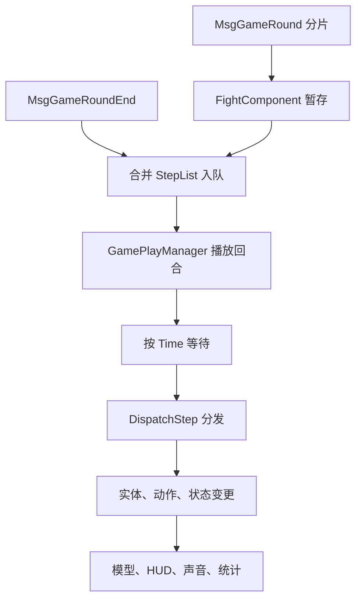

# 战斗执行

[总索引](../README.md)

状态：未完成。通用战斗数据模型、部分官方公式、离线执行器、检查点、HUD 和演出已经接入；原版战斗的完整规则覆盖、逐事件调度、资源闭包、运行验收和 Windows 版本发布仍未完成。

## 功能简介

本页只维护所有战斗共用的会话、阶段、准备、格网、单位、行动队列、技能、命中、伤害／治疗、状态、召唤、胜负、HUD、战报、演出和检查点。具体地图、剧情、任务、掉落、活动入口、养成事务和玩法奖励不属于本页。

“完整还原”表示当前 Unity 代码和资源已经覆盖并完成相应检查；“自定义实现”表示客户端或共享代码没有提供服务器裁决，按已确认的单机规则补足。配置存在、资源已提取或旧引擎测试通过，都不能单独视为通用战斗完成。

### 官方来源与证据边界

原版机制以 [official-source.json](../../official-source.json) 选择的 `871_156598` 客户端／共享反编译代码为主，入口见[当前代码清单](../../.tools/source-packages/current/871_156598/code-manifest.json)。现有战斗配置和部分资源仍来自 `854_156383`，对应[历史反编译目录](../../.tools/source-packages/official-code/)、[历史代码清单](../../assets/reference/official-city/code-manifest.json)、[战斗规则](../../assets/official/battle-rules.json)和[技能规则](../../assets/official/skill-rules.json)。不同版本只按各自来源使用，不混合推断。

客户端能够证明消息消费、数据结构、共享公式、界面和部分生命周期，不能证明服务器如何生成全部步骤或裁决所有结果。`MyFightAI`、部分 AI 组件、随机命中和若干状态触发只有壳或配置；`BattleFormulaHandler.InvokeDamagePhaseProcessor` 为空；部分胜负组件只有标识。因此本页明确区分官方证据和离线补足。

战斗预览对象在编辑模式校验结束时使用 `DestroyImmediate` 清理创建的模型网格、材质、贴图、HUD、挂载父节点及临时 SortingGroup；运行时仍使用 `Destroy`。已有地图角色在释放临时父节点前恢复原父级、姿态及动画，原有 SortingGroup 仅恢复状态。该处理不删除导入资产，避免 `ProjectTools.Validate` 结束时留下编辑模式销毁错误。

## 原始官方实现

战斗以官方 Fight 共享实现、实体组件、技能／状态配置及客户端表现为依据；公式、执行阶段、目标选择、冷却、护盾、状态与结束链保持原顺序。客户端与共享代码不包含的服务器统计、合并及结算规则按本页已确认的本地裁决接线。

### 官方代码与资源依据

以下记录原客户端／配置和已有转换依据；转换产物不等同于 Unity 玩法已接通。

战斗准备区使用当前 `871_156598` 官方输入，`scripts/prepare_battle_preparation.py` 先核对 `Assembly-CSharp.dll`／`Console.dll` 解码哈希及反编译来源，再由 APK 优先、当前云端校验缓存其次解析 `prefabs_ui_fight_changebattleposarea` 和角色3100拖拽组件引用；解码9266条阶段范围与阶段类型偏移，恢复128×128原 Sprite、九宫格、PPU、SpriteRenderer、Sprites/Default材质、2.5秒原透明度动画及原玩家碰撞体。载荷为 `unity/Assets/Official/Combat/Preparation/`，原生绑定为 `unity/Assets/Game/Resources/Combat/Preparation/`，输入对象与输出哈希见[准备来源清单](../../assets/reference/battle-rules/preparation-source-manifest.json)。只恢复已取证的组件，未用替代素材补齐拾起／放下、高亮或NPC交互；实际验证范围与缺项见[战斗执行](battle-execution.md)。

战斗 Boss HP 层数表单独从固定 APK `854_156383` 的 `defaultpackage_assets_config_luban.bundle` 对象 `Assets/Config/Luban/monster_hp_plies.g.bytes` 解码，164 行输入 SHA256 为 `66b6496732f115b7370bc4fa3114d76c66f552de1fa73f70c06fa59b485e342e`。`python -B scripts/prepare_unity_combat_hp_plies.py` 通过固定版 `TbMonsterHpPliesInfo` 构造器生成 `unity/Assets/Official/Combat/monster-hp-plies.json`；输出、APK 对象、bundle 和转换版本记录在 [Boss HP 层数来源清单](../../assets/reference/official-map/monster-hp-plies-source-manifest.json)。

`prepare_fidelity_battle.py` 从固定 854_156383 的原始表和 config_ec 转换 7 张表、45 个怪物等级属性类、7,417 个原实体，共 139 类组件，当前解码无失败且严格核对全部组件字节。包含 471 种怪物及 2,699 组技能／属性配置。原有同 ID 的旧格式实体优先使用相同客户端内的正式配置，选择、跳过范围、原始来源、格式化器及哈希均保留在 [battle-rules/source-manifest.json](../../assets/reference/battle-rules/source-manifest.json)。运行数据为 `assets/official/battle-rules.json`，纳入显式资源清单。

、 移植原伤害公式与怪物属性计算。`generate_battle_reference.py` 编译原 C# 方法生成 97 组伤害及 8 组怪物属性对照，只去掉日志并提供配置读取适配；输出和源码／校验程序哈希见 [damage-reference.json](../../assets/reference/battle-rules/damage-reference.json)。追加 [secondary-reference.json](../../assets/reference/battle-rules/secondary-reference.json) 的 72 组原 C# 治疗、效果命中、生命消耗、护盾换算等对照；副本执行器尚未接入完整实体流程；素材／数据转换和独立公式通过不代表实际战斗已经还原。没有新增自绘素材。

`prepare_fidelity_battle.py` 补入固定 `854_156383` 的 `FightCharacter_part1.g.bytes` 和 `FightMonster_part1` 至 `part21`，与既有 FightSkill／FightStatus／FightPet／FightOther 使用相同原生成格式读取器。运行 `battle-rules.json` 包含原角色体积、旋转中心、移动配置、角色类型和初始状态；完整输入对象、版本、APK／校验 CDN 来源及输入输出 SHA256 见 `battle-rules/source-manifest.json`。此前转换范围与原输出哈希保存在 `battle-rules/history/source-before-character-monster.json`，不将既有未转换实体记为官方缺失。没有新增自绘素材。

`prepare_fidelity_battle.py` 增量转换固定 manifest `854_156383` 的原 stage_npc、npc_level_detail、npc_profession_detail、npc_template、FightNpc 及幻兽额外属性。battle-rules/source-manifest.json 记录输入对象、真实APK/CDN来源及输入输出哈希，前一来源收据保存为 battle-rules/history/source-before-npc.json。

`python scripts/prepare_battle_presentation.py` 从固定原男角色 SplitBinarySO 提取216段100／200战斗及配套动作，复用当前官方可定制皮肤、贴图和原始染色遮罩，采样为本地原生网格帧；4,672段怪物／NPC／召唤体动作复用已登记原模型骨骼、皮肤和贴图。原技能预制体 AnimationClip 覆盖名称用于绑定动作。当前初始剑／杖仍使用既有官方位图及网格，按原pWeapon_R2骨骼相对已有地图站姿变换接入；这是本地挂点适配，不是新绘素材或新的官方原武器网格。逐对象来源及输出SHA256见 official-map/battle-presentation-source-manifest.json，既有模型／角色来源收据哈希保留。

`python scripts/prepare_battle_effects.py` 按原 MyPlayableSequence 时间、FollowBone／Track 挂点和 ParticleSystem／材质转换技能及伤害粒子资源。3,543组绑定、4,226组粒子配置复用原资源和通用粒子转换器；原版本缺包依赖通过独立校验的新版同CAB资源解析，真实864_156496凭据与原版本来源分开保存在 official-map/battle-effects-source-manifest.json 的 counterparts 字段；未填入或改写原版本缓存。声音保留原Wwise事件引用，尚未将其等同于已转换音频。上述来源收据记录实际输出和缺失依赖，运行只使用本地转换后的显式资源。

`prepare_battle_stages.py` 从固定 manifest `854_156383` 的 FightStage EC 与原 `stage_monster_array`／`ai_priority` 表转换256个战场、474个阵型及40组AI优先级；原始表字节与APK内TextAsset逐字节核对。输入对象、APK／校验CDN来源、构造器及输出哈希见 [战场配置来源](../../assets/reference/official-map/battle-stages-source-manifest.json)。

`prepare_battle_scenes.py` 按 `FightComponent.SceneName` 解析229个原预制体，跟随 `FightEnvironmentLoader` 的昼夜GUID和父变换，转换基础层、Sprite／Tilemap／Mesh、Spine及ParticleSystem到本地二维资源。677份场景层包含1354个JSON／几何文件，统一目录为 `assets/official/battle-scenes/`；入口为 `battle-scenes.json`。原BG02副本的atlas键不匹配时，唯一同名且Rect／Pivot／Border／PPU完全相同的原atlas Sprite用于解析，原副本、atlas与实际对象分别登记，没有另绘位图。完整对象、处理及输入输出SHA256见 [战场环境来源](../../assets/reference/official-map/battle-scenes-source-manifest.json)。

`scripts/prepare_unity_battle_scenes.py` 校验上述固定版目录和256个阶段绑定，恢复229个唯一基础场景、非空昼夜网格及6,376张贴图，共6,656项资源；Unity 输出及每项SHA256记录在 `unity/Assets/Official/Combat/Scenes/scene-assets-source-manifest.json`。运行目录 `BattleScenes/catalog.json` 将GameId绑定到 `Resources.Load` 路径；[`OfficialBattleEnvironmentView`](../../unity/Assets/Game/Runtime/Presentation/Combat/OfficialBattleEnvironmentView.cs) 以官方网格顶点、UV、颜色、排序层和贴图建立场景，并按调用方覆盖值或原prefab默认昼夜加载环境几何。昼夜运行时规则见固定版 `FightTimeTypeSwitcher`：消费 `StageInfo.TimeType`，`MapActivedAuto` 再检查地图区域激活；当前Map10入口尚未传入运行时昼夜值。Unity端目前用 `Sprites/Default` 建立材质；原材质／shader、环境粒子与Spine，以及真实Editor／Play Mode画面仍未验证。

固定 APK／匹配 854_156383 的 Appearance 与 FightMonster／FightNpc／FightCharacter／FightPet／FightSkill 资源，经 prepare_battle_animation.py 读取原控制器常量、m_TOS、默认参数、状态与过渡、覆盖片段和 MyPlayable 绑定，输出 assets/official/battle-animation/catalog.json。输入对象、程序集字段、原客户端代码及输出 SHA256 见 battle-animation/source-manifest.json。没有按动作名称前缀编造技能动画。现有 Spine 网格按 12 fps 采样，相同附件拓扑的顶点混合为引擎适配，逐骨骼混合的精度边界在对应功能／地图文档如实记录。

`prepare_unity_battle_skill_playables.py` 从上述固定目录提取 1,451 个含默认 Playable 的技能实体、1,480 个动作 cue（1,191 个 Animator 参数 cue、289 个 clip override），生成 `Combat/skill-playables.json` 并将官方 AnimationClip 复制到 `unity/Assets/Game/Resources/Combat/SkillAnimations/`。8 个 NPC／召唤物 clip 均由固定版技能 prefab 的 `OverrideClip` PPtr 解析到原始对象：7 个来自 APK 内 `defaultpackage_assets_appearanceassets_npc_npc_middle_model_anim.bundle`，另 1 个 `npc_10206/skill_01` 来自固定版本 CDN 的 `defaultpackage_assets_appearanceassets_npc_npc_big_model_anim.bundle`。7 个中型 NPC 动画来自既有 AssetRipper 缓存；新增大体型动画从该固定 bundle 单独转换，按 bundle 名、`m_Name` 和 `m_StopTime` 与原对象核对（1.8333 秒），原始 AnimationClip SHA256 为 `92777a742fd1146f6725d7b9d9a84686ac470bdc18f0a331caff6e5fbdf380c4`，导出 `.anim` SHA256 为 `b331f45ad0117359f3e34242bb01f8195612c014c93d8bf388c2c18295e410f7`。所有 132 个包内 clip 的来源文件／来源对象、APK 或 CDN bundle provenance、输入／输出 SHA256 及目录 GUID 写入 `battle-animation/skill-playables-source-manifest.json`。Unity Editor 导入和 Play Mode 动画结果尚未验证。

`scripts/prepare_battle_native_mesh_pack.py` 将固定 APK 版本 `854_156383` 的已校验原 Spine 抽帧 JSON 规整为 Unity 可读网格帧，并仅绑定哈希匹配的官方 atlas 页，生成 `unity/Assets/StreamingAssets/Combat/native-battle-meshes.zip`。包内含403个模型、4609条动画记录及其引用纹理页；未找到匹配 atlas 页或模型 Spine 绑定的记录保留在来源清单的失败／跳过项，不补画替代素材。该包是原动画帧数据的运行载荷，不包含 Animator 状态机／过渡，也不代表完整战斗画面验收；内置屏 Play Mode 当前只验证岩灵／替身代表模型及姿态采样。

依据：`unity/Assets/Official/Combat/native-battle-meshes-source-manifest.json`。

`prepare_battle_hud.py` 从固定 854_156383 的 FightMainPanel、速度／托管、首领、行动条、战场状态说明、技能／幻兽与 StatusUI prefab 转换原 RectTransform、SafeArea、组件引用、Sprite、原生动画及字体。场景飘字直接转换 FightDamageSettings.EffectUIPoolPresents 的 13 个真实 prefab、TextMesh 位图字形和元素提示动画；保留原状态可见性、颜色、格式化、叠层／回合及首领分层生命／护盾计算。资源与对象输入输出哈希见 `battle-hud/source-manifest.json`，运行纹理在 `assets/official/battle-hud/`。

`prepare_battle_pet_models.py` 转换 40 个 FightPet 世界模型、40 个骨骼和 391 个原动画，保留世界层级、缩放、皮肤及静态几何；来源见 `battle-pets/source-manifest.json`，运行纹理、网格和动画在 `assets/official/battle-pets/`。没有用 UI 幻兽模型或自绘图片代替世界模型。世界模型与 HUD 使用独立显式 PNG 清单；动画绑定另见 `battle-animation/source-manifest.json`。

原控制器、方向 playable、生成／死亡、冻结／恢复在战斗时间线中执行；ShowSkillReplay、CDModify、技能扣血和元素提示绑定取原客户端与公共组件。尚未解析的图片地址原样列在 HUD 来源清单；没有替换或伪装缺项。共享导入、统一素材包和 Windows 正式成品需在资源锁交接后更新。

从1884个原 `MyFightSkill` 对象的 `PreferredPosToPlayable` 生成（输出SHA256 `5b661a9efbbd304977374446aa1c3b064b2b80605ff50b9fd88e8c3e7b426a90`），输入对象逐项匹配 `battle-audio/bindings-source-manifest.json` 的原对象哈希；文件内保留所用对象哈希集合的SHA256，重建入口为 `prepare_battle_audio.py --targets-only`。实体目标类型按原 `FightSkillComponentInfo.IsEntityTargetType` 的1／4／5迁移，用于保持Wwise对象范围和随机容器归属。

音量路由另读取 APK 的 `launch_assets_launch_scriptableconfig_wwisemanagerconfig.bundle`（MD5 `c68c296caddce110b1797a0f4c48e2e8`，SHA256 `a21c3dbc422bc531d05893c4085be52202e8ceaeb9e01cc12fd67b2ec00ab478`）：原 `Volume_ALL`／`Volume_SFX`／`Volume_Voice` 的ID分别为3240620755／3673881719／3676256460；`prepare_battle_audio.py` 的 `routing`／`check` 直接核验原引用与名称哈希。

`scripts/prepare_battle_audio.py` 沿固定 `854_156383` 的 MyFightSkill、全部 MyFightHit 系列、MyFightDamage、MyFightStatus、MyActionAgent、MyFightRoleCharacter 与 DefaultMoveEffectSupport 的 Playable 引用，提取方向、暴击／格挡、状态叠层、出场／死亡、序列时间、持续时间及停止事件；另从五种原阶梯楼层 prefab 读取 `StageDemonBattlefieldPanelItemPlayerPlayable` 的 Wwise 引用。从 28 个已校验原版 Wwise 分包（含 Init）转换 2172 个 Event、2068 份 Vorbis；新增阶梯 `Note_FantasyLadder_Flash`（2367806325）和 `Note_FantasyLadder_Elevator`（828673327）。wwiser 展开原 Event／Action／随机容器及原 dB 增益，vgmstream 解码，保留循环边界、随机变体、防重复／洗牌、停止对象范围与淡出。未使用自动音量归一化或替代音频。运行资源在 `assets/official/battle-audio/`，通过该目录 `resources.json` 和 显式加载；原包 URL／MD5／SHA256、原 Playable 对象／类型与输出哈希分别登记在 `battle-audio/source-manifest.json`、`battle-audio/bindings-source-manifest.json`。`--check` 校验来源包、全部输出哈希、循环与显式绑定覆盖。

prepare_home_ui.py 从固定 854_156383 的 FurnitureFastHangUpDialog、其 ItemPrefab 指针 FurnitureSpeedUsedItem 迁移原层级／状态／滑条与长按字段，共60个窗口／条目、269张相关原图；原客户端／公共程序集的加速请求、预览和四类处理器代码输入 SHA256 登记在 home-completion/source-manifest.json 的 fast_sources。／／ 使用这些真实配置与代码；服务端普通结算体未取得，直接到账和超过设施储存上限的处理由用户经验补证，具体边界仅记对应功能／地图文档。未添加自绘素材或自定义布局。

`scripts/prepare_unity_battle_monster_portraits.py` 按固定 manifest `854_156383` 提取 Map10／Map11 所需 38 种 Monster.IconId (`G_<id>`)。APK 来源包：`defaultpackage_assets_image_itemicon_gameheadicon_monster_map4countries_noatlas.bundle`，MD5 `0479892d6d89bf17fd2e592af3f03a49`，SHA256 `b07fe5bd436a230d6c31f8a88a07e6f3cd3cbcee95ebf1aee56cbd763020c10e`；`defaultpackage_assets_image_itemicon_gameheadicon_monster_mapsp_noatlas.bundle`，MD5 `2683984d4e613c8eb9411bc16ea483cb`，SHA256 `7b71fe37fd62f6255aaa3c42a4bccf181426cbfe0d1a230067e2e192b2e486e2`。魔女召唤所需 `G_3703` 位于 `monster_maptherion_noatlas.bundle`；APK 实际包内没有该 bundle，复用已缓存官方云端文件，MD5 `735124c8a8db27ba8846a5a6770c7f89` 与固定版索引一致，SHA256 `933bd8b252ec9949d39d28057deca746f830fb5b0f0e5ad9ddcfb5580dd18c07`。缓存下载版本 `871_156598` 与所选索引 `854_156383` 分别记录，不更改预期哈希。源输入、PNG／Sprite meta 和输出目录哈希见 `assets/reference/battle-hud/monster-portraits-source-manifest.json`，原 PNG 与 `.meta` 纳入 `unity/Assets/Official/Combat/MonsterPortraits/`，显式绑定 `Combat/OfficialBattleMonsterPortraitCatalog`；catalog SHA256 为 `f67e051f5dc1febb3d4f561f7b8c8502bdc6912668a9b5025bd72af2fc6d010f`。

`scripts/prepare_unity_battle_report_assets.py` 校验固定 APK／CDN manifest `854_156383` 的7个报告 bundle SHA256，并将个人、全员、玩家统计行、技能统计行及分隔线7个 prefab 和34项依赖资产导入 `unity/Assets/Official/Combat/BattleReport/`；7个 Unity Resources prefab 位于 `unity/Assets/Game/Resources/Combat/BattleReport/`。Prefab 的 UGUI／TMP 脚本 GUID 映射至工程内 Unity 包，所有外部 PPtr 均在转换后检查；逐 bundle URL、输入／导出／运行时 prefab SHA256 和资产路径见 [report-panels-source-manifest.json](../../assets/reference/battle-hud/report-panels-source-manifest.json)。其中8个 AssetRipper MonoBehaviour 文件是缺少 IL2CPP 脚本重建后的空壳，不含行为。官方客户端面板逻辑见 `.tools/source-packages/official-code/client-source/FightEndReportPanelProvider.cs`、`FightEndReportPanel.cs`、`FightEndReportPlayerTabView.cs`、`FightEndReportSkillTabView.cs` 及同目录相关 Item／Base 类；业务代码依赖官方服务器报告结构和客户端框架，尚未接入本地执行器，具体功能缺项维护于[通用战斗页](battle-execution.md)。

固定版 `854_156383` 的 `FightUtilsHandler.IsSkillMeetProfession` 经 `ProfessionBaseInfoParser.IsSkillAvailableForProfession` 计算玩家主动／被动技能可用性；对应官方共享实现位于 `.tools/source-packages/official-code/common-source/Common/FightUtilsHandler.cs`、`FightSkillData.cs`、`PassiveSkillData.cs`、`ProfessionBaseInfoParser.cs` 与 `ProfessionUtils.cs`，数据来自 `assets/official/rules.json` 的 `profession_base`。离线目录按 `Skills`、`FightUsedSkills` 和 `PrePro` 继承链计算同一标记；职业为0时依据 `OfflineEquipmentProfile` 的装备位置10解析当前武器类型，按官方 Sword→Zhanshi（1）、Wand→Fashi（10）映射优先回退当前武器，再回退初始武器。Map10、日常副本、幻想塔和竞技场玩家技能绑定均写入 `ProfessionAvailability`。客户端 `FightMainPanelSkillUI` 将不匹配技能显示为 `GameSkillIcon.State.ProfessionLimit`。未找到施放执行链消费 `IsAvailable` 并拒绝技能的证据，故本地只迁移可用性标记与 HUD 状态，不添加释放禁令。

开场对话原生布局与载荷完整性：`prepare_character_creation_opening.py --ui-layout-only` 从固定 APK `854_156383` 的 `defaultpackage_assets_prefabs_ui_story.bundle`（MD5 `5473f9c47986ea5caafb199bd112f7fe`）重新读取 `OptionTalkDialog` 的 22 个布局组件，记录各组件 pathID、原始字节 SHA256 与 bundle／APK 来源，沿已有官方 `UGUIJszx.HorizontalLayoutGroupJSZX` 恢复姓名框。输出 `unity/Assets/StreamingAssets/Opening/ui/opening-ui.json` 的 SHA256 为 `08c4186721aa51ff3103bf283e0060690a4c4c477b9603f6fea03bd5683e5f52`，清单为 `character-creation/opening-source-manifest.json`；原 Sprite、字体、材质和动画资源未替换。开场粒子网格保留 `opening-skill-effects-source-manifest.json` 与运行载荷已有 SHA256，五个文件仅恢复原 LF 字节，Git 属性固定换行，未调整预期哈希。模型沿原 SkeletonDataAsset 的 `0.01` 导入比例，并由 `prepare_opening_model_transforms.py` 提取 APK 内 7 个 FightMonster／FightNpc prefab 的完整模型 Transform 父链（怪物 XY 为 0.3，4201 为 0.3、4202 为 0.23，保留落脚偏移），输出 `Opening/model-transforms.json`，并恢复怪物原材质 `_StraightAlphaInput = 1` 与透明输入，消除透明区域白块，`Resources/Opening/OpeningShaderVariants.shadervariants` 显式保留相应 Windows shader 变体与四个转场 UI shader，避免 Player 剔除动态查找资源后黑屏；清单逐层记录 pathID、原始 SHA256 与 APK 来源，运行时取消按 Boss 高度二次归一缩放；对话选项按官方 `OptionSlot.Reset` 隐藏，Windows 点击推进为用户明确指定的单机交互差异。

开场战斗单位与 HUD：固定 APK `854_156383` 的 FightNpc 4201／4202、Appearance 8401／8402、Boss 3803、GameRoundUI／GameRoundCharacterItem、GamePlayManagerConfig、CharacterDamageUI／DamageSequenceImage 及五套原位图字体已按 `prepare_opening_fighters.py`、`prepare_opening_unit_ui.py`、`prepare_opening_damage_ui.py` 和 `prepare_opening_skill_effects.py` 提取并显式绑定。Boss 原 107 节点／47 粒子、模板缓冲遮罩、网格描边和星空纹理保留；Windows 程序适配保留原材质属性、槽位深度和常量颜色。原生 HP Sprite 的九宫边框与世界单位换算已恢复。输入 APK／bundle／对象、官方类与输出 SHA256 见 [opening-source-manifest.json](../../assets/reference/character-creation/opening-source-manifest.json) 和 [opening-skill-effects-source-manifest.json](../../assets/reference/character-creation/opening-skill-effects-source-manifest.json)。 47 个运行网格保留已有 SHA256，Git 以二进制字节保存；不修改预期哈希。

通用战斗准备与规则补全：`854_156383` 原战斗 prefab 的407项输入／初始化绑定由 `prepare_battle_hud_graphic_bindings.py` 提取并在 Resources 显式加载；404项为 Graphic／CanvasGroup 字段，3项为官方组件字段指向的初始隐藏对象，见 [graphic-bindings-source-manifest.json](../../assets/reference/battle-hud/graphic-bindings-source-manifest.json) 和 [session-source-manifest.json](../../assets/reference/battle-hud/session-source-manifest.json)。`prepare_battle_prop_defaults.py` 从 APK 的 `config_luban` 重新读取73条默认属性，迁移 `LevelPropParser.TryGetPropDict` 的缺键补齐机制，编译绑定至 `FightOfficialLevelPropDefaults`，输入、源码及生成哈希见 [prop-defaults-source-manifest.json](../../assets/reference/battle-rules/prop-defaults-source-manifest.json)。`prepare_battle_rule_texts.py` 从当前 `871_156598` 已校验语言文件提取5149条原文，输出 `Assets/Official/Combat/battle-texts.json`，版本与输入输出记录见 [text-source-manifest.json](../../assets/reference/battle-rules/text-source-manifest.json)，详情弹窗绑定待接。战斗验证依赖的累充原生曲线从已有官方 bundle 经 AssetRipper 恢复，保留曲线并适配 Legacy Animation，见 [动画来源](../../assets/reference/commerce-components/accumulated-panel-animation-source-manifest.json)。

开场技能移动与受击：`prepare_opening_action_motion.py` 复用固定 APK `854_156383`，提取 11532／11833／15301 的 EC 配置、移动 prefab、轨迹曲线及 15300 的跑动触发器；按官方 `MyFightSkill` 的技能实体播放顺序恢复 9 个 NPC 专用动作。精英 3481／Boss 3803 的 `MeshMaterialProperty` 绑定、材质与 shader 对象及 `_HITEFFECT` GLES 程序哈希收录在 [opening-source-manifest.json](../../assets/reference/character-creation/opening-source-manifest.json) 的 `action_motion`；Windows 受击适配保留模板遮罩、透明裁剪及预乘混合，输出绑定为 `Opening/action-motion.json` 与 `Resources/Opening/OpeningSpineHit.shader`。`AppearanceRendererLite`／`CustomRenderExistingMesh` 的运行时材质登记也由同一来源清单记录，Boss 描边在受击克隆期间保持原替换关系；四个剧情 UI shader 调整 Windows 裁剪参数声明顺序，输出哈希列于同节。

通用战斗场景和单位绑定：`scripts/prepare_battle_scene_bindings.py` 按 APK 优先、固定版 `854_156383` 云端缓存回退，恢复原 TagManager 排序层、344种单位模型 Transform 父链／MeshRenderer／血条排序及256个战斗场景的原相机位置和尺寸，严格解码 `GameCameraController` 依赖。输入对象、CAB、pathID、原始哈希和运行绑定哈希见 [layout-source-manifest.json](../../assets/reference/battle-scenes/layout-source-manifest.json)，载荷由 `Combat/battle-scene-bindings.json` 及 SHA256 侧车显式加载。现有场景网格恢复向下 Y／纹理 V，模型采样网格恢复纹理 V，并保留原 prefab 模型节点变换；这些是历史载荷的渲染修复，不代表已替换旧 Spine 转换依赖或完成原生角色动画。真实鼠标准备、运行至结算和场外节点／镜头恢复通过，角色、头像及完整 HUD 缺项仍见战斗所属页。

战斗快捷入口状态：`prepare_battle_function_entry.py` 复用固定 `854_156383` APK 内 `defaultpackage_assets_animation_ui_functionentrysui.bundle` 的原控制器及三个片段，从已校验同版 FightMainPanel 缓存恢复 StateSwitcher、两个按钮及两项 SelfRect 引用；输入对象、bundle／APK 哈希、官方源码和九个可选缺目标通道的哈希记录见 [function-entry-source-manifest.json](../../assets/reference/battle-hud/function-entry-source-manifest.json)。`OfficialBattleFunctionEntryTools.Restore` 保留原60fps曲线、整数参数、三个状态／转换及收展事件，生成 `Assets/Official/Combat/HUD/Resources/Combat/FunctionEntrys.controller` 与三个原生 AnimationClip；输入、转换器和资产／meta SHA256 见 [function-entry-native-source-manifest.json](../../assets/reference/battle-hud/function-entry-native-source-manifest.json)。`OfficialBattleHudView` 按原节点显式绑定官方控件逻辑及桌面指针适配；没有绘制替代面板或恢复消息服务。

战斗 HUD Sprite 导入：`OfficialBattleHudSpriteTools.Restore` 从上述30个固定版 prefab 节点读取88张实际引用图片的尺寸、边界、像素枢轴及 PPU，恢复38份受影响导入器；其中25张原九宫格边界先前未应用。`OfficialBattleHudAssetTools` 同步修复扁平树初始化和资源路径／文件名查找。原节点、官方来源清单／载荷、PNG、meta 及转换器 SHA256 见 [sprite-import-source-manifest.json](../../assets/reference/battle-hud/sprite-import-source-manifest.json)，显式绑定继续使用 `OfficialBattleHudCatalog`。聊天服务和动态头像仍未迁移完毕，新增元数据未生成完整素材快照。

战斗头像拍摄：`prepare_battle_portraits.py` 分别读取 `854_156383`／`871_156598` 官方 APK 配置，确认头照摄影参数与场景分支开关相同，再从固定854 APK 提取摄影棚和两个场景时间轴 prefab 的原层级／组件引用。76项输入对象、版本、原始字节、官方代码、生成器、运行适配及 JSON 哈希见 [portrait-source-manifest.json](../../assets/reference/battle-hud/portrait-source-manifest.json)。运行载荷为 `Assets/Official/Combat/Portraits/Resources/Combat/battle-portraits.json`；`CharacterNativePortraitCapture` 以当前原生附件网格和已有官方姿势拍摄透明头像，不使用采样帧，不生成替代素材。此阶段尚未绑定完整场景时间轴及其材质、粒子与动画，新增载荷未生成完整素材快照。

场景时间轴迁移：`prepare_battle_timeline.py` 按固定 `854_156383` APK 优先及已校验同版依赖恢复 `GameRoundScene`／`GameRoundCharacterItem_Scene` 的原 Transform、实际序列化字段引用、10张 Sprite、3份材质、3种 GLES shader 及原 Animator 控制器／4个片段。源纹理／图集、裁剪与 Sprite 几何、原对象／CAB／pathID、官方代码及运行适配哈希见 [timeline-source-manifest.json](../../assets/reference/battle-hud/timeline-source-manifest.json)；Windows 原生 prefab、材质、Sprite、controller、AnimationClip 与 meta 哈希见 [timeline-native-source-manifest.json](../../assets/reference/battle-hud/timeline-native-source-manifest.json)。显式绑定为 `Combat/OfficialBattleTimelineAssets`，动态头像复用上述摄影参数和当前原生角色网格，原圆形网格实现保持客户端 UV 修正；shader 从实际使用的 GLES 变体转换。其他角色类别和完整事件调度仍未完成，未生成完整素材快照。

场景时间轴粒子：`prepare_battle_timeline_particles.py` 以固定 `854_156383` APK 的 `GameRoundCharacterItem_Scene` 及已校验依赖，经 AssetRipper 1.3.14 保留两组原生 ParticleSystem／Renderer 和四个 Transform，恢复两份材质／两张原贴图。Windows 材质绑定按原 `USE_MAINTEX` 第一粒子 pass 的 GLES 程序转换，保留第二地图投影 pass 原始程序供后续所属流程使用；没有启用原 prefab 关闭的 `UIParticle` 父节点。原 bundle／组件／材质／shader／贴图哈希、解码包、工具／生成器、导出输入和输出见 [timeline-particles-source-manifest.json](../../assets/reference/battle-hud/timeline-particles-source-manifest.json)，显式引用随场景时间轴原生 prefab 打包。

战斗 NPC 时间轴头像：`prepare_battle_npc_portraits.py` 以固定 `854_156383` APK 的 `npc.g.bytes` 与官方构造器解码148条配置，通过 APK 优先及已校验同版云端 bundle 提取89张原 Texture2D／Sprite，保留原尺寸、中心枢轴、PPU和采样／环绕参数。配置、资源清单、原对象／bundle／APK或云端哈希、官方代码、生成器、显式目录及输出见 [npc-portraits-source-manifest.json](../../assets/reference/battle-hud/npc-portraits-source-manifest.json)，绑定入口为 `Combat/OfficialBattleNpcPortraitCatalog`，由通用场景时间轴的 NPC 分支按 `NpcClassId` 解析。战斗两表引用61个非零NPC，已覆盖53个；11015—11022的8张配置图片经854／871清单和全部9个头像 bundle 实际对象核对仍未定位，查找输入分别记录，未混用版本或替换素材；49条 MapExploreBoss 历史图路径及2条空 Icon 保留未绑定。

战斗技能槽状态：`prepare_battle_skill_slots.py` 从固定版 `854_156383` 的 FightMainPanel／GameSkillIconItem 原 prefab 提取4个有序技能槽引用、5份 StateGameObjectConfig、图标／品质／CD文字引用，记录实际组件和 GameObject 原始哈希。`WorldGameSkillIcon` 直接保留官方状态枚举、对象共享判断和切换次序；主面板使用原槽对象，不追加替代卡片，不改坐标和重复节点名；主面板0—6与独立卡0—7的原配置差异原样保留。宠物解锁另核对原 `function_limit` Type 62 的 `HasAnyPetCondition`、`HasAnyPetCondition.IsMet` 与 `FunctionType`，直接读取本地持有数量，迁移 `FightMainPanelSkillUI.RefreshView` 的显隐和 `offsetMax.x=0/70`，输入行、配置和控制器哈希记入同一清单。技能槽状态绑定未新增或替换美术；禁用来源、完整技能事件、宠物图标／能量及详情仍见战斗页。

依据：[skill-slots-source-manifest.json](../../assets/reference/battle-hud/skill-slots-source-manifest.json)。

战斗技能品质：`scripts/prepare_battle_skill_quality.py` 依据原 `GameSkillIcon.Init`、`LanguageUtils.GetItemQualityImage`、Quality／ItemType 枚举及固定854物品／技能／皮肤配置，生成1910条原物品品质绑定与6张官方品质图。输入为 APK 内 `defaultpackage_assets_image_ui_itemquality.bundle`，记录实际 Sprite、SpriteAtlas、Texture2D、CAB、依赖与原始对象哈希；PNG 与既有官方导出逐字节核对。独立原生载荷为 `Assets/Official/Combat/SkillQualities/`，显式目录为 `Resources/Combat/OfficialBattleSkillQualityCatalog`，使用 FullRect／RGBA32、原采样参数及浮点留白／UV，避免自动 tight mesh 二次裁切、额外压缩或透明扩色。详见 [skill-quality-source-manifest.json](../../assets/reference/battle-hud/skill-quality-source-manifest.json)。运行 JSON 用随包 SHA256 侧车核验，输出保护拒绝覆盖已修改资产，Git 对相关哈希输入固定 LF；品质7原加载关系仍未取得，不替换为其他品质图。

- 战斗伤害飘字数值：`scripts/prepare_battle_damage_display.py` 核对854／871两版 `CharacterDamageUIManager`、`CharacterDamageUI`、`DamageResultParameter` 与 `FightDamageComponentImplement`，记录原始显示值和实际 HP 结算的分离；[来源清单](../../assets/reference/battle-hud/damage-display-source-manifest.json) 固定代码、原 HUD 层级及运行绑定哈希。继续使用固定854原数字 prefab；仅恢复数值输入、检查点字段和旧记录回退，不新增替代素材。

- 战斗世界空间数字：`scripts/prepare_battle_world_damage.py` 从固定854官方配置的 GUID 定位7个数字型 `DamageScene/*_Combine_Scene` prefab，复用已核实的 `world-ui.json` 层级及动画，并重新读取原 Transform、TextMesh、DamageNumberUI、CharacterDamageUI、DamageFloatSize、SortingGroup、Font、Material、Texture 对象。输出5套原位图字体与7个层级的显式本地绑定，[来源清单](../../assets/reference/battle-hud/world-damage-source-manifest.json) 记录 APK／缓存来源和输入输出哈希；Windows 材质复用已有 `UI/GameDamage` 程序转换。未更换为普通字体或新布局；纯提示型飘字和合并逻辑仍待完整迁移。

- 战斗元素反馈：`scripts/prepare_battle_element_feedback.py` 从固定854官方6个数字型世界 prefab 重新读取 `ElementConfrontationUI`、文本／背景引用、Animator、原生 TMP 字体、流式字体配置、Sprite／贴图／材质，复用经长度／MD5核实的原 FZY4K TTF；`scripts/prepare_battle_world_shaders.py` 将选定原 GLES 程序逐支转换为 Windows HLSL。复用两版官方文本／显示分支与背景自适应算法，原描边换算依据 APK 恢复的 `TMPEffect.DoSetup`／回调和 `get_atlasPadding` ARM64 指令，方法地址、元数据索引、字节哈希、输入对象及输出／运行绑定见[元素反馈来源](../../assets/reference/battle-hud/element-feedback-source-manifest.json)。仅覆盖这6类飘字的实际单描边分支，未声明完整 TMPEffect；数字源码提取同时保留原 RectTransform 的轴心／锚点，避免旧默认轴心造成文字与数字重叠。

`scripts/prepare_battle_damage_visibility.py` 核对固定854 APK／对应已缓存官方依赖的实际对象，扫描3,708个技能和角色 bundle，严格读取1,367组 `MyFightDamage` 显示开关及551个角色 prefab 根组件。当前规则引用的1,331个伤害实体均已绑定；3组隐藏、318组关闭零值，怪物3933的原 `CustomDamageUITypeFilter` 仅过滤零伤害免疫。两版客户端的隐藏／元素／非零／过滤／零值分支、提示类型与颜色顺序保持可核对来源；运行回执分别保存伤害 prefab 身份和运行序号，旧回执不推造身份。输出 `Resources/Combat/damage-visibility.json`、输入对象／bundle／配置和代码哈希见 [来源清单](../../assets/reference/battle-hud/damage-visibility-source-manifest.json)，接线和验证边界见[战斗执行](battle-execution.md)。

战斗状态计数：`scripts/record_battle_status_counter.py` 记录官方 `FightStatusController.CalcStatusRemainRound`、`FightStatusComponent.RoundComp`、`FightStatusUtilsHandler.GetStatusTargetByType` 与 `FightStatusItemBase`／`FightStatusUIItem` 的计数和节点显示分支，复用已绑定原图标／文字资源；源代码、图标清单输入及运行代码哈希见 [status-counter-source-manifest.json](../../assets/reference/battle-hud/status-counter-source-manifest.json)。此次未新增或替换美术，受控 Play Mode 像素与正常模拟点击回归范围写回[战斗执行](battle-execution.md)。

战报分页依赖：`scripts/restore_battle_report_tabs.py` 按固定854原包／严格同哈希缓存读取7份战报 prefab 的536个组件，补回31个分页组件的原序列化字段、标准布局、Graphic 输入标志和2处 SafeArea；迁移官方 `TabItem／TabGroup／TabTransition／TabAnimatorTransition`，复用既有官方 NoDrawingRayCast／Windows SafeArea，原 Animator Controller 和层级不变。PPtr 转为 Unity 行内格式，原输入、对象、代码、转换工具及运行输出哈希见 [report-tabs-source-manifest.json](../../assets/reference/battle-hud/report-tabs-source-manifest.json)。此清单在既有 `report-panels-source-manifest.json` 的原始导出之上记录运行 prefab 的后续转换。5组分页的16次模拟点击、回调顺序、重复点击、提交输入与原动画通过 Play Mode。

战报图形字段另见 [report-graphics-source-manifest.json](../../assets/reference/battle-hud/report-graphics-source-manifest.json)：从同批官方原 bundle 严格读取279个 Image／MirrorImage／TMP，恢复36个原生 Sprite、完整尺寸／轴心／裁剪偏移、原图集和本地字体引用。既有 AssetRipper 原生导出的几何／图集位置逐项核对，修复紧裁剪 Sprite 尺寸缩小；Knob 由 APK 内置资源的原生 typetree 直接恢复。最终图集使用固定 UnityPy 解码；复用已核对原对象哈希的 FZY4K，MPLUS 原字体按 FontAssetFontConfig 长度和 MD5验证，空动态 atlas 按原配置分配。脚本 `restore_battle_report_graphics.py` 和 Unity 导入工具显式绑定原生引用；本清单覆盖更新后的运行 prefab 输出哈希。279图形／36几何及5组16次分页模拟点击的 Play Mode 检查通过，表格布局、数据行及正式入口尚未完成。

战报布局／缩放／滚动和标准控件：`restore_battle_report_foundation.py` 严格读取同版原组件字段，新增迁移客户端 `LayoutElementClamper／MaintainGlobalScale／MaintainGlobalScaleUI`，复用原 Grid／横向布局、已提交的完整 LoopScroll 代码及 Unity UGUI。此前新增战报图集和字体尚未生成完整素材快照。

依据：[report-foundation-source-manifest.json](../../assets/reference/battle-hud/report-foundation-source-manifest.json)。

战报同步滚动：`restore_battle_report_scroll_sync.py` 从同版原组件严格读取3处表头／列表引用，迁移 `FightEndReportSkillTabView` 的限制、归一化复位和比例跟随方法。本地初始化入口适配原 UIBase 生命周期，保留原布局刷新次序；模拟列表拖拽与两端越界、普通战斗统计和结算返回通过。真实数据提供者、下拉框数据与正式入口仍待迁移。

依据：[report-scroll-source-manifest.json](../../assets/reference/battle-hud/report-scroll-source-manifest.json)。

战报玩家下拉控件：`restore_battle_report_dropdown.py` 严格恢复同版 `UIDropdown／DropdownItem`、所需状态对象／颜色分支及文本键值分支，迁移 APK 公共包内原对象3171787996812696172的行 prefab；保留原层级和五个预览行，三组原始变换及3项共享图形均核对，原动画／控制器复用既有载荷。28个组件／343字段、源对象、代码、managed-reference 适配和运行输出见 [report-dropdown-source-manifest.json](../../assets/reference/battle-hud/report-dropdown-source-manifest.json)。六条控件样本、8次模拟点击、行复用／新建、两档颜色及开关动画终态通过；语言／字体／效果服务、正式全局输入、真实数据和 Wwise 音效尚未完成。`battle_report_font_receipt.py` 将已提交字体载荷与编辑器自动生成的动态字形缓存分别记录，核对原种子字形与所有非缓存参数不变；缓存哈希不代表已提交素材。

战报中文文本：`restore_battle_report_texts.py` 从固定854版两份 WwiseBnk 中文语言 rawfile 严格按该版大小及MD5读取，仅输出7份原战报 prefab 所需25个条目；恢复121处原 `MultiLanguageText` 的完整字段、组件位置及绑定，不改原图形／布局。沿用原 `LocalizationTextService` 查表／回退／文本处理与原键值格式化顺序；完整字体／语言切换、替换提供者及文字效果仍待实现。

依据：[report-text-source-manifest.json](../../assets/reference/battle-hud/report-text-source-manifest.json)。

玩家战报数值行：`restore_battle_report_player_row.py` 从854 APK 的原 `FightEndReportPlayerTabViewItem` 对象迁移10字段／39项字段与引用、原本人底色 managed reference 及组件位置，保留原布局和图形。数值刷新、本体／召唤／宠物三类相加、队伍四项分母和中文紧凑格式复用官方 `FightEndReportPlayerTabView／Item`；未知历史显示空白、未知队伍分母清空对应条。原始 PlayerIcon 引用作为头像／资料待接端点保留；完整头像、未确认代理类型归组和正式窗口仍未完成。四条原 SlicedFilledImage 复用既有官方网格移植和经原始对象 SHA-256 核实的 ImgBgTitle 原生 Sprite，恢复完整字段与四种原色；图形、纹理与代码均无替代。原 bundle／对象／字段及代码／输出哈希见 [report-player-row-source-manifest.json](../../assets/reference/battle-hud/report-player-row-source-manifest.json)。

战斗召唤继承使用已取得的官方 `BattleFormulaHandler.CalcSummonMonsterInheritProp`、`SummonRankAdditiveFactorParser` 和详情合并调用。当前871与历史854相应反编译文件逐字节一致，运行时保持854已校验配置；输入哈希、程序集与转换入口见 [召唤继承清单](../../assets/reference/battle-rules/summon-inheritance-source-manifest.json)，生成脚本为 `scripts/prepare_battle_summon_inheritance.py`。

## 完整还原部分

技能伤害测试的被动技能快照保留战斗装配时的原物品、等阶、完整槽级和来源小阶；统计触发的子实体按原物品关联到详情，不要求子实体与根技能实体相同。快照与主动行动槽分开，状态消失后仍保留在内存检查点。规则检查覆盖状态清除后的检查点往返及不增加主动槽；实际交互和 Windows 验证范围见[技能](skills.md)。

- 怪物单位使用战斗实际计算的等级和段位建立状态，并将同一等级交给主动／被动技能组装；使用玩家等级的关卡不再把导出时的占位等级 1 写回单位。Map14 数据 Play Mode 已执行 1,649 个实例的属性与技能构造，其中动态实例为 87 个；该夹具不代替完整战斗画面、输入、奖励与存档验证。

当前 Unity 工程已经形成可复用的战斗内核，但还不是完整原版战斗交付：

- `FightBattleState` 保存单位、属性、HP／护盾／韧性、技能、状态、格网、回合、召唤链接、事件和战报来源；`FightBattleExecutor.Begin/Restore/Step`、`FightTurnQueue`、`FightBattlePhaseMachine` 提供会话、阶段、回合推进、暂停边界和重复回执保护。
- `FightDamageFormula`、`FightDamageResolver`、`FightDamageSettlement`、`FightStatusLifecycle`、`FightStatusTriggerRuntime` 和 `FightResilienceFormula` 已接入官方数据可证明的部分，包括 HP／护盾差值、绝对伤害、暴击／格挡输入、元素反馈、状态计时／叠层、累计伤害、CD、破韧和随机流。
- `FightBattleGrid`、`OfficialBattleGridMapper`、`FightBattlePreparationPositions` 支持格网、身体占格、移动掩码、合法落点和已授权单位的原子换位；失败操作不修改检查点。
- `FightBattleCheckpointSerializer` 提供版本化 JSON 保存／读取，并在恢复时校验；检查点保留战斗状态、事件序号、随机种子和统计，重复或旧步骤不会再次结算。
- `OfficialBattleRuntimeController`、`OfficialBattleSceneView`、`OfficialBattleHudView`、`OfficialBattleRoundDisplay` 和相关 Catalog 已接入场景、时间轴、血条、Boss、技能槽、状态、战报行、伤害飘字、元素反馈、镜头和公共控件。官方战斗 prefab／材质／字体按来源清单绑定。
- `OfficialBattleProgressDriver` 统一 Arena、Fantasy Tower 和 Daily Dungeon 的自动进度节拍：只在控制器允许推进时累计时间，逐步调用 `Advance`，并用控制器计算的演出时长安排下一步；各玩法保留自己的进入、隐藏、检查点和结果事务。主线额外的阶段门控暂留在地图模块，但仍复用同一战斗控制器。
- `OfficialBattleNativeAnimationLibrary` 和 `OfficialBattleNativeModelView` 已能加载已恢复的原生模型数据；固定版原动画采样包包含403个模型的4609条动画数据，纹理页按来源清单校验。岩灵／替身模型、HUD 绑定和部分骨骼姿态已做局部 Play Mode 检查；抽帧网格不等同 Animator 状态切换、逐骨骼混合或完整战斗演出。
- 战报构建和统计已保留施放、命中、治疗、护盾、承伤、破韧、状态及来源信息；缺失的旧存档字段保持未知，不从剩余 HP／护盾倒推。

### 已迁移代码与局部资源

以下为局部代码／资源接入，完整流程仍受本页缺项限制。

19个原版本缺失CAB依赖按既有独立校验机制读取新版官方同CAB包，真实 `864_156496` 版本、URL、MD5／SHA256和所用对象登记在上述收据的 `counterparts` 字段；其余场景主体保持854版本。没有修改原APK／CDN缓存或原版本185个缺项。场景入口保留原预制体根Transform，逻辑格经地面原点和根矩阵映射到原世界坐标；已转换几何保持同一世界坐标。转换资源加入显式加载清单及Windows导出过滤，运行时无需原Unity包、Python或网络。

Map10 水面 Windows D3D11 编译适配仅为 `TRANSFORM_TEX` 的复合 UV 参数补充整体括号；官方 shader 来源仍为固定版 `854_156383` 的 `defaultpackage_unityshaders.bundle` （bundle hash `cac97355bb4799c415e3cb1ef38b6dc5`、PathID `5093245133389786381`）。原生重建入口为 `unity/Assets/Game/Resources/World/Map10Water.shader`，输出 SHA256 为 `7d8488c9451eb99a4f688d288146dd5059dcc79c8a56c68a6c816536f00ecb43`；已同步 `unity/Assets/Official/World/Map/10/rendering-source-manifest.json` 中的重建输出记录。纹理、官方输入哈希和显式加载路径均沿用原记录，Windows 构建已无水面 shader 编译错误；动态画面仍按地图页验收。

通用战斗复用角色绑定：`OfficialBattleCharacterAnimationTools.Build` 检查既有男女原生 prefab 与实际 AnimatorController，各绑定26个非空 Motion，排除442／449个空状态；`Resources/Combat/OfficialBattleCharacterAnimationCatalog.asset` 按控制器引用和片段名称显式加载。输入 prefab／控制器哈希、既有转换链凭据、生成器及输出哈希见 [character-animation-binding-source-manifest.json](../../assets/reference/battle-models/character-animation-binding-source-manifest.json)。3100模型父链复用上述场景凭据，角色退场还原世界层级、变换、显隐和动画状态。没有重新烘焙 Spine 数据，历史转换依赖和未转换动作继续保留原结论，动态头像仍未完成。

角色附件原生几何：`prepare_native_character_geometry.py` 从当前 `871_156598` 官方 APK 优先读取男女骨骼、分离动画原数据及实际图集，独立使用固定 MIT 格式读取器，保留二进制附件名称覆盖、原骨骼局部顶点、每个影响的权重、region 变换、图集裁剪／旋转及贴图路径。男性654／女性706个现有附件输出至 `Resources/CharacterCreation/native-character-geometry.json`，共享模型工厂绑定 `CharacterNativeAttachmentGeometry` 并校验 SHA256 侧车；原始输入、解码凭据、旧原生 prefab、生成器、运行绑定和输出哈希见 [native-geometry-source-manifest.json](../../assets/reference/character-creation/native-geometry-source-manifest.json)。该几何转换不调用 Spine runtime，也不使用网格帧；既有 Animator 的历史来源继续保留，完整约束／变形／未转换动作不在完成范围。

战斗主面板材质：`prepare_battle_hud_materials.py` 从固定 `854_156383` 官方 FightMainPanel prefab 的三处实际 Image 引用取得序列帧、加亮及胶囊边框材质，沿引用取得原图、Shader 和全部16个 GLES 程序。Windows HLSL 转换保留选定分支的原运算与12个 UI 裁剪变体、材质属性和渲染状态，另外4个原分支归档保留；不复用缺少循环分支的其他 shader。输入对象／CAB／bundle／版本、转换器、运行绑定和输出哈希见 [materials-source-manifest.json](../../assets/reference/battle-hud/materials-source-manifest.json)，Unity 导入参数与原生材质／目录／meta 见 [materials-native-source-manifest.json](../../assets/reference/battle-hud/materials-native-source-manifest.json)。

## 自定义实现

技能伤害测试（StageType 43）采用用户确认的本地怪物属性方案：`FightDamageTestRules` 只在测试关卡消费固定伤害 1／无限生命选项。怪物伤害在护盾结算前变为 1；无限生命保持怪物 HP，保留完整命中伤害和原通知顺序供战报统计，并免除怪物的生命施法费用。选项写入战斗检查点，普通关卡继续使用原结算路径。`scripts/test_skill_damage_test.ps1` 已验证连续致死命中、伤害统计、普通关卡隔离、关闭选项和检查点恢复；`scripts/test_unity_combat.ps1` 的 97 组公式及战斗规则回归通过。技能入口、测试画面、结算界面与发布验证见[技能页](skills.md)，本段不表示完整测试流程已经完成。

以下内容是因为未取得服务器代码而做的本地替代，不宣称为原版服务器规则：

- 离线执行采用固定随机种子、步骤序号、回执和版本化检查点，以便单机续算和重复输入去重；客户端只提供了消费消息和部分公式。
- `FightBattleResultRules` 提供标准清场、显式保护目标和显式玩家对决三种可配置结果策略；主角死亡、保护目标死亡、双方全灭和回合上限的优先级属于离线策略，调用方必须明确参与者，不能从地图或同阵营猜测。
- `FightBattlePreparationPositions` 用调用方提供的控制名单替代服务器站位请求，保留官方格网／身体占格校验，允许合法受控单位交换位置。
- `FightVoodooDollRules` 按已确认方案实现替身：传导完整结算伤害（包括溢出）为绕盾真实伤害，禁止治疗传导，替身结束时转移减益并保留原状态计时／叠层语义；来源和同步实体 ID 仍使用官方配置。
- 服务器未提供的 AI 评分、随机命中、复杂触发顺序、伤害阶段钩子、位移条件、召唤数量／寿命、战报聚合和部分元素／减伤组合只实现了有明确配置或已确认口径的分支，其余保持未决，不把近似结果写成官方规则。

### 已确认的本地接线与边界

prepare_treasure_tasks.py补充固定854_156383的BattleEventType、原TreasureDataBattleStatus／TreasureDataGameDestroyMonsterKind、BlackboardDataType及MapEntityWorldStageType来源继续保留，75件选择键和配置未改变。本项只有代码输入及运行时接线，没有新增素材。服务端事件写入方法未取得，实际触发按用户确认迁移为本地接线，确认原文与实施核对仅记录于对应功能／地图文档。

固定版 `854_156383` 的 `assets/official/battle-rules.json` 中状态实体 `25275` 配置 `FightStatusUnflinchingOnDamageComponent.Rate=0.5`；来源与输出哈希由 `assets/reference/battle-rules/source-manifest.json` 核验。官方共享代码 `.tools/source-packages/official-code/common-source/Common/FightStatusUnflinchingOnDamageComponent.cs` 在状态 `OnInvoked` 时向持有者发出 `EStatusCustomAction.Unflinching`，枚举值为 2（`EStatusCustomAction.cs`）；服务端调用时机未取得。离线实现按用户确认的推断在每次实际 HP 损失时掷配置率，并将动作 2 写入战斗步进事件／回执；固定 HUD world prefab 数据的文案绑定为“霸体”。

固定版 `854_156383` 的 `assets/official/battle-rules.json` 为随机命中实体 `13992`、`59361`、`11202` 配置 `MiniHitTargetCount` 与 `NotSameTarget=true`。官方共享类 `.tools/source-packages/official-code/common-source/Common/FightHitRandomTargetComponentInfo.cs` 定义随机范围、HitList 和去重字段；`.tools/source-packages/official-code/common-source/Common/FightHitRandomTargetComponent.cs` 仅提供这些配置，客户端 `.tools/source-packages/official-code/client-source/MyFightHitRandomTarget.cs` 是空包装，未取得服务端选敌器。离线按用户确认的规则，在同一组件的 HitList 子命中间按格网选择：`NotSameTarget` 排除已选单位，`NotSameEmptyScope` 排除已选空格，`NotSameGrid` 排除已选格子；候选耗尽时跳过后续子命中。`FilterOutOfGroundScope=true` 时越界格在分配前滤除，关闭时越界格可作为空格候选；`AllowEmptyScope` 允许空格消耗子命中名额，`NotAllowHitEmpty` 禁止空格命中，空格本身不造成伤害或召唤。选中单位作为子范围命中中心，召唤子命中仅消费选中的有效单位。执行和覆盖测试位于 `FightBattleHitCollector`、`FightBattleTargeting`、`FightBattleExecutor` 及 `scripts/test_unity_combat.ps1`；`FilterCondition` 等其他区域过滤仍未实现。

断罪魔印累计伤害：`prepare_battle_accumulated_damage.py` 重新解析 `854_156383`／`871_156598` 两版 APK `config_ec` 的 `FightSkill_part703.g.bytes` 与 `FightSkill_part157.g.bytes`，核对24062累计组件、13148技能、13149命中与 Unity `battle-rules.json` 实际字段完全一致。原 bundle、CAB／对象、载荷哈希、反编译组件／枚举、当前中文 `entry_24062_desc` 和生成器哈希见 [accumulated-damage-source-manifest.json](../../assets/reference/battle-rules/accumulated-damage-source-manifest.json)。本地规则按说明累计非真实生命伤害、状态结束时执行原30%自定义伤害链；没有新增或替换美术。服务器完整触发排序未由此取得，已确认的来源分摊、优先选敌与承伤加成接线、施加者阵亡后的结算及剩余实体销毁边界见战斗页。

魔印来源归因与优先选敌：两版24062的 `FightStatusComponent.AI.MoreHit` 已从实际 EC 载荷解码并与运行配置核对；官方 `FightStatusUtilsHandler.DistributeLongProportional` 直接保留整数取整及末项余数。输入、官方代码、运行实现哈希和用户确认的两条本地规则写入 [accumulated-damage-source-manifest.json](../../assets/reference/battle-rules/accumulated-damage-source-manifest.json)。触发实际生命伤害按原角色／技能贡献分摊，独立魔印事件保留；候选与嘲讽／混乱限制后优先标记，再沿原技能排序。这两处服务器接线没有取得，按已确认单机规则补足，不作为服务器源码已还原的结论。

魔印承伤加成：同一生成器已逐字段核对两版 `FightStatusDamageProcessComponent`，并记录官方实体属性、阶级／等级输入、`DamageProcessPhase.BeforeShield` 和空的 `BattleFormulaHandler.InvokeDamagePhaseProcessor`。用户确认先百分比后固定值，故本地仅接24062的已知组合：施加者本人造成的伤害读取独立231／235属性，在扣盾前处理；其他来源、治疗与未命中不执行。用户另确认施加者已阵亡、目标存活且战斗继续时仍结算魔印，原施加者继续作为来源；本地仅对该结束链放行死亡来源，保留其0生命和原技能追加统计，普通死亡单位的攻击资格不变。一阶一级官方输入经缺键默认值、阶级缩放及实体系数得到20%和4789，未把3505实体系数直接当固定伤害。

依据：[accumulated-damage-source-manifest.json](../../assets/reference/battle-rules/accumulated-damage-source-manifest.json)。

战斗元素抗性：`scripts/prepare_battle_element_confrontation.py` 从854／871两版官方 `config_ec` 中重新解码 `FightSkill_part753.g.bytes`，逐字段核对25051—25060的状态、动作及20条 `ElementInfos` 与固定854运行载荷；分别记录两版 APK／缓存、bundle、对象、原始载荷及反编译代码哈希。单状态保留原 float 值，多个状态按用户确认的本地规则先判断元素免疫，否则将各自的伤害倍率乘算；不推定按状态层数重复乘算。共享公式、扣盾前计算、实际 HP 差、结果与检查点保持原路径；服务端绑定和合并器未取得，此处明确记录为经确认的本地补足，旧缺项回执不改写。规则脚本、实际 Play Mode 专项和运行代码哈希见 [element-confrontation-source-manifest.json](../../assets/reference/battle-rules/element-confrontation-source-manifest.json)；元素文字与动效的单独来源见下文。

战斗世界提示：`scripts/prepare_battle_world_tips.py` 按固定854 APK 实际配置和对象恢复免疫、回避、未命中、重置冷却、自定义动作和驱散六类世界 prefab，保留原语言、层级、TMP 字体／材质、单描边、完整动画、排序、相机缩放与堆叠参数。复用已核实的原 FZY4K TTF 及世界 TMP shader，不引入替代素材；共享动态字形缓存、两版客户端、原对象及运行绑定哈希见 [world-tips-source-manifest.json](../../assets/reference/battle-hud/world-tips-source-manifest.json)。重置冷却另保留渐变、三层 Sprite 及13条旧式动画曲线，原 Sprite 与既有 HUD 贴图逐点核对；1,906个技能重放提示开关直接读取原 prefab。提示锚点按两版 `CharacterDamageUI.UpdateAttach／UpdateOffset` 在创建和堆叠时读取实际实体位置并归零本地Z；`DamageFloatSize` 的镜头引用、尺寸缓存、101执行顺序及暂停中的缩放按原客户端恢复。类型11另直接绑定 `DamageCustomActionUI.mIcon`、`EStatusCustomAction` 三条原语言及6条动画曲线；仅 CDModify 显示原箭头。成功驱散通知的发出条件由用户确认。语言直接读取原 APK；旧视图清理后重建通过，保留云端只复用满足原854 MD5／大小及下载凭据SHA256的相同字节，运行载荷不变。受控及实际战斗的验证边界写回[战斗执行](battle-execution.md)。

战报平均数的原代码证据及本地接线见 [report-statistics-source-manifest.json](../../assets/reference/battle-rules/report-statistics-source-manifest.json)。原客户端读取两项平均数，共享数据类仅合并服务器结果，未取得单场生成逻辑；按用户确认使用伤害命中／释放次数及伤害命中／每次释放的去重目标数之和，闪避不计、免疫与全额盾吸收计入。原始计数及旧检查点未知标记随本地存档保存。有效护盾量另按用户确认取成功添加量，三类占比以同施放者各技能对应有效量之和为分母，治疗／护盾的生命比例以施放者最大生命值为分母；新状态在原属性解析后仅归因一次，保留历史缺项标记。已接原技能数值行及用户确认的显示取整、伤害／治疗／增益／减益次数，正式入口和完整来源归因仍待完成。

技能战报数据行：`restore_battle_report_skill_row.py` 严格读取固定854版原 `FightEndReportSkillTabViewItem`，恢复35处序列化字段／引用与 managed-reference 显隐配置；原组件位置、布局及图形不变。迁移原数值刷新顺序、颜色和 Slider；直接复制5个原 `NumberFormatHelper` 方法并接入原中文缩写／百分比路径。平均数的显示取整为已确认本地规则；原始比值不变，伤害次数与治疗次数采用用户确认规则，满血治疗仍计次；增益／减益逐目标成功施加计次，叠层／刷新各计1、丢弃／失败不计，异常减益并入减益；旧存档未知项不补造，待记记录独立于活动实例并随检查点保存。另恢复3处原表头 GM 显隐配置，与数据行保持一致。图标管理器／详情／快照及正式窗口仍待接入。

依据：[report-skill-row-source-manifest.json](../../assets/reference/battle-hud/report-skill-row-source-manifest.json)。

战报间接状态来源：复用已取得854客户端／共享反编译结果，核对 `BattleReportDistributor`、`FightReportComponent`、`BattleReportCollectorApplyStatusByStatus／Cfg` 及 `FightStatusHpAccDecreaseComponentInfo／FightStatusSkillEndComponentInfo`；前者没有服务器聚合实现，后者明确累计损血触发的来源／目标均为持有者。按用户确认，状态直接触发新状态继承既定根来源，独立技能从该次技能起算，未知来源保留未归因。`FightBattleStatusReportSource` 将统计来源与实际施加者／属性／衰减字段分开，接入 HP 阈值、累计损血、技能结束追加状态及其次数／盾量统计；不修改官方资产或配置。专项回归及模拟输入 Play Mode 验证原60840→60841和检查点来源保存，完整被动初始化／未接事件仍待迁移。

依据：`assets/reference/battle-rules/report-statistics-source-manifest.json`。

玩家战报状态评分：直接提取854 APK 的 `defaultpackage_assets_scriptableconfig_modules_fight.bundle`（MD5 `5d9d9996fe22bcca8f9d3bee08280c8c`）中 FightSettings 对象 `-8095793369706998440` 的完整 `ReportSetting`，输出 `unity/Assets/Official/Combat/report-score-settings.json` 及对应加载来源清单，绑定 `OfficialCombatAssetCatalog`。复用反编译 `FightSettings.GetReportApplyStatusScore` 与 `FightReportUIUtils.GetApplyStatusScore`；保留5／5／10状态分、破韧系数1、原阶段列表、null字典提前返回和原计算顺序。官方对象／代码、输出与绑定哈希见 `assets/reference/battle-rules/report-score-settings-source-manifest.json`。服务端计数代码缺失处按用户明确确认实现：BeAbsoluteDamage 包含护盾、溢出及防御／减伤抵消部分，累计既有官方 AbsoluteDamage 字段；破韧按敌方韧性正数归零次数计1。保留普通／异常减益分类次数并接到原评分公式，已知施加者无根技能仍进入角色总分；旧存档没有对应历史保持未知。计数及原配置已通过专项回归，头像、未确认代理类型分组及正式入口仍未完成。

玩家战报列表及归组：从同版官方 `fightendreportplayertabview.bundle` 的 `FightEndReportPlayerTabView` 恢复原 `PlayerSlot／PrefabObj` 两字段、槽与行资源绑定，复用清理子项、实例化、队伍四项合计和重新启用刷新。用户确认 NPC 各占一行、召唤物的召唤物归最终主人的召唤物报告；本地按报告快照 MasterId／CharacterType 归组，保留阵亡／离场单位和未归组原因，不修改玩法主人关系。缺失主人、循环、跨阵营及未确认代理类型不默认归到主角，也不生成完整队伍分母。官方服务器聚合器为空，因此该部分为用户确认的本地补足；宠物召出的召唤物按用户确认归宠物栏，进一步召唤沿该来源分类；代理类型仍有缺项。源对象、字段、代码和输出哈希见 [report-player-view-source-manifest.json](../../assets/reference/battle-hud/report-player-view-source-manifest.json)，计数快照见战报统计来源清单。头像／名称／点击资料、正式窗口及完整战斗发布尚未完成。

战斗替身使用官方12200／12201／4600实体及12202寿命、10140同步技能，原始组件、配置、描述与用户确认的单机裁决分别记录于 [替身来源清单](../../assets/reference/battle-rules/voodoo-doll-source-manifest.json)。`scripts/prepare_battle_voodoo_doll.py` 记录输入；固定真伤绕盾、溢出传导与减益转移为用户已确认的离线执行接线，原生模型和完整演出尚未完成。

## 尚未实现

- **会话和准备**：完整就绪／取消就绪／方案刷新、所有控制权与中途加入接口、完整阵型／高度／身体占格、入场／结束过渡、离开／后台条件和准备冷启动恢复。
- **回合、AI 和技能调度**：完整 `AiType` 评分、嘲讽／混乱、所有技能资格条件、方向与位移规则、逐 Delay 分帧执行、实体等待、负时长、中断／销毁、递归白名单和重入限制。当前仍有同一 Step 内同步处理的路径。
- **命中、伤害和状态**：Scope 旋转／逐格延迟／过滤条件、其余命中组件、完整伤害阶段钩子、全部状态事件／来源约束／快照／转移／持续变化，以及护盾、HP 限制、CD、韧性、元素、固定直伤和耗盾组合的全量联动。
- **召唤和结果**：宠物、格子物件、智能物件及其他召唤的完整继承、数量、寿命、销毁、复活消费者和非命中 HP 变化；各外部玩法的结果策略、资源事务和奖励由所属页接入。
- **HUD、战报和公共控件**：全部时间轴事件和头像、真实 Boss 视野、单位／阶段状态详情、技能品质／能量、正式战报入口、回放／快进／托管／背包／观战／聊天及完整语言字体服务；自动进度驱动目前合并三种 Runner，主线仍有独立阶段门控。
- **画面和音频**：完整复合外观、Animator 状态切换／过渡／混合、生成／复活／召唤特效、Playable 精确停止／中断、范围／弹道／挂点／排序、相机环境、粒子、材质、shader、飘字合并和音频速度同步。
- **验证和发布**：通用战斗全流程 Play Mode 模拟输入、真实画面／遮挡／缩放／声音、重启续战和 Windows Player 验证；完成前不能声称战斗功能完成或发布对应版本。

### 原版战斗系统

以下 F01—F43 是必须保留的通用功能范围，不代表当前全部完成。类名相对于上述官方客户端／共享源码目录。

### 会话、阶段、准备和结果

| 编号 | 原版功能 | 官方机制 |
| --- | --- | --- |
| F01 | 建立、加载、释放 | `FightRoot`、`FightSceneRoot`、`GamePlayManager` 创建战斗上下文、实体容器和场景对象，结束时停用并释放。 |
| F02 | 主面板与延迟 | `FightMainPanelLoader` 按普通、记录或回放模式加载面板，消费 `ShowMainPanelDelay`，取消时停止加载并释放。 |
| F03 | 阶段 | `GameStatus` 包含 Preparing、PlayStart、Play、Pause、EntryTransition、BattleEnd、BattleEndTransition、End 等状态；模式可跳过未使用阶段。 |
| F04 | 准备与就绪 | 准备倒计时、自动就绪、取消就绪、开始权限和 `SkipPrepareStatus/UserStart` 由准备面板与团队倒计时消费。 |
| F05 | 波次、回合和上限 | 波次、个人回合、全局回合分别维护；`GameProgressUI` 显示 `MaxRound`、个人回合上限和临界提示。 |
| F06 | 胜负与结束 | 玩家／敌方死亡、守护目标失败、决斗结果等由结果组件输出，公共层播放结束演出、清理并交接结果。 |
| F07 | 离开与切出 | `FightMainPanelLeaveHandler` 和切出控件按阶段、身份、观战／录像状态及离开策略处理确认和离开。 |

### 格网、站位、移动和目标

| 编号 | 原版功能 | 官方机制 |
| --- | --- | --- |
| F08 | 场地、阵型、占格 | `FightSceneInfo`、`MyFightGridGround`、`MyFightRoleGrid` 保存坐标、高度、身体占格、地形／边界阻挡、出生偏移、方向和翻转。 |
| F09 | 准备拖拽 | `PrepareBattlePlayerDrag` 校验准备阶段、控制权、拖拽阈值、射线格点、最近合法格、占位冲突、回退和拾放演出。 |
| F10 | 调整区域与交换 | `ChangeBattlePosHandler` 按调整区域、出生列表、队伍偏移和控制权决定合法落点及占位交换。 |
| F11 | 中途加入站位 | `ChangePosHandler`、`PrepareBattlePlayerSoulDrag` 按 `JoinInMiddle` 和加入权限预览并提交位置。 |
| F12 | 寻路与位移 | `AStarUtils`、`MyFightGridMover`、`MyFightActionSkillMove` 消费 MoveDist、MoveMask、占格、路径、时长和朝向；技能移动另有延迟、条件和方向。 |
| F13 | 目标与施法方式 | `HitTargetType` 区分敌友、自己、主人和召唤物；`SkillTargetType` 区分点、实体、可站立点、方向、跟随和锁定，范围按近到远展开。 |
| F14 | AI、嘲讽、混乱 | `AiPriorityId/LastAiPriorityId` 引用策略列表，并结合属性最值、角色分组、忽略状态和控制状态选择动作。完整评分器属于服务器缺口。 |
| F15 | 单位详情 | `FightRoleClickInput` 校验查询条件后打开单位详情或执行回调；普通点击不等同手动攻击。 |

### 技能、命中、结算、状态和召唤

| 编号 | 原版功能 | 官方机制 |
| --- | --- | --- |
| F16 | 技能装配 | 技能提供者按物品、实体、等级、品阶、属性、CD、被动和来源创建 `FightSkillAgentComponent`。 |
| F17 | 消耗、CD、次数 | `CostType`、有效消耗、起始重置、限定次数和波次重置共同决定施放资格；状态可修改或停止 CD。 |
| F18 | 动作生命周期 | `ActionDuration`、`Duration` 和等待 Hit、Move、Damage、子技能的条件分别决定动作结束；负时长可表示不自动结束，中断另有通知。 |
| F19 | 额外、重放、子技能 | `FightSkillExtSkill`、`FightSkillReplayCfg`、重放次数、子技能和状态白名单限制来源、条件、递归和次数。 |
| F20 | 命中图 | Fixed、NormalNext、Chained、RandomTarget、CustomTarget、TriggerSkill 等组件展开目标、范围、追踪、延迟、临时属性和附加效果。 |
| F21 | 伤害与治疗 | 共享公式处理攻防、等级／位阶、元素、职业／类别、暴击、格挡、衰减、HP、护盾、绝对伤害和反馈标记。 |
| F22 | 状态生命周期 | 状态支持计时、无限持续、平行／替换、可驱散、叠层／叠时及上限、同来源、属性快照、死亡禁用和复活重启。 |
| F23 | 状态触发 | 开始／结束、个人／全局回合、行动、技能、命中／受伤、死亡／击杀、层数变化、条件检查、转移、移除、持续变化和累计伤害都可触发。 |
| F24 | 控制与防护 | 属性变换、行动条、HP 限制、CD、重放、普通／持续／一次性／无敌护盾、韧性和多层 HP 按组件协同。 |
| F25 | 召唤与附属单位 | 怪物、宠物、格子物件、智能格子物件、替身保留主人、来源、属性继承、数量、寿命、存活和销毁关系。 |

### HUD、公共控件和战报

| 编号 | 原版功能 | 官方机制 |
| --- | --- | --- |
| F26 | 回合时间轴 | `GameProgressUI`、`GameRoundUI` 按 NextTime 队列显示回合、阵营、头像、主角色标识及行动／受击／死亡／插入移除动画。 |
| F27 | 名称、血条、死亡 | `GamePlayerHUD`、`GameCharacterHpUI`、`FightRoleFightHpView` 和 `BattleHpAndShieldHandle` 绑定名称、HP、护盾和死亡标识。 |
| F28 | Boss、韧性、多层 HP | `FightMainPanelBossUI` 显示敌方视野内最多两个 Boss，绑定名称、头像、状态、多层 HP／盾和韧性；最大韧性为0时隐藏。 |
| F29 | 状态详情 | `FightStatusController` 池化状态图标，响应应用、结束、禁用、层数、回合和自定义计数，并提供详情输入。 |
| F30 | 阶段状态 | `FightMainPanelStageStatus` 汇总阶段和实际状态、去重并消费显示黑名单；点击后打开状态明细。 |
| F31 | 技能槽和宠物能量 | `GameSkillIcon` 显示 Ready、Applied、InCD、Ended、LimitedTimes、ProfessionLimit、Disabled；辅助技能另有品质、能量和无宠物占位。 |
| F32 | 准备方案入口 | 准备时可取消就绪、打开方案、校验职业／禁用／宠物提示并刷新战斗快照；方案编辑由技能功能页维护。 |
| F33 | 倍速与锁定 | `FightMainPanelSpeedUI` 根据条件和身份生成档位，分离文案与倍率，并在结束或停用时复位。 |
| F34 | 快进 | `FightMainPanelFastForwardUI` 处理阶段门槛、权限、延迟、防重、请求／执行、失败提示和复位；快进独立于倍速。 |
| F35 | 镜头 | `FightMainPanelCameraUI` 在准备、观战和默认锁定条件下切换跟随／自由镜头。 |
| F36 | 托管、背包 | `FightMainPanelHostingUI/BagUI` 处理显示条件、状态、弹窗和红点；入口不代表任意换装或使用物品。 |
| F37 | 录像、回放、跳过 | 保存意愿、记录流、回放和剧情跳过信号分别处理；录像不是战斗检查点。 |
| F38 | 观战、聊天、扩展 | 公共面板切换观战对象、技能提供者和聊天入口，模式扩展通过外部适配器接入。 |
| F39 | 战报与统计 | 报告提供者按配置选择个人／全员，展示施放、命中、伤害、治疗、护盾、状态次数和占比。 |

### 模型、演出和资源

| 编号 | 原版功能 | 官方机制 |
| --- | --- | --- |
| F40 | 单位外观 | `MyFightRoleCharacter`、`PlayerAnimatorAppearance` 绑定职业、装备、武器、皮肤和单位模型，保留骨骼、网格、贴图、挂点、尺寸、方向和层序。 |
| F41 | 生成、移动、动作 | 单位、技能、命中、伤害 Playable 处理生成、移动、施放、受击、死亡、复活、召唤和清理。 |
| F42 | 特效、飘字、声音 | 范围、弹道、跟踪、偏移、延迟、材质、粒子、声音和飘字由配置与 Playable 驱动。 |
| F43 | UI 生命周期 | `FightMainPanel` 动态装配控件、订阅／解绑事件，保留官方坐标、锚点、字体、遮罩、滚动、按钮命中、旋转和动画。 |

### 原版执行链

原版分为规则状态、过程消息和 Unity 表现三层。`Common.EcEntity/EcComponent` 保存逻辑数据，`MyEntity/MyComponent` 把实体绑定到 GameObject、Playable 和 UI。一次技能可以生成多个命中，一个命中可以产生多个目标结果；技能、动作、命中、伤害和状态有各自结束时点。

`FightRoundDriverComponent` 按 NextTime 升序插入，严格保持同刻步骤的原顺序。客户端可见的行动间隔为 `100000 / sqrt(max(1, Speed) × 境界 SpeedScale)`；属性速度和播放倍率分开处理。技能实例先处理消耗、CD、次数和开始／中断／结束事件，再展开命中与结果。结算结果保留 `SkillId`、`HitId`、`TargetId` 和来源实体，状态保留创建者、持有者、计时者、来源技能和生命周期。

### 实现概括

| 分类 | 当前结论 |
| --- | --- |
| 已完整实现的通用子项 | 战斗状态与检查点模型、确定性回合执行的基础、官方可取得的部分伤害／HP／护盾／元素／状态／韧性公式、格网和受控换位、时间轴／HUD／战报／飘字的已绑定子项，以及部分原生模型加载和局部 Play Mode 检查。 |
| 因没有服务器代码而自定义 | 离线随机流与回执、结果策略、受控站位请求替代、替身传导／减益转移，以及有明确证据的部分 AI、触发、元素、减伤和统计接线。所有近似分支都在本页标明为本地规则。 |
| 仍待实现 | 原版完整准备、逐事件回合调度、AI、命中／状态／召唤／胜负、完整 HUD／公共控件／战报、原生动作／特效／音频、全流程 Play Mode、存档恢复和 Windows Player 发布。 |

### 代码与来源入口

- 规则与执行：`unity/Assets/Game/Runtime/Official/Combat/`
- 离线替代：`unity/Assets/Game/Runtime/Offline/Combat/`
- 表现与 HUD：`unity/Assets/Game/Runtime/Presentation/Combat/`
- 战斗来源清单：`assets/reference/battle-rules/`
- 官方代码与配置：`.tools/source-packages/current/871_156598/official-code/`、`assets/official/`
