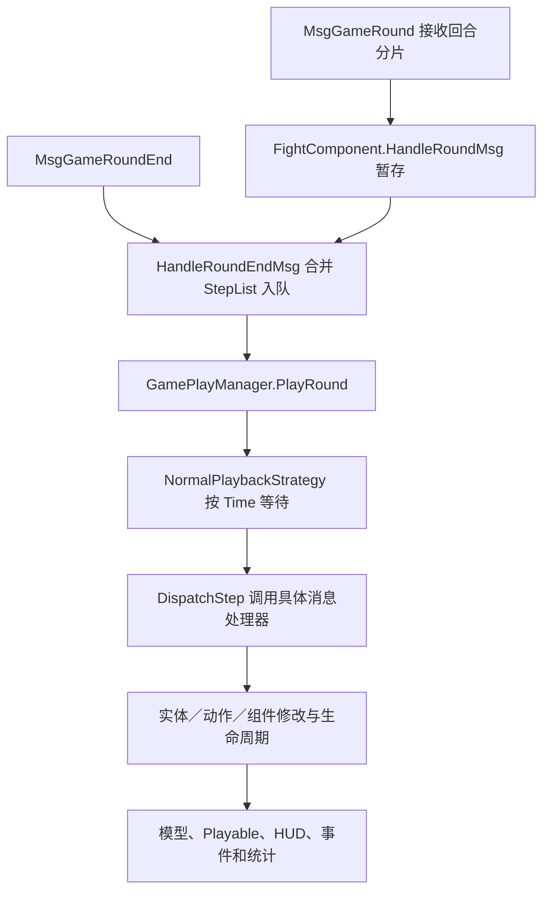

# 战斗执行

[总索引](../README.md)

状态：未完成。已迁移部分官方规则、通用执行器和表现组件；尚未完成原版通用战斗的全部功能、完整 Play Mode 验证及对应 Windows 版本发布。

## 功能简介

本页维护一场战斗共用的会话、阶段、格网、单位、行动队列、技能、命中、伤害／治疗、状态、召唤、胜负输出、HUD、演出和本地检查点。地图、剧情、任务、掉落、养成和玩法专属流程由所属页维护。

下文先记录原版系统及实现机制，再列出现有 Unity 实现、自定义规则和缺项。“有配置”“有资源”“规则测试通过”分别说明，均不直接等于完整战斗已经还原。

### 官方来源与证据边界

原版机制以 [official-source.json](../../official-source.json) 当前选择的 `871_156598` [客户端与共享反编译代码](../../.tools/source-packages/current/871_156598/official-code/)为主，程序集来源见[当前代码清单](../../.tools/source-packages/current/871_156598/code-manifest.json)。现有战斗配置和大部分资源迁移仍来自固定 APK `854_156383`，对应[历史反编译目录](../../.tools/source-packages/official-code/)、[历史代码清单](../../assets/reference/official-city/code-manifest.json)、[rules.json](../../assets/official/rules.json)、[battle-rules.json](../../assets/official/battle-rules.json)与[skill-rules.json](../../assets/official/skill-rules.json)。不同版本不合并解释。

两版 `Assembly-CSharp.dll`、`Console.dll` 的 SHA256 已与各自清单核对；当前版 `GamePlayManager`、`Common.FightSkillAgentComponent`、`Common.BattleFormulaHandler` 已实际重新反编译并与缓存核对。所选48个入口、消息、回合、技能、命中、伤害、状态和公式源码文件跨版相同；该结论不覆盖全部代码、配置或 prefab。

客户端能证明界面、消息消费、数据结构、共享公式及部分生命周期，不能证明完整服务端裁决已取得。`MyFightAI` 是空包装，`FightAIComponent` 主要保存 `AiType`；随机命中与多个状态触发组件只有配置；`BattleFormulaHandler.InvokeDamagePhaseProcessor` 为空；部分胜负组件仅有标识或空壳。下文的本地补足不作为官方服务器规则。

### 原版战斗系统：功能要素

以下 F01—F43 保留原版通用功能编号，表示还原范围，不表示现有实现已完成。类名相对上述客户端／共享源码根目录。

#### 会话、准备、回合与结束

| 编号 | 原版功能 | 实现入口与机制 |
| --- | --- | --- |
| F01 | 建立、加载与释放 | `FightRoot`、`FightSceneRoot`、`GamePlayManager` 建立上下文和实体容器；场景路径为 `Assets/Prefabs/EcEntity/Fight/FightStage/{sceneID}/{game_scene}`，管理激活、停用和释放。 |
| F02 | 主面板与延迟显示 | `FightMainPanelLoader` 按普通／记录／回放选择面板，消费 `ShowMainPanelDelay`；取消时停止加载并释放，`FightMainPanelExtBehaviour` 提供扩展。 |
| F03 | 战斗阶段 | `GameStatus` 包含 Preparing、PlayStart、Play、Pause、EntryTransition、EntryTransitionFinished、BattleEnd、BattleEndTransition、BattleEndTransitionFinished、End；各模式不一定依次经过全部状态。 |
| F04 | 准备、就绪与自动开始 | `FightMainPanelReadyUI`、`GameTeamReadyCountDownUI` 消费就绪状态、截止时间、自动就绪及打断操作，受 `SkipPrepareStatus/UserStart` 和权限限制。 |
| F05 | 波次、回合与上限 | 波次生成、个人回合、全局回合分别管理；`GameProgressUI` 消费 `MaxRound/IsPlayerRoundLimit/PlayerRoundLimit`，临近上限改变文字和动画。 |
| F06 | 胜负、结束与交接 | 怪物死亡、玩家死亡、守护失败、决斗失败等有不同结果组件；公共层输出结果、播放结束演出并清理，外部玩法接收结果。 |
| F07 | 离开与后台切出 | `FightMainPanelLeaveHandler` 与 `FightMainPanelSwitchOutBtnUI` 根据阶段、身份、观战／录像状态及 `LeaveInPreparing/LeaveInPlaying/Background` 处理确认、离开或切出。 |

#### 格网、站位、移动与目标

| 编号 | 原版功能 | 实现入口与机制 |
| --- | --- | --- |
| F08 | 场地、阵型与占格 | `FightSceneInfo`、`MyFightGridGround`、`MyFightRoleGrid`、`GridMoverComponentInfo` 保存坐标、高度、身体占格、地形／边阻挡、出生偏移、方向与翻转；通行掩码按单位消费。 |
| F09 | 准备阶段拖拽 | `PrepareBattlePlayerDrag/Base` 校验阶段、改站位权限、阵营、就绪及控制权；处理拖拽阈值、射线到格网、最近合法格、占位冲突、失败回退和拾起／放下演出。 |
| F10 | 可调整区域与控制权 | `ChangeBattlePosHandler` 使用可调整范围、阵营出生列表和队伍偏移；偶数尺寸做半格中心修正，自己／所属 NPC／其他成员的控制与交换权限不同。 |
| F11 | 中途加入站位接口 | `ChangePosHandler`、`PrepareBattlePlayerSoulDrag` 根据 `JoinInMiddle` 和加入权限预览并提交合法位置；属于受条件控制的公共扩展。 |
| F12 | 寻路与技能位移 | `AStarUtils`、`MyFightGridMover`、`MyFightActionSkillMove` 使用 MoveDist、MoveMask、占格、路径、时长和朝向；`SourceMoveList` 与受击 `MoveCfg` 另带延迟、条件、动作类型及方向。 |
| F13 | 目标关系与施法方式 | `HitTargetType` 区分敌友、自己、主人、召唤物等；`SkillTargetType` 区分点、实体、可站立点、方向、跟随和锁定。范围按近到远保存，动作类型与 `state_mutex` 约束可行动作。 |
| F14 | AI、嘲讽与混乱 | `AiPriorityId/LastAiPriorityId` 引用策略列表，另有属性最值、角色类型分组、忽略状态和控制下可释放标记；完整评分器与 `AiType` 默认决策未取得。 |
| F15 | 点击单位详情 | `FightRoleClickInput` 及派生类校验查询条件后打开详情或回调；普通点击与技能图标不能据此解释为手动攻击入口。 |

#### 技能、命中、状态与召唤

| 编号 | 原版功能 | 实现入口与机制 |
| --- | --- | --- |
| F16 | 技能装配与属性 | 玩家／怪物技能提供者装配技能物品、实体、等级、品阶、属性、CD、被动及来源；`FightSkillAgentComponent` 创建实际技能数据。 |
| F17 | 消耗、CD 与次数 | `CostType/MustHaveValidCost/ResetCDAtStart/LimitedTimes/ResetReleasedTimeOnNextWave` 控制消耗与次数；状态可修改、永久减少或停止 CD。 |
| F18 | 动作与实例生命周期 | `ActionDuration`、`Duration` 及等待自身／全部 Hit、Move、Damage、child Skill 结束的时长分别生效；负值可表示不自动结束，另有中断通知。 |
| F19 | 额外技能、重放与子技能 | `FightSkillExtSkill`、`FightSkillReplayCfg`、`ReplayMaxCountEachRound`、子技能／状态白名单控制来源、条件、次数及递归；废弃 `ExtSkill` 不作为现行入口。 |
| F20 | 命中图与锚点 | Fixed、NormalNext、Chained、RandomTarget、CustomTarget、TriggerSkill 等组件组合命中图；保留范围格、跟踪、延迟、距离延迟、临时属性、忽略 AI 计数与附加效果。 |
| F21 | 伤害、治疗与反馈 | 共享公式计算基数、攻防、等级／境界、元素、职业／类别、暴击／格挡、衰减等；结果区分 HP、护盾、绝对伤害和类型标记，表现另有零伤害／隐藏飘字开关。 |
| F22 | 状态生命周期 | `FightStatusComponentInfo/Implement` 处理计时对象／时点、无限持续、平行／新顶旧／旧顶新、可驱散、叠层／叠时及上限、同来源条件、属性快照、死亡禁用与复活重启。 |
| F23 | 状态事件与触发条件 | 开始／结束、个人／全局回合、行动、技能、命中／受伤、死亡／击杀、层数变化分别触发；另有条件检查、转移、移除、持续变化、累计伤害和自定义伤害。 |
| F24 | 控制、属性与防护 | 属性变换、行动条、HP 条件／限制、CD、重放、普通／持续／一次性／无敌护盾分组件处理；韧性有破韧状态、技能、伤害与恢复，多层血量由 `HpPliesId` 按等级装配。 |
| F25 | 召唤与附属单位 | 怪物、宠物、格子物件、智能格子物件、替身等召唤保留来源／主人、属性继承、生成、数量、存活与销毁关系；不等同普通波次生成。 |

#### HUD、详情与公共控件

| 编号 | 原版功能 | 实现入口与机制 |
| --- | --- | --- |
| F26 | 进度与时间轴 | `GameProgressUI` 显示回合／上限；`GameRoundUI/GameRoundCharacterItem` 处理 NextTime 队列、间距、真实头像、阵营、主角色标识及行动／受击／死亡／插入移除动画。 |
| F27 | 名称、血条与死亡标识 | `GamePlayerHUD` 绑定名称；生命和盾由 `GameCharacterHpUI`、`FightRoleFightHpView`、`BattleHpAndShieldHandle` 等消费。世界浮条与 `PlayerBattleHpBar` 等目标／成员面板分别绑定。 |
| F28 | Boss 栏、多层血量与韧性 | `FightMainPanelBossUI` 最多显示两个存活、敌方视野内 Boss；子项绑定名称、头像、状态、多层 HP／盾及平滑，韧性最大值为0时隐藏。 |
| F29 | 单位状态与详情 | `FightStatusController` 池化图标，响应应用、结束、禁用、层数、回合、自定义计数；保留排布与详情输入。 |
| F30 | 阶段状态与说明 | `FightMainPanelStageStatus` 汇总阶段、自定义及实际状态并去重，消费显示黑名单，点击 `FightStageStatusDialog` 展示明细。 |
| F31 | 技能槽、详情与宠物能量 | `GameSkillIcon` 有 Ready、Applied、InCD、Ended、LimitedTimes、ProfessionLimit、Disabled；宠物／辅助技能另有品质、能量、放电和无宠物占位。常规槽 `DebugBtn` 不作正式施法按钮。 |
| F32 | 准备阶段方案入口 | 准备时可先取消就绪，再打开方案；处理职业不匹配、禁用、宠物提示和忽略分支，切换后刷新战斗快照。方案编辑由[技能页](skills.md)维护。 |
| F33 | 倍速、档位与锁定 | `FightMainPanelSpeedUI` 按条件及身份生成可用档位，文案与倍率分离；回放／联网切换路径不同，结束或停用复位时标。 |
| F34 | 快进 | `FightMainPanelFastForwardUI` 处理功能与阶段门槛、权限、延迟、防重、请求／本地执行、失败提示和复位；独立于倍速。 |
| F35 | 跟随／自由镜头 | `FightMainPanelCameraUI` 受准备阶段、默认锁定、观战和扩展行为控制，改变实际镜头模式。 |
| F36 | 托管与背包入口 | `FightMainPanelHostingUI/BagUI` 处理显示条件、状态、弹窗和红点；入口存在不证明允许战斗中任意换装或使用物品。 |
| F37 | 录像、回放与跳过 | 保存意愿、记录流、回放和剧情可跳过信号各有入口；录像不等同活动战斗的检查点恢复。 |
| F38 | 观战、聊天与扩展接口 | 公共面板可切换观战对象、对应技能提供者和聊天入口；具体模式扩展、离线保留／关闭／替代方案由所属页维护。 |
| F39 | 战报与统计 | 报告提供者按配置选择个人／全员；角色与技能页展示施放／命中、每目标平均次数、伤害、治疗、护盾、状态次数及占比。 |

#### 模型、场景、演出与资源

| 编号 | 原版功能 | 实现入口与机制 |
| --- | --- | --- |
| F40 | 单位与复合外观 | `MyFightRoleCharacter/PlayerAnimatorAppearance` 绑定职业、装备、武器、皮肤及各类单位模型，保留骨骼、网格、贴图、挂点、尺寸、方向和层序。 |
| F41 | 生成、移动与动作 | 单位、技能、命中和伤害 Playable 分别处理生成、移动、施放、受击、死亡、复活与召唤，保留可见性和动作结束后的清理。 |
| F42 | 特效、范围、飘字与声音 | 命中范围、来源到落点、跟踪／弹道、偏移、延迟、材质、粒子、声音和飘字均由实际配置与 Playable 驱动。 |
| F43 | UI 层级与生命周期 | `FightMainPanel` 动态装配控件、订阅并解绑事件；保留原坐标、锚点、字体、遮罩、滚动、按钮命中、旋转和动画，Windows 适配须同时核对缩放与真实输入。 |

### 原版实现机制

#### 数据对象与关系

原版分为规则／状态、过程消息、Unity 表现三层。`Common.EcEntity/EcComponent` 保存逻辑与数据；`MyEntity/MyComponent` 将逻辑对象绑定到 GameObject、Playable 和 UI。

| 对象 | 核心内容与关系 |
| --- | --- |
| 会话与场地 | `StageInfo/FightComponent/FightSceneInfo` 保存阶段、模式、阵营、波次、上限、开关、坐标与格网。 |
| 单位与回合 | `FightRoleFightComponent` 保存属性与生命；`FightRoundComponent/Driver` 保存个人回合、PreTime、NextTime、当前行动者；召唤另有主人关系。 |
| 技能与命中 | 技能物品经 `SkillInfo.EcEntityId` 定位模板；实例保存来源、目标、方向、技能属性，命中再展开范围与子命中。 |
| 结果与状态 | 伤害结果同时关联 `SkillId/HitId/TargetId/SkillSrcEntityId`；状态另有创建者、持有者、计时者、来源技能和生命周期。 |
| 表现与记录 | `MyFightSkill/HitBase/Damage/Status` 消费实例与事件，驱动模型、HUD、音频、统计和录像。 |

一次技能可生成多个命中，每个命中再生成多个目标结果；技能、动作、命中、伤害、状态并不共用一个结束时点。

#### 初始化与过程消息

`FightRoot.Awake` 建立上下文、规则、生命周期、离开、BGM、Playable、位置和称号处理器。`FightLifecycleHandler.Init` 的可见顺序为：初始化 `GamePlayManager` → 激活容器并绑定已有逻辑实体 → 全局 Playable → 主面板 → 时间同步 → 飘字／掉落表现 → 初始化事件；之后 `FightRoot.Init` 再校对位置并触发称号。



`FightProcessStepMsg` 保存类型、载荷和相对回合 Time。普通播放按 `max(0, step.Time - (Time.time - roundStartTime))` 等待，并保留列表顺序；同刻步骤不重新排序。`DispatchStep` 经 `Network.GetMsgListener` 分发。

`MsgGameEntityAdd` 对动作调用 `ActionAgent.StartAction`；对伤害先进入待创建队列并调用 `OnAddInClient` 发出命中／受伤预通知，其余实体直接加入容器。随后才执行实例生命周期和表现。证据：[消息处理](../../.tools/source-packages/current/871_156598/official-code/common-source/MsgGameEntityAdd.cs)、[播放器](../../.tools/source-packages/current/871_156598/official-code/client-source/GamePlayManager.cs)、[普通策略](../../.tools/source-packages/current/871_156598/official-code/client-source/NormalPlaybackStrategy.cs)。完整服务端步骤生成循环不在这条已取得链路中。

#### 行动队列、技能与命中

`FightRoundDriverComponent` 的链表按 NextTime 升序插入；严格使用 `已有.NextTime > 新.NextTime`，相等者排在已有同刻项之后。当前行动时间取行动者 NextTime；重置时 PreTime 为0，NextTime 为个人间隔。`BattleFormulaHandler.SpeedToTime` 的公式是：

```text
行动间隔 = 100000 / sqrt(max(1, Speed) × 境界 SpeedScale)
```

属性速度与播放倍率分别处理。队列代码不能单独证明服务端如何产生全局回合或选择动作。

`FightSkillAgentComponentImplement.EquipSkill` 按技能物品、实体、等级／品阶和来源属性初始化。`FightSkillComponentImplement.Start` 依次处理可见消耗、关联技能管理器、翻转、次数与 LastRound、开始事件；End 和 Interrupt 分别通知结束与中断。战斗内 CD 提供者使用个人回合，非行动期间先加1，计算 `min(CD, CD - (round - LastRound) + 1)`；方案预览提供者返回0，不作执行依据。

`SourceMoveList` 按 Delay 排序。命中图保留来源／目标锚点、范围、跟踪和后继分支，最终延迟为 `Delay + dist × DelayDistFactor`；动作时长、实例时长及等待相关实体结束分别计算。`FightDamageComponentInfo.TriggerExistStateCfg` 明确“触发现有状态在上新状态之前”，其余缺失的跨组件时序不能据字段名补造。

#### 数值结算、状态与胜负

[BattleFormulaHandler](../../.tools/source-packages/current/871_156598/official-code/common-source/Common/BattleFormulaHandler.cs) 先后判定致盲、闪避、格挡；格挡成立时不暴击，否则判暴击。`RandomJudge` 直接比较随机数 `<= rate`，不额外截断概率。致盲／闪避／免疫分支直接返回0。

伤害按官方顺序处理有效防御、基数／系数／固定值、`Attack/(Attack+Defence)`、固定增减伤、元素与精通／抗性、百分比与职业／类别、最终缩放、暴击／格挡、非 PvP 等级差、适用战力压制与料理、目标类别最终缩放、失血／最大HP、距离／大型目标、状态、境界／阶段境界修正及元素克制等分支；治疗另按最大HP／攻击等基数、治疗／受疗修正和最终缩放计算。属性原值为 long，仅 Float 属性除以10000；伤害为负、治疗为正，整数截断位置须保留。

公式输出与实际 HP 损失不同。`DamageResultParameter` 分开保存 DamageValue、ShieldValue、AbsoluteDamage；`FightDamageComponentImplement` 将 HP 限制在0至上限并求实际差值。`OnAddInClient` 先预通知，Start 再写 HP，不重复扣血；护盾承受量不能直接算作 HP 损失。

状态按 Creator／Applicator／主人等对象及回合开始／结束计时，叠层、叠时、共享计数、属性缩放和通知分开处理。回合、行动、技能、命中、死亡等各有事件组件；配置存在不代表服务器订阅、重入、触发限额和顺序已取得。召唤需维护主人及生命周期；`GameCharacterType.NotCheckFightResult` 表明部分附属单位不参与胜负。完整胜负谓词和奖励执行器仍未取得，不能统一按画面上所有单位 HP 判定。

#### 演出、倍率、快进与录像

`MyFightSkill` 按方向选 Playable 并传入来源／目标，中断时停止；`MyFightHitBase` 分开处理命中、范围及来源到落点；`MyFightDamage` 先尝试 Common，再按格挡→暴击→普通反馈并叠加状态效果；`MyFightStatus` 独立处理开始、层数与触发演出。

固定版 `game_settings.Battle` 的倍率为 `[1, 1.5, 2, 2.5]`，按钮文案为 `[1, 2, 3, 4]`；可用档位仍受 `PlayModeSpeeds` 和条件约束。默认 Type0 仅配置索引0／1／2，后两档分别要求条件3005／144；回放 Type12 配置四档且默认索引0。`RoundCountDown=5`、`GameMaxRound=10000` 是提示与兜底，不能覆盖阶段上限；快进解锁延时为1秒，默认锁定镜头为 true。`GamePlayManager.UpdateTimeScale` 在准备阶段恢复1，播放及部分过渡阶段应用战斗速度；声音另走 Wwise RTPC，不能仅凭 Pause 枚举推定完整暂停行为。

录像复用步骤等待链路，队列空时结束。官方快进策略只分发 `GAME_MODIFACTION_RUN_BATTLE_END`、`GAME_MODIFACTION_RUN_END`、`GAME_FASTFORWARD`，依靠结果／快照收束；它与提高倍速、逐条快速执行普通伤害、后台切出和检查点续战各有边界。

## 完整还原部分

本节梳理已迁移的官方算法、配置和客户端表现子项；带有缺项的执行链按实际覆盖范围记录。通用战斗整体仍未完成，缺服务器代码后的本地裁决统一列入“自定义实现”。

### 规则与通用执行链

| 范围 | 现有实现 | 边界与代码入口 |
| --- | --- | --- |
| 数值公式与生命结算 | 已迁移伤害／治疗、命中类型、效果率、速度间隔、衰减及破韧共享公式，保留分支、数值和整数截断；HP 限制在0至上限，原始伤害、盾量、绝对伤害与实际生命差分别保存。 | [FightDamageFormula](../../unity/Assets/Game/Runtime/Official/Combat/FightDamageFormula.cs)、[FightDamageResolver](../../unity/Assets/Game/Runtime/Official/Combat/FightDamageResolver.cs)、[FightDamageSettlement](../../unity/Assets/Game/Runtime/Official/Combat/FightDamageSettlement.cs)、[FightResilienceFormula](../../unity/Assets/Game/Runtime/Official/Combat/FightResilienceFormula.cs)。自定义伤害阶段的完整钩子未取得。 |
| 配置装配 | 本地载荷装配单位、技能、命中图和状态；技能物品映射实体，等级／品阶计算属性、被动和 CD。已恢复73条官方默认属性，仅对缺键补值。 | [FightOfficialCombatCatalog](../../unity/Assets/Game/Runtime/Official/Combat/FightOfficialCombatCatalog.cs)、[FightOfficialSkillItemCatalog](../../unity/Assets/Game/Runtime/Official/Combat/FightOfficialSkillItemCatalog.cs)；[默认属性来源](../../assets/reference/battle-rules/prop-defaults-source-manifest.json)。配置覆盖不代表全部执行组件已迁移。 |
| 队列、技能与波次 | 已接速度／NextTime 队列、个人／全局回合上限、初始 CD、HP 消耗、次数上限、换波重置和停止 CD；未生成波次不入队、不选中、不占位，清场后生成下一波。 | [FightTurnQueue](../../unity/Assets/Game/Runtime/Official/Combat/FightTurnQueue.cs)、[FightSkillState](../../unity/Assets/Game/Runtime/Official/Combat/FightSkillState.cs)。回合裁决和完整技能资格属于服务端缺口。 |
| 格网与命中 | 四方向 AStar、MoveMask、占位／边阻挡、可达路径、范围顺序及阵营／存活／可选中／动作互斥过滤已接入；固定、后继、链式、随机等命中进入收集器，事件保留锚点、范围及距离延迟。 | [FightBattleGrid](../../unity/Assets/Game/Runtime/Official/Combat/FightBattleGrid.cs)、[FightBattleTargeting](../../unity/Assets/Game/Runtime/Official/Combat/FightBattleTargeting.cs)、[FightBattleHitCollector](../../unity/Assets/Game/Runtime/Official/Combat/FightBattleHitCollector.cs)。高度、完整占格及部分命中组件未消费。 |
| 状态生命周期 | 已实现计时对象／时点、无限持续、平行／新顶旧／旧顶新、叠层／叠时上限、到期和对象销毁清理；已有属性变换及持续／一次性／无敌护盾结算。 | [FightStatusLifecycle](../../unity/Assets/Game/Runtime/Official/Combat/FightStatusLifecycle.cs)、[FightStatusPropertyRuntime](../../unity/Assets/Game/Runtime/Official/Combat/FightStatusPropertyRuntime.cs)。来源约束、共享层数及全量事件仍缺。 |
| 已接效果 | 附加状态、随机单条状态、概率／HP 条件、驱散、来源／受击位移、吸血、额外施放、重放、受击者子技能，以及部分 HP 阈值／回合／技能开始结束触发已接入；额外／重放／子技能各限一层。 | [FightBattleExecutor](../../unity/Assets/Game/Runtime/Official/Combat/FightBattleExecutor.cs)、[FightStatusTriggerRuntime](../../unity/Assets/Game/Runtime/Official/Combat/FightStatusTriggerRuntime.cs)。动作0不扣 HP，治疗走 Cure；24233复活状态可将 HP 设为1，复活事件消费者未迁移。触发接线的本地规则见下文。 |
| 韧性、生命层与召唤 | 已接韧性初始化、破韧状态／技能／附加伤害及个人回合恢复，按等级装配 HpPliesId；怪物召唤已有属性／被动、主人、占位、队列、检查点和模型模板。 | [韧性接线](../../unity/Assets/Game/Runtime/Official/Combat/FightBattleExecutor.Resilience.cs)。完整参数调用、继承、数量／寿命／销毁及其他召唤类型未完成。 |
| 会话与阶段 | 已接 Preparing→PlayStart→Play、开始按钮、可选截止时间、一次性自动开始、Play/Pause、BattleEnd／End、主面板延迟挂载和释放取消等待；无截止时间等待，SkipPrepareStatus 才跳过准备。 | [FightBattlePhaseMachine](../../unity/Assets/Game/Runtime/Official/Combat/FightBattlePhaseMachine.cs)、[OfficialBattleRuntimeController](../../unity/Assets/Game/Runtime/Presentation/Combat/OfficialBattleRuntimeController.cs)。调用方在准备阶段停止推进；完整准备与过渡未贯通。 |

准备站位新增复用当前版 `ChangeRangeTool` 的范围构造、Y／X遍历、曼哈顿距离、同距取首格及多区域末次命中分支，偶数边长按原半格偏移。`scripts/prepare_battle_preparation.py` 核对当前程序集哈希并复用反编译源码，解码9266条阶段范围，按 APK 优先、所选云端校验缓存其次恢复原准备区 Sprite、材质、2.5秒透明度动画与玩家拖拽碰撞体；输入／输出及绑定见[准备来源](../../assets/reference/battle-rules/preparation-source-manifest.json)。拾起／放下 Playable、高亮及所属 NPC 专用碰撞体尚未迁移。

`FightProcessPlayback` 保留官方 `NormalPlaybackStrategy` 的列表顺序、相对时钟、同刻／逾期立即派发、取消和指定起始索引行为，不对消息重新排序。当前仅用它阻止最后一步演出尚未结束时推进或回收场景；执行器仍同步计算整步结果，逐命中生命、死亡、状态与召唤消息尚未全部改为事件时点驱动。

`FightBattleExecutor.Begin/Restore/Step` 串联单位、队列、随机流、技能、状态、波次、事件与统计，重复步骤返回既有回执。`OfficialBattleRuntimeController.Begin` 接收检查点、格网映射及技能图标／头像／模型／动作／朝向解析器，`Advance` 推进后刷新场景与 HUD。阶段状态按官方配置汇总显示并去除黑名单；动态说明和阶段实体仍有缺项。

### HUD、场景与演出

| 范围 | 已迁移内容 | 仍有边界 |
| --- | --- | --- |
| 主面板与入口 | 已恢复30个 HUD／飘字 prefab 子集、404项输入标记、88张 Sprite 的原尺寸／九宫格／枢轴／PPU、SafeArea，以及快捷入口原 Animator 的默认收起、展开、收起和空白处关闭。 | 只恢复入口及对应初始化；聊天内容、发送、匹配和其他公共窗口未完成。[输入来源](../../assets/reference/battle-hud/graphic-bindings-source-manifest.json)、[入口来源](../../assets/reference/battle-hud/function-entry-native-source-manifest.json)、[Sprite来源](../../assets/reference/battle-hud/sprite-import-source-manifest.json)。 |
| 材质与技能栏 | 主面板三处原材质及实际 shader 变体、4个原技能槽的引用／状态／CD／次数／职业标记已接入；按本地持有宠物条件恢复宠物槽显隐和原70／0偏移；技能品质1—6按原图及几何绑定，保留原关闭标记。 | 技能完整时序、禁用来源、方案提示与切换、品质7、宠物图标／能量未完成。[材质来源](../../assets/reference/battle-hud/materials-native-source-manifest.json)、[技能槽来源](../../assets/reference/battle-hud/skill-slots-source-manifest.json)、[品质来源](../../assets/reference/battle-hud/skill-quality-source-manifest.json)。 |
| 时间轴与头像 | 已恢复官方场景时间轴的层级、屏幕／世界锚点、队列间距、圆形网格及 Animator；接玩家当前外观100×120动态头照、怪物 IconId、89张 NPC 头像、阵营与主角标识及部分行动／受击／死亡事件。原死亡粒子子节点依官方开关保持关闭。 | 完整事件调度、动态缓存、守护者／拟态解析及8张已核实未取得的 NPC 头像仍缺；11015—11022查找范围与用户确认保留于来源清单，不替换素材。[时间轴来源](../../assets/reference/battle-hud/timeline-native-source-manifest.json)、[头像来源](../../assets/reference/battle-hud/portrait-source-manifest.json)、[NPC来源](../../assets/reference/battle-hud/npc-portraits-source-manifest.json)、[粒子来源](../../assets/reference/battle-hud/timeline-particles-source-manifest.json)。 |
| 血条与状态 | 已接世界 HP／盾／韧性／状态，Boss 最多两栏、多层 HP 与官方平滑参数；状态图标按配置指定对象计时，正数显示、零／负数隐藏，复用可重新开启，1层照常显示。 | Boss 视野仍按波次近似；名称／头像／成员面板、状态详情／自定义数字／禁用态及阶段动态说明未完整恢复。[状态计数来源](../../assets/reference/battle-hud/status-counter-source-manifest.json)。 |
| 场景与模型 | 已恢复344种单位模型父链／排序、256个战斗配置的相机参数，场地几何／贴图及部分怪物采样动画、男女角色原生待机；复用模型时保存并恢复父级、变换、显隐和动画。 | 模型目录与旧采样修复不代表完整原生动画已完成。部分 Animator 参数、前置状态、层权重及 clip override 已接，精确 Playable、相机、环境、复合外观及音频仍缺。[场景来源](../../assets/reference/battle-scenes/layout-source-manifest.json)、[动作绑定来源](../../assets/reference/battle-models/character-animation-binding-source-manifest.json)；共享角色转换见[素材管理](../asset-management.md#spine-角色动画迁移决策)。 |
| 倍速 | 使用官方倍率表和解锁条件，经 Time.timeScale 生效，释放复位。 | 回放默认档、权限差异和 Wwise 声音同步未完整接入；快进、镜头、录像等公共控件仍待完成。 |

场景、HUD 与资源入口分别为 [OfficialBattleSceneView](../../unity/Assets/Game/Runtime/Presentation/Combat/OfficialBattleSceneView.cs)、[OfficialBattleHudView](../../unity/Assets/Game/Runtime/Presentation/Combat/OfficialBattleHudView.cs)、[Assets/Official/Combat](../../unity/Assets/Official/Combat/)、[Resources/Combat](../../unity/Assets/Game/Resources/Combat/) 和 [StreamingAssets/Combat](../../unity/Assets/StreamingAssets/Combat/)。角色创建与附件转换的实现明细在所属页维护，本页只记录战斗消费范围。

### 飘字与反馈

已接回官方13类世界飘字：7类数字资源，以及免疫、回避、未命中、重置冷却、自定义动作、驱散6类提示。保留原字体／atlas、文本、材质、Sprite、层级、排序、尺寸、动画和堆叠参数；自定义动作覆盖“状态免疫／霸体／减少冷却”显示分支，不因此认定其完整服务器触发条件已恢复。

数字沿原 `DamageValue－ShieldValue` 显示，保留吸收前数值、溢出伤害及过量治疗；实际生命差独立统计。6类数字型资源恢复元素“抵抗／克制／免疫”、描边、九宫格背景和动画，保留破韧／元素／真实伤害的显示优先级。来源见[数字资源](../../assets/reference/battle-hud/world-damage-source-manifest.json)、[显示数值](../../assets/reference/battle-hud/damage-display-source-manifest.json)、[元素反馈](../../assets/reference/battle-hud/element-feedback-source-manifest.json)和[世界提示](../../assets/reference/battle-hud/world-tips-source-manifest.json)。

`CharacterDamageUIManager.CanShowDamage` 按原顺序检查隐藏开关、元素、含盾显示数值、角色零值过滤及显示零值开关；技能耗血走独立直接显示路径。提示类型与颜色分别按原分支选择，隐藏不改变扣血或统计。已从原 prefab 读取全部1,331个被引用伤害实体的开关，3933角色保留原零值免疫过滤；回执独立保存 DamageEntityId，旧历史不虚构身份。重放沿原 ReplayType／ShowSkillReplay 筛选，驱散只消费成功通知。[显示条件来源](../../assets/reference/battle-hud/damage-visibility-source-manifest.json)记录提取范围与绑定。

创建及同目标重排时读取实际实体位置，延迟数字使用当时移动插值位置；暂停时继续按镜头尺寸缩放，动画寿命沿战斗时钟。完整合并、来源链、实体销毁和逐命中调度仍待补齐。

### 战报界面与已迁移公式

战报已恢复7份原 prefab 的组件字段基础、分页行为、图形／Sprite／字体、布局／行池／遮罩、同步横向滚动、玩家下拉控件及中文文本；已接技能数值行与玩家数值行。原始技能／玩家快照、完整数据提供者、正式窗口入口、头像／名称／资料点击尚未贯通，当前不能从正常战后流程完整使用全部报告。

| 子项 | 当前已接内容与来源 |
| --- | --- |
| 原界面与交互 | 原分页默认项／互斥／事件顺序，279项图形字段、36个原 Sprite、117项布局／缩放／滚动控件、表头比例跟随、28项下拉控件，以及121处原文本键／25个中文条目。[分页](../../assets/reference/battle-hud/report-tabs-source-manifest.json)、[图形](../../assets/reference/battle-hud/report-graphics-source-manifest.json)、[布局](../../assets/reference/battle-hud/report-foundation-source-manifest.json)、[滚动](../../assets/reference/battle-hud/report-scroll-source-manifest.json)、[下拉框](../../assets/reference/battle-hud/report-dropdown-source-manifest.json)、[文本](../../assets/reference/battle-hud/report-text-source-manifest.json)。 |
| 技能数值行 | 原字段、正常／零值颜色、Slider、GM显隐及中文紧凑格式；接已有伤害／治疗／护盾、次数和占比。旧历史缺项清空，避免行池串值；图标、详情及快照未完成。[技能行来源](../../assets/reference/battle-hud/report-skill-row-source-manifest.json)；代码为 OfficialBattleReportSkillRowBinder。 |
| 玩家数值行 | 原四项数值／占比、本人底色、四条 SlicedFilledImage；沿原本体／召唤／宠物三类相加，再以传入玩家总量为分母。未知历史保留空白，未知分母清空比例。[玩家行来源](../../assets/reference/battle-hud/report-player-row-source-manifest.json)；代码为 OfficialBattleReportPlayerRowBinder。 |
| 玩家列表 | WorldBattleReportPlayerView 绑定原 PlayerSlot／PrefabObj、实例化真实行、合计队伍数值并支持重新启用刷新；PlayerRows 消费已确定分组，未归组记录使完整队伍占比保持未知。归组属于下文列出的本地规则；头像、名称、资料点击和正式入口仍缺。[玩家视图来源](../../assets/reference/battle-hud/report-player-view-source-manifest.json)。 |
| 官方评分 | 已迁移 FightSettings／FightReportUIUtils 的原查找和乘加顺序：增益／普通减益／异常减益权重5／5／10，破韧系数1，None／未知类型0分；null字典提前返回0，空字典仍计算传入破韧项。原9种报告阶段顺序保留。[评分来源](../../assets/reference/battle-rules/report-score-settings-source-manifest.json)；代码为 FightBattleReportScoreSettings。 |

统计数据由 [FightBattleStatistics](../../unity/Assets/Game/Runtime/Official/Combat/FightBattleStatistics.cs) 和 [FightBattleReportBuilder](../../unity/Assets/Game/Runtime/Official/Combat/FightBattleReportBuilder.cs) 生成；缺服务器收集／聚合代码后的计数、分母、来源和归组定义见“自定义实现”，不与已取得的显示公式混写。

### 已有验证范围

以下汇总已有实现记录中的验证结论。原版43项功能及实现机制保留在本页；准备站位与结束演出另通过规则回归、Unity 导入／编译、ProjectTools.Validate 和 DX12 Play Mode 模拟输入。共享工程存在其他功能的未完成编辑器验证脚本，因此使用同目录隔离工程副本，排除该无关脚本后验证；未执行本功能 Windows Player 验证。

| 层次 | 已执行范围 | 尚不覆盖 |
| --- | --- | --- |
| 规则与存档 | 公式固定向量，配置、队列／阶段、范围／移动／延迟、状态／CD／盾／韧性、触发技能、波次、报告统计／来源／归组、检查点序列化及重复步骤回归。入口为 [test_unity_combat.ps1](../../scripts/test_unity_combat.ps1)、对应 scripts/test_battle_*.ps1 和 FightCombatValidation.RunSmokeTest。 | 缺失的服务器裁决、未接组件和真实退出重启续战。 |
| Unity 与资源 | 已有静态检查、Unity 2022.3.57f1c2 导入／编译、ProjectTools.Validate 及受影响 prefab／shader／动画／字段绑定检查通过记录。 | 文件或单项检查通过不等于整体流程／表现已完成。 |
| Play Mode | 隔离会话中的就绪、入口收展／空白关闭、技能栏两种竖屏尺寸、暂停／恢复、战斗结算返回；公式专项、魔印、元素抗性、飘字／提示、移动锚点、头像及战报分页／拖拽／数值行已有实际画面检查。 | 部分提示或列表使用受控样本；正式战报入口、所有动作／音频／条件、完整存档恢复未完成。历史真实鼠标测试不替代后续模拟输入要求。 |
| 准备与结束专项 | 原准备区域 Sprite／材质／透明度循环、原玩家 BoxCollider 与拖拽阈值；模拟按住拖拽后检查坐标、准备中检查点及保存通知，再点击原开始按钮、暂停／恢复、快聊收展，确认最终步骤保留演出到结束后返回地图。实际运行截图已查看。新增 test_battle_lifecycle.ps1 覆盖原消息顺序／时间、区域／换位、守护／决斗／清场策略及旧存档。HUD 与准备目录的派生缓存改为不序列化，修复编辑器域重载后缓存层级丢失。 | 所属 NPC 原生拾取／演出、完整逐命中调度、准备阶段冷启动恢复及 Windows Player。 |
| Windows 交付 | 尚无覆盖完整通用战斗功能的 Windows Player 验证与发布。 | 不能以其他功能已发布或局部战斗可运行认定本功能完成。 |

## 自定义实现

### 缺服务器代码后的本地裁决

客户端可证明配置、消息消费和共享公式，但未取得完整服务端回合／AI／触发／胜负执行链。下表区分已有用户确认与仍待核实的近似项；记录现状不构成对近似项的新增确认。

| 范围 | 现有本地规则及依据缺口 |
| --- | --- |
| 回合裁决与无技能移动 | 个人回合从左到右检查技能，每槽最多主动一次，每招使用完整 MoveDist，移动／伤害／被动／死亡后重评；无可释放技能不伪造普攻，在合法可达格中选择距最近敌人最远的曼哈顿落点。官方有队列和参数，未取得完整回合／移动决策循环；以上按已确认单机规则执行。 |
| AI 与控制状态 | 使用官方40组策略、候选、范围与过滤字段，本地按列表确定性比较；嘲讽优先状态来源，混乱放行技能可忽略阵营；已确认 MoreHit 标记在合法／强制控制限制之后、原覆盖数量／距离等排序之前生效。评分方向、权重、位置搜索及 `AiType` 默认策略没有服务器实现依据，8种近似策略见下表；近似项尚未核实，不能视为已确认的原版规则。 |
| 随机命中 | 根据范围、最小命中、禁止重复目标／空格／同格及越界标记，在可选格中确定性分配子命中；空格可消耗分配但不生成伤害／召唤。候选分配与取随机数的原服务器顺序未取得。 |
| 技能资格、条件与消耗 | HP／回合／召唤池等已出现条件由检查点判断，部分条件召唤按配置池容量限制；CostType=2 暂消耗全部持久护盾并记录为 SkillCost，关联伤害类型6以该消耗值结算。官方前置资格执行器不全；未配置或未识别条件不擅自按枚举补全。职业不匹配保留官方 HUD 标记，因未取得拒绝释放入口，不另加释放禁令。 |
| 状态应用概率与参数 | 按 `AffectedByProp`、角色类型覆盖及官方 EffectRate 接线，保留公式加减项；固定概率不套用该属性修正。`SkillCostHp` 取实际技能扣血，`DamageCostHpPer` 取本次实际 HP 损失乘比例并截断、排除护盾；同时启用时本地优先前者。命中附加状态已接 `FightStatusAgentRateComponent`：按动作／状态类型筛选，读取官方属性数值，独立效果乘算；潮湿使冰冻／霜缚概率×1.3，异常状态抵抗使异常状态概率×0.5。依据配置、官方说明及已确认乘算方案补足，未取得服务器实现；天雷裁决24440已接自身条件触发率：施加对象带感电24441或潮湿24012时，将50%乘配置属性2000的倍率20000／10000，成为说明中的100%；两种状态同时存在只匹配一次，不读取施放者身上的状态。该组件属于技能本身明确列出的条件基础概率，不套 EffectRate；空动作／状态过滤以外的分支及其他触发／施加路径仍待接线。 |
| 驱散、位移与方向 | 用户确认成功移除至少一个状态才产生一次驱散提示，失败／没有可移除状态不提示；原客户端通知的服务器发出条件未取得。驱散／位移的属性概率使用通用 EffectRate，不套用不存在类别字段的减益倍率；`SkillTargetDistanceMoveCondition` 暂按曼哈顿距离≤配置值执行，未知类型拒绝。路径侧移暂按横向先+Y后−Y、纵向先+X后−X，斜向按较大轴、同值按横向，各侧递减距离找合法格。缺省 `MoveBehaviourId=0` 仍按配置移动，互斥规则未证实。 |
| 吸血 | 扩展吸血按本次实际 HP 损失计算并封顶最大HP，缺失属性不回血，治疗不再产生吸血；比例属性暂按10000基准解释，该属性的百分比表依据缺失。 |
| 元素抗性 | 官方已取得10个状态的20条元素／float值和共享公式，未取得服务端绑定和合并器；用户确认同元素免疫优先，其余状态按各自伤害倍率乘算。单状态保留原 float 值，已有旧回执不改写；治疗不套用，不推定按状态层数重复乘算。固定直伤、耗盾覆盖及其他钩子组合不据此扩展。 |
| 状态事件与触发顺序 | 已支持配置按本地事件点立即执行，保留明确回合时点；HP 阈值累计只计实际 HP 损失、治疗不冲减，跨多个阈值重复触发并保留余数。断罪魔印另按官方说明与3000配置，在状态结束时触发30%累计生命伤害；取整沿本地数值转换，回合到期／替换及命中后结束队列的消费为本地接线，服务器的完整排序未取得。额外／重放／子技能限一层，复杂来源、条件、延迟和重入尚未完整恢复；不将局部触发顺序推广为官方全局顺序。 |
| 衰减与计数 | 同目标衰减独立计数、整体衰减跨目标累计，首击计数1且不减伤，明确配置的起始次数仍按配置；子技能沿用父施放编号，行动结束清理。命中后新附状态补记首击为本地接线，未取得完整服务端计数调度。 |
| 魔印承伤加成 | 配置限定24062、BeforeShield、伤害及施加者本人；读取官方属性231百分比和235固定值，按用户确认顺序计算 `原伤害×(1+231/10000)+235`，再扣盾、HP和累计实际生命损失。本地接在已有命中倍率／衰减之后；服务器阶段处理函数为空，此执行接线和固定属性配对属于确认后的本地补足，不能推广到其他阶段或组件。 |
| 特殊减伤 | 状态24181按用户补证先减伤再扣盾／HP，单次伤害严格超过最大HP的4%时读取232号属性，每层减一段并消耗一次。`FightStatusDamageReducePerComponent` 的概率／条件计数／互斥及治疗缩放按配置近似，近远暂以曼哈顿1格划分；未识别逻辑标签／属性替换不执行。 |
| CD、破韧与自定义动作 | CD修改本地更新 LastRound，永久减 CD 按支持的触发路径执行一次；破韧暂用命中 rate=1、技能 DamageParam 作缩放，并接组配置、触发技能与个人回合恢复。Unflinching 暂在实际 HP 伤害后按配置概率触发，盾吸收／治疗／未命中不触发；这些服务端调用点和参数绑定未完整取得。 |
| 阶段状态与胜负 | 缺独立阶段实体时，阶段级状态暂施加给全部单位；Boss 视野暂按波次已生成过滤。新增显式本地结果策略：普通清场只计官方未排除的玩家／怪物／NPC；主角死亡失败。守护按用户确认，被守护单位或玩家死亡失败。决斗按参战玩家，敌全亡胜、己全亡负，双亡战斗无效，不进入消耗／奖励结算；各玩法仍须接入策略与预扣资源退回。未设置策略的旧检查点保留旧裁决。 |
| 单人准备站位 | 用户确认允许调整主角及自己拥有的 NPC、合法占位互换。`FightBattlePreparationPositions` 要求调用方显式提供控制名单，校验双方占格和地形后原子交换；不按同阵营推定所有权。主线接入主角拖拽、失败回退及位置保存，准备中检查点另存阶段／剩余倒计时；旧存档沿原续战行为。中途加入独立接口和 NPC 的完整输入表现仍缺。 |
| 阵亡与再次召唤 | 用户确认玩家阵亡立即结束战斗；玩法或技能存在复活机制时允许复活后再次召唤。不新增配置之外的复活机会，召唤物按已确认方案使用技能等级，主要属性按各召唤物系数继承；其他属性沿官方逐项继承配置。已迁移 `CalcSummonMonsterInheritProp`：固定等级／品阶属性，加参照单位原始属性×召唤物系数×精确品阶系数，原式末尾截断。会心百分比58、数值75及基数79均按表继承，未发现统一额外会心加成，格子物件的零系数仍保留。普通召唤已消费该公式；宠物与替身生成仍未接入。替身按用户确认，身份类型与连接目标一致，传导完整承伤数值（包括致命溢出）直接扣生命、绕过护盾，为不受目标状态／亲和修正的真实伤害，禁止增益，消失／死亡时保留剩余回合与层数转移减益，重名减益按官方同状态规则合并；这些分支尚未接入执行器。 |

8种 AI 近似的实际含义如下，均未验证为官方评分：

| 策略 | 当前本地比较 |
| --- | --- |
| `SaferPos` | 投影最近施法格，优先2格内其他敌人较少者，再比较最近敌距。 |
| `PriorTargetEntityPos` | 优先单位上次成功施法的首个目标 ID。 |
| `ShorterEnemyTargetPosDistAndSameDir` | 优先当前朝向轴上的目标，再比较最近施法格的曼哈顿距离。 |
| `PriorBiggerBodyHitCoverage` | 优先命中范围覆盖可选目标身体格数总和较多者。 |
| `PriorRandom` | 每次排序给每个候选生成一次随机键，按键排序。 |
| `StayAwayFromEnemies` | 最近施法格忽略主目标，优先距其他敌人的最近距离更远者，再比较总距离。 |
| `AttachOperateChildSkillFriendHp` | 同阵营优先，再按当前HP／最大HP由低到高。 |
| `ShorterEnemyDistToTargetPos` | 优先最近施法格到其他敌人的最近曼哈顿距离较短者。 |

### 已确认的战报计数与归因

`BattleReportCollector／FightReportComponent／BattleReportDistributor` 未提供完整单场收集和聚合代码。以下按已有用户确认补足，来源见[战报统计清单](../../assets/reference/battle-rules/report-statistics-source-manifest.json)。

| 项目 | 现有本地定义 |
| --- | --- |
| 命中与平均数 | 每技能伤害命中 H、释放 C、各次释放不同目标数之和 T；平均命中 H/C，平均段数 H/T。同技能重放独立去重；闪避／致盲、治疗、耗血、无伤害动作、魔印追加归因不计，免疫零伤害和完全扣盾计入。例：10次释放×2目标×3段得到6和3；1.8仅在显示层按确认示例四舍五入为2，保存原比值。 |
| 治疗与状态次数 | 治疗按段、按目标计数，满血实际回血0仍计；状态每目标每次成功施加计1，新增／叠层／刷新均计，一次多层仍1，丢弃／概率失败不计。Buff记增益，Debuff和AbnormalDebuff记减益，None不计；另外保留两种减益分类供原评分使用。 |
| 护盾与比例 | 有效护盾取成功添加的数值，后续消耗不冲减；丢弃、未增加盾值的叠层及读档恢复不重计。技能输出／治疗／护盾各以同一施放者全部技能的对应有效量为分母；治疗／护盾占最大血量比以施放者最大HP为分母。 |
| 承伤与破韧 | BeAbsoluteDamage 按已确认口径包含盾吸收、溢出与防御／减伤抵消部分；执行器直接累计官方公式输出的 AbsoluteDamage，不另造去减伤公式或重复加盾量。破韧只在敌方韧性从正数降至0时给实际破韧者计1，部分扣韧、空条后续攻击和重复回执不加。 |
| 间接状态来源 | 状态直接生成新状态时沿用已知根角色／根技能／技能物品；独立触发技能归该技能。已接 HP 阈值、累计生命损失、技能结束三条直接状态链及其护盾归因；统计来源单独保存，不改玩法创建者／属性快照。其他事件与被动初始化仍缺。 |
| 魔印追加归因 | 最终实际扣血按原角色／技能的实际生命伤害贡献分摊，沿官方 DistributeLongProportional 舍入与末项余数；独立魔印事件仍保留，追加量单列 AdditionalAttributedDamage，不二次扣血／命中／承伤。统计合计因此可能高于实际扣血。施加者阵亡但目标仍活且战斗未结束时，已确认继续结算并保留归因。 |
| 玩家归组 | NPC队友各占一行；召唤后代沿 MasterId／CharacterType 归最终主人的召唤物栏，宠物及其召唤后代归宠物栏；阵亡／离场不删除历史。缺主人、循环、跨阵营、未确认代理类型保留未归组，不猜为主角。PetEntity等代理类型仍待确认。代码为 [FightBattleReportGrouping](../../unity/Assets/Game/Runtime/Official/Combat/FightBattleReportGrouping.cs)。 |

新战斗保存完整计数和待记事件，恢复／重复回执不重记。旧检查点缺少命中、盾量、承伤、破韧、状态类型或根来源历史时继续标为未知，不从剩余血盾、旧混合 Hits 或相邻状态倒推；未归因数据保留角色总量，相关技能值／分母保持未知。

### 召唤继承来源与验证

[召唤继承来源清单](../../assets/reference/battle-rules/summon-inheritance-source-manifest.json)记录当前871共享实现与历史854反编译文件逐字节一致，运行配置仍使用已验证的854载荷，不混称当前配置。`FightOfficialCombatCatalog.SummonProperties` 复用原固定属性计算与两次万分比乘法，缺品阶或属性系数按官方解析器返回0。技能20级、品阶5的岩灵／花灵／替身分别检查独立主要属性系数、固定属性及会心三项；技能10710实际生成20级岩灵，并检查存档恢复。尚未完成这些召唤的完整原生模型、生成演出及Player验证。

### 离线技术适配

本地执行器替代网络裁决，以随机种子／随机流、步骤序号、回执和版本化 JSON 检查点支持确定性续算。检查点保存单位属性／技能／状态、格网、队列、事件与统计，恢复时校验；保存／恢复／清除时机由调用方负责。这不是原版录像格式。[FightBattleCheckpointSerializer](../../unity/Assets/Game/Runtime/Official/Combat/FightBattleCheckpointSerializer.cs) 是本地序列化入口。

外部玩法只通过检查点／会话参数传入初始单位、状态和生命修正，接收结果及保存请求；其访问条件、任务、掉落和持久化规则留在所属页。本页不维护具体地图实体或剧情流程。

表现采用官方数据转换后的 Unity 原生资产。未映射技能动作按已确认方案保留当前动作；缺省战术移动暂为0.5秒／格，部分资源解析保留本地回退，均不代表原版完整演出。FightStatusDamageModification.Run 尚未定位原调用点而暂不使用，不据此认定官方弃用。动态字体缓存与已提交原始载荷按来源清单分别记录。

## 尚未实现

| 范围 | 剩余功能 |
| --- | --- |
| 会话与准备（F01—F11） | 完整就绪／取消就绪／方案刷新、所属 NPC 拖拽资源及拾起／放下／高亮、中途加入接口、入场／结束过渡、离开／后台条件；高度、完整身体占格、阵型和出生偏移。主角使用官方 collider 的射线拾取、按住拖拽、合法落点、一次保存通知、准备阶段检查点及开始按钮已在 Play Mode 模拟输入通过；冷启动恢复准备界面尚未验证。多人接口按所属功能确认的单机方案接入。 |
| AI与技能调度（F12—F20） | 补证近似策略及AiType、嘲讽／混乱、方向／位移条件和默认动作互斥；恢复完整技能资格、条件、递归限额／白名单、逐Delay分帧结算、实体等待、负时长、中断／销毁和重入。当前同一Step仍同步结算。 |
| 命中与状态（F20—F24） | Scope旋转／逐格延迟／FilterCondition、其余命中组件／临时属性／形态、现有状态触发和自定义伤害阶段钩子；全量状态事件／条件／来源约束／共享层数／按层属性／快照、死亡禁用／复活、转移和持续变化、其余护盾／控制／HP限制／CD／韧性联动及元素与固定直伤／耗盾覆盖组合。 |
| 召唤与结果（F06、F25） | 宠物、格子物件、智能物件、替身等召唤，完整继承／数量／寿命／销毁及复活消费者；各玩法按参与者名单及保护目标接入已确认的守护／决斗策略，补齐双亡无效时资源预扣退回。普通召唤已迁移 CalcSummonMonsterInheritProp 及固定／继承／品阶系数表，黄金数值、实际10710召唤与检查点回归通过，完整召唤画面仍待补齐；接入已确认的替身类型、完整溢出真伤、禁增益与减益转移。治疗／重入及其余 SyncType 分支仍须取证。 |
| HUD与战报（F26—F32、F39、F43） | 时间轴全事件与缺失头像／缓存，目标／成员血条、Boss真实视野／名称／头像，单位／阶段状态详情，技能禁用／品质7／宠物能量／方案交互。战报正式入口和完整数据提供者、头像／名称／资料、技能图标／详情／快照、其余状态／被动根归因、未确认代理归组、回合参数和完整语言／字体服务。 |
| 公共控件（F33—F38） | 回放档位／权限、快进条件／延迟／防重／失败及快照消费、跟随／自由镜头、托管／背包入口、录像保存／回放／跳过。观战／聊天接口按所属页单机方案接入。 |
| 画面与声音（F40—F43） | 完整复合外观及原生动作、生成／复活／召唤、Playable精确停止／中断／淡入淡出、范围／弹道／挂点／排序、相机／环境／粒子／材质／shader依赖；飘字合并／来源／完整调度、其余TMP效果及Wwise音频／速度同步。未转换或加载失败不等于官方资源缺失。 |
| 运行与发布 | 完整Play Mode模拟输入、画面／遮挡／缩放／声音与重启续战验证；功能完成后构建并真实运行DX12 Windows Player，保护用户存档，按项目要求发布对应版本。当前不得标为通用战斗完成。 |

## 实现概括

| 分类 | 简要结论 |
| --- | --- |
| 已完整实现的子项 | 已取得共享公式的迁移、HP上下限／实际差值、原飘字显示数值／过滤／元素反馈与六类提示，以及已恢复的HUD／战报控件子项已有专项验证；检查点序列化已有回归。队列／CD／状态仅完成已列分支，通用战斗整项尚未完成交付。 |
| 缺服务器代码后的自定义 | 已确认的本地回合、部分选敌／概率／魔印／元素合并与战报计数／归因／归组；另有明确列出的AI、随机命中、位移、减伤、CD／破韧和胜负近似接线，仍需取证或确认。 |
| 仍待实现 | 完整准备／站位、逐事件调度、剩余状态／召唤／胜负、完整HUD／战报／公共控件、原版动作／特效／音频，以及完整Play Mode、重启续战和Windows Player验证发布。 |
