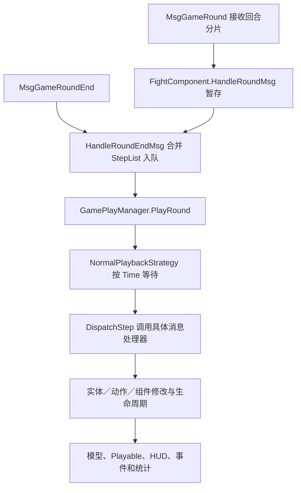

# 战斗执行

[总索引](../README.md)

状态：未完成。已迁移部分官方规则、通用执行器和表现组件；尚未完成原版通用战斗的全部功能、完整 Play Mode 验证及对应 Windows 版本发布。

## 功能简介

本页维护一场战斗共用的会话、阶段、格网、单位、行动队列、技能、命中、伤害／治疗、状态、召唤、胜负输出、HUD、演出和本地检查点。地图入口、剧情、任务、掉落奖励、养成和玩法专属控件由所属页维护；本页只说明它们与通用战斗的接口。

下文先记录原版系统及实现机制，再列出现有 Unity 实现、自定义规则和缺项。“有配置”“有资源”“规则测试通过”分别说明，均不直接等于完整战斗已经还原。

### 官方来源与证据边界

原版机制以 [official-source.json](../../official-source.json) 当前选择的 `871_156598` [客户端与共享反编译代码](../../.tools/source-packages/current/871_156598/official-code/)为主，程序集来源见[当前代码清单](../../.tools/source-packages/current/871_156598/code-manifest.json)。现有战斗配置和大部分资源迁移仍来自固定 APK `854_156383`，对应[历史反编译目录](../../.tools/source-packages/official-code/)、[历史代码清单](../../assets/reference/official-city/code-manifest.json)、[rules.json](../../assets/official/rules.json)、[battle-rules.json](../../assets/official/battle-rules.json)与[skill-rules.json](../../assets/official/skill-rules.json)。不同版本不合并解释。

两版 `Assembly-CSharp.dll`、`Console.dll` 的 SHA256 已与各自清单核对；当前版 `GamePlayManager`、`Common.FightSkillAgentComponent`、`Common.BattleFormulaHandler` 已实际重新反编译并与缓存核对。所选48个入口、消息、回合、技能、命中、伤害、状态和公式源码文件跨版相同；该结论不覆盖全部代码、配置或 prefab。

客户端能证明界面、消息消费、数据结构、共享公式及部分生命周期，不能证明完整服务端裁决已取得。`MyFightAI` 是空包装，`FightAIComponent` 主要保存 `AiType`；随机命中与多个状态触发组件只有配置；`BattleFormulaHandler.InvokeDamagePhaseProcessor` 为空；部分胜负组件仅有标识或空壳。下文的本地补足不作为官方服务器规则。

### 原版战斗系统：功能要素

以下 F01—F43 保留原版通用功能编号，表示还原范围，不表示现有实现已完成。类名相对上述客户端／共享源码根目录。

#### 会话、准备、回合与结束

| 编号 | 原版功能 | 实现入口与机制 |
| --- | --- | --- |
| F01 | 建立、加载与释放 | `FightRoot`、`FightSceneRoot`、`GamePlayManager` 建立上下文和实体容器；场景路径为 `Assets/Prefabs/EcEntity/Fight/FightStage/{sceneID}/{game_scene}`，管理激活、停用和释放。 |
| F02 | 主面板与延迟显示 | `FightMainPanelLoader` 按普通／记录／回放选择面板，消费 `ShowMainPanelDelay`；取消时停止加载并释放，`FightMainPanelExtBehaviour` 提供扩展。 |
| F03 | 战斗阶段 | `GameStatus` 包含 Preparing、PlayStart、Play、Pause、EntryTransition、EntryTransitionFinished、BattleEnd、BattleEndTransition、BattleEndTransitionFinished、End；各模式不一定依次经过全部状态。 |
| F04 | 准备、就绪与自动开始 | `FightMainPanelReadyUI`、`GameTeamReadyCountDownUI` 消费就绪状态、截止时间、自动就绪及打断操作，受 `SkipPrepareStatus/UserStart` 和权限限制。 |
| F05 | 波次、回合与上限 | 波次生成、个人回合、全局回合分别管理；`GameProgressUI` 消费 `MaxRound/IsPlayerRoundLimit/PlayerRoundLimit`，临近上限改变文字和动画。 |
| F06 | 胜负、结束与交接 | 怪物死亡、玩家死亡、守护失败、决斗失败等有不同结果组件；公共层输出结果、播放结束演出并清理，外部玩法接收结果。 |
| F07 | 离开与后台切出 | `FightMainPanelLeaveHandler` 与 `FightMainPanelSwitchOutBtnUI` 根据阶段、身份、观战／录像状态及 `LeaveInPreparing/LeaveInPlaying/Background` 处理确认、离开或切出。 |

#### 格网、站位、移动与目标

| 编号 | 原版功能 | 实现入口与机制 |
| --- | --- | --- |
| F08 | 场地、阵型与占格 | `FightSceneInfo`、`MyFightGridGround`、`MyFightRoleGrid`、`GridMoverComponentInfo` 保存坐标、高度、身体占格、地形／边阻挡、出生偏移、方向与翻转；通行掩码按单位消费。 |
| F09 | 准备阶段拖拽 | `PrepareBattlePlayerDrag/Base` 校验阶段、改站位权限、阵营、就绪及控制权；处理拖拽阈值、射线到格网、最近合法格、占位冲突、失败回退和拾起／放下演出。 |
| F10 | 可调整区域与控制权 | `ChangeBattlePosHandler` 使用可调整范围、阵营出生列表和队伍偏移；偶数尺寸做半格中心修正，自己／所属 NPC／其他成员的控制与交换权限不同。 |
| F11 | 中途加入站位接口 | `ChangePosHandler`、`PrepareBattlePlayerSoulDrag` 根据 `JoinInMiddle` 和加入权限预览并提交合法位置；属于受条件控制的公共扩展。 |
| F12 | 寻路与技能位移 | `AStarUtils`、`MyFightGridMover`、`MyFightActionSkillMove` 使用 MoveDist、MoveMask、占格、路径、时长和朝向；`SourceMoveList` 与受击 `MoveCfg` 另带延迟、条件、动作类型及方向。 |
| F13 | 目标关系与施法方式 | `HitTargetType` 区分敌友、自己、主人、召唤物等；`SkillTargetType` 区分点、实体、可站立点、方向、跟随和锁定。范围按近到远保存，动作类型与 `state_mutex` 约束可行动作。 |
| F14 | AI、嘲讽与混乱 | `AiPriorityId/LastAiPriorityId` 引用策略列表，另有属性最值、角色类型分组、忽略状态和控制下可释放标记；完整评分器与 `AiType` 默认决策未取得。 |
| F15 | 点击单位详情 | `FightRoleClickInput` 及派生类校验查询条件后打开详情或回调；普通点击与技能图标不能据此解释为手动攻击入口。 |

#### 技能、命中、状态与召唤

| 编号 | 原版功能 | 实现入口与机制 |
| --- | --- | --- |
| F16 | 技能装配与属性 | 玩家／怪物技能提供者装配技能物品、实体、等级、品阶、属性、CD、被动及来源；`FightSkillAgentComponent` 创建实际技能数据。 |
| F17 | 消耗、CD 与次数 | `CostType/MustHaveValidCost/ResetCDAtStart/LimitedTimes/ResetReleasedTimeOnNextWave` 控制消耗与次数；状态可修改、永久减少或停止 CD。 |
| F18 | 动作与实例生命周期 | `ActionDuration`、`Duration` 及等待自身／全部 Hit、Move、Damage、child Skill 结束的时长分别生效；负值可表示不自动结束，另有中断通知。 |
| F19 | 额外技能、重放与子技能 | `FightSkillExtSkill`、`FightSkillReplayCfg`、`ReplayMaxCountEachRound`、子技能／状态白名单控制来源、条件、次数及递归；废弃 `ExtSkill` 不作为现行入口。 |
| F20 | 命中图与锚点 | Fixed、NormalNext、Chained、RandomTarget、CustomTarget、TriggerSkill 等组件组合命中图；保留范围格、跟踪、延迟、距离延迟、临时属性、忽略 AI 计数与附加效果。 |
| F21 | 伤害、治疗与反馈 | 共享公式计算基数、攻防、等级／境界、元素、职业／类别、暴击／格挡、衰减等；结果区分 HP、护盾、绝对伤害和类型标记，表现另有零伤害／隐藏飘字开关。 |
| F22 | 状态生命周期 | `FightStatusComponentInfo/Implement` 处理计时对象／时点、无限持续、平行／新顶旧／旧顶新、可驱散、叠层／叠时及上限、同来源条件、属性快照、死亡禁用与复活重启。 |
| F23 | 状态事件与触发条件 | 开始／结束、个人／全局回合、行动、技能、命中／受伤、死亡／击杀、层数变化分别触发；另有条件检查、转移、移除、持续变化、累计伤害和自定义伤害。 |
| F24 | 控制、属性与防护 | 属性变换、行动条、HP 条件／限制、CD、重放、普通／持续／一次性／无敌护盾分组件处理；韧性有破韧状态、技能、伤害与恢复，多层血量由 `HpPliesId` 按等级装配。 |
| F25 | 召唤与附属单位 | 怪物、宠物、格子物件、智能格子物件、替身等召唤保留来源／主人、属性继承、生成、数量、存活与销毁关系；不等同普通波次生成。 |

#### HUD、详情与公共控件

| 编号 | 原版功能 | 实现入口与机制 |
| --- | --- | --- |
| F26 | 进度与时间轴 | `GameProgressUI` 显示回合／上限；`GameRoundUI/GameRoundCharacterItem` 处理 NextTime 队列、间距、真实头像、阵营、主角色标识及行动／受击／死亡／插入移除动画。 |
| F27 | 名称、血条与死亡标识 | `GamePlayerHUD` 绑定名称；生命和盾由 `GameCharacterHpUI`、`FightRoleFightHpView`、`BattleHpAndShieldHandle` 等消费。世界浮条与 `PlayerBattleHpBar` 等目标／成员面板分别绑定。 |
| F28 | Boss 栏、多层血量与韧性 | `FightMainPanelBossUI` 最多显示两个存活、敌方视野内 Boss；子项绑定名称、头像、状态、多层 HP／盾及平滑，韧性最大值为0时隐藏。 |
| F29 | 单位状态与详情 | `FightStatusController` 池化图标，响应应用、结束、禁用、层数、回合、自定义计数；保留排布与详情输入。 |
| F30 | 阶段状态与说明 | `FightMainPanelStageStatus` 汇总阶段、自定义及实际状态并去重，消费显示黑名单，点击 `FightStageStatusDialog` 展示明细。 |
| F31 | 技能槽、详情与宠物能量 | `GameSkillIcon` 有 Ready、Applied、InCD、Ended、LimitedTimes、ProfessionLimit、Disabled；宠物／辅助技能另有品质、能量、放电和无宠物占位。常规槽 `DebugBtn` 不作正式施法按钮。 |
| F32 | 准备阶段方案入口 | 准备时可先取消就绪，再打开方案；处理职业不匹配、禁用、宠物提示和忽略分支，切换后刷新战斗快照。方案编辑由[技能页](skills.md)维护。 |
| F33 | 倍速、档位与锁定 | `FightMainPanelSpeedUI` 按条件及身份生成可用档位，文案与倍率分离；回放／联网切换路径不同，结束或停用复位时标。 |
| F34 | 快进 | `FightMainPanelFastForwardUI` 处理功能与阶段门槛、权限、延迟、防重、请求／本地执行、失败提示和复位；独立于倍速。 |
| F35 | 跟随／自由镜头 | `FightMainPanelCameraUI` 受准备阶段、默认锁定、观战和扩展行为控制，改变实际镜头模式。 |
| F36 | 托管与背包入口 | `FightMainPanelHostingUI/BagUI` 处理显示条件、状态、弹窗和红点；入口存在不证明允许战斗中任意换装或使用物品。 |
| F37 | 录像、回放与跳过 | 保存意愿、记录流、回放和剧情可跳过信号各有入口；录像不等同活动战斗的检查点恢复。 |
| F38 | 观战、聊天与扩展接口 | 公共面板可切换观战对象、对应技能提供者和聊天入口；具体模式扩展、离线保留／关闭／替代方案由所属页维护。 |
| F39 | 战报与统计 | 报告提供者按配置选择个人／全员；角色与技能页展示施放／命中、每目标平均次数、伤害、治疗、护盾、状态次数及占比。 |

#### 模型、场景、演出与资源

| 编号 | 原版功能 | 实现入口与机制 |
| --- | --- | --- |
| F40 | 单位与复合外观 | `MyFightRoleCharacter/PlayerAnimatorAppearance` 绑定职业、装备、武器、皮肤及各类单位模型，保留骨骼、网格、贴图、挂点、尺寸、方向和层序。 |
| F41 | 生成、移动与动作 | 单位、技能、命中和伤害 Playable 分别处理生成、移动、施放、受击、死亡、复活与召唤，保留可见性和动作结束后的清理。 |
| F42 | 特效、范围、飘字与声音 | 命中范围、来源到落点、跟踪／弹道、偏移、延迟、材质、粒子、声音和飘字均由实际配置与 Playable 驱动。 |
| F43 | UI 层级与生命周期 | `FightMainPanel` 动态装配控件、订阅并解绑事件；保留原坐标、锚点、字体、遮罩、滚动、按钮命中、旋转和动画，Windows 适配须同时核对缩放与真实输入。 |

### 原版实现机制

#### 数据对象与关系

原版分为规则／状态、过程消息、Unity 表现三层。`Common.EcEntity/EcComponent` 保存逻辑与数据；`MyEntity/MyComponent` 将逻辑对象绑定到 GameObject、Playable 和 UI。

| 对象 | 核心内容与关系 |
| --- | --- |
| 会话与场地 | `StageInfo/FightComponent/FightSceneInfo` 保存阶段、模式、阵营、波次、上限、开关、坐标与格网。 |
| 单位与回合 | `FightRoleFightComponent` 保存属性与生命；`FightRoundComponent/Driver` 保存个人回合、PreTime、NextTime、当前行动者；召唤另有主人关系。 |
| 技能与命中 | 技能物品经 `SkillInfo.EcEntityId` 定位模板；实例保存来源、目标、方向、技能属性，命中再展开范围与子命中。 |
| 结果与状态 | 伤害结果同时关联 `SkillId/HitId/TargetId/SkillSrcEntityId`；状态另有创建者、持有者、计时者、来源技能和生命周期。 |
| 表现与记录 | `MyFightSkill/HitBase/Damage/Status` 消费实例与事件，驱动模型、HUD、音频、统计和录像。 |

一次技能可生成多个命中，每个命中再生成多个目标结果；技能、动作、命中、伤害、状态并不共用一个结束时点。

#### 初始化与过程消息

`FightRoot.Awake` 建立上下文、规则、生命周期、离开、BGM、Playable、位置和称号处理器。`FightLifecycleHandler.Init` 的可见顺序为：初始化 `GamePlayManager` → 激活容器并绑定已有逻辑实体 → 全局 Playable → 主面板 → 时间同步 → 飘字／掉落表现 → 初始化事件；之后 `FightRoot.Init` 再校对位置并触发称号。



`FightProcessStepMsg` 保存类型、载荷和相对回合 Time。普通播放按 `max(0, step.Time - (Time.time - roundStartTime))` 等待，并保留列表顺序；同刻步骤不重新排序。`DispatchStep` 经 `Network.GetMsgListener` 分发。

`MsgGameEntityAdd` 对动作调用 `ActionAgent.StartAction`；对伤害先进入待创建队列并调用 `OnAddInClient` 发出命中／受伤预通知，其余实体直接加入容器。随后才执行实例生命周期和表现。证据：[消息处理](../../.tools/source-packages/current/871_156598/official-code/common-source/MsgGameEntityAdd.cs)、[播放器](../../.tools/source-packages/current/871_156598/official-code/client-source/GamePlayManager.cs)、[普通策略](../../.tools/source-packages/current/871_156598/official-code/client-source/NormalPlaybackStrategy.cs)。完整服务端步骤生成循环不在这条已取得链路中。

#### 行动队列、技能与命中

`FightRoundDriverComponent` 的链表按 NextTime 升序插入；严格使用 `已有.NextTime > 新.NextTime`，相等者排在已有同刻项之后。当前行动时间取行动者 NextTime；重置时 PreTime 为0，NextTime 为个人间隔。`BattleFormulaHandler.SpeedToTime` 的公式是：

```text
行动间隔 = 100000 / sqrt(max(1, Speed) × 境界 SpeedScale)
```

属性速度与播放倍率分别处理。队列代码不能单独证明服务端如何产生全局回合或选择动作。

`FightSkillAgentComponentImplement.EquipSkill` 按技能物品、实体、等级／品阶和来源属性初始化。`FightSkillComponentImplement.Start` 依次处理可见消耗、关联技能管理器、翻转、次数与 LastRound、开始事件；End 和 Interrupt 分别通知结束与中断。战斗内 CD 提供者使用个人回合，非行动期间先加1，计算 `min(CD, CD - (round - LastRound) + 1)`；方案预览提供者返回0，不作执行依据。

`SourceMoveList` 按 Delay 排序。命中图保留来源／目标锚点、范围、跟踪和后继分支，最终延迟为 `Delay + dist × DelayDistFactor`；动作时长、实例时长及等待相关实体结束分别计算。`FightDamageComponentInfo.TriggerExistStateCfg` 明确“触发现有状态在上新状态之前”，其余缺失的跨组件时序不能据字段名补造。

#### 数值结算、状态与胜负

[BattleFormulaHandler](../../.tools/source-packages/current/871_156598/official-code/common-source/Common/BattleFormulaHandler.cs) 先后判定致盲、闪避、格挡；格挡成立时不暴击，否则判暴击。`RandomJudge` 直接比较随机数 `<= rate`，不额外截断概率。致盲／闪避／免疫分支直接返回0。

伤害按官方顺序处理有效防御、基数／系数／固定值、`Attack/(Attack+Defence)`、固定增减伤、元素与精通／抗性、百分比与职业／类别、最终缩放、暴击／格挡、非 PvP 等级差、适用战力压制与料理、目标类别最终缩放、失血／最大HP、距离／大型目标、状态、境界／阶段境界修正及元素克制等分支；治疗另按最大HP／攻击等基数、治疗／受疗修正和最终缩放计算。属性原值为 long，仅 Float 属性除以10000；伤害为负、治疗为正，整数截断位置须保留。

公式输出与实际 HP 损失不同。`DamageResultParameter` 分开保存 DamageValue、ShieldValue、AbsoluteDamage；`FightDamageComponentImplement` 将 HP 限制在0至上限并求实际差值。`OnAddInClient` 先预通知，Start 再写 HP，不重复扣血；护盾承受量不能直接算作 HP 损失。

状态按 Creator／Applicator／主人等对象及回合开始／结束计时，叠层、叠时、共享计数、属性缩放和通知分开处理。回合、行动、技能、命中、死亡等各有事件组件；配置存在不代表服务器订阅、重入、触发限额和顺序已取得。召唤需维护主人及生命周期；`GameCharacterType.NotCheckFightResult` 表明部分附属单位不参与胜负。完整胜负谓词和奖励执行器仍未取得，不能统一按画面上所有单位 HP 判定。

#### 演出、倍率、快进与录像

`MyFightSkill` 按方向选 Playable 并传入来源／目标，中断时停止；`MyFightHitBase` 分开处理命中、范围及来源到落点；`MyFightDamage` 先尝试 Common，再按格挡→暴击→普通反馈并叠加状态效果；`MyFightStatus` 独立处理开始、层数与触发演出。

固定版 `game_settings.Battle` 的倍率为 `[1, 1.5, 2, 2.5]`，按钮文案为 `[1, 2, 3, 4]`；可用档位仍受 `PlayModeSpeeds` 和条件约束。默认 Type0 仅配置索引0／1／2，后两档分别要求条件3005／144；回放 Type12 配置四档且默认索引0。`RoundCountDown=5`、`GameMaxRound=10000` 是提示与兜底，不能覆盖阶段上限；快进解锁延时为1秒，默认锁定镜头为 true。`GamePlayManager.UpdateTimeScale` 在准备阶段恢复1，播放及部分过渡阶段应用战斗速度；声音另走 Wwise RTPC，不能仅凭 Pause 枚举推定完整暂停行为。

录像复用步骤等待链路，队列空时结束。官方快进策略只分发 `GAME_MODIFACTION_RUN_BATTLE_END`、`GAME_MODIFACTION_RUN_END`、`GAME_FASTFORWARD`，依靠结果／快照收束；它与提高倍速、逐条快速执行普通伤害、后台切出和检查点续战各有边界。

## 完整还原部分

以下列出已迁移的官方算法和可复用子项，并明确现有接线边界。涉及服务端缺口的决策见“自定义实现”；本节不将部分执行器或 UI 资源认定为整场战斗完整还原。

### 现有规则与执行器

| 子项 | 当前实现 | 主要入口 |
| --- | --- | --- |
| 官方数值函数与实际 HP 结算 | 已迁移伤害／治疗、命中类型、效果率、速度间隔、衰减、破韧等共享公式及 HP 上下限／实际差值；保留官方分支与截断。未取得的自定义伤害阶段钩子不在其中。 | [FightDamageFormula](../../unity/Assets/Game/Runtime/Official/Combat/FightDamageFormula.cs)、[FightDamageResolver](../../unity/Assets/Game/Runtime/Official/Combat/FightDamageResolver.cs)、[FightDamageSettlement](../../unity/Assets/Game/Runtime/Official/Combat/FightDamageSettlement.cs)、[FightResilienceFormula](../../unity/Assets/Game/Runtime/Official/Combat/FightResilienceFormula.cs) |
| 配置装配 | 本地 JSON 装配单位、技能、命中图和状态；技能物品映射实体，技能／被动属性按等级与数值表计算；`LevelPropParser.TryGetPropDict` 的73条默认属性配置已从 APK 重新解码，缺键才补默认值，保留显式值，避免技能伤害倍率和状态数值丢失；CD 按官方属性计算。 | [FightOfficialCombatCatalog](../../unity/Assets/Game/Runtime/Official/Combat/FightOfficialCombatCatalog.cs)、[FightOfficialSkillItemCatalog](../../unity/Assets/Game/Runtime/Official/Combat/FightOfficialSkillItemCatalog.cs) |
| 行动队列与技能状态 | 已接速度／NextTime 队列、个人／全局上限、初始 CD、HP 消耗、次数上限、换波重置及停止 CD；完整施法资格和服务器调度未取得。 | [FightTurnQueue](../../unity/Assets/Game/Runtime/Official/Combat/FightTurnQueue.cs)、[FightSkillState](../../unity/Assets/Game/Runtime/Official/Combat/FightSkillState.cs)、[FightStatusCooldownRuntime](../../unity/Assets/Game/Runtime/Official/Combat/FightStatusCooldownRuntime.cs) |
| 格网与目标过滤 | 四方向 AStar、MoveMask、占位／边阻挡、可达路径、技能范围顺序、阵营／存活／可选中和动作互斥过滤已接入。身体占格已有数据与部分判定，高度和完整阵型仍未全部消费。 | [FightBattleGrid](../../unity/Assets/Game/Runtime/Official/Combat/FightBattleGrid.cs)、[FightBattleTargeting](../../unity/Assets/Game/Runtime/Official/Combat/FightBattleTargeting.cs) |
| 波次与命中基础 | 未生成波次不入队、不选中、不占位，清场后生成下一波；固定／后继／链式／随机等命中配置进入收集器，范围、锚点、距离延迟及主要类型标记进入事件。随机分配和未覆盖配置见后文。 | [FightBattleHitCollector](../../unity/Assets/Game/Runtime/Official/Combat/FightBattleHitCollector.cs)、[FightBattleHitExecutor](../../unity/Assets/Game/Runtime/Official/Combat/FightBattleHitExecutor.cs)、[FightBattleExecutor](../../unity/Assets/Game/Runtime/Official/Combat/FightBattleExecutor.cs) |
| 状态基础生命周期 | 计时对象、开始／结束时点、无限持续、平行／新顶旧／旧顶新、叠层／叠时上限、到期及对象销毁清理已实现；属性变换与持续／一次性／无敌护盾已有结算。完整来源约束、共享层数与事件体系仍有缺项。 | [FightStatusLifecycle](../../unity/Assets/Game/Runtime/Official/Combat/FightStatusLifecycle.cs)、[FightStatusPropertyRuntime](../../unity/Assets/Game/Runtime/Official/Combat/FightStatusPropertyRuntime.cs) |
| 阶段机与会话接口 | 已接 Preparing→StartGameBtn→PlayStart→Play、可选截止时间、一次性自动开始、Play/Pause、BattleEnd 和释放 End；无截止时间保持等待，`SkipPrepareStatus` 才跳过准备。主面板按 `ShowMainPanelDelay` 延迟挂载，释放取消等待；准备时调用方暂停推进规则。组队就绪、拖拽及入场／结束演出仍未贯通。 | [FightBattlePhaseMachine](../../unity/Assets/Game/Runtime/Official/Combat/FightBattlePhaseMachine.cs)、[OfficialBattleRuntimeController](../../unity/Assets/Game/Runtime/Presentation/Combat/OfficialBattleRuntimeController.cs) |

通用执行器的 `Begin/Restore/Step` 已连接本地状态、随机流、序列／计数回执、波次、技能、状态和统计；重复步骤返回已有回执。检查点按版本化 JSON 保存单位属性／技能／状态、格网、队列、随机流、步骤事件和统计，并在恢复时校验。这是离线适配，不是原版录像服务器的复刻；入口何时保存、恢复或清除由调用方负责。

### 已接入的效果与表现

| 子项 | 当前实现与边界 |
| --- | --- |
| 命中效果 | 已接附加状态、随机单条状态、概率／HP 条件、驱散、来源／受击位移、吸血，以及额外施放、状态层数重放和受击者子技能；目前额外／重放／子技能各限一层。动作0不扣 HP，治疗动作／治疗技能走 Cure，其他动作分类不直接关闭配置伤害。带复活组件的状态24233可将 HP 设为1，复活事件消费者尚未迁移。 |
| 已覆盖状态触发 | HP 阈值组件可施加状态／技能；25256 在施加者回合开始触发12980，25177 在主人回合结束触发50180；24440／24476 在技能开始触发12520／12580；25011／60840 在技能结束按计数施加状态。仅覆盖当前支持的来源、目标和简单过滤，不能代表全部事件组件。 |
| 冷却、韧性与生命层 | 已有 CD 修改／永久减少／停止、韧性初始化、破韧状态／技能／附加伤害／个人回合恢复，以及按等级装配 `HpPliesId`。部分触发与参数绑定依赖本地规则，见下文。 |
| 怪物召唤 | 已按命中配置创建怪物，装配属性、被动状态／技能、主人、占位、队列、检查点和模型模板，部分条件技能使用各自召唤池容量；完整属性继承、寿命及销毁联动仍缺。 |
| 阶段状态 | 读取阶段状态及按角色类型／职业／目标配置、全局／阵营周期状态；显示列表按官方并集去黑名单。阶段状态到单位的应用是本地适配，动态说明仍不完整。 |
| 通用场景接口 | `Begin` 接收检查点、格网映射、技能／头像／模型／动作／朝向解析器；`Advance` 执行后刷新场景与 HUD，发布步骤、控件和速度事件。未生成波次延迟创建模型；同一步多段路径连续播放，消费动作时长／速度，缺省战术移动暂用0.5秒每格。 |
| HUD 与倍率 | 已恢复30个 HUD／飘字 prefab 子集及对应 sprite／字体／节点资料，接入回合、NextTime 时间轴、技能图标／CD／次数／职业标记、单位状态和阶段状态弹窗。倍率读取官方表与条件，经 `Time.timeScale` 生效、释放复位；回放默认档、身份差异和声音同步未完整接入。 |
| HP、盾与 Boss 栏 | 已有世界 HP／盾／韧性／状态显示；Boss 最多两栏，接入多层 HP、护盾 Sprite／颜色、层数、官方平滑参数和韧性。当前 Boss 敌方视野以波次生成近似，名称／真实头像及完整条件仍待核对与运行验证。 |
| 模型、场景与动作 | 已有官方怪物模型目录、原生采样网格动画及部分角色 Animator／clip 绑定，支持部分待机、路径移动、施放、受击／格挡、死亡及结束清理；战场基础／昼夜几何和贴图已有显式加载。完整复合外观、精确 Playable、相机、环境、材质和音频未完成。 |
| 动画参数与映射 | 已接部分官方技能 Playable 的 Animator 参数、前置状态、层权重和 clip override；启用 `myEndResumeParam` 时按叠加栈恢复，但现有固定参数 cue 未启用该标志，恢复分支仅有通用测试。clip 覆盖按官方语义保留至 controller 释放；序列精确停止／中断和淡入淡出待接。无可用技能动作映射按已确认方案保留当前动作。 |
| 飘字 | 已接普通／暴击／格挡／治疗／深渊、免疫／闪避／致盲、HP 消耗、重置 CD、CDModify、Unflinching，使用官方节点、字体、颜色、文案、可转换曲线及同目标堆叠参数。合并、状态来源、驱散、盾量和元素克制反馈仍缺，实际画面未整体验证。 |
| 事件与战报数据 | 每次命中记录来源／目标／技能／命中身份、类型、延迟、盾量、绝对伤害和 HP 前后值；统计单位／技能的施放、命中、伤害和治疗，取实际 HP 差值。`FightBattleReportBuilder` 可生成数据，已提取报告资源仍未绑定成可操作战报。 |

代码入口：[通用执行器](../../unity/Assets/Game/Runtime/Official/Combat/FightBattleExecutor.cs)、[状态触发](../../unity/Assets/Game/Runtime/Official/Combat/FightStatusTriggerRuntime.cs)、[阶段状态](../../unity/Assets/Game/Runtime/Official/Combat/FightStageStatusRuntime.cs)、[韧性接线](../../unity/Assets/Game/Runtime/Official/Combat/FightBattleExecutor.Resilience.cs)、[检查点](../../unity/Assets/Game/Runtime/Official/Combat/FightBattleCheckpointSerializer.cs)、[统计报告](../../unity/Assets/Game/Runtime/Official/Combat/FightBattleReportBuilder.cs)、[场景表现](../../unity/Assets/Game/Runtime/Presentation/Combat/OfficialBattleSceneView.cs)、[HUD](../../unity/Assets/Game/Runtime/Presentation/Combat/OfficialBattleHudView.cs)。规则、资源与运行目录分别为 [Assets/Official/Combat](../../unity/Assets/Official/Combat/)、[Resources/Combat](../../unity/Assets/Game/Resources/Combat/)、[StreamingAssets/Combat](../../unity/Assets/StreamingAssets/Combat/)；来源与转换约束统一见[素材管理](../asset-management.md)。

战斗 HUD 的30个原 prefab 已补取404项 Graphic／CanvasGroup 输入标记及3项初始可见性引用；按官方 `SafeArea` 恢复主面板适配，按 `ChatQuickMsgEntryPanel.OnEnable` 和 `GameMatchMiniPanel.RefreshUI` 关闭初始表情面板、无冷却遮罩和无会话匹配内容，并迁移 `NoDrawingRayCast`。输入绑定见[来源清单](../../assets/reference/battle-hud/graphic-bindings-source-manifest.json)，阶段与代码来源见[会话清单](../../assets/reference/battle-hud/session-source-manifest.json)。这些初始化分支不代表聊天、匹配和整个 HUD 已迁移完毕。

已从当前官方中文语言资源提取5149条战斗相关名称／说明供核对技能、秘法与状态规则，保留原键、富文本和缺键；[文字清单](../../assets/reference/battle-rules/text-source-manifest.json)单独记录 `871_156598` 输入，未把它冒记为历史配置版本。运行载荷为 `Assets/Official/Combat/battle-texts.json`，技能／状态详情弹窗的交互与加载绑定仍待完成。默认属性的 APK 输入、解析源码、输出与哈希见[属性默认值清单](../../assets/reference/battle-rules/prop-defaults-source-manifest.json)。

### 验证范围

已有规则回归覆盖公式固定样例、配置装配、队列／阶段、范围／移动／延迟、状态／CD／盾／韧性、触发技能、波次、统计与检查点往返；主要入口为 [test_unity_combat.ps1](../../scripts/test_unity_combat.ps1) 及 `scripts/test_battle_*.ps1` 的对应通用套件。规则检查还可由 [FightCombatValidation.RunSmokeTest](../../unity/Assets/Game/Runtime/Official/Combat/Editor/FightCombatValidation.cs) 和 `Zjcs.Editor.ProjectTools.Validate` 执行。已完成的规则测试证明对应代码分支，不证明缺失服务端流程已被复刻。本页链接、功能编号与差异格式已核对，`python -B scripts/check_unity_project.py` 静态元数据检查通过；上述文档检查不扩大战斗规则或运行验证结论。

本次97组公式与核心检查、35个战斗专项脚本、静态元数据检查，以及 Unity 2022.3.57f1c2 导入／编译和 `Zjcs.Editor.ProjectTools.Validate` 均通过；单人准备的 Play Mode 使用 Windows SendInput 发送鼠标移动／按下／抬起，核对实际输入状态和射线命中，成功从准备进入 Play、首步 Counter=1、伤害事件=2，并检查官方技能图标、怪物行动头像、回合文字、倍率权限和暂停恢复。此测试使用隔离存档和简化角色载体，查看了准备／运行截图；角色白块、未填充的技能栏和镜头／战场表现仍有问题，不能宣称画面完整还原。检查点序列化有专项回归，实际退出重启恢复与 Windows Player 尚未覆盖。

HUD 曾完成隔离导入和 prefab 组件树检查；部分素材／动画转换及绑定有独立回归。通用战斗尚未完成完整 Unity Play Mode 真实输入、画面、状态和重启恢复验证，也没有与该完整功能对应的 Windows Player 完成发布。全工程编译与构建状态见[Unity 工程与启动流程](unity-project.md)，不在本页维护其他模块编译错误或地图运行记录。

## 自定义实现

以下区分“缺少服务端执行代码后的本地补足”和“离线运行所需的技术适配”。它们已在现有执行器中使用，但不能据官方配置或测试通过称为官方完整规则；新增差异仍须取得证据或用户确认。

### 因服务端代码缺失采用的本地规则

| 范围 | 现有本地规则及依据缺口 |
| --- | --- |
| 回合裁决与无技能移动 | 个人回合从左到右检查技能，每槽最多主动一次，每招使用完整 MoveDist，移动／伤害／被动／死亡后重评；无可释放技能不伪造普攻，在合法可达格中选择距最近敌人最远的曼哈顿落点。官方有队列和参数，未取得完整回合／移动决策循环；以上按已确认单机规则执行。 |
| AI 与控制状态 | 使用官方40组策略、候选、范围与过滤字段，本地按列表确定性比较；嘲讽优先状态来源，混乱放行技能可忽略阵营。评分方向、权重、位置搜索及 `AiType` 默认策略没有服务器实现依据，8种近似策略见下表。 |
| 随机命中 | 根据范围、最小命中、禁止重复目标／空格／同格及越界标记，在可选格中确定性分配子命中；空格可消耗分配但不生成伤害／召唤。候选分配与取随机数的原服务器顺序未取得。 |
| 技能资格、条件与消耗 | HP／回合／召唤池等已出现条件由检查点判断，部分条件召唤按配置池容量限制；CostType=2 暂消耗全部持久护盾并记录为 SkillCost，关联伤害类型6以该消耗值结算。官方前置资格执行器不全；未配置或未识别条件不擅自按枚举补全。职业不匹配保留官方 HUD 标记，因未取得拒绝释放入口，不另加释放禁令。 |
| 状态应用概率与参数 | 按 `AffectedByProp`、角色类型覆盖及官方 EffectRate 接线，保留公式加减项；固定概率不套用该属性修正。`SkillCostHp` 取实际技能扣血，`DamageCostHpPer` 取本次实际 HP 损失乘比例并截断、排除护盾；同时启用时本地优先前者。命中附加状态已接 `FightStatusAgentRateComponent`：按动作／状态类型筛选，读取官方属性数值，独立效果乘算；潮湿使冰冻／霜缚概率×1.3，异常状态抵抗使异常状态概率×0.5。依据配置、官方说明及已确认乘算方案补足，未取得服务器实现；触发技能概率和其他状态路径仍待接线。 |
| 驱散、位移与方向 | 驱散／位移的属性概率使用通用 EffectRate，不套用不存在类别字段的减益倍率；`SkillTargetDistanceMoveCondition` 暂按曼哈顿距离≤配置值执行，未知类型拒绝。路径侧移暂按横向先+Y后−Y、纵向先+X后−X，斜向按较大轴、同值按横向，各侧递减距离找合法格。缺省 `MoveBehaviourId=0` 仍按配置移动，互斥规则未证实。 |
| 吸血 | 扩展吸血按本次实际 HP 损失计算并封顶最大HP，缺失属性不回血，治疗不再产生吸血；比例属性暂按10000基准解释，该属性的百分比表依据缺失。 |
| 状态事件与触发顺序 | 已支持配置按本地事件点立即执行，保留明确回合时点；HP 累计只计实际 HP 损失、治疗不冲减，跨多个阈值重复触发并保留余数。额外／重放／子技能限一层，复杂来源、条件、延迟和重入尚未完整恢复；不将局部触发顺序推广为官方全局顺序。 |
| 衰减与计数 | 同目标衰减独立计数、整体衰减跨目标累计，首击计数1且不减伤，明确配置的起始次数仍按配置；子技能沿用父施放编号，行动结束清理。命中后新附状态补记首击为本地接线，未取得完整服务端计数调度。 |
| 特殊减伤 | 状态24181按用户补证先减伤再扣盾／HP，单次伤害严格超过最大HP的4%时读取232号属性，每层减一段并消耗一次。`FightStatusDamageReducePerComponent` 的概率／条件计数／互斥及治疗缩放按配置近似，近远暂以曼哈顿1格划分；未识别逻辑标签／属性替换不执行。 |
| CD、破韧与自定义动作 | CD修改本地更新 LastRound，永久减 CD 按支持的触发路径执行一次；破韧暂用命中 rate=1、技能 DamageParam 作缩放，并接组配置、触发技能与个人回合恢复。Unflinching 暂在实际 HP 伤害后按配置概率触发，盾吸收／治疗／未命中不触发；这些服务端调用点和参数绑定未完整取得。 |
| 阶段状态与胜负 | 缺独立阶段实体时，阶段级状态暂施加给全部单位；Boss 视野暂按波次已生成过滤。执行器现有清场／玩家死亡／回合超时结果仅供当前本地会话，不覆盖全部结果组件；守护、决斗等完整胜负谓词仍待取得或确认。 |

8种 AI 近似的实际含义如下，均未验证为官方评分：

| 策略 | 当前本地比较 |
| --- | --- |
| `SaferPos` | 投影最近施法格，优先2格内其他敌人较少者，再比较最近敌距。 |
| `PriorTargetEntityPos` | 优先单位上次成功施法的首个目标 ID。 |
| `ShorterEnemyTargetPosDistAndSameDir` | 优先当前朝向轴上的目标，再比较最近施法格的曼哈顿距离。 |
| `PriorBiggerBodyHitCoverage` | 优先命中范围覆盖可选目标身体格数总和较多者。 |
| `PriorRandom` | 每次排序给每个候选生成一次随机键，按键排序。 |
| `StayAwayFromEnemies` | 最近施法格忽略主目标，优先距其他敌人的最近距离更远者，再比较总距离。 |
| `AttachOperateChildSkillFriendHp` | 同阵营优先，再按当前HP／最大HP由低到高。 |
| `ShorterEnemyDistToTargetPos` | 优先最近施法格到其他敌人的最近曼哈顿距离较短者。 |

### 离线技术适配

本地执行器代替运行时网络裁决；随机种子／随机流、步骤序号、重复请求回执和版本化检查点保证本地重放一致。执行与表现分别由 `FightBattleExecutor` 和 `OfficialBattleRuntimeController` 等承担，不将本地序列化当作官方录像格式。战斗结果通过调用方接口交接，外部奖励、任务与进度的事务规则由所属页维护。

动画数据转换为 Unity 原生播放，保留官方贴图、骨骼、网格和已取得动作；缺映射时保留当前动作、缺省战术移动时长和局部资源解析回退属于适配边界。模型目录或 prefab 树恢复不等于原版完整画面；具体方案遵循[Spine 原生迁移决策](../asset-management.md#spine-角色动画迁移决策)。`FightStatusDamageModification.Run` 在本项目暂不使用，未定位原调用点；这不表示官方已弃用该机制。

## 尚未实现

以下为通用战斗缺项；已有局部代码仍保留在上文，不重复标成完全未实现。

| 范围 | 仍需完成 |
| --- | --- |
| 会话与准备（F01—F07） | 单人开始与主面板延迟已接；仍需组队就绪／取消就绪切方案、合法站位拖拽与范围／权限／回退、入场／结束过渡、完整离开／后台条件及确认提示。局部分支通过不能代替完整流程。 |
| 格网与 AI（F08—F15） | 高度、完整身体占格／阵型／出生偏移、未支持位移方向与条件、默认动作互斥、真实点击详情和镜头坐标；补证 AI 评分器、`AiType` 默认策略、嘲讽／混乱边界及所有近似的原版语义。 |
| 调度与技能生命周期（F16—F20） | 当前同一 Step 内同步结算，尚未按每个 Delay 分帧结算、等待相关实体、处理负时长／中断／销毁和完整重入；需恢复技能资格、全部条件、重放限额与子技能／状态白名单，而非仅一层触发。 |
| 命中与数值扩展（F20—F21） | Scope 旋转／逐格延迟／FilterCondition、未覆盖命中组件和临时属性、形态切换、现有状态触发、完整自定义伤害阶段钩子，以及衰减／元素克制聚合等缺失调用语义。 |
| 状态、盾与复活（F22—F24） | 全量状态事件和条件组、来源限制／共享层数／按层属性／快照、死亡禁用与复活重启、转移／持续变化／累计和自定义伤害其余分支；补齐未覆盖护盾类型、控制／HP限制、CD修改触发及韧性联动。 |
| 已确认规则的剩余接线 | `TriggerDamageAddToDamageSource` 按确认方案区分被动与技能效果归因、统计实际生命损失，当前尚未完整落实；技能／秘法效果间的独立外部概率修正应乘算，固定概率不受影响、直接加状态不掷概率，并保留官方 EffectRate 加减项，命中附加状态已接入，触发技能及其他施加路径仍需补齐。 |
| 召唤与胜负（F06、F25） | 宠物／格子物件／智能物件／替身等非怪物召唤、完整继承、数量／寿命与来源死亡销毁、复活事件消费者；按结果组件和参与者标记恢复完整通用判定接口，缺服务器规则时再取证或确认。 |
| HUD 与报告（F26—F32、F39、F43） | 真实玩家／NPC动态头像、名称与显示条件、完整时间轴事件动画、玩家目标／成员血条、Boss 真实视野／头像、单位状态详情／自定义数字／禁用态、技能详情／品质／全部状态、宠物能量、准备提示与方案刷新、阶段动态说明。战报需绑定官方交互面板，补齐被动／状态归因、盾量／状态次数／占比及属性快照。 |
| 公共控件（F33—F38） | 回放默认倍率与档位恢复、权限差异、快进条件／延时／防重／失败及本地快照消费、跟随／自由镜头、托管／背包入口、录像保存／回放／跳过的本地流程。观战／聊天等接口按所属页已确认离线方案接入，不自行新增联网或替代规则。 |
| 画面、动画与声音（F40—F43） | 玩家／NPC／宠物／召唤物复合外观、全部原生动画和精确动作映射、生成／复活／召唤、Playable 停止／中断／淡入淡出、范围／弹道／挂点／层序、原相机和环境、材质／shader／纹理及 CAB 依赖；缺失飘字种类、合并条件、元素提示、Wwise音频与速度同步。未转换或加载失败不视为官方资源缺失。 |
| 运行与交付 | 完成相关规则回归、静态检查、Unity 导入／编译和 `Zjcs.Editor.ProjectTools.Validate`；在 Play Mode 用真实鼠标／键盘检查完整流程、缩放／遮挡、画面／声音、状态和重启续战。功能完成时构建并真实运行 Windows Player，保护已有存档，按项目要求发布对应可执行版本。 |

### 实现概括

| 分类 | 简要结论 |
| --- | --- |
| 已完整实现的规则子项 | 已取得共享公式的迁移、HP 上下限与实际差值、基础队列／CD／状态生命周期子集、检查点序列化已有实现及对应回归；通用战斗整项仍未完成。 |
| 缺服务器代码后的自定义 | 本地回合循环、AI／随机命中、部分资格／概率／状态触发／位移／减伤／CD／破韧接线及局部胜负，按已确认单机方案或明确标出的近似执行。 |
| 仍待实现 | 组队准备与拖拽、逐事件调度、剩余状态／召唤／胜负、完整 HUD／战报／控件、原版角色／Playable／特效／音频，以及 Play Mode 和 Windows 完整运行验证。 |
