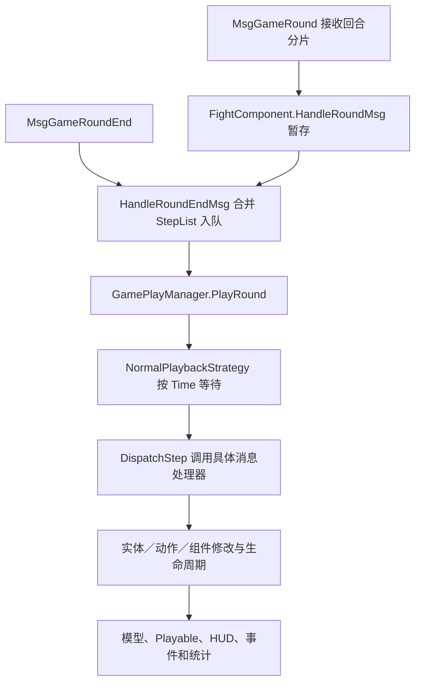

# 战斗执行

[总索引](../README.md)

状态：未完成。已迁移部分官方规则、通用执行器和表现组件；尚未完成原版通用战斗的全部功能、完整 Play Mode 验证及对应 Windows 版本发布。

## 功能简介

本页维护一场战斗共用的会话、阶段、格网、单位、行动队列、技能、命中、伤害／治疗、状态、召唤、胜负输出、HUD、演出和本地检查点。地图入口、剧情、任务、掉落奖励、养成和玩法专属控件由所属页维护；本页只说明它们与通用战斗的接口。

下文先记录原版系统及实现机制，再列出现有 Unity 实现、自定义规则和缺项。“有配置”“有资源”“规则测试通过”分别说明，均不直接等于完整战斗已经还原。

### 官方来源与证据边界

原版机制以 [official-source.json](../../official-source.json) 当前选择的 `871_156598` [客户端与共享反编译代码](../../.tools/source-packages/current/871_156598/official-code/)为主，程序集来源见[当前代码清单](../../.tools/source-packages/current/871_156598/code-manifest.json)。现有战斗配置和大部分资源迁移仍来自固定 APK `854_156383`，对应[历史反编译目录](../../.tools/source-packages/official-code/)、[历史代码清单](../../assets/reference/official-city/code-manifest.json)、[rules.json](../../assets/official/rules.json)、[battle-rules.json](../../assets/official/battle-rules.json)与[skill-rules.json](../../assets/official/skill-rules.json)。不同版本不合并解释。

两版 `Assembly-CSharp.dll`、`Console.dll` 的 SHA256 已与各自清单核对；当前版 `GamePlayManager`、`Common.FightSkillAgentComponent`、`Common.BattleFormulaHandler` 已实际重新反编译并与缓存核对。所选48个入口、消息、回合、技能、命中、伤害、状态和公式源码文件跨版相同；该结论不覆盖全部代码、配置或 prefab。

客户端能证明界面、消息消费、数据结构、共享公式及部分生命周期，不能证明完整服务端裁决已取得。`MyFightAI` 是空包装，`FightAIComponent` 主要保存 `AiType`；随机命中与多个状态触发组件只有配置；`BattleFormulaHandler.InvokeDamagePhaseProcessor` 为空；部分胜负组件仅有标识或空壳。下文的本地补足不作为官方服务器规则。

### 原版战斗系统：功能要素

以下 F01—F43 保留原版通用功能编号，表示还原范围，不表示现有实现已完成。类名相对上述客户端／共享源码根目录。

#### 会话、准备、回合与结束

| 编号 | 原版功能 | 实现入口与机制 |
| --- | --- | --- |
| F01 | 建立、加载与释放 | `FightRoot`、`FightSceneRoot`、`GamePlayManager` 建立上下文和实体容器；场景路径为 `Assets/Prefabs/EcEntity/Fight/FightStage/{sceneID}/{game_scene}`，管理激活、停用和释放。 |
| F02 | 主面板与延迟显示 | `FightMainPanelLoader` 按普通／记录／回放选择面板，消费 `ShowMainPanelDelay`；取消时停止加载并释放，`FightMainPanelExtBehaviour` 提供扩展。 |
| F03 | 战斗阶段 | `GameStatus` 包含 Preparing、PlayStart、Play、Pause、EntryTransition、EntryTransitionFinished、BattleEnd、BattleEndTransition、BattleEndTransitionFinished、End；各模式不一定依次经过全部状态。 |
| F04 | 准备、就绪与自动开始 | `FightMainPanelReadyUI`、`GameTeamReadyCountDownUI` 消费就绪状态、截止时间、自动就绪及打断操作，受 `SkipPrepareStatus/UserStart` 和权限限制。 |
| F05 | 波次、回合与上限 | 波次生成、个人回合、全局回合分别管理；`GameProgressUI` 消费 `MaxRound/IsPlayerRoundLimit/PlayerRoundLimit`，临近上限改变文字和动画。 |
| F06 | 胜负、结束与交接 | 怪物死亡、玩家死亡、守护失败、决斗失败等有不同结果组件；公共层输出结果、播放结束演出并清理，外部玩法接收结果。 |
| F07 | 离开与后台切出 | `FightMainPanelLeaveHandler` 与 `FightMainPanelSwitchOutBtnUI` 根据阶段、身份、观战／录像状态及 `LeaveInPreparing/LeaveInPlaying/Background` 处理确认、离开或切出。 |

#### 格网、站位、移动与目标

| 编号 | 原版功能 | 实现入口与机制 |
| --- | --- | --- |
| F08 | 场地、阵型与占格 | `FightSceneInfo`、`MyFightGridGround`、`MyFightRoleGrid`、`GridMoverComponentInfo` 保存坐标、高度、身体占格、地形／边阻挡、出生偏移、方向与翻转；通行掩码按单位消费。 |
| F09 | 准备阶段拖拽 | `PrepareBattlePlayerDrag/Base` 校验阶段、改站位权限、阵营、就绪及控制权；处理拖拽阈值、射线到格网、最近合法格、占位冲突、失败回退和拾起／放下演出。 |
| F10 | 可调整区域与控制权 | `ChangeBattlePosHandler` 使用可调整范围、阵营出生列表和队伍偏移；偶数尺寸做半格中心修正，自己／所属 NPC／其他成员的控制与交换权限不同。 |
| F11 | 中途加入站位接口 | `ChangePosHandler`、`PrepareBattlePlayerSoulDrag` 根据 `JoinInMiddle` 和加入权限预览并提交合法位置；属于受条件控制的公共扩展。 |
| F12 | 寻路与技能位移 | `AStarUtils`、`MyFightGridMover`、`MyFightActionSkillMove` 使用 MoveDist、MoveMask、占格、路径、时长和朝向；`SourceMoveList` 与受击 `MoveCfg` 另带延迟、条件、动作类型及方向。 |
| F13 | 目标关系与施法方式 | `HitTargetType` 区分敌友、自己、主人、召唤物等；`SkillTargetType` 区分点、实体、可站立点、方向、跟随和锁定。范围按近到远保存，动作类型与 `state_mutex` 约束可行动作。 |
| F14 | AI、嘲讽与混乱 | `AiPriorityId/LastAiPriorityId` 引用策略列表，另有属性最值、角色类型分组、忽略状态和控制下可释放标记；完整评分器与 `AiType` 默认决策未取得。 |
| F15 | 点击单位详情 | `FightRoleClickInput` 及派生类校验查询条件后打开详情或回调；普通点击与技能图标不能据此解释为手动攻击入口。 |

#### 技能、命中、状态与召唤

| 编号 | 原版功能 | 实现入口与机制 |
| --- | --- | --- |
| F16 | 技能装配与属性 | 玩家／怪物技能提供者装配技能物品、实体、等级、品阶、属性、CD、被动及来源；`FightSkillAgentComponent` 创建实际技能数据。 |
| F17 | 消耗、CD 与次数 | `CostType/MustHaveValidCost/ResetCDAtStart/LimitedTimes/ResetReleasedTimeOnNextWave` 控制消耗与次数；状态可修改、永久减少或停止 CD。 |
| F18 | 动作与实例生命周期 | `ActionDuration`、`Duration` 及等待自身／全部 Hit、Move、Damage、child Skill 结束的时长分别生效；负值可表示不自动结束，另有中断通知。 |
| F19 | 额外技能、重放与子技能 | `FightSkillExtSkill`、`FightSkillReplayCfg`、`ReplayMaxCountEachRound`、子技能／状态白名单控制来源、条件、次数及递归；废弃 `ExtSkill` 不作为现行入口。 |
| F20 | 命中图与锚点 | Fixed、NormalNext、Chained、RandomTarget、CustomTarget、TriggerSkill 等组件组合命中图；保留范围格、跟踪、延迟、距离延迟、临时属性、忽略 AI 计数与附加效果。 |
| F21 | 伤害、治疗与反馈 | 共享公式计算基数、攻防、等级／境界、元素、职业／类别、暴击／格挡、衰减等；结果区分 HP、护盾、绝对伤害和类型标记，表现另有零伤害／隐藏飘字开关。 |
| F22 | 状态生命周期 | `FightStatusComponentInfo/Implement` 处理计时对象／时点、无限持续、平行／新顶旧／旧顶新、可驱散、叠层／叠时及上限、同来源条件、属性快照、死亡禁用与复活重启。 |
| F23 | 状态事件与触发条件 | 开始／结束、个人／全局回合、行动、技能、命中／受伤、死亡／击杀、层数变化分别触发；另有条件检查、转移、移除、持续变化、累计伤害和自定义伤害。 |
| F24 | 控制、属性与防护 | 属性变换、行动条、HP 条件／限制、CD、重放、普通／持续／一次性／无敌护盾分组件处理；韧性有破韧状态、技能、伤害与恢复，多层血量由 `HpPliesId` 按等级装配。 |
| F25 | 召唤与附属单位 | 怪物、宠物、格子物件、智能格子物件、替身等召唤保留来源／主人、属性继承、生成、数量、存活与销毁关系；不等同普通波次生成。 |

#### HUD、详情与公共控件

| 编号 | 原版功能 | 实现入口与机制 |
| --- | --- | --- |
| F26 | 进度与时间轴 | `GameProgressUI` 显示回合／上限；`GameRoundUI/GameRoundCharacterItem` 处理 NextTime 队列、间距、真实头像、阵营、主角色标识及行动／受击／死亡／插入移除动画。 |
| F27 | 名称、血条与死亡标识 | `GamePlayerHUD` 绑定名称；生命和盾由 `GameCharacterHpUI`、`FightRoleFightHpView`、`BattleHpAndShieldHandle` 等消费。世界浮条与 `PlayerBattleHpBar` 等目标／成员面板分别绑定。 |
| F28 | Boss 栏、多层血量与韧性 | `FightMainPanelBossUI` 最多显示两个存活、敌方视野内 Boss；子项绑定名称、头像、状态、多层 HP／盾及平滑，韧性最大值为0时隐藏。 |
| F29 | 单位状态与详情 | `FightStatusController` 池化图标，响应应用、结束、禁用、层数、回合、自定义计数；保留排布与详情输入。 |
| F30 | 阶段状态与说明 | `FightMainPanelStageStatus` 汇总阶段、自定义及实际状态并去重，消费显示黑名单，点击 `FightStageStatusDialog` 展示明细。 |
| F31 | 技能槽、详情与宠物能量 | `GameSkillIcon` 有 Ready、Applied、InCD、Ended、LimitedTimes、ProfessionLimit、Disabled；宠物／辅助技能另有品质、能量、放电和无宠物占位。常规槽 `DebugBtn` 不作正式施法按钮。 |
| F32 | 准备阶段方案入口 | 准备时可先取消就绪，再打开方案；处理职业不匹配、禁用、宠物提示和忽略分支，切换后刷新战斗快照。方案编辑由[技能页](skills.md)维护。 |
| F33 | 倍速、档位与锁定 | `FightMainPanelSpeedUI` 按条件及身份生成可用档位，文案与倍率分离；回放／联网切换路径不同，结束或停用复位时标。 |
| F34 | 快进 | `FightMainPanelFastForwardUI` 处理功能与阶段门槛、权限、延迟、防重、请求／本地执行、失败提示和复位；独立于倍速。 |
| F35 | 跟随／自由镜头 | `FightMainPanelCameraUI` 受准备阶段、默认锁定、观战和扩展行为控制，改变实际镜头模式。 |
| F36 | 托管与背包入口 | `FightMainPanelHostingUI/BagUI` 处理显示条件、状态、弹窗和红点；入口存在不证明允许战斗中任意换装或使用物品。 |
| F37 | 录像、回放与跳过 | 保存意愿、记录流、回放和剧情可跳过信号各有入口；录像不等同活动战斗的检查点恢复。 |
| F38 | 观战、聊天与扩展接口 | 公共面板可切换观战对象、对应技能提供者和聊天入口；具体模式扩展、离线保留／关闭／替代方案由所属页维护。 |
| F39 | 战报与统计 | 报告提供者按配置选择个人／全员；角色与技能页展示施放／命中、每目标平均次数、伤害、治疗、护盾、状态次数及占比。 |

#### 模型、场景、演出与资源

| 编号 | 原版功能 | 实现入口与机制 |
| --- | --- | --- |
| F40 | 单位与复合外观 | `MyFightRoleCharacter/PlayerAnimatorAppearance` 绑定职业、装备、武器、皮肤及各类单位模型，保留骨骼、网格、贴图、挂点、尺寸、方向和层序。 |
| F41 | 生成、移动与动作 | 单位、技能、命中和伤害 Playable 分别处理生成、移动、施放、受击、死亡、复活与召唤，保留可见性和动作结束后的清理。 |
| F42 | 特效、范围、飘字与声音 | 命中范围、来源到落点、跟踪／弹道、偏移、延迟、材质、粒子、声音和飘字均由实际配置与 Playable 驱动。 |
| F43 | UI 层级与生命周期 | `FightMainPanel` 动态装配控件、订阅并解绑事件；保留原坐标、锚点、字体、遮罩、滚动、按钮命中、旋转和动画，Windows 适配须同时核对缩放与真实输入。 |

### 原版实现机制

#### 数据对象与关系

原版分为规则／状态、过程消息、Unity 表现三层。`Common.EcEntity/EcComponent` 保存逻辑与数据；`MyEntity/MyComponent` 将逻辑对象绑定到 GameObject、Playable 和 UI。

| 对象 | 核心内容与关系 |
| --- | --- |
| 会话与场地 | `StageInfo/FightComponent/FightSceneInfo` 保存阶段、模式、阵营、波次、上限、开关、坐标与格网。 |
| 单位与回合 | `FightRoleFightComponent` 保存属性与生命；`FightRoundComponent/Driver` 保存个人回合、PreTime、NextTime、当前行动者；召唤另有主人关系。 |
| 技能与命中 | 技能物品经 `SkillInfo.EcEntityId` 定位模板；实例保存来源、目标、方向、技能属性，命中再展开范围与子命中。 |
| 结果与状态 | 伤害结果同时关联 `SkillId/HitId/TargetId/SkillSrcEntityId`；状态另有创建者、持有者、计时者、来源技能和生命周期。 |
| 表现与记录 | `MyFightSkill/HitBase/Damage/Status` 消费实例与事件，驱动模型、HUD、音频、统计和录像。 |

一次技能可生成多个命中，每个命中再生成多个目标结果；技能、动作、命中、伤害、状态并不共用一个结束时点。

#### 初始化与过程消息

`FightRoot.Awake` 建立上下文、规则、生命周期、离开、BGM、Playable、位置和称号处理器。`FightLifecycleHandler.Init` 的可见顺序为：初始化 `GamePlayManager` → 激活容器并绑定已有逻辑实体 → 全局 Playable → 主面板 → 时间同步 → 飘字／掉落表现 → 初始化事件；之后 `FightRoot.Init` 再校对位置并触发称号。



`FightProcessStepMsg` 保存类型、载荷和相对回合 Time。普通播放按 `max(0, step.Time - (Time.time - roundStartTime))` 等待，并保留列表顺序；同刻步骤不重新排序。`DispatchStep` 经 `Network.GetMsgListener` 分发。

`MsgGameEntityAdd` 对动作调用 `ActionAgent.StartAction`；对伤害先进入待创建队列并调用 `OnAddInClient` 发出命中／受伤预通知，其余实体直接加入容器。随后才执行实例生命周期和表现。证据：[消息处理](../../.tools/source-packages/current/871_156598/official-code/common-source/MsgGameEntityAdd.cs)、[播放器](../../.tools/source-packages/current/871_156598/official-code/client-source/GamePlayManager.cs)、[普通策略](../../.tools/source-packages/current/871_156598/official-code/client-source/NormalPlaybackStrategy.cs)。完整服务端步骤生成循环不在这条已取得链路中。

#### 行动队列、技能与命中

`FightRoundDriverComponent` 的链表按 NextTime 升序插入；严格使用 `已有.NextTime > 新.NextTime`，相等者排在已有同刻项之后。当前行动时间取行动者 NextTime；重置时 PreTime 为0，NextTime 为个人间隔。`BattleFormulaHandler.SpeedToTime` 的公式是：

```text
行动间隔 = 100000 / sqrt(max(1, Speed) × 境界 SpeedScale)
```

属性速度与播放倍率分别处理。队列代码不能单独证明服务端如何产生全局回合或选择动作。

`FightSkillAgentComponentImplement.EquipSkill` 按技能物品、实体、等级／品阶和来源属性初始化。`FightSkillComponentImplement.Start` 依次处理可见消耗、关联技能管理器、翻转、次数与 LastRound、开始事件；End 和 Interrupt 分别通知结束与中断。战斗内 CD 提供者使用个人回合，非行动期间先加1，计算 `min(CD, CD - (round - LastRound) + 1)`；方案预览提供者返回0，不作执行依据。

`SourceMoveList` 按 Delay 排序。命中图保留来源／目标锚点、范围、跟踪和后继分支，最终延迟为 `Delay + dist × DelayDistFactor`；动作时长、实例时长及等待相关实体结束分别计算。`FightDamageComponentInfo.TriggerExistStateCfg` 明确“触发现有状态在上新状态之前”，其余缺失的跨组件时序不能据字段名补造。

#### 数值结算、状态与胜负

[BattleFormulaHandler](../../.tools/source-packages/current/871_156598/official-code/common-source/Common/BattleFormulaHandler.cs) 先后判定致盲、闪避、格挡；格挡成立时不暴击，否则判暴击。`RandomJudge` 直接比较随机数 `<= rate`，不额外截断概率。致盲／闪避／免疫分支直接返回0。

伤害按官方顺序处理有效防御、基数／系数／固定值、`Attack/(Attack+Defence)`、固定增减伤、元素与精通／抗性、百分比与职业／类别、最终缩放、暴击／格挡、非 PvP 等级差、适用战力压制与料理、目标类别最终缩放、失血／最大HP、距离／大型目标、状态、境界／阶段境界修正及元素克制等分支；治疗另按最大HP／攻击等基数、治疗／受疗修正和最终缩放计算。属性原值为 long，仅 Float 属性除以10000；伤害为负、治疗为正，整数截断位置须保留。

公式输出与实际 HP 损失不同。`DamageResultParameter` 分开保存 DamageValue、ShieldValue、AbsoluteDamage；`FightDamageComponentImplement` 将 HP 限制在0至上限并求实际差值。`OnAddInClient` 先预通知，Start 再写 HP，不重复扣血；护盾承受量不能直接算作 HP 损失。

状态按 Creator／Applicator／主人等对象及回合开始／结束计时，叠层、叠时、共享计数、属性缩放和通知分开处理。回合、行动、技能、命中、死亡等各有事件组件；配置存在不代表服务器订阅、重入、触发限额和顺序已取得。召唤需维护主人及生命周期；`GameCharacterType.NotCheckFightResult` 表明部分附属单位不参与胜负。完整胜负谓词和奖励执行器仍未取得，不能统一按画面上所有单位 HP 判定。

#### 演出、倍率、快进与录像

`MyFightSkill` 按方向选 Playable 并传入来源／目标，中断时停止；`MyFightHitBase` 分开处理命中、范围及来源到落点；`MyFightDamage` 先尝试 Common，再按格挡→暴击→普通反馈并叠加状态效果；`MyFightStatus` 独立处理开始、层数与触发演出。

固定版 `game_settings.Battle` 的倍率为 `[1, 1.5, 2, 2.5]`，按钮文案为 `[1, 2, 3, 4]`；可用档位仍受 `PlayModeSpeeds` 和条件约束。默认 Type0 仅配置索引0／1／2，后两档分别要求条件3005／144；回放 Type12 配置四档且默认索引0。`RoundCountDown=5`、`GameMaxRound=10000` 是提示与兜底，不能覆盖阶段上限；快进解锁延时为1秒，默认锁定镜头为 true。`GamePlayManager.UpdateTimeScale` 在准备阶段恢复1，播放及部分过渡阶段应用战斗速度；声音另走 Wwise RTPC，不能仅凭 Pause 枚举推定完整暂停行为。

录像复用步骤等待链路，队列空时结束。官方快进策略只分发 `GAME_MODIFACTION_RUN_BATTLE_END`、`GAME_MODIFACTION_RUN_END`、`GAME_FASTFORWARD`，依靠结果／快照收束；它与提高倍速、逐条快速执行普通伤害、后台切出和检查点续战各有边界。

## 完整还原部分

以下列出已迁移的官方算法和可复用子项，并明确现有接线边界。涉及服务端缺口的决策见“自定义实现”；本节不将部分执行器或 UI 资源认定为整场战斗完整还原。

### 现有规则与执行器

| 子项 | 当前实现 | 主要入口 |
| --- | --- | --- |
| 官方数值函数与实际 HP 结算 | 已迁移伤害／治疗、命中类型、效果率、速度间隔、衰减、破韧等共享公式及 HP 上下限／实际差值；保留官方分支与截断。未取得的自定义伤害阶段钩子不在其中。 | [FightDamageFormula](../../unity/Assets/Game/Runtime/Official/Combat/FightDamageFormula.cs)、[FightDamageResolver](../../unity/Assets/Game/Runtime/Official/Combat/FightDamageResolver.cs)、[FightDamageSettlement](../../unity/Assets/Game/Runtime/Official/Combat/FightDamageSettlement.cs)、[FightResilienceFormula](../../unity/Assets/Game/Runtime/Official/Combat/FightResilienceFormula.cs) |
| 配置装配 | 本地 JSON 装配单位、技能、命中图和状态；技能物品映射实体，技能／被动属性按等级与数值表计算；`LevelPropParser.TryGetPropDict` 的73条默认属性配置已从 APK 重新解码，缺键才补默认值，保留显式值，避免技能伤害倍率和状态数值丢失；CD 按官方属性计算。 | [FightOfficialCombatCatalog](../../unity/Assets/Game/Runtime/Official/Combat/FightOfficialCombatCatalog.cs)、[FightOfficialSkillItemCatalog](../../unity/Assets/Game/Runtime/Official/Combat/FightOfficialSkillItemCatalog.cs) |
| 行动队列与技能状态 | 已接速度／NextTime 队列、个人／全局上限、初始 CD、HP 消耗、次数上限、换波重置及停止 CD；完整施法资格和服务器调度未取得。 | [FightTurnQueue](../../unity/Assets/Game/Runtime/Official/Combat/FightTurnQueue.cs)、[FightSkillState](../../unity/Assets/Game/Runtime/Official/Combat/FightSkillState.cs)、[FightStatusCooldownRuntime](../../unity/Assets/Game/Runtime/Official/Combat/FightStatusCooldownRuntime.cs) |
| 格网与目标过滤 | 四方向 AStar、MoveMask、占位／边阻挡、可达路径、技能范围顺序、阵营／存活／可选中和动作互斥过滤已接入。身体占格已有数据与部分判定，高度和完整阵型仍未全部消费。 | [FightBattleGrid](../../unity/Assets/Game/Runtime/Official/Combat/FightBattleGrid.cs)、[FightBattleTargeting](../../unity/Assets/Game/Runtime/Official/Combat/FightBattleTargeting.cs) |
| 波次与命中基础 | 未生成波次不入队、不选中、不占位，清场后生成下一波；固定／后继／链式／随机等命中配置进入收集器，范围、锚点、距离延迟及主要类型标记进入事件。随机分配和未覆盖配置见后文。 | [FightBattleHitCollector](../../unity/Assets/Game/Runtime/Official/Combat/FightBattleHitCollector.cs)、[FightBattleHitExecutor](../../unity/Assets/Game/Runtime/Official/Combat/FightBattleHitExecutor.cs)、[FightBattleExecutor](../../unity/Assets/Game/Runtime/Official/Combat/FightBattleExecutor.cs) |
| 状态基础生命周期 | 计时对象、开始／结束时点、无限持续、平行／新顶旧／旧顶新、叠层／叠时上限、到期及对象销毁清理已实现；属性变换与持续／一次性／无敌护盾已有结算。完整来源约束、共享层数与事件体系仍有缺项。 | [FightStatusLifecycle](../../unity/Assets/Game/Runtime/Official/Combat/FightStatusLifecycle.cs)、[FightStatusPropertyRuntime](../../unity/Assets/Game/Runtime/Official/Combat/FightStatusPropertyRuntime.cs) |
| 阶段机与会话接口 | 已接 Preparing→StartGameBtn→PlayStart→Play、可选截止时间、一次性自动开始、Play/Pause、BattleEnd 和释放 End；无截止时间保持等待，`SkipPrepareStatus` 才跳过准备。主面板按 `ShowMainPanelDelay` 延迟挂载，释放取消等待；准备时调用方暂停推进规则。组队就绪、拖拽及入场／结束演出仍未贯通。 | [FightBattlePhaseMachine](../../unity/Assets/Game/Runtime/Official/Combat/FightBattlePhaseMachine.cs)、[OfficialBattleRuntimeController](../../unity/Assets/Game/Runtime/Presentation/Combat/OfficialBattleRuntimeController.cs) |

通用执行器的 `Begin/Restore/Step` 已连接本地状态、随机流、序列／计数回执、波次、技能、状态和统计；重复步骤返回已有回执。检查点按版本化 JSON 保存单位属性／技能／状态、格网、队列、随机流、步骤事件和统计，并在恢复时校验。这是离线适配，不是原版录像服务器的复刻；入口何时保存、恢复或清除由调用方负责。

### 已接入的效果与表现

| 子项 | 当前实现与边界 |
| --- | --- |
| 命中效果 | 已接附加状态、随机单条状态、概率／HP 条件、驱散、来源／受击位移、吸血，以及额外施放、状态层数重放和受击者子技能；目前额外／重放／子技能各限一层。动作0不扣 HP，治疗动作／治疗技能走 Cure，其他动作分类不直接关闭配置伤害。带复活组件的状态24233可将 HP 设为1，复活事件消费者尚未迁移。 |
| 已覆盖状态触发 | HP 阈值组件可施加状态／技能；25256 在施加者回合开始触发12980，25177 在主人回合结束触发50180；24440／24476 在技能开始触发12520／12580；25011／60840 在技能结束按计数施加状态。仅覆盖当前支持的来源、目标和简单过滤，不能代表全部事件组件。 |
| 冷却、韧性与生命层 | 已有 CD 修改／永久减少／停止、韧性初始化、破韧状态／技能／附加伤害／个人回合恢复，以及按等级装配 `HpPliesId`。部分触发与参数绑定依赖本地规则，见下文。 |
| 怪物召唤 | 已按命中配置创建怪物，装配属性、被动状态／技能、主人、占位、队列、检查点和模型模板，部分条件技能使用各自召唤池容量；完整属性继承、寿命及销毁联动仍缺。 |
| 阶段状态 | 读取阶段状态及按角色类型／职业／目标配置、全局／阵营周期状态；显示列表按官方并集去黑名单。阶段状态到单位的应用是本地适配，动态说明仍不完整。 |
| 通用场景接口 | `Begin` 接收检查点、格网映射、技能／头像／模型／动作／朝向解析器；`Advance` 执行后刷新场景与 HUD，发布步骤、控件和速度事件。未生成波次延迟创建模型；同一步多段路径连续播放，消费动作时长／速度，缺省战术移动暂用0.5秒每格。 |
| HUD 与倍率 | 已恢复30个 HUD／飘字 prefab 子集及对应 sprite／字体／节点资料，接入回合、NextTime 时间轴、技能图标／CD／次数／职业标记、单位状态和阶段状态弹窗。倍率读取官方表与条件，经 `Time.timeScale` 生效、释放复位；回放默认档、身份差异和声音同步未完整接入。 |
| HP、盾与 Boss 栏 | 已有世界 HP／盾／韧性／状态显示；Boss 最多两栏，接入多层 HP、护盾 Sprite／颜色、层数、官方平滑参数和韧性。当前 Boss 敌方视野以波次生成近似，名称／真实头像及完整条件仍待核对与运行验证。 |
| 模型、场景与动作 | 已有官方怪物模型目录、原生采样网格动画及部分角色 Animator／clip 绑定，支持部分待机、路径移动、施放、受击／格挡、死亡及结束清理；战场基础／昼夜几何和贴图已有显式加载。完整复合外观、精确 Playable、相机、环境、材质和音频未完成。 |
| 动画参数与映射 | 已接部分官方技能 Playable 的 Animator 参数、前置状态、层权重和 clip override；启用 `myEndResumeParam` 时按叠加栈恢复，但现有固定参数 cue 未启用该标志，恢复分支仅有通用测试。clip 覆盖按官方语义保留至 controller 释放；序列精确停止／中断和淡入淡出待接。无可用技能动作映射按已确认方案保留当前动作。 |
| 飘字 | 已接普通／暴击／格挡／治疗／深渊、免疫／闪避／致盲、HP 消耗、重置 CD、CDModify、Unflinching，使用官方节点、字体、颜色、文案、可转换曲线及同目标堆叠参数。数字按原始伤害加吸收盾量显示，保留溢出伤害／过量治疗，实际 HP 另作统计；已接6类数字飘字的元素抵抗／克制／免疫提示；已接成功驱散通知；合并、状态来源及完整时序仍缺。 |
| 事件与战报数据 | 每次命中记录来源／目标／技能／命中身份、类型、延迟、盾量、绝对伤害和 HP 前后值；统计单位／技能的施放、命中、伤害和治疗，取实际 HP 差值。`FightBattleReportBuilder` 可生成数据，已提取报告资源仍未绑定成可操作战报。 |

代码入口：[通用执行器](../../unity/Assets/Game/Runtime/Official/Combat/FightBattleExecutor.cs)、[状态触发](../../unity/Assets/Game/Runtime/Official/Combat/FightStatusTriggerRuntime.cs)、[阶段状态](../../unity/Assets/Game/Runtime/Official/Combat/FightStageStatusRuntime.cs)、[韧性接线](../../unity/Assets/Game/Runtime/Official/Combat/FightBattleExecutor.Resilience.cs)、[检查点](../../unity/Assets/Game/Runtime/Official/Combat/FightBattleCheckpointSerializer.cs)、[统计报告](../../unity/Assets/Game/Runtime/Official/Combat/FightBattleReportBuilder.cs)、[场景表现](../../unity/Assets/Game/Runtime/Presentation/Combat/OfficialBattleSceneView.cs)、[HUD](../../unity/Assets/Game/Runtime/Presentation/Combat/OfficialBattleHudView.cs)。规则、资源与运行目录分别为 [Assets/Official/Combat](../../unity/Assets/Official/Combat/)、[Resources/Combat](../../unity/Assets/Game/Resources/Combat/)、[StreamingAssets/Combat](../../unity/Assets/StreamingAssets/Combat/)；来源与转换约束统一见[素材管理](../asset-management.md)。

战斗 HUD 的30个原 prefab 已补取404项 Graphic／CanvasGroup 输入标记及3项初始可见性引用；按官方 `SafeArea` 恢复主面板适配，按 `ChatQuickMsgEntryPanel.OnEnable` 和 `GameMatchMiniPanel.RefreshUI` 关闭初始表情面板、无冷却遮罩和无会话匹配内容，并迁移 `NoDrawingRayCast`。输入绑定见[来源清单](../../assets/reference/battle-hud/graphic-bindings-source-manifest.json)，阶段与代码来源见[会话清单](../../assets/reference/battle-hud/session-source-manifest.json)。这些初始化分支不代表聊天、匹配和整个 HUD 已迁移完毕。

快捷聊天入口已补回原 `FunctionEntrys` Animator：默认 `Fold=1`／`Folded`，面板缩放为零；展开设0，按原0.1667秒曲线及1.1倍过冲播放；收起设1，保留0.1333秒片段、原状态转换和动画事件。按钮、内部点击范围和整数映射均从原 prefab 字段恢复，显隐保持原浮点阶跃曲线。官方 `FunctionEntrysPanelBase`／`StateAnimatorConfig` 分支迁移至 `WorldFunctionEntrysPanelBase`，`WorldChatQuickMsgEntryPanel` 保留展开前激活、收起事件后隐藏表情面板的子类分支；桌面输入适配提供真实指针及当前阶段弹窗状态。APK 内控制器／片段、已校验同版 HUD prefab、反编译源码、缺少可选目标的曲线哈希及提取结果见[状态来源](../../assets/reference/battle-hud/function-entry-source-manifest.json)；Unity 原生 controller／三个 AnimationClip 的输入输出哈希见[原生资产来源](../../assets/reference/battle-hud/function-entry-native-source-manifest.json)。这只恢复入口收展，不代表聊天内容、发送、冷却或联网服务已实现；其他公共窗口接入时仍须提供 Panel／Dialog 状态。

30个 HUD prefab 引用的88张 Sprite 已按原尺寸、九宫格边界、像素枢轴和 PPU 校验，修复38份导入设置（其中25份边界错误）。原导入工具未从扁平节点构建树，且将资源路径键与文件名混用，导致原元数据未应用；现已修复这两处读取，并可独立仅重导受影响 Sprite。底部异常椭圆实际来自 `ChatMiniPanel/miniContent/BgImg`，恢复官方40像素边界后呈原圆角矩形；保留原节点和布局，聊天内容绑定仍未完成。来源节点、原载荷／来源清单哈希、PNG／meta 及转换器哈希见[导入来源](../../assets/reference/battle-hud/sprite-import-source-manifest.json)。

战场表现已从固定 APK／同版本已缓存资源恢复344种单位的模型 Transform 父链与 MeshRenderer 排序、256个战斗配置对应场景的原相机位置和正交尺寸，保留原始 CAB、pathID 和对象哈希，见[场景绑定来源](../../assets/reference/battle-scenes/layout-source-manifest.json)。运行时按现有场景载荷的排序层范围绑定单位及血条；怪物恢复原模型节点的缩放／落脚偏移和图集 V，战场网格恢复 Unity Y、原深度及纹理 V。进入战斗暂停场外根节点并切换场景镜头，退出按原 activeSelf 和镜头尺寸恢复。跟随／自由镜头、完整 Cinemachine、环境粒子／材质及原生角色动画仍未完成；旧采样网格的修复不代表已完成免费原生动画迁移。

复用玩家模型时已恢复3100原 prefab 的模型父链、0.3缩放及落脚偏移，血条／移动根节点保持独立，转向只修改模型。退出还原原父级、局部变换、显隐及动画状态。现有男女原生控制器各26个有效片段按实际 Motion 名映射，排除442／449个空状态；战斗待机绑定到有效片段，查找 Animator 使用 Unity 显式判空后再检索子节点。输入控制器、prefab、既有转换凭据和绑定输出哈希见[角色动画绑定来源](../../assets/reference/battle-models/character-animation-binding-source-manifest.json)。本次只修复已有原生片段的接入，没有重新烘焙历史动画或完成全部动作转换。

玩家附件几何已从当前 `871_156598` 官方骨骼／图集独立恢复，见[原生几何来源](../../assets/reference/character-creation/native-geometry-source-manifest.json)。`prepare_native_character_geometry.py` 通过 MIT 格式读取器提取原骨骼局部坐标、每个影响骨骼的权重、region 变换和图集裁剪／旋转；修复读取器遗漏二进制附件名称覆盖的问题，保留真实贴图路径。`CharacterNativeAttachmentGeometry` 在既有原生骨骼上计算 Unity 动态网格，沿用插槽／附件层级、材质、排序及染色属性，不使用逐帧网格代替本次几何修复。男性654／女性706个现有附件均有非零几何，男性旧 prefab 的498处失效网格引用也从官方数据重建；与有效旧网格的 UV 逐顶点核对。共享模型工厂已绑定，男女角色的头发、五官和身体在战斗实际画面中可见。此项保留既有 Animator 片段，完整动画曲线、约束、变形、绘制顺序动画及未迁移动作仍未完成；历史 runtime 转换依赖未被声明已替换。

动态头像已核对两版官方 `GamePlayManagerConfig` 和 `PlayerPortraitSettings`：均启用 ETC2 场景分支，头照参数均为100×120、正交尺寸1、偏移(-0.07,2.7,-5)，排除外观类型7／8／12、不拍摄粒子，场景头像请求姿势为 `home/idle_01`。已从 APK 提取摄影棚、`GameRoundScene` 和 `GameRoundCharacterItem_Scene` 的层级／绑定，见[头像来源](../../assets/reference/battle-hud/portrait-source-manifest.json)。`CharacterNativePortraitCapture` 按官方摄影顺序先更新原生 Animator／附件网格，再以独立相机与 CommandBuffer 绘制当前外观并读取透明纹理；不使用逐帧网格。时间轴已切换到此场景分支，以本场实际玩家外观生成透明头像，绑定原 `HeadSr` 与圆形网格，修复此前错误 UI 分支造成的头像白块。纹理／Sprite 随战斗释放；跨战斗动态缓存尚未恢复。

场景时间轴按原 `GameRoundUI`／`GameRoundScene`／`GameRoundCharacterItemScene` 的序列化字段恢复层级、屏幕到世界锚点、相机尺寸缩放和队列间距／环绕位移。`prepare_battle_timeline.py` 从固定854 APK 优先提取原 prefab、10张 Sprite、3份材质和3种编译 GLES shader；保留实际纹理尺寸／UV、裁剪／旋转、Sprite 边界／枢轴／PPU、材质参数及排序，来源见[场景时间轴来源](../../assets/reference/battle-hud/timeline-source-manifest.json)。`OfficialBattleTimelineTools` 转换为 Windows 原生 prefab、Sprite、材质、controller 及4个片段，5个原状态（含无 Motion 的 Me）、4个触发参数和 AnyState 转换保持原值；显隐仍为浮点阶跃曲线。圆形头像网格直接迁移 `CircleSpriteRenderer` 的半径、32段扇形、宽高修正及 UVOffset，主角色特效按主角色身份显示，行动缩放由原 Acting／Idle 片段控制。shader 从实际使用的 GLES 变体转换，保留透明裁剪、预乘／非预乘混合、深度写入及噪声遮罩；没有使用占位 shader 或自绘头像。原生输出及转换器哈希见[原生资产来源](../../assets/reference/battle-hud/timeline-native-source-manifest.json)。

场景时间轴的两组原生死亡粒子已保留完整 `ParticleSystem`／`ParticleSystemRenderer` 序列化、四个原层级变换、两份材质和两张贴图，按原排序层适配到本项目。`Effect/Noise_Mask_Pro` 当前实际使用 `USE_MAINTEX` 变体，Windows shader 对应原第一粒子 pass，保留 UV 旋转／平移、顶点色、强度、透明裁剪及原混合／ColorMask／深度／模板参数；另一地图投影 pass 的原 GLES 数据也保留在来源载荷中。原 prefab 的 `UIParticle` 父节点为关闭，死亡片段只在0.1333秒打开外层、0.5秒关闭外层，没有打开该子节点，因此运行时继续保持粒子分支关闭。来源及 AssetRipper 1.3.14 输入、原始组件、依赖、生成器和输出哈希见[粒子来源](../../assets/reference/battle-hud/timeline-particles-source-manifest.json)。Unity 导入后逐项比较原生粒子序列化、验证两个系统和材质 shader；真实鼠标战斗及结算返回通过，实际画面与原开关关系一致。

NPC 时间轴头像按原 `RefreshNpcIcon → NpcInfo.Icon → GetDynamicTextureSprite` 接线，由通用场景时间轴独立解析 `NpcClassId`，优先于玩家／怪物回调，不再显示为主角头像。`prepare_battle_npc_portraits.py` 从固定854 APK 反编译构造器完整解码148条 NPC 配置，再按 APK 优先、已校验同版云端补充提取89张原 Texture2D／Sprite；保留原132×132尺寸、100 PPU、中心枢轴、完整矩形、颜色空间和采样／环绕，沿用原 NPC 圆形节点、材质和 UV。显式资源为 `Combat/OfficialBattleNpcPortraitCatalog`，输入对象、代码、版本、原图及输出哈希见[NPC头像来源](../../assets/reference/battle-hud/npc-portraits-source-manifest.json)。

非零 `stage_npc`／`npc_template` 共引用61个 NPC，其中53个头像已覆盖。11015—11022配置引用的 `UI/NPC/Npc_Icon/Map_9/npc_icon_<ID>` 在854／871两版资源清单和全部9个 NPC 头像 bundle 的实际 Sprite／Texture 对象中均未找到；两版该 Map_9 bundle 的 MD5 同为 `75c50e5277993934da6e16d97aa29187`。查找记录写入上述来源清单；用户确认无其他官方资源来源，保留这8项缺口，不替换素材。另保留49条 MapExploreBoss 历史图路径和2条原空 Icon 的空绑定，它们未被这两张战斗表引用；不因此声称对应 Boss 头像已迁移。

89张头像已通过 Unity 原图哈希、Sprite 几何与导入参数校验；实际 Play Mode 在独立时间轴样本中显示8401／8411／11001三种 NPC，检查专用节点、纹理和33顶点圆形网格，并查看运行截图。随后真实鼠标就绪、快捷入口、战斗结算和返回通过；静态检查及 `ProjectTools.Validate` 通过。样本只验证头像分支，不代表这些 NPC 的模型、技能和助战流程均已迁移，也未执行该子项的 Windows Player 发布。

战斗主面板的三处原 `Image.m_Material` 引用已恢复：技能方案提示 `FightMainPanel_SkillList`／`UI/EffectSequeue`、宠物支援技能 `UIImgAdd`／`UI/EffectAdditive` 和回合边框 `UICapsuleBorderFlow_SaveToggle`／`UI/CapsuleBorderFlow`。`prepare_battle_hud_materials.py` 从固定854原 prefab 沿实际引用闭包取得材质、原序列图和编译 GLES 程序，保留全部材质数值、纹理变换、混合／模板／ColorMask 与采样参数；机械转换原顶点和片元表达式、矩阵列及精度，生成 Windows HLSL，保留12个实际使用的 UI 裁剪组合及另外4个原未用序列分支。显式目录为 `Combat/OfficialBattleHudMaterialAssets`，由通用 HUD renderer 按原节点路径绑定，见[主面板材质来源](../../assets/reference/battle-hud/materials-source-manifest.json)及[原生输出](../../assets/reference/battle-hud/materials-native-source-manifest.json)。

Unity 已校验三处运行绑定、全部声明属性、纹理尺寸／哈希／采样和12个 shader 变体；实际 Play Mode 中原4×4循环序列的两次屏幕采样相差722像素，查看准备和战斗画面，技能方案处的白色方块已恢复为原贴图效果。真实鼠标就绪、快捷聊天、结算和返回通过，静态检查通过。此项仅恢复材质链，技能方案首次点击标记、至少两组有效方案的提示显隐及完整切换面板仍待恢复；未据此宣称这些交互已完成，未发布整套战斗 Windows 版本。

现已接入玩家头像、怪物 IconId、已取得的 NPC 头像、阵营图、当前行动缩放、队列位置、受击／死亡触发及战斗显隐清理；删除了普通 UI 时间轴的错误回退实现。完整逐事件调度、NPC剩余头像／守护者／拟态等解析和动态缓存仍待完成，不能把基础触发接线视为整套事件动画已还原。

男女隔离创角存档的真实鼠标 Play Mode 已验证就绪、快捷入口收展／点击空白关闭、执行到最终结果和返回；实际查看准备及战斗画面，核对100×120真实头像、33顶点圆形网格、怪物 Sprite、透明背景及主角色标识。返回后场景时间轴和头像租约对象清除，场外层级、镜头与动画恢复。原生资产校验覆盖层级变换、Sprite 几何、renderer／圆形参数和完整 Animator 参数／状态／转换／曲线；静态检查及 `ProjectTools.Validate` 通过。此项未改裁决规则，未重复运行此前通过的36个规则套件；未执行 Windows Player 验证。

已从当前官方中文语言资源提取5149条战斗相关名称／说明供核对技能、秘法与状态规则，保留原键、富文本和缺键；[文字清单](../../assets/reference/battle-rules/text-source-manifest.json)单独记录 `871_156598` 输入，未把它冒记为历史配置版本。运行载荷为 `Assets/Official/Combat/battle-texts.json`，技能／状态详情弹窗的交互与加载绑定仍待完成。默认属性的 APK 输入、解析源码、输出与哈希见[属性默认值清单](../../assets/reference/battle-rules/prop-defaults-source-manifest.json)。

天雷裁决条件触发依据[来源清单](../../assets/reference/battle-rules/trigger-rate-source-manifest.json)中的组件字段、官方属性计算和 `item_10624_func_desc`。本地补足仅实现已取得配置的 `HasAnyStatus` 分支；服务器执行代码未取得，非空动作／状态类型过滤不作推测。固定随机流验证普通50%不触发、潮湿／感电各自100%触发、两条件不重复乘算、条件归属、无关状态和检查点恢复；`test_battle_status_skill_start.ps1` 和全部35个通用战斗套件均已通过，静态检查及 Unity `ProjectTools.Validate` 通过；准备页真实鼠标点击到首步执行复验通过，未将该局部流程视为全功能或 Windows 发布验证。

断罪魔印24062的累计结算已接入本地生命周期：`FightStatusAccumulatedDamageRuntime` 按命中前后实际 HP 差累计，只接收配置列出的伤害类型1—7，排除真实伤害、治疗、技能扣血和护盾量，保留原角色／技能贡献；状态到期或被新实例替换后，`FightBattleExecutor.AccumulatedDamage` 触发官方技能13148／命中13149，取累计量的30%并截断整数，保留原命中“不忽略护盾、非真实伤害”的结算参数。累计值、来源贡献及尚未执行的结束队列随检查点保存，重复步骤不再次扣血。两版 APK 的此链配置均重新解析并与 Unity 实际载荷逐字段核对一致，官方中文说明、反编译字段、bundle 和对象凭据见[累计伤害来源](../../assets/reference/battle-rules/accumulated-damage-source-manifest.json)。施加者已阵亡但目标存活、战斗尚未结束时，仍执行结束伤害并保留原施加者归因；这是用户补证后的本地规则。来源实体已销毁／离场、目标已死亡等其他通用结束边界及完整服务器触发排序仍未全部恢复，不能将本子项视为整个状态系统已还原。

魔印承伤加成使用已取得的 `FightStatusDamageProcessComponent`：仅对状态施加者本人造成的伤害生效，按用户补证先乘百分比、再加固定值，位于扣盾前。`FightStatusCreatorDamageBoostRuntime` 读取状态独立属性231／235，不合并到持有者全局属性，避免影响其他角色或重复计入公式。属性仍由官方等级、阶级、缺省补齐和系数计算；一阶一级得到231=2000（20%）、235=4789，因此100点基础伤害变为4909。无伤害动作、治疗、闪避、免疫及致盲不因固定值产生额外伤害，召唤物不继承此项来源资格。状态移除后停止加成，旧检查点按官方配置恢复组件。其他自定义伤害阶段和过滤组合未据此补全。

伤害飘字现按两版 `CharacterDamageUIManager.MyBattle_OnDamage` 的 `DamageValue－ShieldValue` 显示，数字按 `FightDamageSettings.EffectUIPoolPresents` 的 GUID 接回7类实际使用的世界空间 `*_Combine_Scene` prefab，恢复5套官方位图字体的原 atlas、字形 UV／字宽，以及 TextMesh、颜色、层级、动画、相机缩放和堆叠高度，见[世界空间数字来源](../../assets/reference/battle-hud/world-damage-source-manifest.json)。原 SortingGroup 第21层及脚本起始序号1000，沿已迁移场景几何的 `层索引×1000＋序号` 方式映射为22000，避免数字落在环境之后；既有自定义动作提示使用同一映射。`FightDamageComponentImplement.CalcDamageValue` 的原始数值与实际 HP 差分别保留，详见[显示数值来源](../../assets/reference/battle-hud/damage-display-source-manifest.json)。全额护盾命中显示吸收前数值；溢出伤害和过量治疗不以实际 HP 差截短。统计及魔印贡献继续按实际 HP 变化计算。新检查点保存原始数值及存在标记，旧检查点只回退到已存 HP 差与盾量，不补造历史溢出值。零值／隐藏开关已按下文恢复；来源合并和精确命中时序仍未完整恢复，元素文字及动效见下文。

数字专项覆盖全额／部分护盾、溢出伤害、过量治疗、实际 HP 统计、新旧检查点；7类数字共10个受控样本均绑定原字体与 atlas，并检查实际渲染像素。实际 Play Mode 经模拟指针开始战斗，全额护盾命中飘出121，护盾吸收121且生命扣除0；实际战斗相机启停该数字产生1131个变化像素，已查看运行截图，确认数字位于场景之前。该样本继续通过技能栏缩放、入口收展及结算返回，不将数值／资源修复视为完整飘字演出已完成。

元素抗性状态25051—25060的20条配置已从854／871两版官方 `FightSkill_part753.g.bytes` 重新解码，状态、动作及 `FightStatusDamageElementComponent.ElementInfos` 均与固定854运行载荷一致，见[元素抗性来源](../../assets/reference/battle-rules/element-confrontation-source-manifest.json)。`TryResolveElementConfrontation` 对单个匹配状态保留原 float 值，交给已迁移的 `BattleFormulaHandler.Damage` 对应公式按“伤害×(1－值)”计算，再沿原整型转换、护盾与实际 HP 结算。多个状态命中同一元素时，按用户确认的本地规则先判断元素免疫；存在免疫即完全免疫，否则将各状态的伤害倍率乘算，即 `伤害×∏(1－Value)`。20%减伤与20%增伤合计96%，20%与30%增伤合计156%；免疫同时存在增伤时仍不扣生命或护盾。结果保存 `ElementConfrontation`／`IsElementAffect`，随检查点保留；元素免疫与命中类型免疫分别记录。服务端接线和合并器未取得，以上接线和聚合属于有配置依据、经用户确认的本地补足，不标作已取得的服务器实现；该确认不扩展为按状态层数重复乘算。旧回执的 `ElementConfrontationUnresolved` 继续保留历史结果，新步骤按确认规则计算。固定直伤、耗盾覆盖及其他伤害钩子的完整相互作用仍待取证。

元素专项通过全部20条原值、扣盾前80→50盾／30生命、元素免疫不消耗护盾、无关元素／移除／100点治疗、不同顺序的96%乘算、64%减伤组合、156%增伤组合、免疫优先及保存恢复和重放幂等；97组公式与核心检查、伤害显示专项通过。实际 Play Mode 在隔离存档中经模拟指针就绪，单状态样本使同一命中由121变为97点生命伤害；双状态25051＋25052样本记录合成值0.03999996，按公式原 float 计算及整型转换得到117点实际生命伤害，未将已取整的基线121再次作为公式输入。两个流程均走通入口收展、结算返回及675×1200／450×800技能栏检查，已查看战斗和返回画面。静态元数据40,827项、Unity 导入／编译及 `ProjectTools.Validate` 检查通过；数字受控渲染覆盖7类原资源与10个数值样本。元素抗性规则与文字／动效分别验证，未声称整套战斗 Windows 发布完成。

战斗技能栏现直接使用 `FightMainPanelSkillUI.SkillIcons` 序列化的4个原槽，按引用顺序绑定，保留重复节点名称、Transform、布局和动画目标；移除向横向布局末尾追加替代卡片的做法。`WorldGameSkillIcon` 迁移官方状态枚举、`StateGameObjectConfig.SetState` 的关闭／开启顺序及冷却文字，`OfficialBattleSkillSlotBindings` 显式绑定图标、品质图、CD文字和各状态对象。空槽应用 None；已接冷却、次数耗尽、职业不符和施放状态，职业不符优先于次数／CD。主面板内嵌槽实际仅有状态0—6，独立卡有0—7，保留缺失状态关闭所有已配置对象的原行为，不自设禁用遮罩。两份原 prefab、组件／对象哈希及官方代码见[技能槽来源](../../assets/reference/battle-hud/skill-slots-source-manifest.json)。服务器禁用标记、完整开始／结束时序、准备阶段差异、宠物图标／能量及战报等原入口的技能详情仍待接通。原底栏 `ItemIconSkill` 所在节点没有 Button，`FightMainPanelSkillUI` 也未设置详情点击，不擅自新增底栏弹窗交互。专项循环验证原配置0—7（含未配置状态）、CD文字、职业／次数优先级、施放和移除后回到空槽，断言刷新不增加节点、不改变兄弟顺序。实际 Play Mode 确认原槽绑定与空槽 None，模拟就绪、入口收展、空白关闭和结算返回通过，并复验魔印4934点及阵亡归因；已查看准备和战斗画面。Unity 导入／编译、`ProjectTools.Validate` 与40,625项静态元数据检查通过。宠物槽按官方 `FunctionType.Pet=62` 的 `HasAnyPetCondition` 读取本地持有宠物数量：大于0显示宠物槽，技能列表 `offsetMax.x=0`；否则隐藏并取原 `mNoUnlockPetOffset=70`，保留纵向偏移。立即和延迟挂载均读取同一进度会话，不用编造等级条件。专项验证0／1只宠物及70／0／70切换、纵向值不变；实际模拟指针流程复验空宠物存档的隐藏和70偏移、结算返回及魔印4934／阵亡30归因，Unity 编译、项目验证通过。在675×1200和450×800两个竖屏尺寸下，四个原槽全部位于屏幕边界内，未解锁宠物槽隐藏，已查看对应运行画面。自动化独占单个 Game 视图，截图像素尺寸必须与输入／布局视口一致，避免多个 Game 视图共用场景时产生错误裁切。完整技能事件时序和宠物能量仍未完成。

技能品质按官方 `GameSkillIcon.Init` → `LanguageUtils.GetItemQualityImage` 读取物品配置，显式目录 `Combat/OfficialBattleSkillQualityCatalog` 覆盖1910条技能／皮肤物品品质。1—6种品质从固定854 APK 的 `defaultpackage_assets_image_ui_itemquality.bundle` 实际 Sprite／SpriteAtlas／Texture2D 引用提取；6张 PNG 与既有原图逐字节一致，独立以 FullRect、RGBA32、原双线性／Clamp／sRGB／无 mipmap 参数导入，不增加二次压缩或透明像素扩色。`OfficialBattleSkillQualityGeometry` 按原184×184矩形、浮点 textureRect／textureRectOffset 恢复 Simple Image 留白和 UV，避免截断或 Unity 自动紧密裁剪产生二次裁切；保留原 Image、Mask、Transform 和可见标记。来源、CAB、对象／代码／配置／输出哈希见[技能品质来源](../../assets/reference/battle-hud/skill-quality-source-manifest.json)，原图位于 `Assets/Official/Combat/SkillQualities/`。专项覆盖6种原生导入、五组原物品品质映射、边界／UV／颜色及原版蓝色图坐标样本；实际战斗在675×1200及450×800均验证已装备技能的品质和几何绑定，模拟就绪、入口收展、结算返回及魔印专项复验通过，已查看运行画面。原 prefab 默认关闭的品质图仍保持关闭，不人为显示。Unity 导入／编译、`ProjectTools.Validate` 与40,642项静态元数据检查通过。配置中的怪物被动16019为品质7，`ImgQuality_Rainbow` 的原加载／资源绑定仍待定位，没有凭名称映射到 `Multicolour`。

### 验证范围

入口收展专项先复现默认状态遗漏，再验证三个原生片段的全部目标曲线、整数参数、状态／转换和事件；88张 HUD Sprite 的实际导入属性、静态检查及 Unity `ProjectTools.Validate` 通过。Play Mode 以真实鼠标验证开始、收起初态、两次展开、按钮收起和战场空白处点击收起，实际查看展开／收起画面及恢复后的聊天背景圆角。UI 检查期间只暂停测试宿主的回合推进并断言计数不变，随后恢复实际战斗至结算返回；没有用回调调用代替点击。该验证不覆盖消息发送、其他公共窗口或完整 HUD。

`TriggerDamageAddToDamageSource` 已按用户确认的本地规则接入：把魔印最终实际扣血按原来源角色／技能的实际生命伤害占比分摊，排除盾量及溢出；沿用官方 `FightStatusUtilsHandler.DistributeLongProportional` 的默认 `Math.Round` 与末项余数，不生成第二次扣血、命中或承伤事件。魔印独立事件及技能统计继续保留，来源角色／技能额外增加伤害统计，并以 `AdditionalAttributedDamage` 单列其中的追加量；这是额外来源归因，伤害统计合计可高于实际扣血。贡献、追加量及战报字段随检查点保存。完整被动根来源映射和官方战报面板仍未完成。

官方 `FightStatusComponent.AI.MoreHit` 已进入状态实例、模板复制和检查点，旧检查点恢复时从已取得的配置补回该字段。按用户确认顺序，在合法候选与控制限制之后优先带标记的可攻击目标，再执行原技能覆盖数量、距离和属性排序；嘲讽来源仍优先，混乱不能释放时仍无候选，混乱允许攻击的同阵营目标亦按候选排序；治疗技能不受攻击标记优先级影响。该比较器缺少服务器实现，优先级接线属于已确认的单机规则。

累计伤害专项验证覆盖实际执行器命中60后追加18、实际 HP／来源／类型过滤、护盾吸收、溢出截断、到期／替换只结算一次、深复制、保存恢复和重复步骤幂等；新增60／40贡献分摊18／12、5点实际扣血分为2／3、关闭标记不追加、盾量不追加及旧检查点 AI 恢复。选敌回归覆盖标记先于覆盖数量／距离、标记平局保留原排序、嘲讽／混乱和不可选目标；全部37个战斗专项脚本通过。实际 Play Mode 经真实鼠标开始后消费待结算魔印，断言独立13148／13149事件扣血30及原技能追加18／12，继续结算返回并查看画面。该样本验证来源分摊；承伤加成和施加者阵亡后的结算另有专项覆盖。

承伤加成与阵亡来源的 Play Mode 使用模拟鼠标，经实际 EventSystem 射线命中发送按下／抬起／点击，走通就绪、快捷入口收展、点击空白关闭和最终结算返回，未直接调用业务按钮回调。同一基础命中的121点生命伤害，在官方20%及4789属性下变为4934；阵亡施加者另保留独立30点魔印伤害与原技能追加30点统计，施加者生命仍为0。实际查看战斗和返回截图，静态元数据40,606项及 Unity 导入／编译、`ProjectTools.Validate` 通过。技能栏布局及其余演出仍有缺项，以上结果仅覆盖该伤害链和已测交互。

已有规则回归覆盖公式固定样例、配置装配、队列／阶段、范围／移动／延迟、状态／CD／盾／韧性、触发技能、波次、统计与检查点往返；主要入口为 [test_unity_combat.ps1](../../scripts/test_unity_combat.ps1) 及 `scripts/test_battle_*.ps1` 的对应通用套件。规则检查还可由 [FightCombatValidation.RunSmokeTest](../../unity/Assets/Game/Runtime/Official/Combat/Editor/FightCombatValidation.cs) 和 `Zjcs.Editor.ProjectTools.Validate` 执行。已完成的规则测试证明对应代码分支，不证明缺失服务端流程已被复刻。本页链接、功能编号与差异格式已核对，`python -B scripts/check_unity_project.py` 静态元数据检查通过；上述文档检查不扩大战斗规则或运行验证结论。

已有97组公式与核心检查、38个战斗专项脚本、静态元数据检查，以及 Unity 2022.3.57f1c2 导入／编译和 `Zjcs.Editor.ProjectTools.Validate` 通过。单人准备的 Play Mode 使用 Windows SendInput 发送鼠标移动／按下／抬起，核对实际输入状态和射线命中，成功从准备进入 Play、首步 Counter=1、伤害事件=2，并检查官方技能图标、怪物行动头像、回合文字、倍率权限和暂停恢复。角色修复复验经正式创角接口分别生成男女隔离存档和实际模型，断言战斗待机有非空片段、头发／眼／眉／嘴均有激活的非零原生网格，继续执行到最终结果，确认场外根节点、镜头尺寸、复用角色父级／缩放／动画和排序恢复；实际查看准备、战斗和返回画面。`CharacterNativeGeometryValidation.Run` 对男女全部1360个附件检查非零／有限几何、有效旧 UV 一致性、加权骨骼运动及姿态恢复通过；格式解码的三个名称／路径回归通过。场地、怪物贴图、玩家比例、待机及头发／五官已修复；其余战斗动作与部分 HUD 仍有问题；空技能位另按原槽状态恢复，返回地图的完整画面亦未作为完成结论。检查点序列化有专项回归，实际退出重启恢复与 Windows Player 尚未覆盖。

HUD 曾完成隔离导入和 prefab 组件树检查；部分素材／动画转换及绑定有独立回归。通用战斗尚未完成完整 Unity Play Mode 模拟输入、画面、状态和重启恢复验证，也没有与该完整功能对应的 Windows Player 完成发布。全工程编译与构建状态见[Unity 工程与启动流程](unity-project.md)，不在本页维护其他模块编译错误或地图运行记录。

元素提示按854官方6个数字型世界 prefab 的 `ElementConfrontationUI` 恢复“抵抗／克制／免疫”：使用原文本键、`DiKangTrigger`／`KeZhiTrigger` 的零过渡 Animator 和实际动画曲线；两版代码的两个负值分支均显示“克制”，未把私有未调用的“大克”分支接成新规则。保留破韧、元素、真实伤害的原优先顺序；元素免疫仍显示文字，并隐藏数字、类型图、附加／序列和背景，零值元素事件也进入原元素分支。原 `DamageAutoSizeTextBack` 按文字世界尺寸、内边距和上下限调整九宫格背景，保留右侧锚边；重新读取原 RectTransform，修复旧转换遗漏右侧文字轴心造成与数字重叠的问题。克制的原 SpriteRenderer 标量材质绑定重新按实际 shader 属性与哈希解码，沿原曲线更新 `_SquenceRate`，材质实例随视图释放。显隐／射线开关保留离散阶跃，避免以连续插值提前关闭特效。

资源从固定854 APK／对应已缓存官方依赖的实际对象取得：原动态 `FZY4K SDF - dynamic` 字体的 face／字形／atlas／参数、原流式字体配置及通过长度／MD5核对的 FZY4K TTF、3张原贴图、3个原 Sprite、4个材质和选定 GLES 程序，显式转换为 Windows HLSL 和本地 Unity 资产。原生 `TMPEffect.DoSetup` 与回调按已恢复 APK ARM64 指令核实，单描边归一化为 `Clamp01(宽度×原字号／文字字号／atlasPadding)`，描边色保留原值；不扩展为已恢复其他 TMP 特效。加载、导入及来源分别见 `OfficialBattleElementFeedback*`、`Official/WorldUI/ElementConfrontationUI.cs`／`DamageAutoSizeTextBack.cs` 和[元素反馈来源](../../assets/reference/battle-hud/element-feedback-source-manifest.json)。

元素反馈的受控检查覆盖6类资源各6种输入（无元素、零值、抵抗、两档负值、免疫）及破韧优先，共37个样本；检查原字号／描边、右侧文字轴心、九宫格随文本扩展且锚边不动、免疫隐藏数字、真实伤害优先级、序列材质曲线变化和实际离屏渲染像素。编辑器检查显式采样原动画，实际 OnEnable 激活另由 Play Mode 验证：隔离存档通过模拟指针操作，抵抗117、克制146、免疫0分别与同一121基线对照，检查实际相机中原文字贡献像素，并查看战斗截图；不以离屏检查代替实际交互。三种流程均通过入口收展、675×1200／450×800缩放和结算返回，已查看战斗及返回画面；静态检查、Unity 导入／编译及 `ProjectTools.Validate` 通过。战斗专用测试环境跳过正常开场自动引导，使用自身场景与隔离存档。完整飘字种类、合并／来源和逐事件调度、其他 TMP 特效分支及 Windows 完整战斗交付仍未完成。

### 原伤害飘字显示条件

已复用两版客户端 `CharacterDamageUIManager.CanShowDamage`、`GetEffectUITypeByDamage`、`GetDamageColor` 和 `CustomDamageUITypeFilter.IsFilter` 的明确分支。显示检查依次为：`myHideDamage` 一律隐藏；元素影响直接显示；含盾的显示数值非零直接显示；其余零值先检查目标角色的类型过滤，再读取 `myShowZeroDamage`。隐藏仅影响飘字，不改变扣血、盾、事件或统计。技能耗血沿原 `OnSkillCostHp` 直接显示路径，不套用命中显示过滤。

固定854原生 prefab 共扫描3,708个技能／角色 bundle，严格读取1,367组 `MyFightDamage` 显示开关，覆盖当前两份规则载荷中全部1,331个被引用的伤害实体；其中3组隐藏、318组不显示零值。另核对551个角色 prefab 的根组件，只有怪物3933带零伤害免疫过滤；按实际 `TempEntityId` 绑定，未配置的角色不推定拥有过滤器。筛选器本身保留暴击、格挡、闪避、致盲、免疫、破韧、真实伤害七个开关，非零和元素反馈在它之前放行。

提示资源先按原始 `DamageValue>0` 选择治疗，再按免疫、闪避、致盲、暴击、格挡及深渊元素选择；零值治疗结果不被强制改成治疗提示。原颜色分支独立按治疗结果、元素内格挡、暴击、普通色执行，不再由免疫／闪避额外改成默认色。通用 `MyFightDamage` 治疗沿原治疗色，不依据技能ID为零另选状态治疗色；其他状态专用入口仍待迁移。

执行器回执新增 `DamageEntityId` 保存原命中配置引用的伤害 prefab ID，与运行时伤害序号及命中实体ID分开，存档／恢复后继续使用同一显示配置。历史回执没有该字段时保留0，沿原组件默认值（不隐藏、显示零值），不从其他ID编造身份；明确的正ID未绑定时直接报错。代码入口为 `Official/Combat/CharacterDamageUIManager.cs`、`CustomDamageUITypeFilter.cs`、`OfficialBattleDamageVisibilityCatalog.cs` 和 `OfficialBattleSceneView.cs`；本地资源为 `Resources/Combat/damage-visibility.json`，提取及来源见 [prepare_battle_damage_visibility.py](../../scripts/prepare_battle_damage_visibility.py) 与[显示条件来源](../../assets/reference/battle-hud/damage-visibility-source-manifest.json)。没有引入服务器公式或自定义概率。

受控检查覆盖24种呈现输入，包括全部隐藏配置、延迟隐藏、元素／盾量放行、3933过滤及模板优先、零／正治疗值、混合标记、深渊和耗血；另检查七类过滤、提示与颜色不同的优先级。规则回归核对隐藏事件仍实际扣血、配置ID随检查点恢复、旧回执不虚构ID。隔离存档的 Play Mode 通过模拟指针检查就绪、入口收展、675×1200／450×800缩放和完整结算返回；同次三条命中分别为隐藏后仍扣121生命、关闭零值提示和显示原版零字形，实际相机中零字形贡献533个像素，回执保存／恢复保留三种伤害配置身份。已查看战斗及返回画面；静态检查、Unity 导入／编译和 `ProjectTools.Validate` 通过。此项不代表剩余飘字种类的原生资源、合并／来源和完整调度已经恢复，通用战斗 Windows 整项交付仍待完成。

### 原版免疫、回避和未命中提示

`FightDamageSettings.EffectUIPoolPresents` 的4／8／9三类已接回实际 `BattleImmunityDamageFloatEffect_Scene`、`FightDodgeDamageFloatEffect_Scene`、`FightBlindingDamageFloatEffect_Scene`。固定854 APK 的原节点层级、RectTransform、世界空间 TMP、字体／材质引用、描边、排序、相机缩放、场景偏移、1秒动画及0.268堆叠高度均从实际对象恢复；原文分别为“免疫／回避／未命中”，没有以近似文案替代。三类共享既有原 FZY4K 字体和世界 TMP shader，字形缓存由已核实的官方 TTF 生成。原显示颜色和隐藏／零值筛选继续独立执行，没有为此改动伤害公式。

提取入口为 [prepare_battle_world_tips.py](../../scripts/prepare_battle_world_tips.py)，载荷为 `Resources/Combat/world-tips.json`；`OfficialBattleWorldTips`、`OfficialBattleElementFeedback.BindText` 和 `OfficialBattleSceneView.SpawnWorldTip` 显式绑定原资源。[来源清单](../../assets/reference/battle-hud/world-tips-source-manifest.json)记录原 bundle／对象、语言、两版客户端、共享资产及运行代码哈希。这里复用客户端的结果消费，没有补造普通免疫的服务器判定。

三类均完成受控实际渲染，并在 Play Mode 内再次验证原文字、36号字体、描边、动画和颜色，分别产生1443／1550／1904个可见像素。实际战斗通过共享公式分别产生回避和致盲结果，核对生命／护盾均不变，原世界提示在实际相机中可见；使用模拟指针完成就绪、入口收展、两种竖屏尺寸检查和结算返回，已查看运行画面。40,966项静态元数据、Unity 导入／编译及 `ProjectTools.Validate` 通过，同时复验24种显示条件、36种元素输入及破韧优先级。普通免疫仅验证受控结果的表现，不据此声明其完整触发规则已恢复。重放及驱散的扩展见下节；完整来源／调度仍待迁移。

### 原版重置冷却和驱散提示

`EffectUIPoolPresents` 的10／12两类恢复为 `FightResetSkillCDFloatEffect_Scene` 和 `FightDisperseDamageFloatEffect_Scene`。重置冷却保留原36号渐变 TMP、单描边、两层背景、箭头、三个 SpriteRenderer 的模式／尺寸／排序，以及 `GameCanvas_CharacterUI_Delay_Scene` 的13条透明度、位置和缩放曲线；显示时长2秒、堆叠高度0.226，不能以普通单行提示代替。两张贴图与 APK 实际 Sprite 解包像素逐点一致，复用既有 HUD 原贴图，按原轴心、PPU、边框和网格建立独立 Sprite 资产，并追溯原图集及实际纹理。驱散保留“驱散”原文、1秒动画和0.268堆叠高度。静态提示不再套用命中伤害的颜色覆盖。

沿两版 `CharacterDamageUIManager.OnSkillReplay`，`Extra=1` 不显示提示，`Normal=0`／`ExtraWithTip=2` 继续检查原 `MyFightSkill.ShowSkillReplay`。已核对现有规则载荷全部1,906个技能的原 prefab 开关，其中16个关闭提示；补查了旧动画目录过滤掉的26项，未从名称或技能类别推测开关。旧回执没有 `ReplayType` 时使用原枚举默认0，没有原实体身份的历史合成技能保留原字段默认显示。技能重放的完整服务器限额及递归调度仍未取得，不因恢复提示而宣称已实现。

驱散执行回执保留 `DispersedUnitIds`，成功删除至少一个状态的一次处理只记录一次目标；移除多个状态仍只显示一次，概率失败、没有符合条件的可移除状态和普通状态到期不产生提示。保存／恢复保留该通知。客户端 `FightDisperseModification` 只消费通知，服务器发出条件缺失，此成功条件由用户明确确认，属于下节所列本地补足。

受控渲染已覆盖五类世界提示，重置冷却／驱散分别产生4,596／1,507个可见像素；核对原字号、渐变、材质、单描边、三层 Sprite 和动画。另检查原关闭提示开关、`Extra` 隐藏及 `ExtraWithTip` 显示。规则回归核对成功移除多个状态只通知一次、失败／无匹配状态不通知及回执保存恢复；既有重放套件和97组核心公式检查通过。

实际重放使用原技能13220和状态24031，确认重放回执产生原版重置冷却提示；驱散使用原12940的友方净化命中和潮湿24012，实际移除后显示原文并核对通知存档。两类文字在实际战斗相机分别贡献726／670个像素，均通过模拟指针就绪、入口收展、两种窗口宽度和最终结算返回，已查看战斗、缩放及返回画面。驱散使用移动距离为0的隔离定点样本，未将此结果扩展为移动中的提示／镜头验证。主工作区40,993项及隔离工作树26,391项静态元数据通过；隔离工作树的 Unity 导入／编译和完整 `ProjectTools.Validate` 通过，并复验7类数字、24种显示输入、36种元素输入及破韧优先级。窗口截图等待当前视口与实际图像尺寸一致后检查，避免编辑器原生窗口延迟调整造成误判。

提取工具直接按固定 APK 的原 Wwise 清单读取语言字节；旧提取视图清理后仍可重建。依赖优先从 APK 读取，仅允许复用保留云端中满足854原清单 MD5／大小及自身下载凭据 SHA256 的相同文件，不替换成已变化的新版对象。重建已实际运行，运行载荷与图形验证时逐字节相同；共享动态字形缓存只增加原提示用字。来源记录保留原配置版本和实际读取位置。

自定义动作提示按 `FightDamageSettings` 的类型11接回 `BattleCustomDamageFloatEffect_Scene` 实际对象，复用世界提示的原生绑定；保留36号 FZY4K TMP、原材质与描边、0.06文字缩放、0.268堆叠高度、相机基准5及1秒原动画的6条曲线。`EStatusCustomAction` 的“状态免疫／霸体／减少冷却”直接读取原 APK 语言；`DamageCustomActionUI.ShouldShowIcon` 仅在 CDModify 显示原箭头，其他动作保持图标关闭。原字体、Sprite 和材质按对象身份复用，来源并入[世界提示清单](../../assets/reference/battle-hud/world-tips-source-manifest.json)。该表现迁移不补造状态免疫的服务器触发条件，CD修改与霸体仍遵循下文已标明的本地触发范围。受控画面核对三条文案、字体／描边、6条曲线和箭头条件，实际渲染分别为状态免疫2875、霸体1439、减少冷却2914像素。Play Mode 使用60801状态的CD动作及25275状态的受伤动作，经实际执行器发出通知；霸体样本仅将测试实例触发率固定为100%，生产配置仍为50%。两个定点样本均验证回执保存恢复、模拟就绪／入口收展、两种窗口宽度及结算返回，实际相机中文字贡献分别为1219／620像素，已查看战斗与返回画面；不据此扩展移动、原服务器触发或完整重启续战的结论。97组公式与核心检查、CD状态及既有自定义动作载荷检查通过；静态检查通过（主工作区41,026、隔离集成树26,391个GUID）。Unity导入／编译及隔离集成树的 `Zjcs.Editor.ProjectTools.Validate` 通过，包含六类世界提示、既有数字／元素反馈与战斗会话回归。

## 自定义实现

外部玩法可以传入待生效状态与 HP 修正，下一场战斗入场时应用、结束后清除；已确认的单机边界是 `-100%` HP 修正至少保留1点生命。状态 ID、属性和战斗状态绑定沿官方配置，外部访问条件、次数和持久化由所属功能页维护。

以下区分“缺少服务端执行代码后的本地补足”和“离线运行所需的技术适配”。它们已在现有执行器中使用，但不能据官方配置或测试通过称为官方完整规则；新增差异仍须取得证据或用户确认。

### 因服务端代码缺失采用的本地规则

| 范围 | 现有本地规则及依据缺口 |
| --- | --- |
| 回合裁决与无技能移动 | 个人回合从左到右检查技能，每槽最多主动一次，每招使用完整 MoveDist，移动／伤害／被动／死亡后重评；无可释放技能不伪造普攻，在合法可达格中选择距最近敌人最远的曼哈顿落点。官方有队列和参数，未取得完整回合／移动决策循环；以上按已确认单机规则执行。 |
| AI 与控制状态 | 使用官方40组策略、候选、范围与过滤字段，本地按列表确定性比较；嘲讽优先状态来源，混乱放行技能可忽略阵营；已确认 MoreHit 标记在合法／强制控制限制之后、原覆盖数量／距离等排序之前生效。评分方向、权重、位置搜索及 `AiType` 默认策略没有服务器实现依据，8种近似策略见下表。 |
| 随机命中 | 根据范围、最小命中、禁止重复目标／空格／同格及越界标记，在可选格中确定性分配子命中；空格可消耗分配但不生成伤害／召唤。候选分配与取随机数的原服务器顺序未取得。 |
| 技能资格、条件与消耗 | HP／回合／召唤池等已出现条件由检查点判断，部分条件召唤按配置池容量限制；CostType=2 暂消耗全部持久护盾并记录为 SkillCost，关联伤害类型6以该消耗值结算。官方前置资格执行器不全；未配置或未识别条件不擅自按枚举补全。职业不匹配保留官方 HUD 标记，因未取得拒绝释放入口，不另加释放禁令。 |
| 状态应用概率与参数 | 按 `AffectedByProp`、角色类型覆盖及官方 EffectRate 接线，保留公式加减项；固定概率不套用该属性修正。`SkillCostHp` 取实际技能扣血，`DamageCostHpPer` 取本次实际 HP 损失乘比例并截断、排除护盾；同时启用时本地优先前者。命中附加状态已接 `FightStatusAgentRateComponent`：按动作／状态类型筛选，读取官方属性数值，独立效果乘算；潮湿使冰冻／霜缚概率×1.3，异常状态抵抗使异常状态概率×0.5。依据配置、官方说明及已确认乘算方案补足，未取得服务器实现；天雷裁决24440已接自身条件触发率：施加对象带感电24441或潮湿24012时，将50%乘配置属性2000的倍率20000／10000，成为说明中的100%；两种状态同时存在只匹配一次，不读取施放者身上的状态。该组件属于技能本身明确列出的条件基础概率，不套 EffectRate；空动作／状态过滤以外的分支及其他触发／施加路径仍待接线。 |
| 驱散、位移与方向 | 用户确认成功移除至少一个状态才产生一次驱散提示，失败／没有可移除状态不提示；原客户端通知的服务器发出条件未取得。驱散／位移的属性概率使用通用 EffectRate，不套用不存在类别字段的减益倍率；`SkillTargetDistanceMoveCondition` 暂按曼哈顿距离≤配置值执行，未知类型拒绝。路径侧移暂按横向先+Y后−Y、纵向先+X后−X，斜向按较大轴、同值按横向，各侧递减距离找合法格。缺省 `MoveBehaviourId=0` 仍按配置移动，互斥规则未证实。 |
| 吸血 | 扩展吸血按本次实际 HP 损失计算并封顶最大HP，缺失属性不回血，治疗不再产生吸血；比例属性暂按10000基准解释，该属性的百分比表依据缺失。 |
| 元素抗性 | 官方已取得10个状态的20条元素／float值和共享公式，未取得服务端绑定和合并器；用户确认同元素免疫优先，其余状态按各自伤害倍率乘算。单状态保留原 float 值，已有旧回执不改写；治疗不套用，不推定按状态层数重复乘算。固定直伤、耗盾覆盖及其他钩子组合不据此扩展。 |
| 状态事件与触发顺序 | 已支持配置按本地事件点立即执行，保留明确回合时点；HP 阈值累计只计实际 HP 损失、治疗不冲减，跨多个阈值重复触发并保留余数。断罪魔印另按官方说明与3000配置，在状态结束时触发30%累计生命伤害；取整沿本地数值转换，回合到期／替换及命中后结束队列的消费为本地接线，服务器的完整排序未取得。额外／重放／子技能限一层，复杂来源、条件、延迟和重入尚未完整恢复；不将局部触发顺序推广为官方全局顺序。 |
| 衰减与计数 | 同目标衰减独立计数、整体衰减跨目标累计，首击计数1且不减伤，明确配置的起始次数仍按配置；子技能沿用父施放编号，行动结束清理。命中后新附状态补记首击为本地接线，未取得完整服务端计数调度。 |
| 魔印承伤加成 | 配置限定24062、BeforeShield、伤害及施加者本人；读取官方属性231百分比和235固定值，按用户确认顺序计算 `原伤害×(1+231/10000)+235`，再扣盾、HP和累计实际生命损失。本地接在已有命中倍率／衰减之后；服务器阶段处理函数为空，此执行接线和固定属性配对属于确认后的本地补足，不能推广到其他阶段或组件。 |
| 特殊减伤 | 状态24181按用户补证先减伤再扣盾／HP，单次伤害严格超过最大HP的4%时读取232号属性，每层减一段并消耗一次。`FightStatusDamageReducePerComponent` 的概率／条件计数／互斥及治疗缩放按配置近似，近远暂以曼哈顿1格划分；未识别逻辑标签／属性替换不执行。 |
| CD、破韧与自定义动作 | CD修改本地更新 LastRound，永久减 CD 按支持的触发路径执行一次；破韧暂用命中 rate=1、技能 DamageParam 作缩放，并接组配置、触发技能与个人回合恢复。Unflinching 暂在实际 HP 伤害后按配置概率触发，盾吸收／治疗／未命中不触发；这些服务端调用点和参数绑定未完整取得。 |
| 阶段状态与胜负 | 缺独立阶段实体时，阶段级状态暂施加给全部单位；Boss 视野暂按波次已生成过滤。执行器现有清场／玩家死亡／回合超时结果仅供当前本地会话，不覆盖全部结果组件；守护、决斗等完整胜负谓词仍待取得或确认。 |

8种 AI 近似的实际含义如下，均未验证为官方评分：

| 策略 | 当前本地比较 |
| --- | --- |
| `SaferPos` | 投影最近施法格，优先2格内其他敌人较少者，再比较最近敌距。 |
| `PriorTargetEntityPos` | 优先单位上次成功施法的首个目标 ID。 |
| `ShorterEnemyTargetPosDistAndSameDir` | 优先当前朝向轴上的目标，再比较最近施法格的曼哈顿距离。 |
| `PriorBiggerBodyHitCoverage` | 优先命中范围覆盖可选目标身体格数总和较多者。 |
| `PriorRandom` | 每次排序给每个候选生成一次随机键，按键排序。 |
| `StayAwayFromEnemies` | 最近施法格忽略主目标，优先距其他敌人的最近距离更远者，再比较总距离。 |
| `AttachOperateChildSkillFriendHp` | 同阵营优先，再按当前HP／最大HP由低到高。 |
| `ShorterEnemyDistToTargetPos` | 优先最近施法格到其他敌人的最近曼哈顿距离较短者。 |

魔印承伤与阵亡来源专项使用完整官方属性目录，覆盖20%及4789的实际解析、25%后加10的受控顺序、扣盾前135→100盾／35生命、其他角色和召唤物不加成、治疗与无伤害动作不变、属性不泄漏至全局、状态移除、保存恢复与旧检查点补齐。生命周期样本覆盖施加者阵亡后到期30伤害、部分／完全护盾、来源角色／技能归因、原来源保持0生命和重复步骤幂等。

### 离线技术适配

本地执行器代替运行时网络裁决；随机种子／随机流、步骤序号、重复请求回执和版本化检查点保证本地重放一致。执行与表现分别由 `FightBattleExecutor` 和 `OfficialBattleRuntimeController` 等承担，不将本地序列化当作官方录像格式。战斗结果通过调用方接口交接，外部奖励、任务与进度的事务规则由所属页维护。

动画数据转换为 Unity 原生播放，保留官方贴图、骨骼、网格和已取得动作；缺映射时保留当前动作、缺省战术移动时长和局部资源解析回退属于适配边界。模型目录或 prefab 树恢复不等于原版完整画面；具体方案遵循[Spine 原生迁移决策](../asset-management.md#spine-角色动画迁移决策)。`FightStatusDamageModification.Run` 在本项目暂不使用，未定位原调用点；这不表示官方已弃用该机制。

## 尚未实现

以下为通用战斗缺项；已有局部代码仍保留在上文，不重复标成完全未实现。

| 范围 | 仍需完成 |
| --- | --- |
| 会话与准备（F01—F07） | 单人开始与主面板延迟已接；仍需组队就绪／取消就绪切方案、合法站位拖拽与范围／权限／回退、入场／结束过渡、完整离开／后台条件及确认提示。局部分支通过不能代替完整流程。 |
| 格网与 AI（F08—F15） | 高度、完整身体占格／阵型／出生偏移、未支持位移方向与条件、默认动作互斥、真实点击详情和镜头坐标；补证 AI 评分器、`AiType` 默认策略、嘲讽／混乱边界及所有近似的原版语义。 |
| 调度与技能生命周期（F16—F20） | 当前同一 Step 内同步结算，尚未按每个 Delay 分帧结算、等待相关实体、处理负时长／中断／销毁和完整重入；需恢复技能资格、全部条件、重放限额与子技能／状态白名单，而非仅一层触发。 |
| 命中与数值扩展（F20—F21） | Scope 旋转／逐格延迟／FilterCondition、未覆盖命中组件和临时属性、形态切换、现有状态触发、完整自定义伤害阶段钩子，以及衰减、元素抗性与固定直伤／耗盾覆盖及其他钩子组合等缺失调用语义。 |
| 状态、盾与复活（F22—F24） | 全量状态事件和条件组、来源限制／共享层数／按层属性／快照、死亡禁用与复活重启、转移／持续变化／累计和自定义伤害其余分支；补齐未覆盖护盾类型、控制／HP限制、CD修改触发及韧性联动。 |
| 已确认规则的剩余接线 | 魔印 `TriggerDamageAddToDamageSource` 已按实际生命伤害占比分摊到原角色／技能，保留独立魔印事件；其余状态／被动根来源与显示归因仍待补齐；技能／秘法效果间的独立外部概率修正应乘算，固定概率不受影响、直接加状态不掷概率，并保留官方 EffectRate 加减项，命中附加状态和天雷裁决的已描述条件触发率已接入，其他触发技能及施加路径仍需补齐。 |
| 召唤与胜负（F06、F25） | 宠物／格子物件／智能物件／替身等非怪物召唤、完整继承、数量／寿命与来源死亡销毁、复活事件消费者；按结果组件和参与者标记恢复完整通用判定接口，缺服务器规则时再取证或确认。 |
| HUD 与报告（F26—F32、F39、F43） | NPC 11015—11022的8张待定位头像、守护者／拟态头像及玩家动态缓存、名称与显示条件、时间轴完整事件调度、玩家目标／成员血条、Boss 真实视野／头像、单位状态详情／自定义数字／禁用态、技能详情／禁用来源及完整状态时序、品质7原加载／资源绑定、宠物图标／能量、准备提示与方案刷新、阶段动态说明。战报需绑定官方交互面板，补齐被动／状态归因、盾量／状态次数／占比及属性快照。 |
| 公共控件（F33—F38） | 回放默认倍率与档位恢复、权限差异、快进条件／延时／防重／失败及本地快照消费、跟随／自由镜头、托管／背包入口、录像保存／回放／跳过的本地流程。观战／聊天等接口按所属页已确认离线方案接入，不自行新增联网或替代规则。 |
| 画面、动画与声音（F40—F43） | 玩家／NPC／宠物／召唤物复合外观、全部原生动画和精确动作映射、生成／复活／召唤、Playable 停止／中断／淡入淡出、范围／弹道／挂点／层序、原相机控制和环境粒子／材质、材质／shader／纹理及 CAB 依赖；已接原配置全部13类世界飘字，仍需移动中的提示与镜头接线、合并条件、剩余元素反馈接线、Wwise音频与速度同步。未转换或加载失败不视为官方资源缺失。 |
| 运行与交付 | 完成相关规则回归、静态检查、Unity 导入／编译和 `Zjcs.Editor.ProjectTools.Validate`；在 Play Mode 用模拟鼠标／键盘检查完整流程、缩放／遮挡、画面／声音、状态和重启续战。功能完成时构建并真实运行 Windows Player，保护已有存档，按项目要求发布对应可执行版本。 |

### 实现概括

| 分类 | 简要结论 |
| --- | --- |
| 已完整实现的规则子项 | 已取得共享公式的迁移、HP 上下限与实际差值、基础队列／CD／状态生命周期子集、检查点序列化已有实现及对应回归；7类原数字资源／显示数值、6类元素文字、背景、材质和动画、6类原免疫／回避／未命中／重置冷却／自定义动作／驱散提示，以及原命中隐藏／零值过滤子项已接入，通用战斗整项仍未完成。 |
| 缺服务器代码后的自定义 | 本地回合循环、AI／随机命中、部分资格／概率／状态触发／位移／减伤／CD／破韧接线及局部胜负，按已确认单机方案或明确标出的近似执行。 |
| 仍待实现 | 组队准备与拖拽、逐事件调度、剩余状态／召唤／胜负、完整 HUD／战报／控件、原版角色／Playable／特效／音频，以及 Play Mode 和 Windows 完整运行验证。 |
